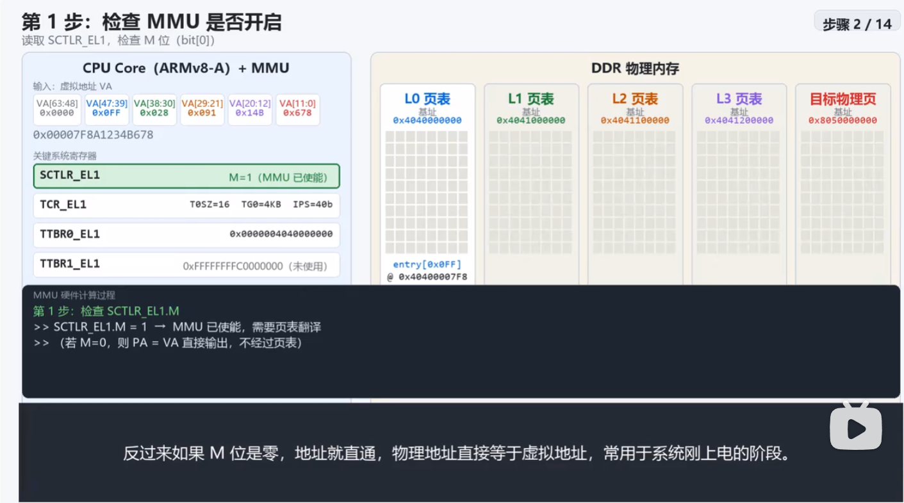
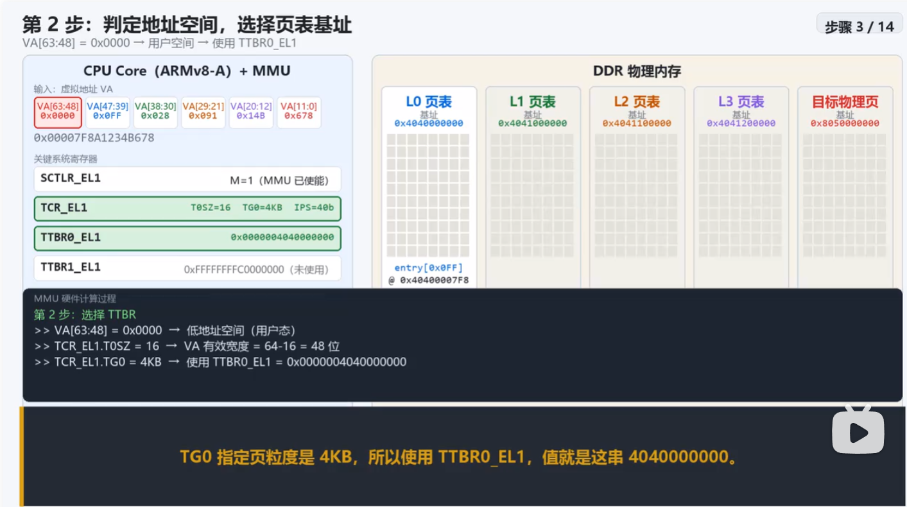
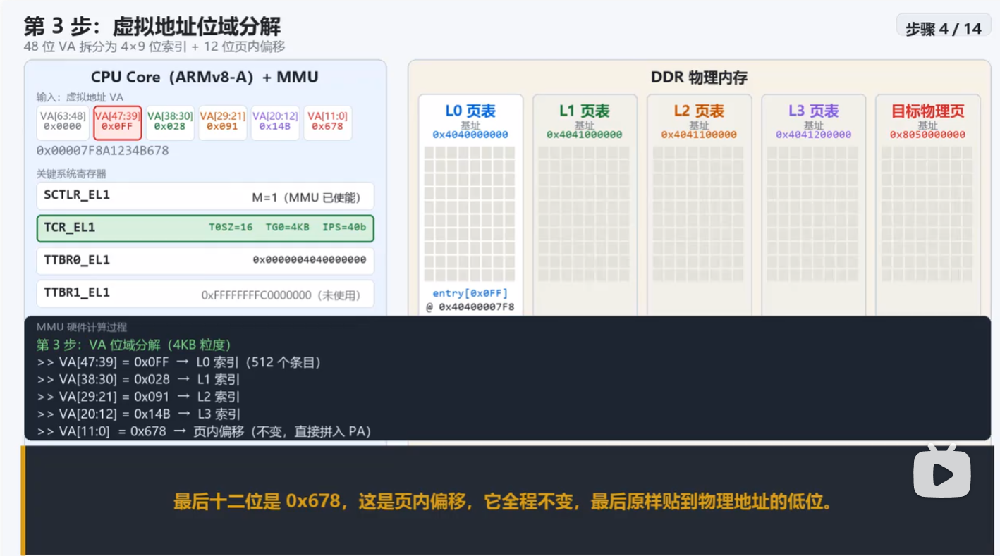
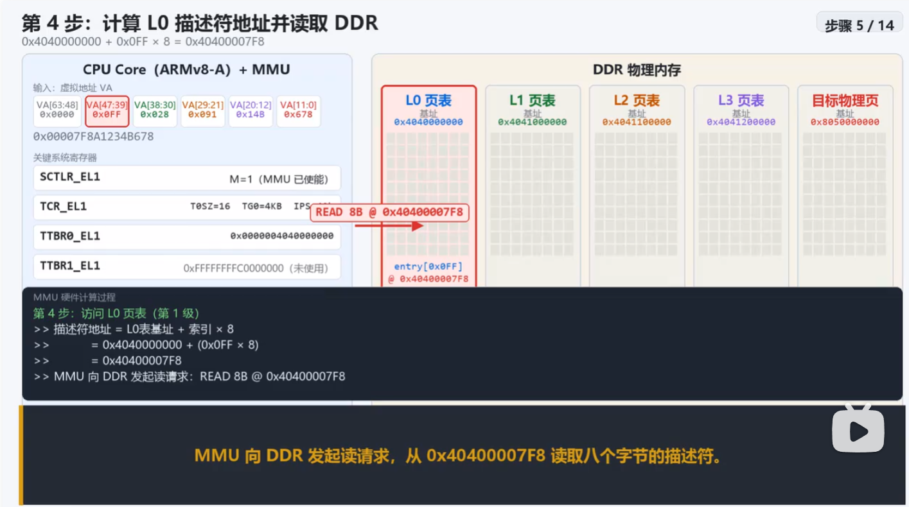
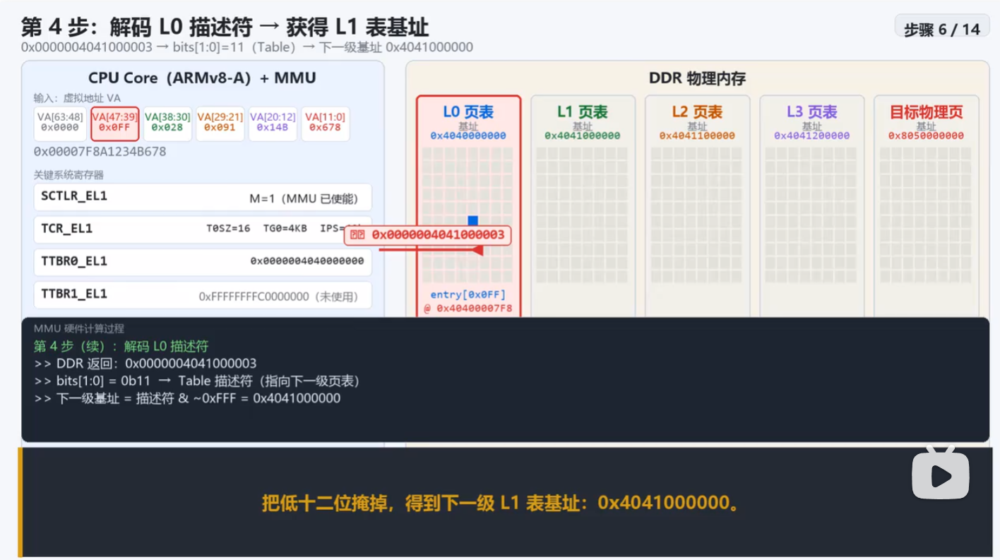
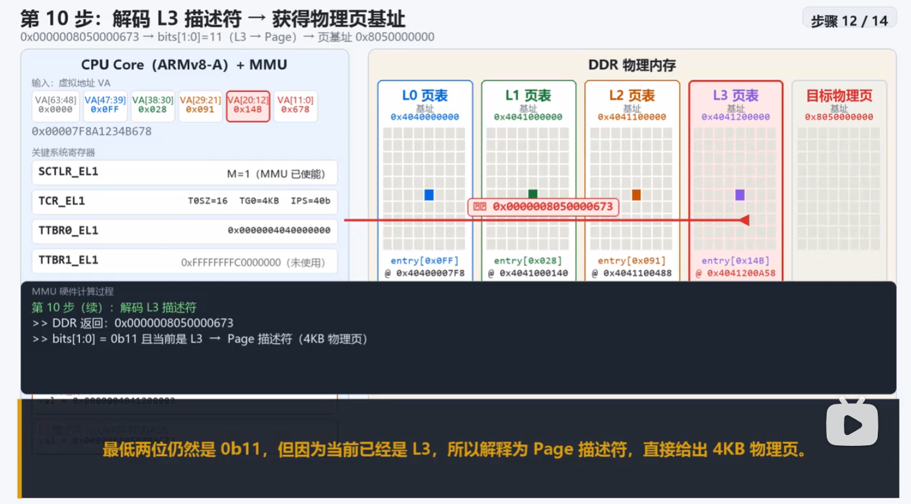
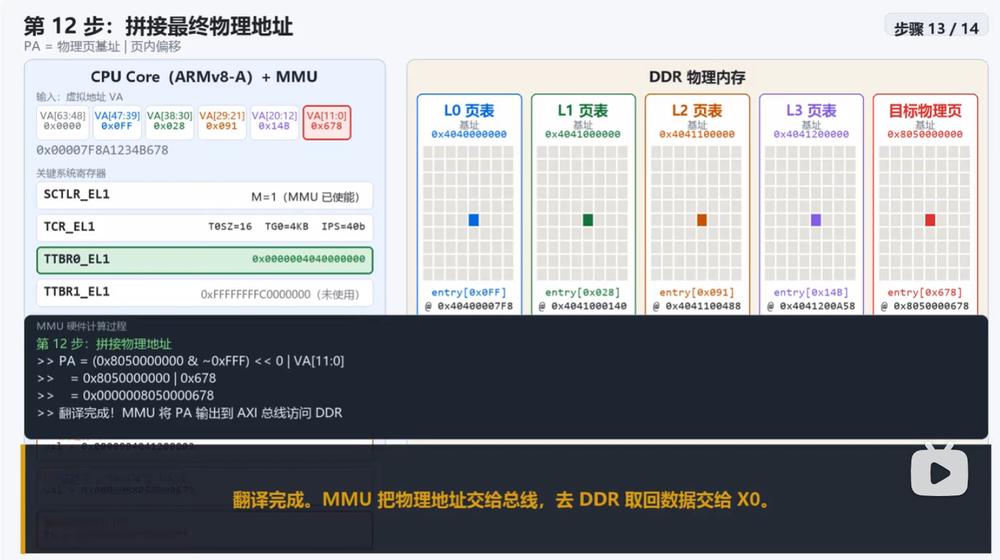
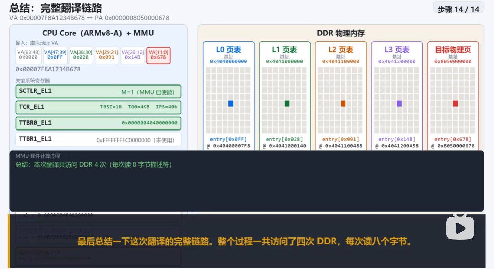

# Note for ARM
1. *AAPCS*
   - *ARM Architecture Procedure Call Standard*，*ARM* 架构过程调用标准，是 *ARM ABI* 的一部分，用于定义 ARM 架构下函数调用的统一规则，包括：
     1. 参数如何传递
     2. 返回值如何返回
     3. 哪些寄存器由调用者保存，哪些由被调用者保存
     4. 栈的使用方式与对齐要求
   - 函数参数传递（如 *R0~R3*）
   - 返回值置位（*R0* 或 *R0~R1*）
   - *R14*（*LR*）：函数返回地址
   - 寄存器保存规则（如 *R4~R11* 为被调用者保存）
   - 栈对齐要求（通常 8 字节）
2. *ATPCS*
   > [ATPCS 和 AAPCS](https://www.cnblogs.com/jontian/p/6115312.html)
   - *ATPCS, ARM-Thumb Procedure Call Standard*
3. *CAS* 原子操作的 *ARM* 实现
   - *CAS，Compare-And-Swap*，是一种无锁原子操作，通过比较内存值与预期值并在相等时更新，实现多线程环境下的线程安全。
   - 包含三个操作数：内存值-*V*、预期值-*A*、新值-*B*
   - *ARM* 架构通过 `LL/SC, load-linked/Store-Conditional` 指令实现，`LDREX` 加载内存并标记，`STREX` 在标记未失效时写入新值。

## 协处理器寄存器指令

## MMU
1. *TLB*，地址转换后备缓冲器，常称为快表，用以缓存虚拟地址到物理地址的映射结果

2. *TTBR, Translation Table Base Register*，即翻译表基址寄存器
   - 是 *ARM* 架构 *MMU* 中用于存放页表基地址的寄存器
   - *CPU* 进行虚拟地址到物理地址翻译时，需要先知道页表在内存中的位置，*TTBR* 就是告诉 *MMU*“页表从哪里开始”的那个寄存器
   - 在 *ARMv7* 中，通常有两个 *TTBR*：
     - *TTBR0*：存放用户空间页表的基地址。进程切换时，它会被更新为新进程的 *PGD* 地址
     - *TTBR1*：存放内核空间页表的基地址。内核空间在所有进程中共享，所以 *TTBR1* 通常固定不变
   - *CPU* 翻译一个虚拟地址时，会根据地址的高位判断它属于用户空间还是内核空间，然后选用 *TTBR0* 或 *TTBR1* 作为页表遍历的起点
   - 在 *ARMv7* 中，*TTBR* 不只包含页表基地址，还包含 *ASID* 和若干控制位

3. *ASID, Address Space Identifier*，即地址空间标识符
   - 是 *ARM MMU* 中用于区分不同进程地址空间的一个标识，它被写入 *TTBR* 的高位，与页表基址一起参与地址翻译
   - 它的核心作用是避免每次进程切换都刷新整个 *TLB*
     - 没有 *ASID* 时，进程切换必须清空 *TLB*，否则新进程可能命中旧进程的地址翻译缓存，导致错误
     - 有了 *ASID*，*TLB* 表项会带上“这个翻译属于哪个 *ASID*”的标记。切换进程时，*CPU* 只需换一个 *ASID*，旧进程的 *TLB* 表项仍然保留，新进程不会误用它们。当旧进程再次运行时，如果 *ASID* 未变，它的 *TLB* 表项可能还在，从而加速地址翻译
   - *ASID* 的位数由硬件决定

4. 内存访问流程，以 *ARMv8* 架构为例
   > [ARMv8 MMU 地址转换逻辑分析](https://www.bilibili.com/video/BV1ZNnZ62Ejj/?spm_id_from=333.1007.top_right_bar_window_history.content.click&vd_source=f87b1dc9ce95722a192942b341ae04d2)
   1. 如下汇编指令需要从寄存器 `x1` 所表示的地址处读取数据并将其 *load* 到寄存器 `x0` 内：
      ```asm
      ldr x0, [x1]
      ```
      - 假设 `x1` 中存放的内容是 0x00007f8a1234b678
   2. 由于 `x1` 中存放的是虚拟地址，而数据保存在 *DDR* 内存里，但 *DDR* 内存控制器只认物理地址，虚拟地址没法直接发送到总线上
   3. *MMU* 承接将上述虚拟地址翻译为物理地址的工作，大致顺序如下：
      - 首先检查 `SCTLR_EL1` 寄存器的 *M* 位，确认 *MMU* 是否已经使能（如果未使能，则地址直通，物理地址直接等于虚拟地址，常用于系统刚上电的阶段）
      - 其次，根据虚拟地址的高 16 位，决定用 *TTBR0* 还是 *TTBR1* 作为页表基地址
      - 然后，将虚拟地址拆分为 *PGD、PUD、PMD、PTE* + 页内偏移五个部分，前面分别对应四个索引值，通过它们来获取页表项。前面四个值记录的是偏移值，而页表地址根据第一级页表基地址或从上一级页表项中读取值来确定
      - 沿着页表级别读取页表项，这里一共要读 4 次 *DDR*，在读取完最后一级页表项后，根据所得内容加上原来的页内偏移得最终需要访问的物理地址
      - 根据转换后得到物理地址，从 *DDR* 中取回数据。因此，一次数据读取涉及 5 次 *DDR* 访问。另外，如果能够命中 *TLB* 中缓存的内容，则可以直接获取到物理地址，从而节省了 4 次 *DDR* 的访问。
   4. 图示如下（图片来源：[ARMv8 MMU 地址转换逻辑分析](https://www.bilibili.com/video/BV1ZNnZ62Ejj/?spm_id_from=333.1007.top_right_bar_window_history.content.click&vd_source=f87b1dc9ce95722a192942b341ae04d2)）：
       ->  ->  ->  ->  -> ... ->  ->  -> 
   5. 补充，如果是 *2MB* 大页，则遍历到 *L2* 级页表（*PMD*）就结束了，此时返回的低位标记是 *0b01* 表示当前项不是 *Table* 描述符而是物理页地址
