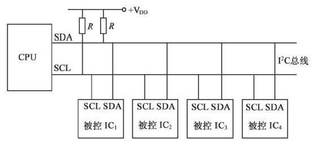
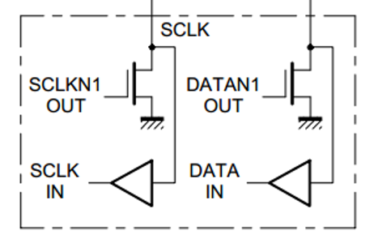
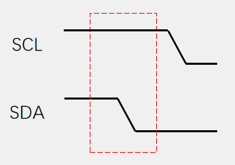
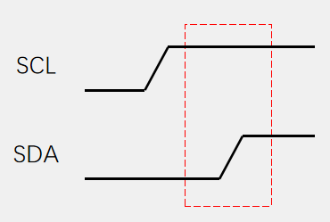
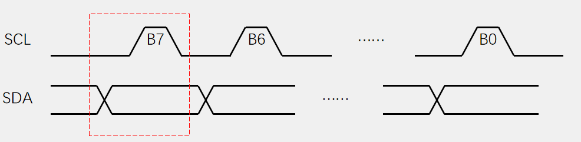
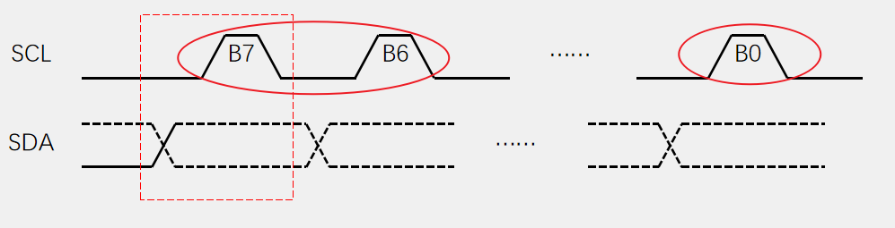
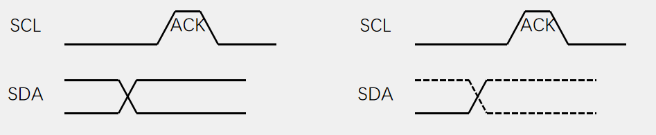
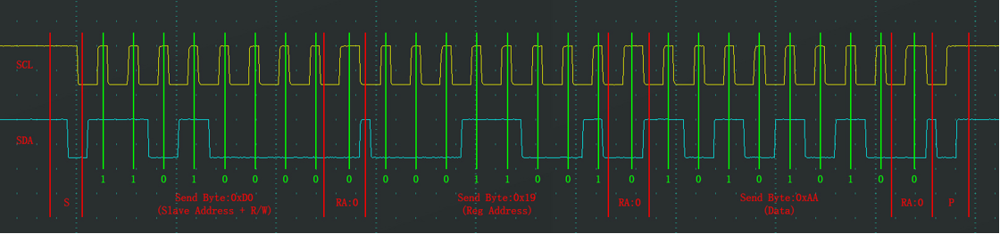
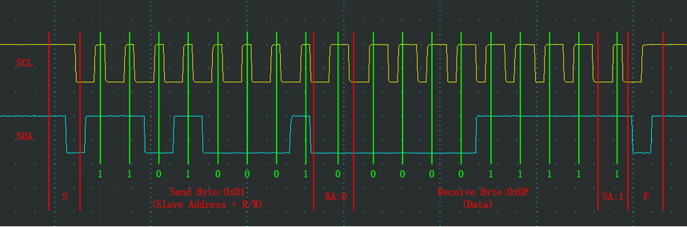
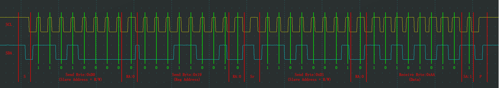

# Note for I2C
## 简介
- *I2C, Inter IC Bus*，一种通用数据总线；
- 两根通信线：*SCL (Serial Clock)* 和 *SDA (Serial Data)*；
- 同步通信，半双工通信；
- 带数据应答；
- 支持总线挂载多设备（一主多从、多主多从）；

## 硬件电路
1. 所有 *I2C* 设备的 *SCL* 连在一起，*SDA* 连在一起；
2. **设备的 *SCL* 和 *SDA* 都要配置成开漏输出**；
3. *SCL* 和 *SDA* 各添加一个上拉电阻，阻值一般为 $4.7 \ K\Omega$ 左右；

2 + 3 的原因：  
- 避免通信双方出现一个高电平、另一个低电平，从而导致电路短路的问题
- *I2C* 禁止所有设备输出强上拉的高电平，采用外置弱上拉电阻加开漏输出的电路结构

硬件电路连接：

  - 左：*SCL*；右：*SDA*
  - 开漏输出：
    - 输出低电平时，开关管导通，与 *GND* 连接（强下拉）；
    - 输出高电平时，开关管断开，输出处于浮空状态。此时通过外部上拉电阻，使线路处于高电平状态（弱上拉）
  - 线与：
    - 只有当所有设备输出高电平时，线路才处于高电平状态；当存在一个设备输出低电平时，线路处于低电平状态；
    - 在多主机模式下会利用此特征

弱上拉和强下拉：
- 下降沿迅速、上升沿较缓慢
- 随着通信速率的提升，需要调整时钟的占空比。给低电平分配更多的时间，以准备数据
- 随着通信速录的提升，在时钟的波形上，上升沿的缓慢程度更加明显。这也限制了 *I2C* 通信的最大速率

## 基本时序
1. 起始时序
   - *SCL* 高电平期间，主机将 *SDA* 从高电平拉低
   - 随后主机再将 *SCL* 拉低（一方面可实现占用 *SCL* 的目的；另一方面可方便基本单元的拼接：**除了起始和终止条件，每个时序单元的 *SCL* 都是以低电平开始，低电平结束**）
   
2. 终止时序
   - 在 *SDA* 被拉高之前，*SCL* 首先切换到高电平
   - *SCL* 高电平期间，*SDA* 从低电平切换到高电平
   - 终止时序后，*SDA* 和 *SCL* 均处于高电平的空闲状态
   
3. 发送一个字节
   - *SCL* 低电平期间，主机将数据位依次放到 *SDA* 数据线上（**高位先行, MSB**），然后释放 *SCL*；
   - 从机将在 *SCL* 高电平期间读取数据位；
   - *SCL* 高电平期间 *SDA* 不允许有数据变化，依次循环上述过程 8 次，即可发送一个字节；
   
4. 接收一个字节
   - *SCL* 低电平期间，从机将数据位依次放到 *SDA* 线上（**高位先行, MSB**），随后主机释放 *SCL*；
   - 主机将在 *SCL* 高电平期间读取数据位
   
5. 发送应答和接收应答
   - 发送应答：主机在接受完一个字节之后，在下一个时钟发送一位数据，**数据 0 表示应答（*ACK*），数据 1 表示非应答（*NACK*）**；
   - 接收应答：主机在发送完一个字节之后，在下一个时钟接收一位数据，判断从机是否应答。数据 0 表示应答，数据 1 表示非应答（**主机在接收之前，需要释放 *SDA***）。
   

- 总结就是：
  - 上拉电阻 -> *SDA* 和 *SCL* 的空闲电平均为高电平
  - 开始时序：*SCL* 空闲电平 +（*SDA* 空闲电平 -> 低电平）
  - 终止时序：*SCL* 空闲电平 +（*SDA* 低电平 -> 空闲电平）
  - 一个完整的数据帧，总是以起始条件开始、终止条件结束，且开始和终止均由主机产生
  - 开始时序后，主机发送的第 1 个字节（8 位）数据（寻址 + 读/写位）：7 位从机地址 + 1 位 读/写位 构成
    - 在同一条 *I2C* 总线里，挂载的每个设备地址必须不一样
    - 一般器件的地址可通过相关配置引脚改变
    - 另外从机地址还可能是 10 位地址，此时主机在开始时序后需发送 2 个字节来表示寻址 + 读/写 信息（第一个字节以 1110 开头）
  - 数据采样：
    - 接收方在 *SCL* 高电平期间采样 *SDA* 作为数据（一般在 *SCL* 上升沿时接收方就将读取 *SDA* 上的数据）
    - 数据发送方需要在 *SCL* 高电平之前（低电平状态）时将数据放到 *SDA* 上（ *SCL* 处于低电平时，允许 *SDA* 上数据的变化。一般在 *SCL* 下降沿时，将数据更新到 *SDA* 上），且在 *SCL* 高电平期间保持稳定
  - 应答判断：
    - 数据接收方需要在接收完数据后的下一个时钟周期发送应答信号，同样还是体现在 *SDA* 数据线上
    - 积极应答 *ACK*：应答发送方将 *SDA* 拉低（还是一样的，空闲为高电平）。因此，应答接收方需要在这之前释放 *SDA* 线（不要将它拉低）
    - 消极应答 *NACK*：应答发送方无响应，*SDA* 为高，应答接收方即可判断这是 *NACK*。这通常对应着通信结束，后接终止时序。
  - 通信过程中，*SCL* 信号大多是由主机控制。但如果从机无法快速地处理通信数据，可将 *SCL* 信号拉低，实现同步的效果。这在 *I2C* 协议中被称为时钟拉伸（*clock stretching*）
    - 当从机需要更多时间处理数据（例如，*CPU* 还没把数据写入发送寄存器，或还没读走接收到的数据）时，它可以在接收或发送一个字节后，将 *SCL* 线强拉在低电平
    - 主机在释放 *SCL* 试图将其拉高时，如果检测到 *SCL* 实际上仍被从机拉低，它必须进入等待状态，直到从机释放 *SCL* 线后，才能继续产生时钟脉冲

## 通信过程
- 指定地址写：
  - 起始位
  - 发送从机设备地址 + *W(0)* 位
  - 从机应答（0）
  - 发送从机内部地址
  - 从机应答（0）
  - 发送写入数据；
  - 从机应答（0）
  - 停止位
  
    - *RA，Receive Acknowledge*
- 当前地址读：
  - 起始位
  - 发送从机设备地址 + *R(1)* 位
  - 从机应答（0）
  - 接收数据
  - 发送应答位（0，继续读取；1，读取结束）
  - 读取结束，发送停止位
  
- 指定地址读（通过指定地址写改变从机设备当前的读地址，然后再开始读过程）：
  - 起始位
  - 发送从机设备地址 + *W(0)* 位
  - 从机应答（0）
  - 发送从机内部地址
  - 从机应答（0）
  - **起始位**
  - 发送从机设备地址 + *R(1)* 位
  - 从机应答（0）
  - 接收数据
  - 发送应答位（0，继续读取；1，读取结束）
  - 读取结束，发送停止位
  
    - *SR, Start Repeat*

## I2C 通信速率
*I2C* 的通信速率并非固定值，而是由总线所支持的工作模式决定。主流模式包括标准模式、快速模式、快速模式增强版和高速模式，速率从 100 *kbit/s* 到 3.4 *Mbit/s* 不等。

| 模式名称 | 最高速率 | 说明 |
| :--- | :--- | :--- |
| 标准模式 (*Standard-mode*) | 100 *kbit/s* | 最基础的速率，兼容性最广 |
| 快速模式 (*Fast-mode*) | 400 *kbit/s* | 目前最常用的速率，向下兼容标准模式器件 |
| 快速模式增强版 (*Fast-mode Plus*) | 1 *MHz* | 速率进一步提升，常用于需要更高吞吐量的场景 |
| 高速模式 (*High-speed mode*) | 3.4 *Mbit/s* | 速率最高，但通常需要主机具备特定的电流源上拉电路来**加速信号边沿** |

“向下兼容”原则：**总线速率通常由总线上最慢的器件决定**。虽然快速模式器件可以跑到 400 *kbit/s*，但如果总线上挂了一个标准模式的从机，主机通常需要将速率降至 100 *kbit/s* 以确保通信正常。

时钟拉伸的影响：时钟拉伸机制，虽然不会改变主机设定的基础时钟频率，但会拉长实际传输一个字节所需的时间，从而降低有效的数据吞吐率。从机处理数据越慢，拉伸越多，整体速率就越低。

## 软件 I2C 和硬件 I2C
- 软件
  1. **软件模拟时将起始时序后 *SDA* 和 *SCL* 按照低电平处理，结束位反之**
  2. 发送和接收数据的 *SCL* 时序在每处理一个位之后默认**当作低电平处理**
  3. 软件 *I2C* 在接收数据时，需要先释放 *SDA*（将 *SDA* 拉高，因为 *SDA* 具有线与逻辑）

- 硬件 - *I2C* 控制器（外设）
  1. 由硬件自动执行时钟生成、起始终止条件生成、应答位收发、数据收发等功能，减轻 *CPU* 负担
  2. *CR*（控制寄存器）+ *DR*（数据寄存器）+ *SR*（状态寄存器）
  3. 不同通信速率的支持
  4. *DMA*
  5. 兼容 *SMBus*
  6. 地址模式（7 位/10 位）
  7. （多）主机、从机模式

- 对比
  - 硬件：执行效率比较高，可以节省软件资源；功能更强大，可以实现完整的多主机通信模型；时序波形规整，通信速率快，等等
  - 软件：灵活，适合简单的应用场景

## reference
1. [江科大](https://www.bilibili.com/video/BV1th411z7sn?spm_id_from=333.788.videopod.episodes&vd_source=f87b1dc9ce95722a192942b341ae04d2&p=31)