# Note for USB
这是第一版笔记草稿，需后续整理：将草稿内容分为三个部分：
1. USB 通信协议部分，如 USB 2.0 协议 
2. USB 相关扩展协议部分，如 HID 协议
3. USB Linux 内核部分，包括 USB 子系统、USB 控制器驱动、USB 设备驱动等

其中 1 和 2 放置在通信协议目录下，3 放置在 Linux 驱动部分目录下


参考资料：

* 《圈圈教你玩USB》
* 简书jianshu_kevin@126.com的文章
  * [USB协议（一）](https://www.jianshu.com/p/3afc1eb5bd32)
  * [USB协议(二)](https://www.jianshu.com/p/cf8e7df5ff09)
  * [USB协议(三)](https://www.jianshu.com/p/2a6e22194cd3)
* 官网：https://www.usb.org/documents - usb 2.0 specification

## USB视频涉及的内容
* 必须掌握的概念
  * 硬件框架、软件框架
  * USB设备识别过程
  * 描述符等概念
* APP开发
  * libusb接口函数
  * 编写APP操作USB设备

* USB设备驱动
  * 操作USB设备的内核接口函数
  * 编写USB设备驱动程序
  * USB摄像头的编程
  * USB Audio Class 讲讲就更好了(留到ALSA部分讲)
* USB控制器驱动
  * USB设备的枚举过程
    * usb系统中的拓扑（命名）
    * usb 枚举(外接hub)，结合硬件电路图来说明
  * USB设备的读写流程
* OTG
  * type c硬件接口、micro usb硬件接口
  * OTG角色触发过程
  * OTG硬件调试经验
  * OTG使用
* Gadget
  * function和composite怎么联系起来的，可以结合zero.c那个驱动讲讲
  * Gadget的几个使用示例

## 实验现象
现象：把USB设备比如Android手机接到PC
* 右下角弹出"发现android phone"
* 跳出一个对话框，提示你安装驱动程序

问1：USB设备插到电脑上去，接触到的对方设备是什么？
答1：是USB控制器，是USB控制器内嵌的root hub

问2. 既然还没有"驱动程序"，为何能知道是"android phone"
答2. windows里已经有了USB的总线驱动程序，接入USB设备后，是"总线驱动程序"知道你是"android phone"
     提示你安装的是"设备驱动程序"。 USB总线驱动程序负责：识别USB设备, 给USB设备找到对应的驱动程序  

问3. 为什么一接入USB设备，PC机就能发现它？
答3. PC的USB口内部，D-和D+接有15K的下拉电阻，未接USB设备时为低电平
     USB设备的USB口内部，D-或D+接有1.5K的上拉电阻；它一接入PC，就会把PC USB口的D-或D+拉高，从硬件的角度通知PC有新设备接入。
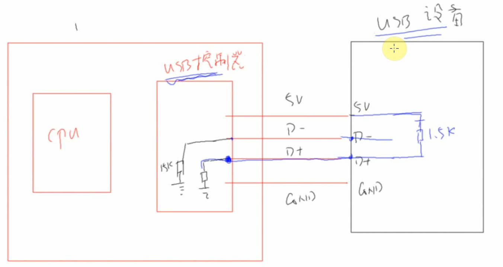

问4. USB设备种类非常多，为什么一接入电脑，就能识别出来它的种类？
答4. PC和USB设备都得遵守一些规范。比如：USB设备接入电脑后，PC机会发出"你是什么"？USB设备就必须回答"我是xxx", 并且回答的格式是固定的。USB总线驱动程序会发出某些命令想获取设备信息(描述符)，USB设备必须返回"描述符"给PC。
     
问5. PC机上接有非常多的USB设备，怎么分辨它们？
答5. 每一个USB设备接入PC时，USB总线驱动程序都会给它分配一个编号。PC机想访问某个USB设备时，发出的命令都含有对应的编号(地址)。

问6. USB设备刚接入PC时，还没有编号；那么PC怎么把"分配的编号"告诉它？
答6. 新接入的USB设备的默认编号是0，在未分配新编号前，PC使用0编号和它通信。

## 硬件框架
在USB系统中，有2个硬件概念：

* USB Host：它跟处理器相连，处理器通过USB Host跟各类USB设备通信。USB Host中集成有一个root hub
* USB Device：这分为两类设备
  * Hub：用来扩展USB接口
  * Function：就是普通的USB设备，比如U盘、声卡等


## 软件框架
APP可以通过USB设备驱动程序访问USB设备，
也可以绕过USB设备驱动，直接通过USB控制器驱动访问USB设备。

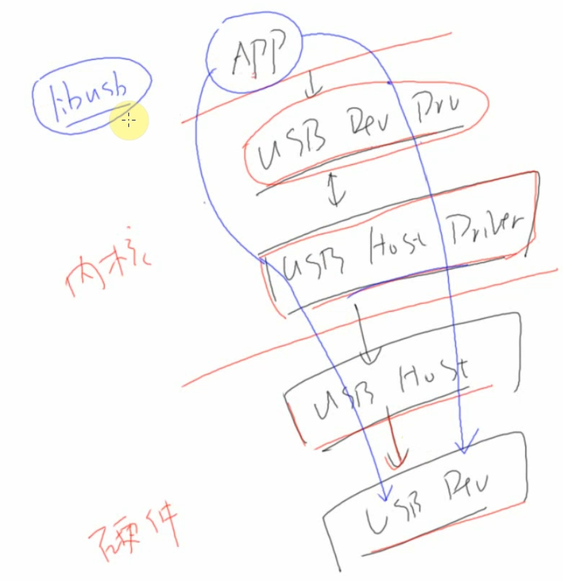

## 软件工程师眼里的USB电气信号
* 《usb_20.pdf》的《Chapter 7 Electrical》
* USB的NRZI信号格式：https://zhuanlan.zhihu.com/p/460018993
* USB2.0包Packet的组成：https://www.usbzh.com/article/detail-459.html

### 学习的起点
USB 2.0协议支持3种速率：低速(Low Speed，1.5Mbps)、全速(Full Speed, 12Mbps)、高速(High Speed, 480Mbps)。

USB Hub、USB设备，也分为低速、全速、高速三种类型。一个USB设备，可能兼容低速、全速，可能兼容全速、高速，但是不会同时兼容低速、高速。

#### USB设备状态切换图
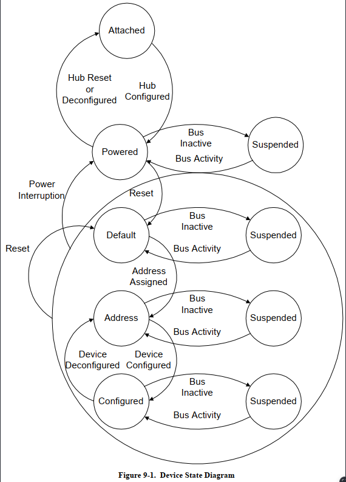
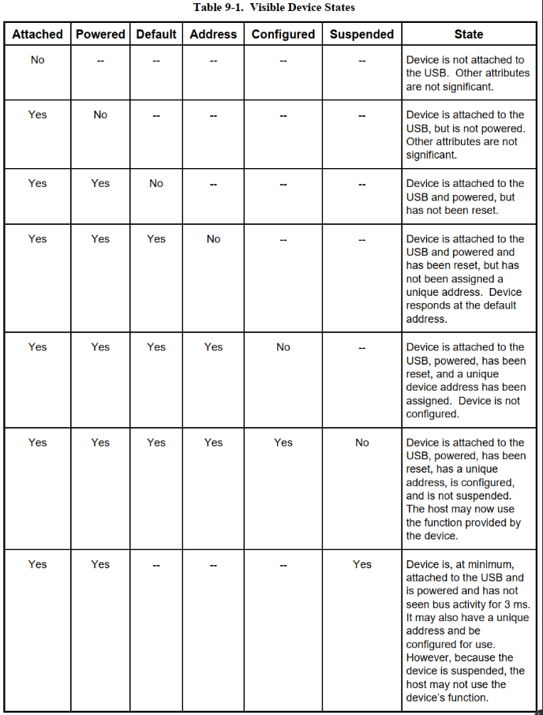

#### 硬件线路
下图是兼容高速模式的USB收发器电路图：
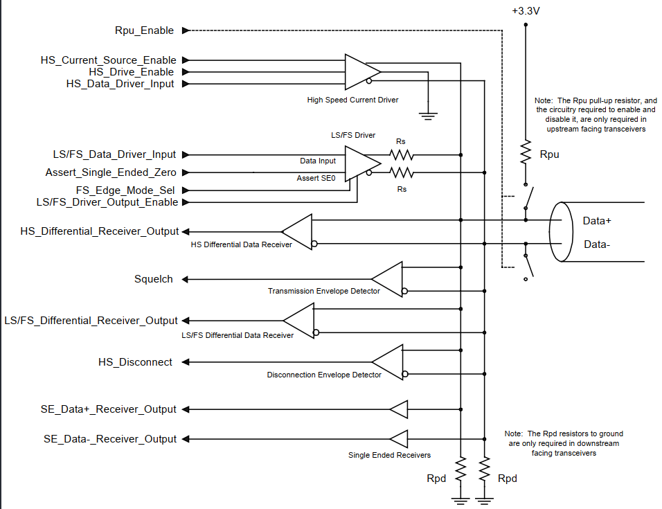

USB连接涉及Hub Port和USB设备，硬件连接如下：
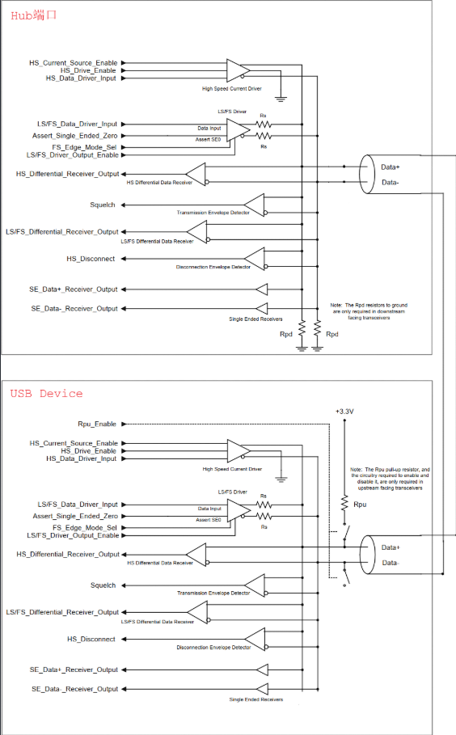
下拉电阻：15K；上拉电阻 1.5K

Full-speed/High-speed：
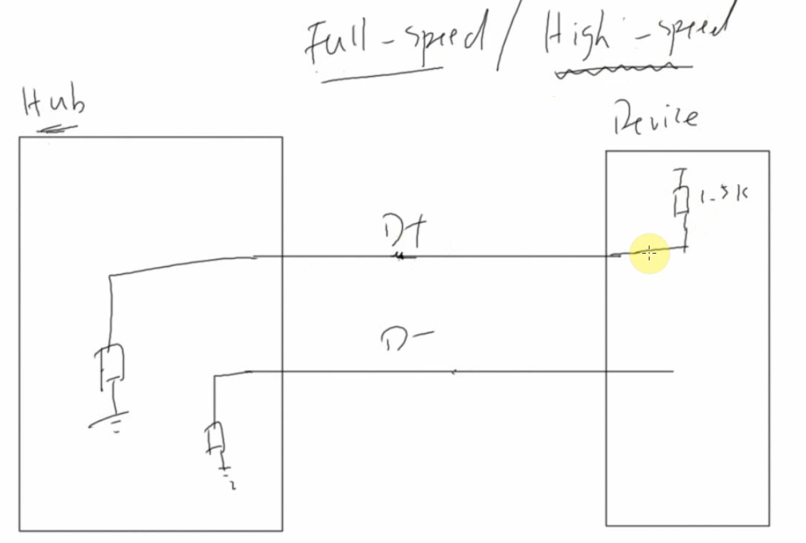
- 高速模式是兼容全速模式的
- 设备插入后，USB HUB 还需检查当前设备是否支持高速模式

Low-speed：
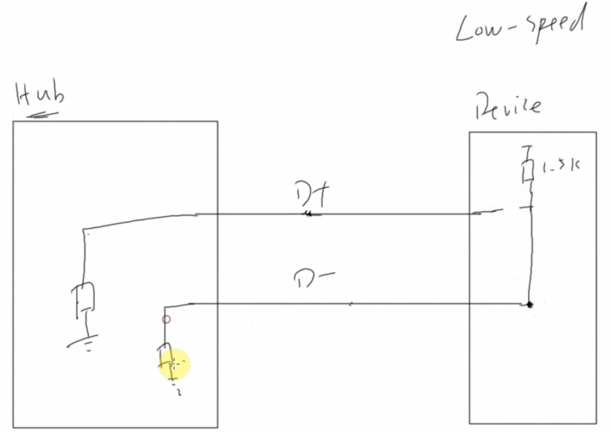

### 电子信号
USB连接线有4条：5V、D+、D-、GND。数据线D+、D-，只能表示4种状态。USB协议中，很巧妙地使用这两条线路实现了空闲(Idle)、开始(SOP)、传输数据(Data)、结束(EOP)等功能。

#### 低速/全速信号电平
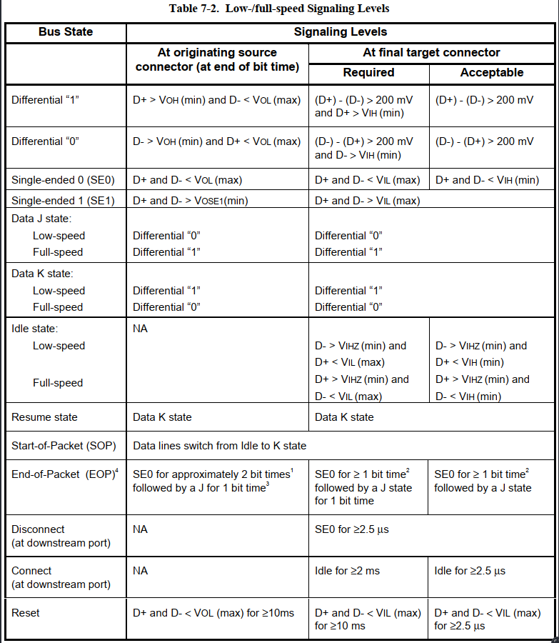

#### 高速信号电平
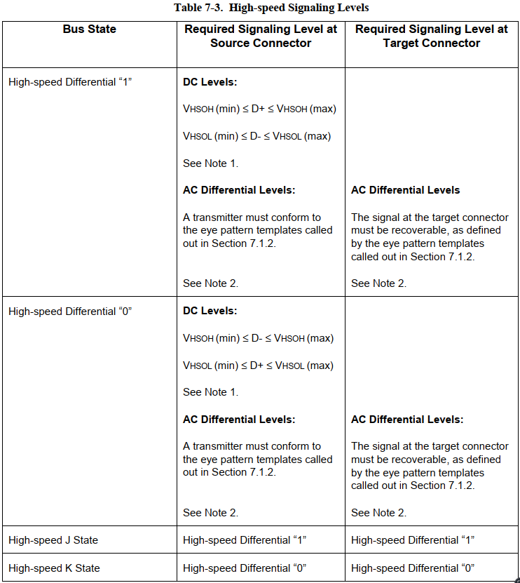

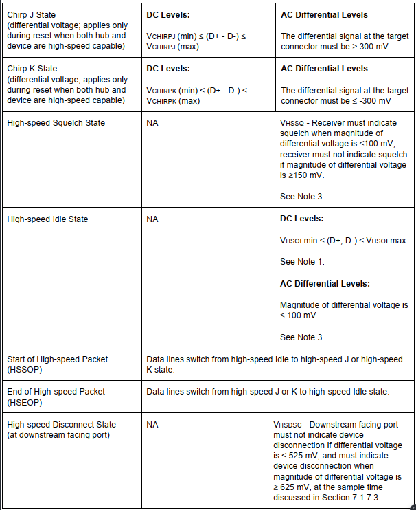

#### 设备连接与断开
##### 链接
Hub端口的D+、D-都有15K的下拉电阻，平时为低电平。全速设备内部的D+有1.5K的上拉电阻，低速设备内部的D-有1.5K的上拉电阻，连接到Hub后会导致Hub的D+或D-电平变化，Hub根据变化的引脚分辨接进来的是全速设备还是低速设备。

高速设备一开始也是作为全速设备被识别的。

全速设备、高速设备连接时，D+引脚的电平由低变高：
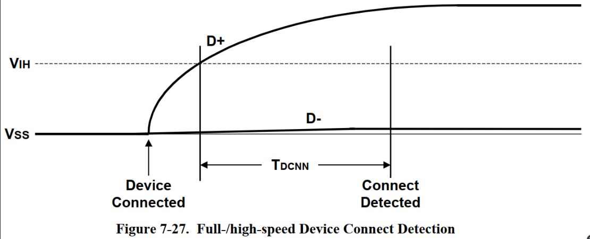

低速设备连接时，D-引脚的电平由低变高：
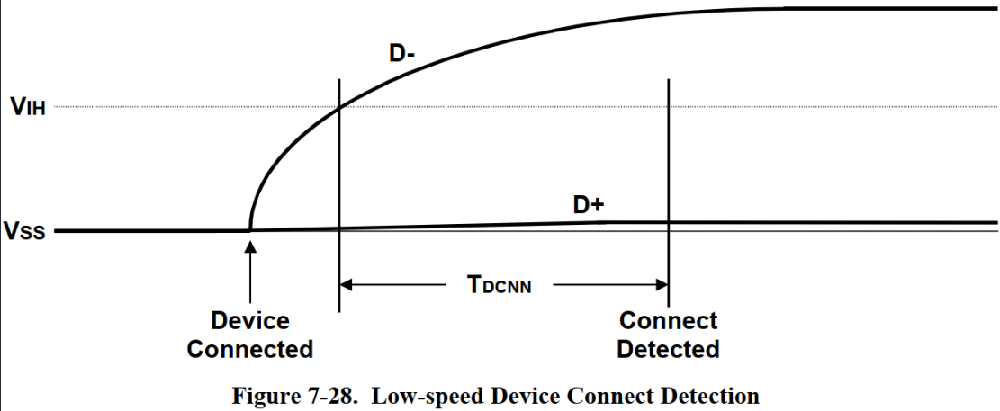

##### 断开
对于低速、全速设备，接到Hub时导致D-或D+引脚变为高电平，断开设备后，D-或D+引脚变为低电平：

对于高速设备，它先作为全速设备被识别出来，然后再被识别为高速设备。工作于高速模式时，D+的上拉电阻是断开的，所以对于工作于高速模式的USB设备，无法通过D+的引脚电平变化监测到它已经断开。
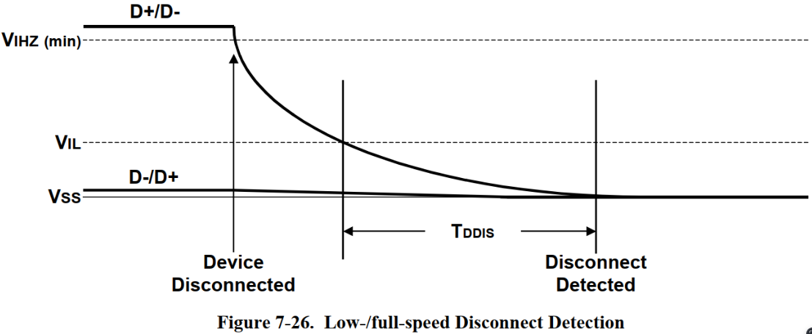

工作于高速模式的设备，D+、D-两边有45欧姆的下拉电阻，用来消除反射信号：
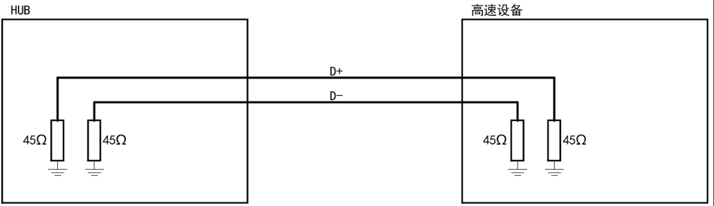

当断开高速设备后，Hub发出信号，得到的反射信号无法衰减，Hub监测到这些信号后就知道高速设备已经断开，内部电路图如下：
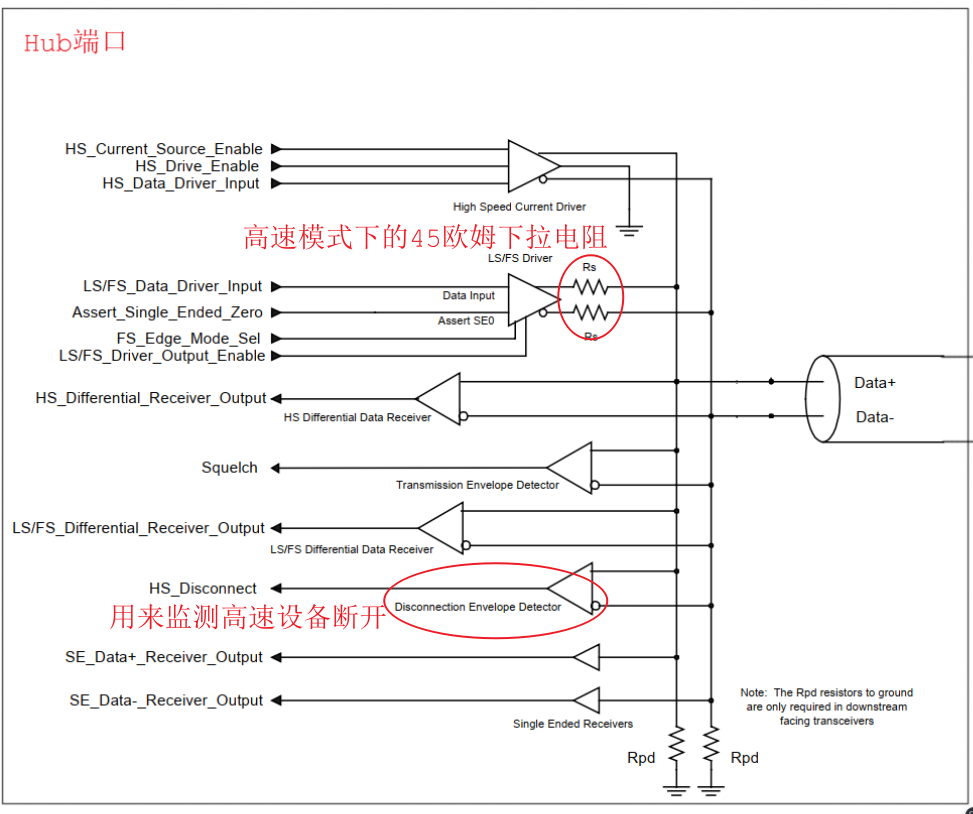

#### 复位
从状态切换图上看，一个USB设备连接后，它将会被供电，然后被复位。当软件出错时，我们也可以发出复位信号重新驱动设备。

那么，USB Hub端口或USB控制器端口如何发出复位信号？发出SE0信号，并维持至少10ms。

USB设备看到Reset信号后，需要准备接收"SetAddress()"请求；如果它不能回应这个请求，就是"不能识别的设备"。

#### 设备速率识别
##### 低速/全速
Hub端口的D+、D-都有15K的下拉电阻，平时为低电平。全速设备内部的D+有1.5K的上拉电阻，低速设备内部的D-有1.5K的上拉电阻，连接到Hub后会导致Hub的D+或D-电平变化，Hub根据变化的引脚分辨接进来的是全速设备还是低速设备。
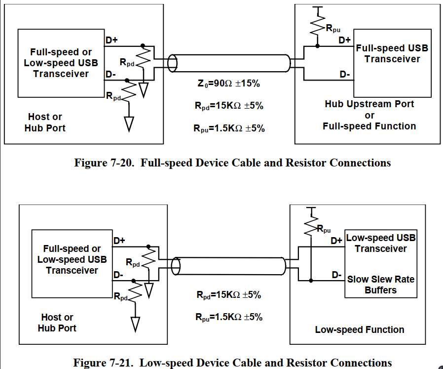

##### 高速
高速设备必定兼容全速模式，所以高速设备内部D+也有1.5K的上拉电阻，只不过这个电阻是可以断开的：工作于高速模式时要断开它。

高速设备首先作为全速设备被识别出来，然后Hub如何确定它是否支持高速模式？

Hub端口如何监测一个新插入的USB设备能否工作于高速模式？流程如下：

* 对于低速设备，Hub端口不会监测它能否工作于高速模式。低速设备不能兼容高速模式。
* Hub端口发出SE0信号，这就是复位信号
* USB设备监测到SE0信号后，会发出"a high-speed detection handshake"信号表示自己能支持高速模式，这可以细分为一下3种情景
  * 如果USB设备原来处于"suspend"状态，它检测到SE0信号后，就发出"a high-speed detection handshake"信号
  * 如果USB设备原来处于"non-suspend"状态，并且处于全速模式，它检测到SE0信号后，就发出"a high-speed detection handshake"信号。这个情景，就是一个设备刚插到Hub端口时的情况，它一开始工作于全速模式。
  * 如果USB设备原来处于"non-suspend"状态，并且处于高速模式，它会切换回到全速模式(重新连接D+的上拉电阻)，然后发出"a high-speed detection handshake"信号

"a high-speed detection handshake"信号，就是"高速设备监测握手信号"，既然是握手信号，自然是有来有回：

* USB设备维持D+的上拉电阻，发出"Chirp K "信号，表示自己能支持高速模式
* 如果Hub没监测到"Chirp K "信号，它就知道这个设备不支持高速模式
* 如果Hub监测到"Chirp K "信号后，如果Hub能支持高速模式，就发出一系列的"Chirp K"、"Chirp J"信号，这是用来通知USB设备：Hub也能支持高速模式。发出一系列的"Chirp K"、"Chirp J"信号后，Hub继续维持SE0信号直到10ms。
* USB设备发出"Chirp K "信号后，就等待Hub回应一系列的"Chirp K"、"Chirp J"信号
  * 收到一系列的"Chirp K"、"Chirp J"信号：USB设备端口D+的上拉电阻，使能高速模式
  * 没有收到一系列的"Chirp K"、"Chirp J"信号：USB设备转入全速模式

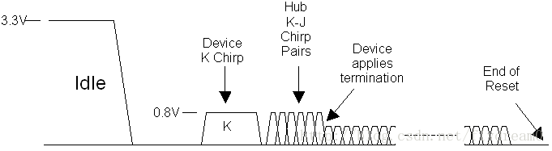

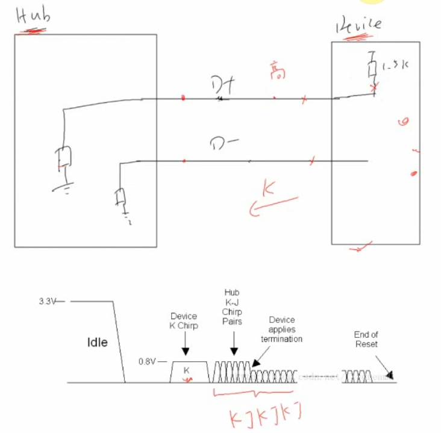
- hub 发送 se0 信号
- usb 设备发送 k 信号
- hub 响应 k-j 信号对
- usb 设备断开 1.5K 上拉电阻
- ...

#### 数据信号
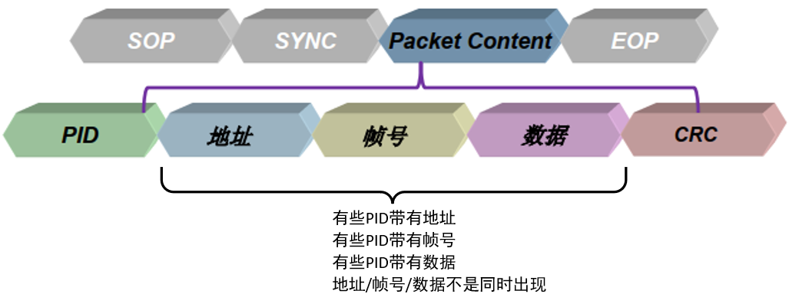

##### 低速/全速的SOP和EOP
SOP：Start Of Packet，Hub驱动D+、D-这两条线路从Idle状态变为K状态。SOP中的K状态就是SYNC信号的第1位数据，SYNC格式为3对KJ外加2个K。

EOP：End Of Packet，由数据的发送方发出EOP，数据发送方驱动D+、D-这两条线路，先设为SE0状态并维持2位时间，再设置为J状态并维持1位时间，最后D+、D-变为高阻状态，这时由线路的上下拉电阻使得总线进入Idle状态。
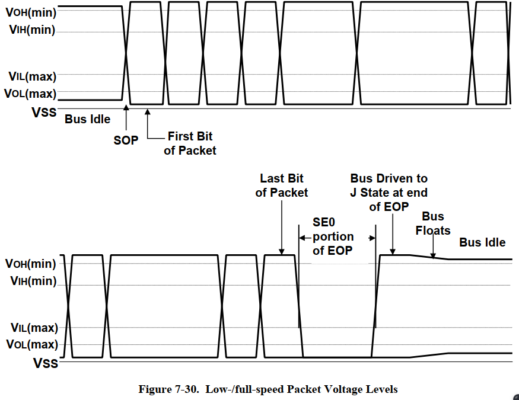

##### 高速的SOP
高速的EOP比较复杂，作为软件开发人员无需掌握。

高速模式中，Ide状态为：D+、D-接地。SOP格式为：从Idle状态切换为K状态。SOP中的K状态就是SYNC信号的第1位数据。

高速模式中的SYNC格式为：KJKJKJKJ KJKJKJKJ KJKJKJKJ KJKJKJKK，即15对KJ，外加2个K。

##### NRZI与位填充
参考文章：[USB的NRZI信号格式](https://zhuanlan.zhihu.com/p/460018993)

NRZI：Non Return Zero Inverted Code，反向不归零编码。NRZI的编码方位为：对于数据0，波形翻转；对于数据1，波形不变。
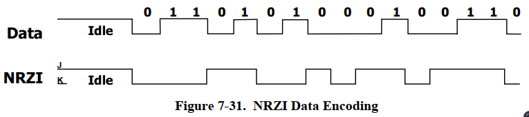

使用NRZI，发送端可以很巧妙地把"时钟频率"告诉接收端：只要传输连续的数据0即可。在下图中，低速/全速协议中"Sync Pattern"的原始数据是"00000001"，接收端从前面的7个0波形就可以算出"时钟频率"。
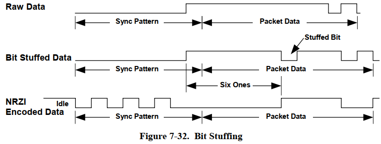

使用NRZI时，如果传输的数据总是"1"，会导致波形维持不变。如果电平长时间维持不变，比如传输100位1时，如果接收方稍有偏差，就可能认为接收到了99位1、101位1。而USB中采用了Bit-Stuffing位填充处理，即在连续发送6个1后面会插入1个0，强制翻转发送信号，从而让接收方调整频率，同步接收。而接收方在接收时只要接收到连续的6个1后，直接将后面的0删除即可恢复数据的原貌。

NRZI数据格式如上图所示。

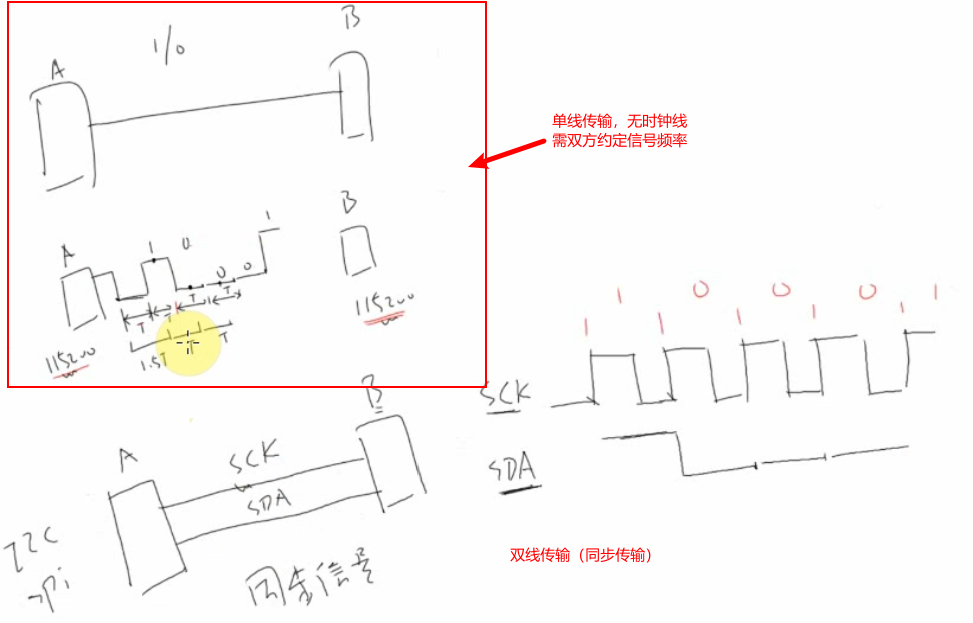
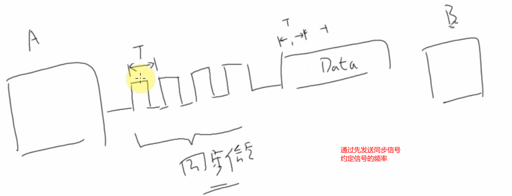

## USB协议层数据格式
* 《usb_20.pdf》的《Chapter 8  Protocol Layer》
* USB的NRZI信号格式：https://zhuanlan.zhihu.com/p/460018993
* USB2.0包Packet的组成：https://www.usbzh.com/article/detail-459.html

包的组成：
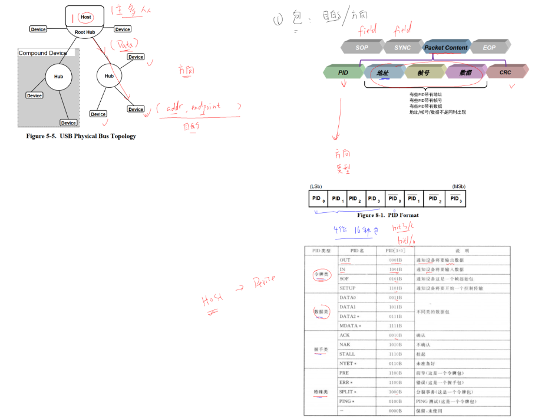
- 握手包是没有 data 和 crc 的

数据都是由 host 发起
host -> device:
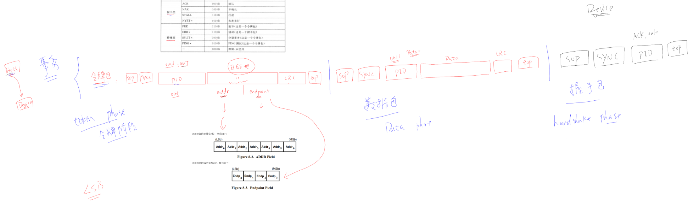
device -> host:
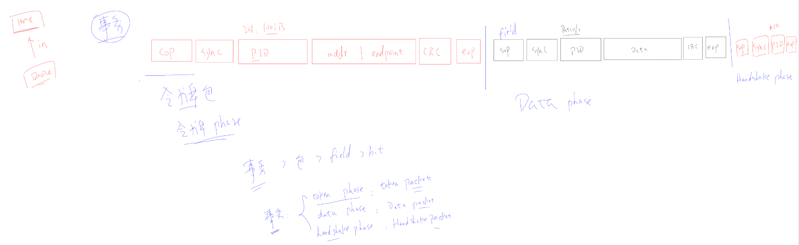

事务（transaction） -> 包（package） -> 域（field）-> bit
事务：token phase (令牌包，token package) + data phase (数据包，data package) + handshake phase (握手包，handshake package)

### 硬件拓扑结构
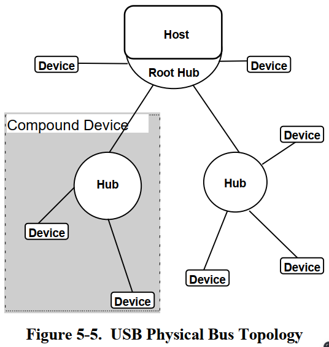

* compound device ：多个设备组合起来，通过HUB跟Host相连
* composite device  ：一个物理设备有多个逻辑设备(multiple interfaces)

在软件开发过程中，我们可以忽略Hub的存在，硬件拓扑图简化如下：
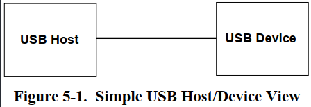

一个物理设备里面可能有多个逻辑设备，Hos可以外接多个逻辑设备，硬件拓扑图如下：
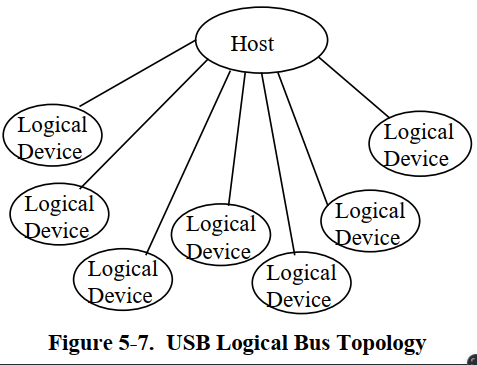

### 协议层
要理解协议层、理解数据如何传输，带着这几个问题去看文档、看视频：

* 如何寻址设备？
* 如何表示数据方向(读、还是写)
* 如何确认结果？

提前罗列出来：

* USB系统是一个Host对应多个设备，要传输数据首先要通知设备：
  * 发出IN令牌包：表示想读数据，里面含有设备地址
  * 发出OUT令牌包：表示想写数据，里面含有设备地址
* 数据阶段：
  * Host想读数据：前面发出IN令牌包后，现在读取数据包
  * Host想发出数据：前面发出OUT令牌包后，现在发出数据包
* 结果如何？有握手包
  * Host想读数据，设备可能未就绪，就会回应NAK包
  * Host想写数据，它发出数据后，设备正确接收了，就回复ACK包

#### 字节/位传输顺序
先传输最低位(LSB)。在后续文档中，描述数据时按照传输顺序从左到右列出来。

#### SYNC域
Host发出SOP信号后，就会发出SYNC信号：它是一系列的、最大传输频率的脉冲，接收方使用它来同步数据。对于低速/全速设备，SYNC信号是8位数据(从做到右是00000001)；对于高速设备，SYNC信号是32位数据(从左到右是00000000000000000000000000000001)。使用NRZI编码时，前面每个"0"都对应一个跳变。

在很多文档里，把SOP和SYNC统一称为"SYNC"，它的意思是"SYNC"中含有"SOP"。

#### 包格式
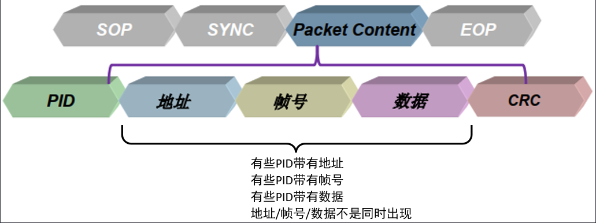

USB总线上传输的数据以包为单位。USB包里含有哪些内容("域")？

* SOP：用来表示包的起始
* SYNC：用来同步时钟
* PID：表示包的类型
* 地址：在USB硬件体系中，一个Host对应多个Logical Device，那么Host发出的包，如何确定发给谁？
  * 发给所有设备：包里不含有设备地址
  * 发给某个设备：包里含有设备地址、端点号

* 帧号、数据等跟PID相关的内容
* CRC校验码

发起一次完整的传输，可能涉及多个包。那么，第1个包里含有设备地址、端点号，后续的包就没必要包含设备地址、端点号。

##### PID域
注意：所有的USB文档提到的"输入"、"输出"，都是基于Host的角度，"输出"表示从Host输出到设备，"输入"表示Host从设备得到数据。

有哪些USB包？根据包数据里的PID的bit1, bit0可以分为4类：

* 令牌包(Token)：01B
* 数据包(Data)：11B
* 握手包(Handshake)：10B
* 特殊包(Special)：00B

PID有4位，使用bit1,bit0确定分类，使用bit3,bit2进一步细分。如下表(来自《圈圈教你玩USB》)所示：
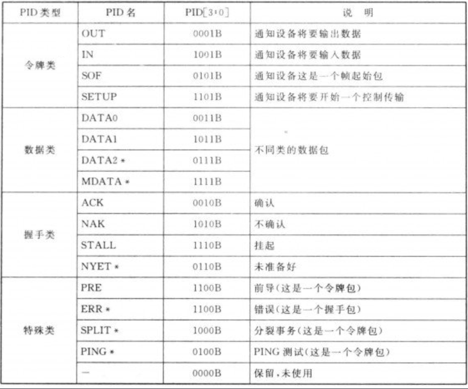
在USB包中，PID域使用8位来表示，格式如下：
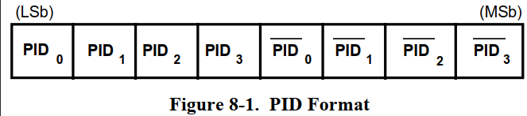
前4位表示PID，后4位是对应位的取反。接收方发现后4位不是前4位的取反的话，就认为发生了错误。

##### 令牌包(Token)
令牌类的PID，起"通知作用"，通知谁？SOF令牌包被用来通知所有设备，OUT/IN/SETUP令牌包被用来通知某个设备。

对于OUT、IN、SETUP令牌包，它们都是要通知到具体的设备，格式如下：
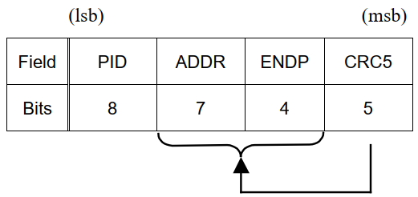
USB设备的地址有7位，格式如下：
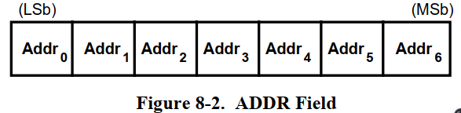
USB设备的端点号有4位，格式如下：
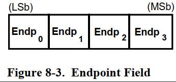

对于SOF包，英文名为"Start-of-Frame marker and frame number"。对于USB全速设备，Host每1ms产生一个帧；对于高速设备，每125us产生一个微帧，1帧里有8个微帧。Host会对当前帧号进行累加计数，在每帧或每微帧开始时，通过SOF令牌包发送帧号。对于高速设备，每1毫秒里有8个微帧，这8个微帧的帧号是一样的，每125us发送一个SOF令牌包。

SOF令牌包格式如下：
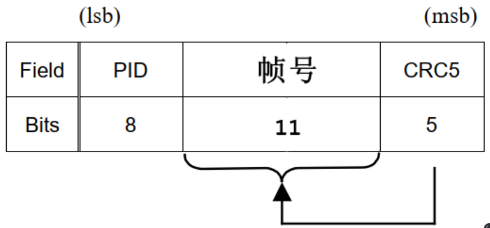

##### 数据包
Host使用OUT、IN、SETUP来通知设备：我要传输数据了。数据通过"数据包"进行传输。

数据包也有4种类型：DATA0、DATA1、DATA2、MDATA。其中DATA2、MDATA在高速设备中使用。对软件开发人员来说，我们暂时仅需了解DATA0、DATA1。

为什么要引入DATA0、DATA1这些不同类型的数据包？为了纠错。

Host和设备都会维护自己的数据包切换机制，当数据包成功发送或者接收时，数据包类型切换。当检测到对方使用的数据包类型不对时，USB系统认为发生了错误。

比如：

* Host发送DATA0给设备，设备返回ACK表示成功接收，设备期待下一个数据是DATA1
* 但是Host没有接收到ACK，Host认为数据没有发送成功，Host继续使用DATA0发送上一次的数据
* 设备再次接收到DATA0数据包，它就知道：哦，这是重传的数据包

数据包格式如下：
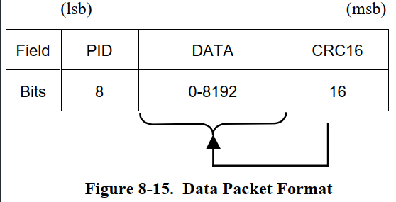

对于全速设备，数据包中的数据做大是1023字节；对于全速设备，数据包中的数据做大是1024字节。

##### 握手包
握手包有4类：ACK、NAK、STALL、NYET

* ACK：数据接收方用来回复发送方，表示正确接收到了数据并且有足够的空间保存数据。
* NAK：Host发送数据给设备时，设备可以回应NAK表示"我还没准备好，没办法接收数据"；Host想读取设备的数据时，设备可以回复NAK表示"我没有数据给你"。
* STALL：表示发生了错误，比如设备无法执行这个请求(不支持该断点等待)、断点已经挂起。设备返回STALL后，需要主机进行干预才能接触STALL状态。
* NYET：仅适用于高速设备。Host可以发出PING包用来确认设备有数据，设备可以回应NYET表示"还没呢"。Hub也可以回应NYET表示低速/全速传输还没完结。

#### 传输细节
##### 传输(Transfer)和事务(Transaction)
USB传输的基本单位是包(Packet)，包的类型由PID表示。一个单纯的包，是无法传输完整的数据。

为什么？比如想输出数据，可以发出OUT令牌包，OUT令牌包可以指定目的地。但是数据如何传输呢？还需要发出DATA0或DATA1数据包。设备收到数据后，还要回复一个ACK握手包。

所以，完整的数据传输，需要涉及多个包：令牌包、数据包、握手包。这个完整的数据传输过程，被称为事务(Transaction)。

有些事务需要握手包，有些事务不需要握手包，有些事务可以传输很大的数据，有些事务只能传输小量数据。

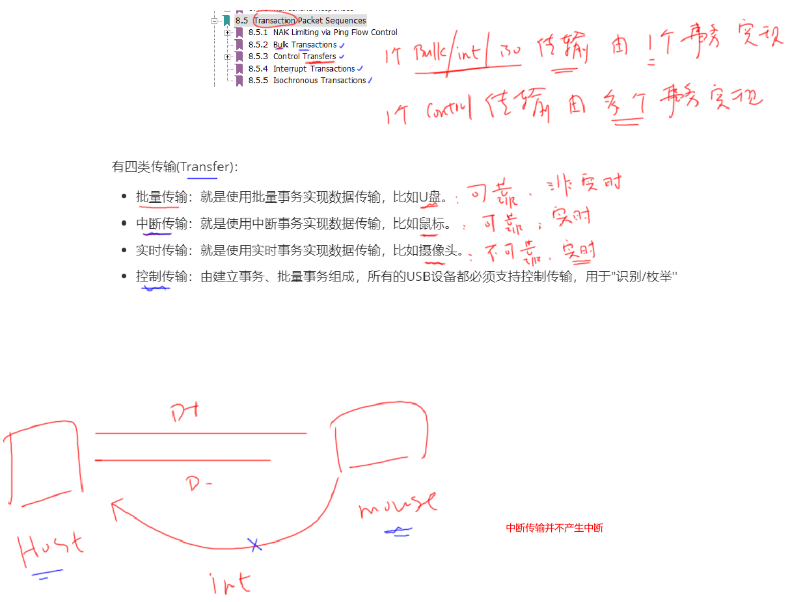
有四类事务：
* 批量事务：用来传输大量的数据，数据的正确性有保证，时效没有保证。
* 中断事务：用来传输周期性的、小量的数据，数据的正确性和时效都有保证。
* 实时事务：用来传输实时数据，数据的正确性没有保证，时效有保证。
* 建立事务：跟批量事务类似，只不过令牌包是SETUP令牌包。

有四类传输(Transfer)：
* 批量传输：就是使用批量事务实现数据传输，比如U盘。
* 中断传输：就是使用中断事务实现数据传输，比如鼠标。
* 实时传输：就是使用实时事务实现数据传输，比如摄像头。
* 控制传输：由建立事务、批量事务组成，所有的USB设备都必须支持控制传输，用于"识别/枚举"

暂时记住这个关系：
* BIT组成域(Field)
* 域组成包(Packet)
* 包组成事务(Transaction)
* 事务组成传输(Transfer)

##### 过程(stage)和阶段(phase)
事务由多个包组成，比如Host要发送数据给设备，这就会涉及很多个包：

* Host发出OUT令牌包，表示要发数据给哪个设备
* Host发出DATA0数据包
* 设备收到数据后，回应ACK包

这个完整的事务涉及3个包(Packet)，分为3个阶段(Phase)：
* 令牌阶段(Token phase)：由令牌包实现
* 数据阶段(Data phase)：由数据包实现
* 握手阶段(Handshake phase)：由握手包实现

事务由包组成，这些包分别处于3个阶段(phase)：令牌阶段，数据阶段，握手阶段。

对于批量传输、中断传输、实时传输，它们分别由一个事务组成，不再细分为若干个过程。

但是控制传输由多个事务组成，这些事务分别处于3个过程：建立过程(stage)、数据过程(stage)、状态过程(stage)。

总结起来就是：
* 控制传输由多个过程(stage)组成，每个过程由一个事务来实现
* 每个事务由多个阶段(phase)组成，每个阶段有一个包来实现

##### 批量传输
单次批量传输：
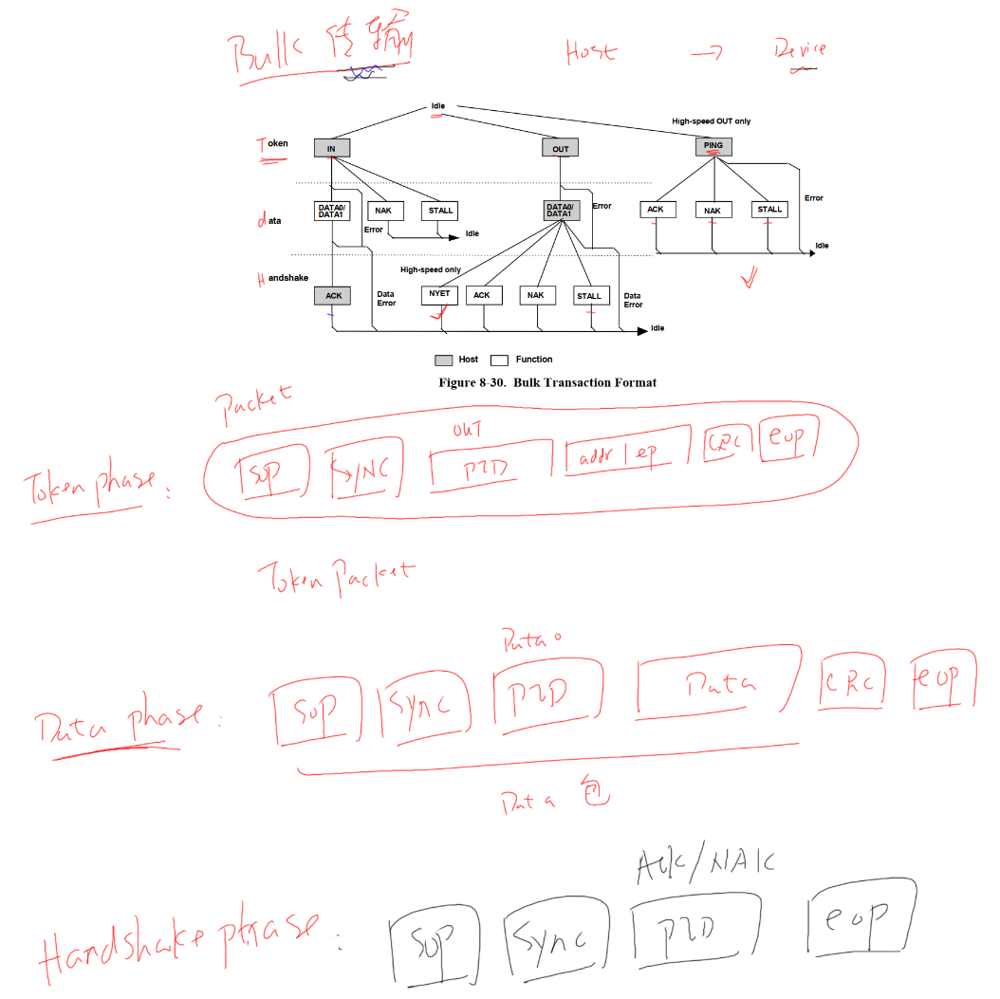
多次批量传输（data0 和 data1 相互切换）：
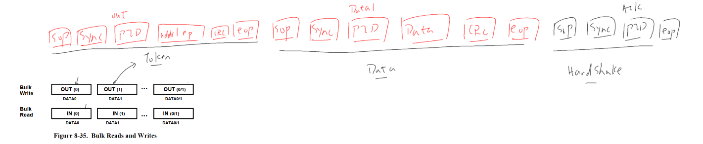

批量传输用批量事务来实现，用于传输大量的数据，数据的正确性有保证，时效没有保证。

批量事务由3个阶段(phase)组成：令牌阶段、数据阶段、握手阶段。每个阶段都是一个完整的包，含有SOP、SYNC、PID、EOP。

下图中各个矩形框就对应一个完整的包。
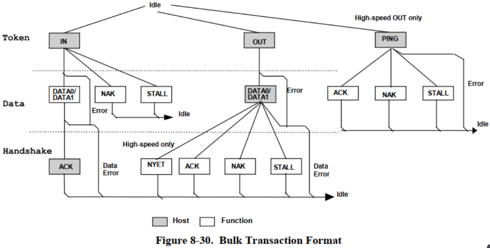

《圈圈教你玩USB》中有详细的示例：
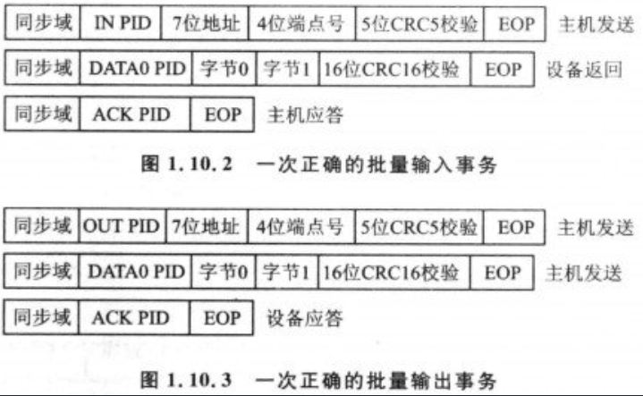

##### 中断传输
中断传输时，host 会以固定时间间隔去访问 USB device（USB device 是无法主动发起传输的，传输都是由 host 发起）
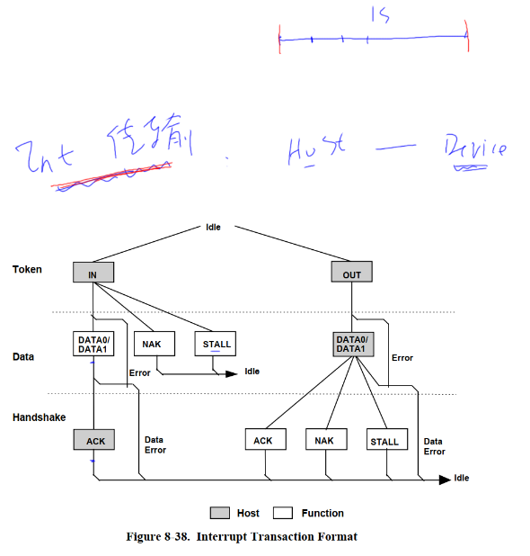

中断传输用中断事务来实现，用于传输小量的、周期性的数据，数据的正确性和时效都有保证。

中断事务由3个阶段(phase)组成：令牌阶段、数据阶段、握手阶段。每个阶段都是一个完整的包，含有SOP、SYNC、PID、EOP。

下图中各个矩形框就对应一个完整的包。
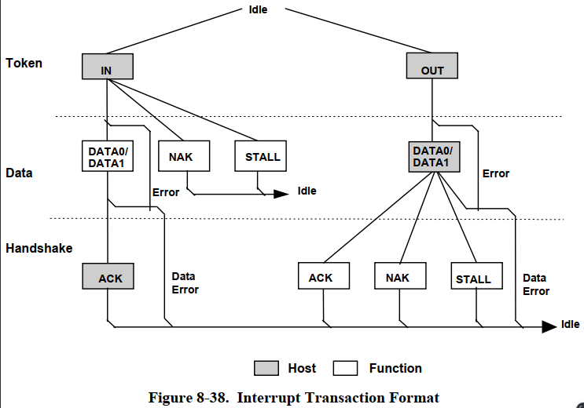

中断事务跟批量事务非常类似，Host使用它来周期性地读数据、写数据。

以鼠标为例，我们需要及时获得鼠标的数据，不及时的话你会感觉鼠标很迟钝。但是USB协议中并没有中断功能，它使用"周期性的读、写"来实现及时性。具体过程如下：

* Host每隔n毫秒发出一个IN令牌包
* 鼠标有数据的话，发出DATA0或DATA1数据包给Host；鼠标没有数据的话，发出NAK给Host。

中断事务的优先级比批量事务更高，它要求实时性，而批量事务不要求实时性。

##### 实时传输
只有 token + data 阶段，没有 handshake 阶段
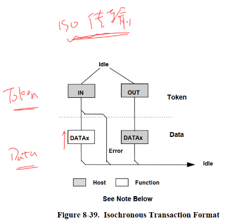

实时传输用实时事务来实现，用于传输实时数据，对数据的正确性没有要求。

实时事务由2个阶段(phase)组成：令牌阶段、数据阶段。每个阶段都是一个完整的包，含有SOP、SYNC、PID、EOP。

实时事务不需要握手阶段，一个示例的场景是：为了传输摄像头的实时数据，偶尔的数据错误是可以忍受的，大不了出现短暂的花屏。如果为了解决花屏而重传数据，那就会导致后续画面被推迟，实时性无法得到保证。

下图中各个矩形框就对应一个完整的包。
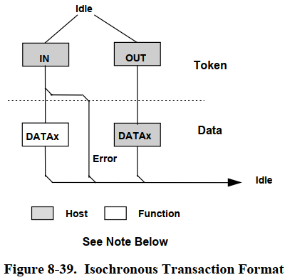

实时事务跟中断事务非常类似，Host也会周期性的发起实时事务，主要区别在于：
* 实时事务不要求准确性，没有握手阶段
* 实时事务传输的数据量比较大，中断事务传输的数据量比较小

##### 控制传输
控制传输由多个事务组成：建立事务 -> 数据事务 -> 状态事务
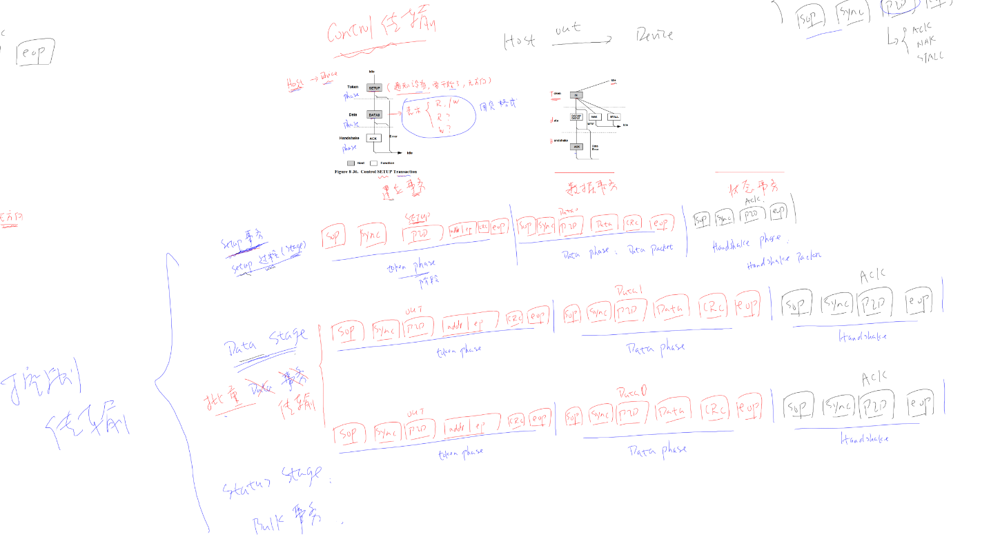

总的传输流程：
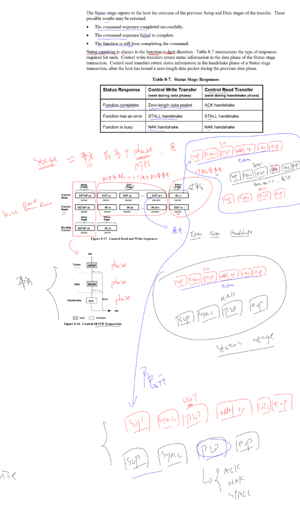

总结如下：


在使用批量传输时，使用IN令牌包或OUT令牌包表示数据传输方向。

控制传输的令牌包永远是SETUP，怎么分辨是读数据，还是写数据？发出SETUP令牌包后，还要发出DATA0数据包，根据数据的内容来确定后续是读数据，还是写数据。这个过程称为"建立事务"(SETUP Transaction)

但是控制传输由多个事务组成，这些事务分别处于3个过程：建立过程(stage)、数据过程(stage)、状态过程(stage)。

* 建立过程(stage)，使用SETUP事务：Host发出SETUP令牌包、DATA0数据包、得到ACK握手包
* 数据过程(stage)，使用批量事务：
  * 对于输出：Host发出OUT令牌包，发出DATA0、DATA1数据包、得到ACK握手包
  * 对于输入：Host发出IN令牌包，读到DATA0、DATA1数据包、发出ACK握手包
* 状态过程(stage)，使用批量事务：
  * 对于输出：Host发出IN令牌包，读到DATA1数据包，发出ACK握手包
  * 对于输入：Host发出OUT令牌包，发出DATA1数据包，等待ACK握手包


上图中的每一个方框，都是一个完整的事务，含有：Token Packet、Data Packet、Handshake Packet。

### 使用工具体验数据格式
可以在搜索引擎里搜"usbprotocolsuite"，安装"usbprotocolsuite"后，可以在文档目录里找打很多示程序(后缀名为usb)：

使用"usbprotocolsuite"打开这些文件，即可体验USB数据传输：


观察控制传输：


观察批量传输：


## USB描述符
* 《usb_20.pdf》的《Chapter 9  USB Device Framework》

USB 设备状态切换图，见上文

### 标准设备请求
#### SETUP事务的数据格式
Host使用控制传输来识别设备、设置设备地址、启动设备的某些特性，对于控制传输，它首先发出"setup事务"，如下：


在"setup事务"中，
* SETUP令牌包：用来通知设备，"要开始传输了"
* DATA0数据包：它含有固定的格式，用来告诉设备"是读还是写"、"读什么"、"写什么"

Hos通过DATA0数据包发送8字节数据给设备，它的格式如下图所示：


#### 标准设备请求
控制传输的建立事务中，可以使用下列格式的数据：


上表中各个"宏"取值如下：


#### 设备/配置/接口/端点
在SETUP事务的数据里，表示了要访问的是什么：Device？Interface？Endpoint？

对于一个USB设备，它可以多种配置(Configuration)。比如4G上网卡就有2种配置：U盘、上网卡。第1次把4G上网卡插入电脑时，它是一个U盘，可以按照里面的程序。装好程序后，把它再次插入电脑，它就是一个上网卡。驱动程序可以选择让它工作于哪种配置，同一时间只能有一种配置。大多数的USB设备只有一种配置。

一个配置下，可以有多个接口(Interface)，接口等同于功能(Function)。比如USB耳机有两个接口(功能)：声音收发、按键控制。

一个接口，可能有多个设置(Setting)，比如默认设置下它使用较低的带宽，可以选择其他设置以使用更高带宽。

一个接口，由一个或多个端点(Endpoint)组成。端点0属于整个设备的，端点0是双向的。接口还可以有其他端点，这些端点是单向的，要么是批量(Bulk)端点、要么是中断(Interrupt)端点、要么是同步(Isochronous)端点。

USB 描述符举例：


### 描述符
怎么描述设备、配置、接口、端点？使用描述符(Descriptors)，有设备描述符、配置描述符、接口描述符、端点描述符。所谓描述符，就是一些格式化的数据，用来描述信息。
一个USB设备，

* 只有一个设备描述符：用来表示设备的ID、它有多少个配置、它的端点0一次最大能传输多少字节数据
* 可能有多个配置描述符：用来表示它有多少个接口、供电方式、最大电流
* 一个配置描述符下面，可能有多个接口描述符：用来表示它是哪类接口、有几个设置(Setting)、有几个端点
* 一个接口描述符符下面，可能有多个端点描述符：用来表示端点号、方向(IN/OUT)、类型(批量/中断/同步)

还有一些字符串描述符(String descriptors)，它用可读的文字来描述设备，是可选的。


#### 设备描述符


#### 配置描述符


#### 接口描述符


#### 端点描述符


#### 示例
在Ubuntu中可以执行`lsusb -v`查看USB设备的描述符信息：

```shell
book@100ask:~$ sudo lsusb -v
[sudo] password for book:

Bus 001 Device 001: ID 1d6b:0002 Linux Foundation 2.0 root hub
Device Descriptor:
  bLength                18
  bDescriptorType         1
  bcdUSB               2.00
  bDeviceClass            9 Hub
  bDeviceSubClass         0 Unused
  bDeviceProtocol         0 Full speed (or root) hub
  bMaxPacketSize0        64
  idVendor           0x1d6b Linux Foundation
  idProduct          0x0002 2.0 root hub
  bcdDevice            5.04
  iManufacturer           3 Linux 5.4.0-124-generic ehci_hcd
  iProduct                2 EHCI Host Controller
  iSerial                 1 0000:02:03.0
  bNumConfigurations      1
  Configuration Descriptor:
    bLength                 9
    bDescriptorType         2
    wTotalLength           25
    bNumInterfaces          1
    bConfigurationValue     1
    iConfiguration          0
    bmAttributes         0xe0
      Self Powered
      Remote Wakeup
    MaxPower                0mA
    Interface Descriptor:
      bLength                 9
      bDescriptorType         4
      bInterfaceNumber        0
      bAlternateSetting       0
      bNumEndpoints           1
      bInterfaceClass         9 Hub
      bInterfaceSubClass      0 Unused
      bInterfaceProtocol      0 Full speed (or root) hub
      iInterface              0
      Endpoint Descriptor:
        bLength                 7
        bDescriptorType         5
        bEndpointAddress     0x81  EP 1 IN
        bmAttributes            3
          Transfer Type            Interrupt
          Synch Type               None
          Usage Type               Data
        wMaxPacketSize     0x0004  1x 4 bytes
        bInterval              12
Hub Descriptor:
  bLength               9
  bDescriptorType      41
  nNbrPorts             6
  wHubCharacteristic 0x000a
    No power switching (usb 1.0)
    Per-port overcurrent protection
  bPwrOn2PwrGood       10 * 2 milli seconds
  bHubContrCurrent      0 milli Ampere
  DeviceRemovable    0x00
  PortPwrCtrlMask    0xff
 Hub Port Status:
   Port 1: 0000.0100 power
   Port 2: 0000.0100 power
   Port 3: 0000.0100 power
   Port 4: 0000.0100 power
   Port 5: 0000.0100 power
   Port 6: 0000.0100 power
Device Status:     0x0001
  Self Powered

Bus 002 Device 003: ID 0e0f:0002 VMware, Inc. Virtual USB Hub
Device Descriptor:
  bLength                18
  bDescriptorType         1
  bcdUSB               1.10
  bDeviceClass            9 Hub
  bDeviceSubClass         0 Unused
  bDeviceProtocol         0 Full speed (or root) hub
  bMaxPacketSize0         8
  idVendor           0x0e0f VMware, Inc.
  idProduct          0x0002 Virtual USB Hub
  bcdDevice            1.00
  iManufacturer           1 VMware, Inc.
  iProduct                2 VMware Virtual USB Hub
  iSerial                 0
  bNumConfigurations      1
  Configuration Descriptor:
    bLength                 9
    bDescriptorType         2
    wTotalLength           25
    bNumInterfaces          1
    bConfigurationValue     1
    iConfiguration          1 VMware, Inc.
    bmAttributes         0xe0
      Self Powered
      Remote Wakeup
    MaxPower                0mA
    Interface Descriptor:
      bLength                 9
      bDescriptorType         4
      bInterfaceNumber        0
      bAlternateSetting       0
      bNumEndpoints           1
      bInterfaceClass         9 Hub
      bInterfaceSubClass      0 Unused
      bInterfaceProtocol      0 Full speed (or root) hub
      iInterface              1 VMware, Inc.
      Endpoint Descriptor:
        bLength                 7
        bDescriptorType         5
        bEndpointAddress     0x81  EP 1 IN
        bmAttributes            3
          Transfer Type            Interrupt
          Synch Type               None
          Usage Type               Data
        wMaxPacketSize     0x0001  1x 1 bytes
        bInterval             255
Hub Descriptor:
  bLength               9
  bDescriptorType      41
  nNbrPorts             7
  wHubCharacteristic 0x0009
    Per-port power switching
    Per-port overcurrent protection
  bPwrOn2PwrGood       50 * 2 milli seconds
  bHubContrCurrent    100 milli Ampere
  DeviceRemovable    0x00
  PortPwrCtrlMask    0xfe
 Hub Port Status:
   Port 1: 0000.0100 power
   Port 2: 0000.0100 power
   Port 3: 0000.0100 power
   Port 4: 0000.0100 power
   Port 5: 0000.0100 power
   Port 6: 0000.0100 power
   Port 7: 0000.0100 power
Device Status:     0x2909
  Self Powered

Bus 002 Device 002: ID 0e0f:0003 VMware, Inc. Virtual Mouse
Device Descriptor:
  bLength                18
  bDescriptorType         1
  bcdUSB               1.10
  bDeviceClass            0 (Defined at Interface level)
  bDeviceSubClass         0
  bDeviceProtocol         0
  bMaxPacketSize0         8
  idVendor           0x0e0f VMware, Inc.
  idProduct          0x0003 Virtual Mouse
  bcdDevice            1.03
  iManufacturer           1 VMware
  iProduct                2 VMware Virtual USB Mouse
  iSerial                 0
  bNumConfigurations      1
  Configuration Descriptor:
    bLength                 9
    bDescriptorType         2
    wTotalLength           34
    bNumInterfaces          1
    bConfigurationValue     1
    iConfiguration          1 VMware
    bmAttributes         0xc0
      Self Powered
    MaxPower                0mA
    Interface Descriptor:
      bLength                 9
      bDescriptorType         4
      bInterfaceNumber        0
      bAlternateSetting       0
      bNumEndpoints           1
      bInterfaceClass         3 Human Interface Device
      bInterfaceSubClass      1 Boot Interface Subclass
      bInterfaceProtocol      2 Mouse
      iInterface              1 VMware
        HID Device Descriptor:
          bLength                 9
          bDescriptorType        33
          bcdHID               1.10
          bCountryCode            0 Not supported
          bNumDescriptors         1
          bDescriptorType        34 Report
          wDescriptorLength      46
         Report Descriptors:
           ** UNAVAILABLE **
      Endpoint Descriptor:
        bLength                 7
        bDescriptorType         5
        bEndpointAddress     0x81  EP 1 IN
        bmAttributes            3
          Transfer Type            Interrupt
          Synch Type               None
          Usage Type               Data
        wMaxPacketSize     0x0008  1x 8 bytes
        bInterval               1
Device Status:     0x0001
  Self Powered

Bus 002 Device 001: ID 1d6b:0001 Linux Foundation 1.1 root hub
Device Descriptor:
  bLength                18
  bDescriptorType         1
  bcdUSB               1.10
  bDeviceClass            9 Hub
  bDeviceSubClass         0 Unused
  bDeviceProtocol         0 Full speed (or root) hub
  bMaxPacketSize0        64
  idVendor           0x1d6b Linux Foundation
  idProduct          0x0001 1.1 root hub
  bcdDevice            5.04
  iManufacturer           3 Linux 5.4.0-124-generic uhci_hcd
  iProduct                2 UHCI Host Controller
  iSerial                 1 0000:02:00.0
  bNumConfigurations      1
  Configuration Descriptor:
    bLength                 9
    bDescriptorType         2
    wTotalLength           25
    bNumInterfaces          1
    bConfigurationValue     1
    iConfiguration          0
    bmAttributes         0xe0
      Self Powered
      Remote Wakeup
    MaxPower                0mA
    Interface Descriptor:
      bLength                 9
      bDescriptorType         4
      bInterfaceNumber        0
      bAlternateSetting       0
      bNumEndpoints           1
      bInterfaceClass         9 Hub
      bInterfaceSubClass      0 Unused
      bInterfaceProtocol      0 Full speed (or root) hub
      iInterface              0
      Endpoint Descriptor:
        bLength                 7
        bDescriptorType         5
        bEndpointAddress     0x81  EP 1 IN
        bmAttributes            3
          Transfer Type            Interrupt
          Synch Type               None
          Usage Type               Data
        wMaxPacketSize     0x0002  1x 2 bytes
        bInterval             255
Hub Descriptor:
  bLength               9
  bDescriptorType      41
  nNbrPorts             2
  wHubCharacteristic 0x000a
    No power switching (usb 1.0)
    Per-port overcurrent protection
  bPwrOn2PwrGood        1 * 2 milli seconds
  bHubContrCurrent      0 milli Ampere
  DeviceRemovable    0x00
  PortPwrCtrlMask    0xff
 Hub Port Status:
   Port 1: 0000.0103 power enable connect
   Port 2: 0000.0107 power suspend enable connect
Device Status:     0x0001
  Self Powered
```

### 设备枚举过程示例
通过控制传输获取描述符信息：


使用"usbprotocolsuite"打开 `HS_MassStorage_Enum_And_Reads.usb`，可以看到设备的枚举过程：

* 使用控制传输，读取设备信息(设备描述符)：第一次读取时，它只需要得到8字节数据，因为第8个数据表示端点0能传输的最大数据长度。
    
* Host分配地址给设备，然后把新地址发给设备：
    
* 使用新地址，重新读取设备描述符，设备描述符长度是18：
    
* 读取配置描述符：它传入的长度是255，想一次性把当前配置描述符、它下面的接口描述符、端点描述符全部读出来
    
* 读取字符描述符
    


## libusb 的使用
* libusb GIT仓库：https://github.com/libusb/libusb.git
* libusb 官网：https://libusb.info/
* libusb API接口：https://libusb.sourceforge.io/api-1.0/
* libusb 示例：https://github.com/libusb/libusb/tree/master/examples

软件框架如下，用户空间程序可以借助 libusb 直接通过 USB 控制器驱动访问 USB 设备，从而实现用户态的驱动程序（相当于将内核空间的 USB 设备驱动移至用户空间来实现）


### 概述
#### 介绍
libusb是一个使用C编写的库，它提供USB设备的通用的访问方法。APP通过它，可以方便地访问USB设备，无需编写USB设备驱动程序。

* 可移植性：支持Linux、macOS、Windows、Android、OpenBSD等
* 用户模式：APP不需要特权模式、也不需要提升自己的权限即可访问USB设备
* 支持所有USB协议：从1.0到3.1都支持

libusb支持所有的传输类型(控制/批量/中断/实时)，有两类API接口：同步(Synchronous，简单)，异步(Asynchronous，复杂但是更强大)。它是轻量级的、线程安全的。还支持热拔插。

#### 用法
可以通过libusb访问USB设备，不需要USB设备端的驱动程序，需要移除原来的驱动程序。然后就可以直接访问USB控制器的驱动程序，使用open/read/write/ioctl/close这些接口来打开设备、收发数据、关闭设备。
libusb封装了更好用的函数，这些函数的使用可以分为5个步骤：

* 初始化
* 打开设备
* 移除原驱动/认领接口
* 传输
* 关闭设备


### API接口
#### 分类
libusb的接口函数分为两类：同步(Synchronous device I/O)、异步(Asynchronous device I/O)。

USB数据传输分为两个步骤，对于读数据，先给设备发出数据的请求，一段时间后数据返回；对于写数据，先发送数据给设备，一段时间后得到回应。

同步接口的核心在于把上述两个步骤放在一个函数里面。比如想去读取一个USB键盘的数据，给键盘发出读请求后，如果用户一直没有按下键盘，那么读函数会一直等待。

异步接口的核心在于把上述两个步骤分开：使用一个非阻塞的函数启动传输，它会立刻返回；提供一个回调函数用来处理返回结果。

同步接口的示例代码如下，在`libusb_bulk_transfer`函数内部，如果没有数据则会休眠：
```c
unsigned char data[4];
int actual_length;
int r = libusb_bulk_transfer(dev_handle, LIBUSB_ENDPOINT_IN, data, sizeof(data), &actual_length, 0);
if (r == 0 && actual_length == sizeof(data)) {
    // 接收到的数据保存在data数组里
    // 解析这些数据就可以知道按键状态
} else {
    error();
}
```

使用同步接口时，代码比较简单。但是无法实现"多endpoint"的操作：上一个endpoint的传输在休眠，除非使用另一个线程，否则在同一个线程内部在等待期间是无法操作另一个endpoint的。还有另一个缺点：无法取消传输。

异步接口是在libusb-1.0引入的新性能，接口更复杂，但是功能更强大。在异步接口函数里，它启动传输、设置回调函数后就立刻返回。等"读到数据"或是"得到回应"后，回调函数被调用。发起数据传输的线程无需休眠等待结果，它支持"多endpoint"的操作，也支持取消传输。

#### 初始化/反初始化
```c
/** \ingroup libusb_lib
 * 初始化libusb，这个函数必须先于其他libusb的函数执行
 *
 * 如果传入NULL，那么函数内部会穿件一个默认的context
 * 如果已经创建过默认的context，这个context会被重新使用(不会重新初始化它)
 *
 * 参数：
 * ctx : context pointer的位置，也可以传入NULL
 * 返回值
 * 0 - 成功
 * 负数 - 失败
 */
int API_EXPORTED libusb_init(libusb_context **ctx);
```
初始化libusb，参数是一个"a context pointer"的指针，如果这个参数为NULL，则函数内部会创建一个"default context"。所谓"libusb context"就是libusb上下文，就是一个结构体，里面保存有各类信息，比如：libusb的调试信息是否需要打印、各种互斥锁、各类链表(用来记录USB传输等等)。

程序退出前，调用如下函数：
```c
/** \ingroup libusb_lib
 * 发初始化libusb
 * 在关闭usb设备(libusb_close)后、退出程序前调用此函数
 *
 * 参数:
 * ctx : context, 传入NULL表示default context
 */
void API_EXPORTED libusb_exit(libusb_context *ctx);
```

#### 获取设备
可以使用`libusb_get_device_list`取出所有设备，函数接口如下：
```c
/** @ingroup libusb_dev
 * 返回一个list，list里含有当前系统中所有的USB设备
 *
 * 我们一般会在list里寻找需要访问的设备，找到之后使用libusb_open函数打开它
 * 然后调用libusb_free_device_list释放list
 *
 * 这个函数的返回值表示list中有多少个设备
 * list的最后一项是NULL
 *
 * 参数:
 * ctx  : context
 * list : output location for a list of devices, 最后必须调用libusb_free_device_list()来释放它
 * 返回值: list中设备的个数, 或错误值
 */
ssize_t API_EXPORTED libusb_get_device_list(libusb_context *ctx,
	libusb_device ***list);
```
调用此函数后，所有设备的信息存入list，然后遍历list，找到想操作的设备。这个函数内部会分配list的空间，所以用完后要释放掉，使用以下函数释放：
```c
/** \ingroup libusb_dev
 * 前面使用libusb_get_device_list()获得了设备list, 
 * 使用完后要调用libusb_free_device_list()释放这个list
 * 如果参数unref_devices为1, 则list中每个设备的引用计数值减小1
 * 参数: 
 * list : 要释放的设备list
 * unref_devices : 是否要将设备的引用计数减1
 */
void API_EXPORTED libusb_free_device_list(libusb_device **list,
	int unref_devices);
```

#### 打开/关闭设备
使用libusb_get_device_list得到设备列表后，可以选择里面的某个设备，然后调用libusb_open：
```c
/** \ingroup libusb_dev
 * 打开一个设备并得到它的句柄, 以后进行IO操作时都是使用句柄
 *
 * 使用libusb_get_device()函数可以得到设备的list, 
 * 从list里确定你要访问的设备后, 使用libusb_open()去打开它。
 * libusb_open()函数内部会增加此设备的引用计数, 使用完毕后要调用libusb_close()减小引用计数。
 *
 * 参数:
 * dev : 要打开的设备
 * dev_handle : 输出参数, 用来保存句柄
 * 返回值: 
 * 0 - 成功
 * LIBUSB_ERROR_NO_MEM : 缺少内存
 * LIBUSB_ERROR_ACCESS : 权限不足
 * LIBUSB_ERROR_NO_DEVICE : 这个设备未连接
 * 其他错误 : 其他LIBUSB_ERROR错误码
 */
int API_EXPORTED libusb_open(libusb_device *dev,
	libusb_device_handle **dev_handle);
```
使用libusb_open函数打开USB设备后，可以得到一个句柄：libusb_device_handle。以后调用各种数据传输函数时，就是使用libusb_device_handle。

使用完毕后，调用libusb_close关闭设备，函数原型如下：
```c
/** \ingroup libusb_dev
 * 关闭设备句柄, 在程序退出之前应该使用它去关闭已经打开的句柄
 *
 * 设备的引用计数在前面被libusb_open()函数增加了。
 * 在libusb_close()函数的内部，它会减小设备的引用计数。
 *
 * 参数: dev_handle - 句柄
 */
void API_EXPORTED libusb_close(libusb_device_handle *dev_handle);
```

#### 根据ID打开设备
如果知道设备的VID、PID，那么可以使用libusb_open_device_with_vid_pid来找到它、打开它。这个函数的内部，先使用`libusb_get_device_list`列出所有设备，然后遍历它们根据ID选出设备，接着调用libusb_open打开它，最后调用libusb_free_device_list释放设备。

libusb_open_device_with_vid_pid函数原型如下：
```c
/** \ingroup libusb_dev
 * 打开设备的常规做法是使用libusb_get_device_list()得到设备list，
 * 然后遍历list，找到设备
 * 接着使用libusb_open()函数得到句柄
 * 
 * 如果知道USB设备的VID、PID，那么可以使用libusb_open_device_with_vid_pid()函数快速打开它，得到句柄。
 * 
 * 这个函数有一个缺点: 如果系统中有多个ID相同的设备，你只能打开第1个设备
 *
 * 参数:
 * ctx : context, 或者传入NULL以使用默认的context
 * vendor_id : 厂家ID
 * product_id : 产品ID
 * 
 * 返回值: 
 * 句柄 - 找到的第1个设备的句柄
 * NULL - 没有找到设备
 */
DEFAULT_VISIBILITY
libusb_device_handle * LIBUSB_CALL libusb_open_device_with_vid_pid(
	libusb_context *ctx, uint16_t vendor_id, uint16_t product_id);
```

#### 描述符相关函数
##### 获得设备描述符
```c
/** \ingroup libusb_desc
 * 获得设备描述符
 *
 * 参数:
 * dev - 哪个设备
 * desc - 输出参数, 用来保存设备描述符
 *
 * 返回值:
 * 0 - 成功, 或其他LIBUSB_ERROR错误码
 */
int API_EXPORTED libusb_get_device_descriptor(libusb_device *dev,
	struct libusb_device_descriptor *desc);
```
##### 获得/释放配置描述符
```c
/** \ingroup libusb_desc
 * 获得指定的配置描述符
 *
 * 参数:
 * dev - 哪个设备
 * config_index - 哪个配置
 * config - 输出参数, 用来保存配置描述符, 使用完毕要调用libusb_free_config_descriptor()释放掉
 * 
 * 返回值:
 * 0 - 成功
 * LIBUSB_ERROR_NOT_FOUND - 没有这个配置
 * 其他LIBUSB_ERROR错误码
 */
int API_EXPORTED libusb_get_config_descriptor(libusb_device *dev,
	uint8_t config_index, struct libusb_config_descriptor **config);

/** \ingroup libusb_desc
 * Free a configuration descriptor obtained from
 * 前面使用libusb_get_active_config_descriptor()或libusb_get_config_descriptor()获得配置描述符，
 * 用完后调用libusb_free_config_descriptor()释放掉
 */
void API_EXPORTED libusb_free_config_descriptor(
	struct libusb_config_descriptor *config);
```

#### detach/attach驱动
使用libusb访问USB设备时，需要先移除(detach)设备原来的驱动程序，然后认领接口(claim interface)。有两种办法：
1. 方法1：
    ```c
    // 只是设置一个标记位表示libusb_claim_interface
    // 使用libusb_claim_interface时会detach原来的驱动
    libusb_set_auto_detach_kernel_driver(hdev, 1);  
    
    // 标记这个interface已经被使用认领了
    libusb_claim_interface(hdev, interface_number);
    ```
2. 方法2：
    ```c
    // detach原来的驱动
    libusb_detach_kernel_driver(hdev, interface_number);

    // 标记这个interface已经被使用认领了
    libusb_claim_interface(hdev, interface_number);
    ```

函数`libusb_detach_kernel_driver`原型如下：
```c
/** \ingroup libusb_dev
 * 给USB设备的接口(interface)移除驱动程序. If successful, you will then be
 * 移除原来的驱动后才能"claim the interface"、执行IO操作
 *
 * 实际上libusb会给这个接口安装一个特殊的内核驱动,
 * 所以本函数"移除驱动"是移除其他驱动，不是移除这个特殊的驱动。
 * 若干这个接口已经安装了这个特殊的驱动，本函数会返回LIBUSB_ERROR_NOT_FOUND.
 *
 * 参数:
 * dev_handle - 设备句柄
 * interface_number - 哪一个接口
 * 
 * 返回值:
 * 0 - 成功
 * LIBUSB_ERROR_NOT_FOUND - 这个接口没有安装其他驱动
 * LIBUSB_ERROR_INVALID_PARAM - 没有这个接口
 * LIBUSB_ERROR_NO_DEVICE - 这个设备未连接
 * LIBUSB_ERROR_NOT_SUPPORTED - 系统不支持此操作, 比如Windows
 * 其他LIBUSB_ERROR错误码
 */
int API_EXPORTED libusb_detach_kernel_driver(libusb_device_handle *dev_handle,
	int interface_number);
```

函数`libusb_claim_interface`原型如下：
```c
/** \ingroup libusb_dev
 * libusb使用内核里一个特殊的驱动程序，
 * libusb_claim_interface()函数就是给某个usb接口安装这个特殊的驱动程序，
 * 在使用libusb的函数执行IO操作之前必须调用本函数。
 *
 * 你可以给"已经claim过的接口"再次调用本函数，它直接返回0。
 *
 * 如果这个接口的auto_detach_kernel_driver被设置为1，
 * libusb_claim_interface()函数会先移除其他驱动。
 *
 * 本函数时纯粹的逻辑操作：只是替换接口的驱动程序而已，不会导致USB硬件传输。
 *
 * 参数:
 * dev_handle - 句柄, 表示USB设备
 * interface_number - 接口
 *
 * 返回值:
 * 0 - 成功
 * LIBUSB_ERROR_NOT_FOUND - 没有这个接口
 * LIBUSB_ERROR_BUSY - 其他APP或者驱动正在使用这个接口
 * LIBUSB_ERROR_NO_DEVICE - 设备未连接
 * 其他LIBUSB_ERROR错误码
 */
int API_EXPORTED libusb_claim_interface(libusb_device_handle *dev_handle,
	int interface_number);
```

使用完USB设备后，在调用libusb_close之前，应该`libusb_release_interface`释放接口：
```c
/** \ingroup libusb_dev
 * 前面使用libusb_claim_interface()给接口安装了给libusb使用的特殊驱动程序,
 * 使用完毕后，在调用libusb_close()关闭句柄之前，
 * 可以调用libusb_release_interface()卸载特殊驱动程序
 * 如果设备的auto_detach_kernel_driver为1，还会重新安装普通驱动程序
 * 
 * 这是一个阻塞函数, 它会给USB设备发送一个请求: SET_INTERFACE control,
 * 用来把接口的状态复位到第1个setting(the first alternate setting)
 *
 * 参数:
 * dev_handle - 设备句柄
 * interface_number - 哪个接口
 * 
 * 返回值:
 * 0 - 成功
 * LIBUSB_ERROR_NOT_FOUND - 这个接口没有被claim(没有安装特殊的驱动程序)
 * LIBUSB_ERROR_NO_DEVICE - 设备未连接
 * 其他LIBUSB_ERROR错误码
 */
int API_EXPORTED libusb_release_interface(libusb_device_handle *dev_handle,
	int interface_number);
```

#### 同步传输函数
##### 控制传输
```c
/** \ingroup libusb_syncio
 * 启动控制传输
 *
 * 传输方向在bmRequestType里
 * wValue,wIndex和wLength是host-endian字节序
 *
 * 参数:
 * dev_handle - 设备句柄
 * bmRequestType - setup数据包的bmRequestType域
 * bRequest      - setup数据包的bRequest域
 * wValue        - setup数据包的wValue域
 * wIndex        - setup数据包的wIndex域
 * data          - 保存数据的buffer, 可以是in、out数据
 * wLength       - setup数据包的wLength域
 * timeout       - 超时时间(单位ms)，就是这个函数能等待的最大时间; 0表示一直等待直到成功
 * 
 * 返回值:
 * 正整数 - 成功传输的数据的长度
 * LIBUSB_ERROR_TIMEOUT - 超时
 * LIBUSB_ERROR_PIPE  - 设备不支持该请求
 * LIBUSB_ERROR_NO_DEVICE - 设备未连接
 * LIBUSB_ERROR_BUSY - 如果这个函数时在事件处理上下文(event handling context)里则返回这个错误
 * LIBUSB_ERROR_INVALID_PARAM - 传输的字节超过OS或硬件的支持
 * the operating system and/or hardware can support (see \ref asynclimits)
 * 其他LIBUSB_ERROR错误码
 */
int API_EXPORTED libusb_control_transfer(libusb_device_handle *dev_handle,
	uint8_t bmRequestType, uint8_t bRequest, uint16_t wValue, uint16_t wIndex,
	unsigned char *data, uint16_t wLength, unsigned int timeout);
```

##### 批量传输
```c
/** \ingroup libusb_syncio
 * 启动批量传输
 * 传输方向在endpoint的"方向位"里表示
 *
 * 对于批量读，参数length表示"期望读到的数据最大长度", 实际读到的长度保存在transferred参数里
 *
 * 对于批量写, transferred参数表示实际发送出去的数据长度
 *
 * 发生超时错误时，也应该检查transferred参数。
 * libusb会根据硬件的特点把数据拆分为一小段一小段地发送出去，
 * 这意味着发送满某段数据后可能就发生超时错误，需要根据transferred参数判断传输了多少数据。
 *
 * 参数:
 * dev_handle - 设备句柄
 * endpoint - 端点
 * data          - 保存数据的buffer, 可以是in、out数据
 * length  - 对于批量写，它表示要发送的数据长度; 对于批量读，它表示"要读的数据的最大长度"
 * transferred - 输出参数，表示实际传输的数据长度
 * timeout       - 超时时间(单位ms)，就是这个函数能等待的最大时间; 0表示一直等待直到成功
 *
 * 返回值:
 * 0 - 成功，根据transferred参数判断传输了多少长度的数据
 * LIBUSB_ERROR_TIMEOUT - 超时, 根据transferred参数判断传输了多少长度的数据
 * LIBUSB_ERROR_PIPE - 端点错误，端点被挂起了
 * LIBUSB_ERROR_OVERFLOW - 溢出，设备提供的数据太多了
 * LIBUSB_ERROR_NO_DEVICE - 设备未连接
 * LIBUSB_ERROR_BUSY - 如果这个函数时在事件处理上下文(event handling context)里则返回这个错误
 * LIBUSB_ERROR_INVALID_PARAM - 传输的字节超过OS或硬件的支持
 * 其他LIBUSB_ERROR错误码
 */
int API_EXPORTED libusb_bulk_transfer(libusb_device_handle *dev_handle,
	unsigned char endpoint, unsigned char *data, int length,
	int *transferred, unsigned int timeout);
```

##### 中断传输
```c
/** \ingroup libusb_syncio
 * 启动中断传输
 * 传输方向在endpoint的"方向位"里表示
 *
 * 对于中断读，参数length表示"期望读到的数据最大长度", 实际读到的长度保存在transferred参数里
 *
 * 对于中断写, transferred参数表示实际发送出去的数据长度，不一定能发送完全部数据。
 *
 * 发生超时错误时，也应该检查transferred参数。
 * libusb会根据硬件的特点把数据拆分为一小段一小段地发送出去，
 * 这意味着发送满某段数据后可能就发生超时错误，需要根据transferred参数判断传输了多少数据。
 *
 * 参数:
 * dev_handle - 设备句柄
 * endpoint - 端点
 * data          - 保存数据的buffer, 可以是in、out数据
 * length  - 对于批量写，它表示要发送的数据长度; 对于批量读，它表示"要读的数据的最大长度"
 * transferred - 输出参数，表示实际传输的数据长度
 * timeout       - 超时时间(单位ms)，就是这个函数能等待的最大时间; 0表示一直等待直到成功
 *
 * 返回值:
 * 0 - 成功，根据transferred参数判断传输了多少长度的数据
 * LIBUSB_ERROR_TIMEOUT - 超时, 根据transferred参数判断传输了多少长度的数据
 * LIBUSB_ERROR_PIPE - 端点错误，端点被挂起了
 * LIBUSB_ERROR_OVERFLOW - 溢出，设备提供的数据太多了
 * LIBUSB_ERROR_NO_DEVICE - 设备未连接
 * LIBUSB_ERROR_BUSY - 如果这个函数时在事件处理上下文(event handling context)里则返回这个错误
 * LIBUSB_ERROR_INVALID_PARAM - 传输的字节超过OS或硬件的支持
 * 其他LIBUSB_ERROR错误码
 */
int API_EXPORTED libusb_interrupt_transfer(libusb_device_handle *dev_handle,
	unsigned char endpoint, unsigned char *data, int length,
	int *transferred, unsigned int timeout);
```

#### 异步传输函数
##### 使用步骤
使用libusb的异步函数时，有如下步骤：

* 分配：分配一个`libusb_transfer`结构体
* 填充：填充`libusb_transfer`结构体，比如想访问哪个endpoint、数据buffer、长度等等
* 提交：提交`libusb_transfer`结构体启动传输
* 处理事件：检查传输的结果，调用`libusb_transfer`结构体的回调函数
* 释放：释放资源，比如释放`libusb_transfer`结构体

##### 分配transfer结构体
```c
/** \ingroup libusb_asyncio
 * 分配一个libusb_transfer结构体，
 * 如果iso_packets不为0，还会分配iso_packets个libusb_iso_packet_descriptor结构体
 * 使用完毕后需要调用libusb_free_transfer()函数释放掉
 *
 * 对于控制传输、批量传输、中断传输，iso_packets参数需要设置为0
 *
 * 对于实时传输，需要指定iso_packets参数，
 * 这个函数会一起分配iso_packets个libusb_iso_packet_descriptor结构体。
 * 这个函数返回的libusb_transfer结构体并未初始化，
 * 你还需要初始化它的这些成员:
 *   libusb_transfer::num_iso_packets
 *   libusb_transfer::type
 *
 * 你可以指定iso_packets参数，意图给实时传输分配结构体，
 * 但是你可以把这个结构题用于其他类型的传输，
 * 在这种情况下，只要确保num_iso_packets为0就可以。
 *
 * 参数:
 * iso_packets - 分配多少个isochronous packet descriptors to allocate
 *
 * 返回值:
 * 返回一个libusb_transfer结构体或NULL
 */
DEFAULT_VISIBILITY
struct libusb_transfer * LIBUSB_CALL libusb_alloc_transfer(
	int iso_packets);
```

##### 填充控制传输
```c
/** \ingroup libusb_asyncio
 * 构造控制传输结构体
 *
 * 如果你传入buffer参数，那么buffer的前面8字节会被当做"control setup packet"来解析，
 * buffer的最后2字节表示wLength，它也会被用来设置libusb_transfer::length
 * 所以，建议使用流程如下:
 * 1. 分配buffer，这个buffer的前面8字节对应"control setup packet"，后面的空间可以用来保存其他数据
 * 2. 设置"control setup packet"，通过调用libusb_fill_control_setup()函数来设置
 * 3. 如果是要把数据发送个设备，把要发送的数据放在buffer的后面(从buffer[8]开始放)
 * 4. 调用libusb_fill_bulk_transfer
 * 5. 提交传输: 调用libusb_submit_transfer()
 *
 * 也可以让buffer参数为NULL，
 * 这种情况下libusb_transfer::length就不会被设置,
 * 需要手工去设置ibusb_transfer::buffer、ibusb_transfer::length
 *
 * 参数:
 * transfer - 要设置的libusb_transfer结构体
 * dev_handle - 设备句柄
 * buffer - 数据buffer，如果不是NULL的话，它前面8直接会被当做"control setup packet"来处理，
 *          也会从buffer[6], buffer[7]把length提取出来，用来设置libusb_transfer::length
 *           这个buffer必须是2字节对齐
 * callback - 传输完成时的回调函数
 * user_data - 传给回调函数的参数
 * timeout - 超时时间(单位: ms)
 */
static inline void libusb_fill_control_transfer(
	struct libusb_transfer *transfer, libusb_device_handle *dev_handle,
	unsigned char *buffer, libusb_transfer_cb_fn callback, void *user_data,
	unsigned int timeout);
```

##### 填充批量传输
```c
/** \ingroup libusb_asyncio
 * 构造批量传输结构体
 *
 * 参数:
 * transfer - 要设置的libusb_transfer结构体
 * dev_handle - 设备句柄
 * endpoint - 端点
 * buffer - 数据buffer
 * length - buffer的数据长度
 * callback - 传输完成时的回调函数
 * user_data - 传给回调函数的参数
 * timeout - 超时时间(单位: ms)
 */
static inline void libusb_fill_bulk_transfer(struct libusb_transfer *transfer,
	libusb_device_handle *dev_handle, unsigned char endpoint,
	unsigned char *buffer, int length, libusb_transfer_cb_fn callback,
	void *user_data, unsigned int timeout);
```

##### 填充中断传输
```c
/** \ingroup libusb_asyncio
 * 构造中断传输结构体
 *
 * 参数:
 * transfer - 要设置的libusb_transfer结构体
 * dev_handle - 设备句柄
 * endpoint - 端点
 * buffer - 数据buffer
 * length - buffer的数据长度
 * callback - 传输完成时的回调函数
 * user_data - 传给回调函数的参数
 * timeout - 超时时间(单位: ms)
 */
static inline void libusb_fill_interrupt_transfer(
	struct libusb_transfer *transfer, libusb_device_handle *dev_handle,
	unsigned char endpoint, unsigned char *buffer, int length,
	libusb_transfer_cb_fn callback, void *user_data, unsigned int timeout);
```

##### 填充实时传输
```c
/** \ingroup libusb_asyncio
 * 构造实时传输结构体
 *
 * 参数:
 * transfer - 要设置的libusb_transfer结构体
 * dev_handle - 设备句柄
 * endpoint - 端点
 * buffer - 数据buffer
 * length - buffer的数据长度
 * num_iso_packets - 实时传输包的个数
 * callback - 传输完成时的回调函数
 * user_data - 传给回调函数的参数
 * timeout - 超时时间(单位: ms)
 */
static inline void libusb_fill_iso_transfer(struct libusb_transfer *transfer,
	libusb_device_handle *dev_handle, unsigned char endpoint,
	unsigned char *buffer, int length, int num_iso_packets,
	libusb_transfer_cb_fn callback, void *user_data, unsigned int timeout);
```

##### 提交传输
```c
/** \ingroup libusb_asyncio
 * 提交传输Submit，这个函数会启动传输，然后立刻返回
 *
 * 参数:
 * transfer - 要传输的libusb_transfer结构体
 *
 * 返回值:
 * 0 - 成功
 * LIBUSB_ERROR_NO_DEVICE - 设备未连接
 * LIBUSB_ERROR_BUSY - 这个传输已经提交过了
 * LIBUSB_ERROR_NOT_SUPPORTED - 不支持这个传输
 * LIBUSB_ERROR_INVALID_PARAM - 传输的字节超过OS或硬件的支持
 * 其他LIBUSB_ERROR错误码
 */
int API_EXPORTED libusb_submit_transfer(struct libusb_transfer *transfer);
```

##### 处理事件
有4个函数，其中2个没有`completed`后缀的函数过时了：
```c
/** \ingroup libusb_poll
 * 处理任何"pengding的事件"
 *
 * 使用异步传输函数时，提交的tranfer结构体后就返回了。
 * 可以使用本函数处理这些传输的返回结果。
 *
 * 如果timeval参数为0，本函数会处理"当前、已经pending的事件"，然后马上返回。
 *
 * 如果timeval参数不为0，并且当前没有待处理的事件，本函数会阻塞以等待事件，直到超时。
 * 在等待过程中，如果事件发生了、或者得到了信号(signal)，那么这个函数会提前返回。
 *
 * completed参数用来避免竞争，如果它不为NULL:
 * 本函数获得"event handling lock"后，会判断completed指向的数值，
 * 如果这个数值非0(表示别的线程已经处理了、已经completed了)，
 * 则本函数会立刻返回(既然都completed了，当然无需再处理)
 *
 * 参数:
 * ctx - context(如果传入NULL则使用默认context)
 * tv - 等待事件的最大时间，0表示不等待
 * completed - 指针，可以传入NULL
 *
 * 返回值:
 * 0 - 成功
 * LIBUSB_ERROR_INVALID_PARAM - timeval参数无效
 * 其他LIBUSB_ERROR错误码
 */
int API_EXPORTED libusb_handle_events_timeout_completed(libusb_context *ctx,
	struct timeval *tv, int *completed);

/** \ingroup libusb_poll
 * 处理任何"pengding的事件"
 *
 * 跟libusb_handle_events_timeout_completed()类似,
 * 就是调用"libusb_handle_events_timeout_completed(ctx, tv, NULL);"
 * 最后的completed参数为NULL。
 *
 * 这个函数只是为了保持向后兼容，新的代码建议使用libusb_handle_events_completed()或
 * libusb_handle_events_timeout_completed()，
 * 这2个新函数可以处理竞争。
 *
 * 参数:
 * ctx - context(如果传入NULL则使用默认context)
 * tv - 等待事件的最大时间，0表示不等待
 *
 * 返回值:
 * 0 - 成功
 * LIBUSB_ERROR_INVALID_PARAM - timeval参数无效
 * 其他LIBUSB_ERROR错误码
 */
int API_EXPORTED libusb_handle_events_timeout(libusb_context *ctx,
	struct timeval *tv);

/** \ingroup libusb_poll
 * 处理任何"pengding的事件"，以阻塞方式处理(blocking mode)
 *
 * 本函数的内部实现就是调用: libusb_handle_events_timeout_completed(ctx, &tv, completed);
 * 超时时间设置为60秒
 *
 * 参数:
 * ctx - context(如果传入NULL则使用默认context)
 * completed - 指针，可以传入NULL
 *
 * 返回值:
 * 0 - 成功
 * LIBUSB_ERROR_INVALID_PARAM - timeval参数无效
 * 其他LIBUSB_ERROR错误码
 */
int API_EXPORTED libusb_handle_events_completed(libusb_context *ctx,
	int *completed);

/** \ingroup libusb_poll
 * 处理任何"pengding的事件"，以阻塞方式处理(blocking mode)
 *
 * 本函数的内部实现就是调用: libusb_handle_events_timeout_completed(ctx, &tv, NULL);
 * 超时时间设置为60秒
 *
 * 这个函数只是为了保持向后兼容，新的代码建议使用libusb_handle_events_completed()或
 * libusb_handle_events_timeout_completed()，
 * 这2个新函数可以处理竞争。
 * 
 * 参数:
 * ctx - context(如果传入NULL则使用默认context)
 *
 * 返回值:
 * 0 - 成功
 * LIBUSB_ERROR_INVALID_PARAM - timeval参数无效
 * 其他LIBUSB_ERROR错误码
 */
int API_EXPORTED libusb_handle_events(libusb_context *ctx);
```

##### 释放transfer结构体
传输完毕，需要释放libusb_transfer结构体，如果要重复利用这个结构体则无需释放。
```c
/** \ingroup libusb_asyncio
 * 释放libusb_transfer结构体
 * 前面使用libusb_alloc_transfer()分配的结构体，要使用本函数来释放。
 *
 * 如果libusb_transfer::flags的LIBUSB_TRANSFER_FREE_BUFFER位非0，
 * 那么会使用free()函数释放ibusb_transfer::buffer
 * 
 * 不能使用本函数释放一个活动的传输结构体(active, 已经提交尚未结束)
 * 
 */
void API_EXPORTED libusb_free_transfer(struct libusb_transfer *transfer);
```

### 使用示例
#### libusb 源码示例
在libusb源码的examples目录下有示例程序，我们也有一些真实的案列。
#### dnw工具
dnw是s3c2440时代的工具，使用它可以从PC给开发板传输文件。它的核心源码如下，使用同步接口进行数据传输：
```c
/* open the device using libusb */
status = libusb_init(NULL);
if (status < 0) {
    printf("libusb_init() failed: %s\n", libusb_error_name(status));
    return -1;
}

hdev = libusb_open_device_with_vid_pid(NULL, (uint16_t)DNW_DEVICE_IDVENDOR, (uint16_t)DNW_DEVICE_IDPRODUCT);
if (hdev == NULL) {
    printf("libusb_open() failed\n");
    goto err3;
}

/* We need to claim the first interface */
libusb_set_auto_detach_kernel_driver(hdev, 1);
status = libusb_claim_interface(hdev, 0);
if (status != LIBUSB_SUCCESS) {
    libusb_close(hdev);
    printf("libusb_claim_interface failed: %s\n", libusb_error_name(status));
    goto err2;
}

ret =  libusb_bulk_transfer(hdev, 0x03, buf, num_write, &transferred, 3000);
```

#### openocd
openocd是一个开源的USB JTAG调试软件，它也是使用libusb，涉及USB的操作代码如下。
##### 找到设备
```c
static int cmsis_dap_usb_open(struct cmsis_dap *dap, uint16_t vids[], uint16_t pids[], const char *serial)
{
	int err;
	struct libusb_context *ctx;
	struct libusb_device **device_list;

	err = libusb_init(&ctx);
	if (err) {
		LOG_ERROR("libusb initialization failed: %s", libusb_strerror(err));
		return ERROR_FAIL;
	}

	int num_devices = libusb_get_device_list(ctx, &device_list);
	if (num_devices < 0) {
		LOG_ERROR("could not enumerate USB devices: %s", libusb_strerror(num_devices));
		libusb_exit(ctx);
		return ERROR_FAIL;
	}

	for (int i = 0; i < num_devices; i++) {
		struct libusb_device *dev = device_list[i];
		struct libusb_device_descriptor dev_desc;

		err = libusb_get_device_descriptor(dev, &dev_desc);
		if (err) {
			LOG_ERROR("could not get device descriptor for device %d: %s", i, libusb_strerror(err));
			continue;
		}

		/* Match VID/PID */

		bool id_match = false;
		bool id_filter = vids[0] || pids[0];
		for (int id = 0; vids[id] || pids[id]; id++) {
			id_match = !vids[id] || dev_desc.idVendor == vids[id];
			id_match &= !pids[id] || dev_desc.idProduct == pids[id];

			if (id_match)
				break;
		}

		if (id_filter && !id_match)
			continue;

		/* Don't continue if we asked for a serial number and the device doesn't have one */
		if (dev_desc.iSerialNumber == 0 && serial && serial[0])
			continue;

		struct libusb_device_handle *dev_handle = NULL;
		err = libusb_open(dev, &dev_handle);
		if (err) {
			/* It's to be expected that most USB devices can't be opened
			 * so only report an error if it was explicitly selected
			 */
			if (id_filter) {
				LOG_ERROR("could not open device 0x%04x:0x%04x: %s",
						dev_desc.idVendor, dev_desc.idProduct, libusb_strerror(err));
			} else {
				LOG_DEBUG("could not open device 0x%04x:0x%04x: %s",
						dev_desc.idVendor, dev_desc.idProduct, libusb_strerror(err));
			}
			continue;
		}

		/* Match serial number */

		bool serial_match = false;
		char dev_serial[256] = {0};
		if (dev_desc.iSerialNumber > 0) {
			err = libusb_get_string_descriptor_ascii(
					dev_handle, dev_desc.iSerialNumber,
					(uint8_t *)dev_serial, sizeof(dev_serial));

			if (err < 0) {
				const char *msg = "could not read serial number for device 0x%04x:0x%04x: %s";
				if (serial)
					LOG_WARNING(msg, dev_desc.idVendor, dev_desc.idProduct,
								libusb_strerror(err));
				else
					LOG_DEBUG(msg, dev_desc.idVendor, dev_desc.idProduct,
								libusb_strerror(err));
			} else if (serial && strncmp(dev_serial, serial, sizeof(dev_serial)) == 0) {
				serial_match = true;
			}
		}

		if (serial && !serial_match) {
			libusb_close(dev_handle);
			continue;
		}

		/* Find the CMSIS-DAP string in product string */

		bool cmsis_dap_in_product_str = false;
		char product_string[256] = {0};
		if (dev_desc.iProduct > 0) {
			err = libusb_get_string_descriptor_ascii(
					dev_handle, dev_desc.iProduct,
					(uint8_t *)product_string, sizeof(product_string));
			if (err < 0) {
				LOG_WARNING("could not read product string for device 0x%04x:0x%04x: %s",
						dev_desc.idVendor, dev_desc.idProduct, libusb_strerror(err));
			} else if (strstr(product_string, "CMSIS-DAP")) {
				LOG_DEBUG("found product string of 0x%04x:0x%04x '%s'",
						  dev_desc.idVendor, dev_desc.idProduct, product_string);
				cmsis_dap_in_product_str = true;
			}
		}

		bool device_identified_reliably = cmsis_dap_in_product_str
											|| serial_match || id_match;

		/* Find the CMSIS-DAP interface */

		for (int config = 0; config < dev_desc.bNumConfigurations; config++) {
			struct libusb_config_descriptor *config_desc;
			err = libusb_get_config_descriptor(dev, config, &config_desc);
			if (err) {
				LOG_ERROR("could not get configuration descriptor %d for device 0x%04x:0x%04x: %s",
						config, dev_desc.idVendor, dev_desc.idProduct, libusb_strerror(err));
				continue;
			}

			LOG_DEBUG("enumerating interfaces of 0x%04x:0x%04x",
					  dev_desc.idVendor, dev_desc.idProduct);
			int config_num = config_desc->bConfigurationValue;
			const struct libusb_interface_descriptor *intf_desc_candidate = NULL;
			const struct libusb_interface_descriptor *intf_desc_found = NULL;

			for (int interface = 0; interface < config_desc->bNumInterfaces; interface++) {
				const struct libusb_interface_descriptor *intf_desc = &config_desc->interface[interface].altsetting[0];
				int interface_num = intf_desc->bInterfaceNumber;

				/* Skip this interface if another one was requested explicitly */
				if (cmsis_dap_usb_interface != -1 && cmsis_dap_usb_interface != interface_num)
					continue;

				/* CMSIS-DAP v2 spec says:
				 *
				 * CMSIS-DAP with default V2 configuration uses WinUSB and is therefore faster.
				 * Optionally support for streaming SWO trace is provided via an additional USB endpoint.
				 *
				 * The WinUSB configuration requires custom class support with the interface setting
				 *     Class Code: 0xFF (Vendor specific)
				 *     Subclass: 0x00
				 *     Protocol code: 0x00
				 *
				 * Depending on the configuration it uses the following USB endpoints which should be configured
				 * in the interface descriptor in this order:
				 *  - Endpoint 1: Bulk Out – used for commands received from host PC.
				 *  - Endpoint 2: Bulk In – used for responses send to host PC.
				 *  - Endpoint 3: Bulk In (optional) – used for streaming SWO trace (if enabled with SWO_STREAM).
				 */

				/* Search for "CMSIS-DAP" in the interface string */
				bool cmsis_dap_in_interface_str = false;
				if (intf_desc->iInterface != 0) {

					char interface_str[256] = {0};

					err = libusb_get_string_descriptor_ascii(
							dev_handle, intf_desc->iInterface,
							(uint8_t *)interface_str, sizeof(interface_str));
					if (err < 0) {
						LOG_DEBUG("could not read interface string %d for device 0x%04x:0x%04x: %s",
								  intf_desc->iInterface,
								  dev_desc.idVendor, dev_desc.idProduct,
								  libusb_strerror(err));
					} else if (strstr(interface_str, "CMSIS-DAP")) {
						cmsis_dap_in_interface_str = true;
						LOG_DEBUG("found interface %d string '%s'",
								  interface_num, interface_str);
					}
				}

				/* Bypass the following check if this interface was explicitly requested. */
				if (cmsis_dap_usb_interface == -1) {
					if (!cmsis_dap_in_product_str && !cmsis_dap_in_interface_str)
						continue;
				}

				/* check endpoints */
				if (intf_desc->bNumEndpoints < 2) {
					LOG_DEBUG("skipping interface %d, has only %d endpoints",
							  interface_num, intf_desc->bNumEndpoints);
					continue;
				}

				if ((intf_desc->endpoint[0].bmAttributes & 3) != LIBUSB_TRANSFER_TYPE_BULK ||
						(intf_desc->endpoint[0].bEndpointAddress & 0x80) != LIBUSB_ENDPOINT_OUT) {
					LOG_DEBUG("skipping interface %d, endpoint[0] is not bulk out",
							  interface_num);
					continue;
				}

				if ((intf_desc->endpoint[1].bmAttributes & 3) != LIBUSB_TRANSFER_TYPE_BULK ||
						(intf_desc->endpoint[1].bEndpointAddress & 0x80) != LIBUSB_ENDPOINT_IN) {
					LOG_DEBUG("skipping interface %d, endpoint[1] is not bulk in",
							  interface_num);
					continue;
				}

				/* We can rely on the interface is really CMSIS-DAP if
				 * - we've seen CMSIS-DAP in the interface string
				 * - config asked explicitly for an interface number
				 * - the device has only one interface
				 * The later two cases should be honored only if we know
				 * we are on the right device */
				bool intf_identified_reliably = cmsis_dap_in_interface_str
							|| (device_identified_reliably &&
									(cmsis_dap_usb_interface != -1
									 || config_desc->bNumInterfaces == 1));

				if (intf_desc->bInterfaceClass != LIBUSB_CLASS_VENDOR_SPEC ||
						intf_desc->bInterfaceSubClass != 0 || intf_desc->bInterfaceProtocol != 0) {
					/* If the interface is reliably identified
					 * then we need not insist on setting USB class, subclass and protocol
					 * exactly as the specification requires.
					 * At least KitProg3 uses class 0 contrary to the specification */
					if (intf_identified_reliably) {
						LOG_WARNING("Using CMSIS-DAPv2 interface %d with wrong class %" PRId8
								  " subclass %" PRId8 " or protocol %" PRId8,
								  interface_num,
								  intf_desc->bInterfaceClass,
								  intf_desc->bInterfaceSubClass,
								  intf_desc->bInterfaceProtocol);
					} else {
						LOG_DEBUG("skipping interface %d, class %" PRId8
								  " subclass %" PRId8 " protocol %" PRId8,
								  interface_num,
								  intf_desc->bInterfaceClass,
								  intf_desc->bInterfaceSubClass,
								  intf_desc->bInterfaceProtocol);
						continue;

					}
				}

				if (intf_identified_reliably) {
					/* That's the one! */
					intf_desc_found = intf_desc;
					break;
				}

				if (!intf_desc_candidate && device_identified_reliably) {
					/* This interface looks suitable for CMSIS-DAP. Store the pointer to it
					 * and keep searching for another one with CMSIS-DAP in interface string */
					intf_desc_candidate = intf_desc;
				}
			}

			if (!intf_desc_found) {
				/* We were not able to identify reliably which interface is CMSIS-DAP.
				 * Let's use the first suitable if we found one */
				intf_desc_found = intf_desc_candidate;
			}

			if (!intf_desc_found) {
				libusb_free_config_descriptor(config_desc);
				continue;
			}

			/* We've chosen an interface, connect to it */
			int interface_num = intf_desc_found->bInterfaceNumber;
			int packet_size = intf_desc_found->endpoint[0].wMaxPacketSize;
			int ep_out = intf_desc_found->endpoint[0].bEndpointAddress;
			int ep_in = intf_desc_found->endpoint[1].bEndpointAddress;

			libusb_free_config_descriptor(config_desc);
			libusb_free_device_list(device_list, true);

			LOG_INFO("Using CMSIS-DAPv2 interface with VID:PID=0x%04x:0x%04x, serial=%s",
					dev_desc.idVendor, dev_desc.idProduct, dev_serial);

			int current_config;
			err = libusb_get_configuration(dev_handle, &current_config);
			if (err) {
				LOG_ERROR("could not find current configuration: %s", libusb_strerror(err));
				libusb_close(dev_handle);
				libusb_exit(ctx);
				return ERROR_FAIL;
			}

			if (config_num != current_config) {
				err = libusb_set_configuration(dev_handle, config_num);
				if (err) {
					LOG_ERROR("could not set configuration: %s", libusb_strerror(err));
					libusb_close(dev_handle);
					libusb_exit(ctx);
					return ERROR_FAIL;
				}
			}

			err = libusb_claim_interface(dev_handle, interface_num);
			if (err)
				LOG_WARNING("could not claim interface: %s", libusb_strerror(err));

			dap->bdata = malloc(sizeof(struct cmsis_dap_backend_data));
			if (!dap->bdata) {
				LOG_ERROR("unable to allocate memory");
				libusb_release_interface(dev_handle, interface_num);
				libusb_close(dev_handle);
				libusb_exit(ctx);
				return ERROR_FAIL;
			}

			dap->packet_size = packet_size;
			dap->packet_buffer_size = packet_size;
			dap->bdata->usb_ctx = ctx;
			dap->bdata->dev_handle = dev_handle;
			dap->bdata->ep_out = ep_out;
			dap->bdata->ep_in = ep_in;
			dap->bdata->interface = interface_num;

			dap->packet_buffer = malloc(dap->packet_buffer_size);
			if (!dap->packet_buffer) {
				LOG_ERROR("unable to allocate memory");
				cmsis_dap_usb_close(dap);
				return ERROR_FAIL;
			}

			dap->command = dap->packet_buffer;
			dap->response = dap->packet_buffer;

			return ERROR_OK;
		}

		libusb_close(dev_handle);
	}

	libusb_free_device_list(device_list, true);

	libusb_exit(ctx);
	return ERROR_FAIL;
}
```

##### 读写数据
```c
static int cmsis_dap_usb_read(struct cmsis_dap *dap, int timeout_ms)
{
	int transferred = 0;
	int err;

	err = libusb_bulk_transfer(dap->bdata->dev_handle, dap->bdata->ep_in,
							dap->packet_buffer, dap->packet_size, &transferred, timeout_ms);
	if (err) {
		if (err == LIBUSB_ERROR_TIMEOUT) {
			return ERROR_TIMEOUT_REACHED;
		} else {
			LOG_ERROR("error reading data: %s", libusb_strerror(err));
			return ERROR_FAIL;
		}
	}

	memset(&dap->packet_buffer[transferred], 0, dap->packet_buffer_size - transferred);

	return transferred;
}

static int cmsis_dap_usb_write(struct cmsis_dap *dap, int txlen, int timeout_ms)
{
	int transferred = 0;
	int err;

	/* skip the first byte that is only used by the HID backend */
	err = libusb_bulk_transfer(dap->bdata->dev_handle, dap->bdata->ep_out,
							dap->packet_buffer, txlen, &transferred, timeout_ms);
	if (err) {
		if (err == LIBUSB_ERROR_TIMEOUT) {
			return ERROR_TIMEOUT_REACHED;
		} else {
			LOG_ERROR("error writing data: %s", libusb_strerror(err));
			return ERROR_FAIL;
		}
	}

	return transferred;
}
```

## 使用libusb读取鼠标数据
* HID规范：https://www.usb.org/sites/default/files/hid1_11.pdf (文件已经下载放在GIT仓库) -P71
* 文档：USB Human Interface Devices,  https://wiki.osdev.org/USB_Human_Interface_Devices
* 内核 USB 鼠标驱动程序 usbmouse.c - 滚轮信息


查看系统中 USB 设备的信息（lsusb -v）


### HID协议
HID: Human Interface Devices, 人类用来跟计算机交互的设备。就是鼠标、键盘、游戏手柄等设备。

对于USB接口的HID设备，有一套协议。

#### 描述符
HID设备有如下描述符：


* HID设备的"设备描述符"并无实际意义，没有使用"设备描述符"来表示自己是HID设备。
* HID设备只有一个配置，所以只有一个配置描述符
* 接口描述符
  * bInterfaceClass为3，表示它是HID设备
  * bInterfaceSubClass是0或1，1表示它支持"Boot Interface"(表示PC的BIOS能识别、使用它)，0表示必须等操作系统启动后通过驱动程序来使用它。
  * bInterfaceProtocol：0-None, 1-键盘, 2-鼠标
* 端点描述符：HID设备有一个控制端点、一个中断端点
    

对于鼠标，HOST可以通过中断端点读到数据。

#### 数据格式
##### 键盘
通过中断传输可以读到键盘数据，它是8字节的数据，格式如下：

| 偏移 | 大小  | 描述                                                     |
| ---- | ----- | -------------------------------------------------------- |
| 0    | 1字节 | "Modifier keys status"，就是ctrl、alt、shift等按键的状态 |
| 1    | 1字节 | 保留                                                     |
| 2    | 1字节 | 第1个按键的键值                                          |
| 3    | 1字节 | 第2个按键的键值                                          |
| 4    | 1字节 | 第3个按键的键值                                          |
| 5    | 1字节 | 第4个按键的键值                                          |
| 6    | 1字节 | 第5个按键的键值                                          |
| 7    | 1字节 | 第6个按键的键值                                          |

第0个字节中每一位都表示一个按键的状态，某位等于1时，表示对应的按键被按下，格式如下：

| 位   | 长度 | 描述                         |
| ---- | ---- | ---------------------------- |
| 0    | 1    | Left Ctrl                    |
| 1    | 1    | Left Shift                   |
| 2    | 1    | Left Alt                     |
| 3    | 1    | Left GUI(Windows/Super key)  |
| 4    | 1    | Right Ctrl                   |
| 5    | 1    | Right Shift                  |
| 6    | 1    | Right Alt                    |
| 7    | 1    | Right GUI(Windows/Super key) |

读到的键盘数据里有6个按键值，每个按键值都是8位的数据。如果某个按键值不等于0，就表示某个按键被按下了。
按键值跟按键的对应关系，请看后面的《1.2.4 扫描码》。

示例：按键"A"、"B"、"C"、"X"的按键值分别是4、5、6、0x1B。
按下了"A"，USB键盘上报的数据为：
```shell
00 00 04 00 00 00 00 00
```

松开"A"，USB键盘上报的数据为：
```shell
00 00 00 00 00 00 00 00
```

按下"A"、"B"，USB键盘上报的数据为：
```shell
00 00 04 05 00 00 00 00
```

保持"A"、"B"不松开，继续按下"C"，USB键盘上报的数据为：
```shell
00 00 04 05 06 00 00 00
```

松开"A"，但是保持"B"、"C"不松开，USB键盘上报的数据为：
```shell
00 00 05 06 00 00 00 00
```

USB键盘上报的数据里，哪个按键先被按下，就先记录它的按键值。在上面的例子里，"A"松开后只有"B"、"C"这两个按键，"B"、"C"的按键值挪到了前面。

按下"Left shift"、并且按下"X"，USB键盘上报的数据为：
```shell
02 00 1B 00 00 00 00 00
```

USB键盘只能上报6个按键值，如果有超过6个按键被按下，那么它讲上报"phantom condition"(6个按键值都是1)，但是"Modifier keys status"还是有效的。比如"Right Shift"被按下，另外超过6个的按键也被按下时，USB键盘上报的数据为：
```shell
20 00 01 01 01 01 01 01
```

##### LED
我们还可控制键盘的LED，需要发出一个控制传输请求：SetReport ，使用这个请求发送一个字节的数据。

这个字节的数据格式如下，某位为1时，会点亮相应的LED：

| 位   | 长度 | 描述        |
| ---- | ---- | ----------- |
| 0    | 1    | Num Lock    |
| 1    | 1    | Caps Lock   |
| 2    | 1    | Scroll Lock |
| 3    | 1    | Compose     |
| 4    | 1    | Kana        |
| 5    | 1    | 保留，写为0 |

发出的SetReport，是一个控制传输的"setup packet"，格式如下：


以libusb的函数描述它的参数，如下：
```c
int LIBUSB_CALL libusb_control_transfer(libusb_device_handle *dev_handle,
	uint8_t request_type, uint8_t bRequest, uint16_t wValue, uint16_t wIndex,
	unsigned char *data, uint16_t wLength, unsigned int timeout);

/* 示例代码 */
unsigned char data = (1<<1); /* 点亮Caps Lock */
uint16_t wValue = (0x02<<8)|0; // 0x02: 发给设备, 0: report ID
uint16_t wIndex = 0; // 一般是0, the interface number of the USB keyboard
libusb_control_transfer(dev_handle, 0x21, 0x09, wValue, wIndex, &data, 1, timeout);
```

##### 鼠标
通过中断传输可以读到鼠标数据，它是8字节的数据，格式如下：
| 偏移 | 大小         | 描述     |
| ---- | ------------ | -------- |
| 0    | 1字节        |          |
| 1    | 1字节        | 按键状态 |
| 2    | 2字节        | X位移    |
| 4    | 2字节        | Y位移    |
| 6    | 1字节或2字节 | 滚轮     |

按键状态里，每一位对应鼠标的一个按键，等1时表示对应按键被点击了，格式如下：
| 位   | 长度 | 描述                                                    |
| ---- | ---- | ------------------------------------------------------- |
| 0    | 1    | 鼠标的左键                                              |
| 1    | 1    | 鼠标的右键                                              |
| 2    | 1    | 鼠标的中间键                                            |
| 3    | 5    | 保留，设备自己定义<br />bit3: 鼠标的侧边按键<br />bit4: |

X位移、Y位移都是8位的有符号数。对于X位移，负数表示鼠标向左移动，正数表示鼠标向右移动，移动的幅度就使用这个8位数据表示。对于Y位移，负数表示鼠标向上移动，正数表示鼠标向下移动，移动的幅度就使用这个8位数据表示。

笔记：可能每个鼠标数据对应的位置不同，所占字节长度不同，需要根据实际情况来定。可以通过 libusb 读取实时数据来分析


##### 扫描码
USB规范里为每个按键定义了16位的按键值，注意：它是16位的，但是USB键盘只使用8位表示按键值。所以有些按键需要通过"Modifier keys status"来确定。比如"Left Ctrl"的按键值是224，这无法通过8位数据来表示，在USB键盘上报的数据里，使用第0字节的bit4来表示。


### 使用同步接口读取鼠标数据
#### 编写源码
```c
#include <errno.h>
#include <signal.h>
#include <stdio.h>
#include <stdlib.h>
#include <string.h>

#include <libusb-1.0/libusb.h>

int main(int argc, char **argv)
{
    int err;
    libusb_device *dev, **devs;
    int num_devices;
    int endpoint;
    int interface_num;
    int found = 0;
    int transferred;
    int count = 0;
    unsigned char buffer[16];
    struct libusb_config_descriptor *config_desc;
    struct libusb_device_handle *dev_handle = NULL;
    
    /* libusb_init */

    err = libusb_init(NULL);
    if (err < 0) {
        fprintf(stderr, "failed to initialise libusb %d - %s\n", err, libusb_strerror(err));
        exit(1);
    }

    /* get device list */
    if ((num_devices = libusb_get_device_list(NULL, &devs)) < 0) {
        fprintf(stderr, "libusb_get_device_list() failed\n");
        libusb_exit(NULL);
        exit(1);
    }
    fprintf(stdout, "libusb_get_device_list() ok\n");

    /* for each device, get config descriptor */
    for (int i = 0; i < num_devices; i++) {
        dev = devs[i];

        /* parse interface descriptor, find usb mouse */        
        err = libusb_get_config_descriptor(dev, 0, &config_desc);
        if (err) {
            fprintf(stderr, "could not get configuration descriptor\n");
            continue;
        }
        fprintf(stdout, "libusb_get_config_descriptor() ok\n");

        for (int interface = 0; interface < config_desc->bNumInterfaces; interface++) {
            const struct libusb_interface_descriptor *intf_desc = &config_desc->interface[interface].altsetting[0];
            interface_num = intf_desc->bInterfaceNumber;

            if (intf_desc->bInterfaceClass != 3 || intf_desc->bInterfaceProtocol != 2)
                continue;
            else
            {
                /* 找到了USB鼠标 */
                fprintf(stdout, "find usb mouse ok\n");
                for (int ep = 0; ep < intf_desc->bNumEndpoints; ep++)
                {
                    if ((intf_desc->endpoint[ep].bmAttributes & 3) == LIBUSB_TRANSFER_TYPE_INTERRUPT ||
                            (intf_desc->endpoint[ep].bEndpointAddress & 0x80) == LIBUSB_ENDPOINT_IN) {
                        /* 找到了输入的中断端点 */
                        fprintf(stdout, "find in int endpoint\n");
                        endpoint = intf_desc->endpoint[ep].bEndpointAddress;
                        found = 1;
                        break;
                    }
                    
                }
            }

            if (found)
                break;
        }

        libusb_free_config_descriptor(config_desc);
        
        if (found)
            break;        
    }

    if (!found)
    {
        /* free device list */
        libusb_free_device_list(devs, 1);
        libusb_exit(NULL);
        exit(1);
    }

    if (found)
    {
        /* libusb_open */
        err = libusb_open(dev, &dev_handle);
        if (err)
        {
            fprintf(stderr, "failed to open usb mouse\n");
            exit(1);
        }
        fprintf(stdout, "libusb_open ok\n");
    }

    /* free device list */
    libusb_free_device_list(devs, 1);

    /* claim interface */
    libusb_set_auto_detach_kernel_driver(dev_handle, 1);  
    err = libusb_claim_interface(dev_handle, interface_num);
    if (err)
    {
        fprintf(stderr, "failed to libusb_claim_interface\n");
        exit(1);
    }
    fprintf(stdout, "libusb_claim_interface ok\n");

    /* libusb_interrupt_transfer */
    while (1)
    {
        err = libusb_interrupt_transfer(dev_handle, endpoint, buffer, 16, &transferred, 5000);
        if (!err) {
            /* parser data */
            printf("%04d datas: ", count++);
            for (int i = 0; i < transferred; i++)
            {
                printf("%02x ", buffer[i]);
            }
            printf("\n");
        } else if (err == LIBUSB_ERROR_TIMEOUT){
            fprintf(stderr, "libusb_interrupt_transfer timout\n");
        } else {
            fprintf(stderr, "libusb_interrupt_transfer err : %d\n", err);
            //exit(1);
        }
        
    }

    /* libusb_close */
    libusb_release_interface(dev_handle, interface_num);
    libusb_close(dev_handle);
    libusb_exit(NULL);
}
```

#### 上机实验

##### 在Ubuntu上实验
```shell
// 1. 安装开发包
$ sudo apt install libusb-1.0-0-dev
    
// 2. 修改源码，包含libusb.h 头文件时用如下代码
#include <libusb-1.0/libusb.h>

// 3. 编译程序指定库
gcc -o readmouse readmouse.c -lusb-1.0
```

##### 在IMX6ULL开发板上实验
* 交叉编译libusb
  ```shell
  sudo apt-get install libtool
  
  unzip libusb-1.0.26.zip
  cd libusb-1.0.26
  ./autogen.sh
  
  ./configure --host=arm-buildroot-linux-gnueabihf --prefix=$PWD/tmp
  
  make
  
  make install
  
  ls tmp/
  include  lib
  ```

* 安装库、头文件到工具链的目录里
  ```shell
  libusb-1.0.26/tmp/lib$ cp * -rfd /home/book/100ask_imx6ull-sdk/ToolChain/arm-buildroot-linux-gnueabihf_sdk-buildroot/arm-buildroot-linux-gnueabihf/sysroot/usr/lib/
  
  libusb-1.0.26/tmp/include$ cp libusb-1.0 -rf /home/book/100ask_imx6ull-sdk/ToolChain/arm-buildroot-linux-gnueabihf_sdk-buildroot/arm-buildroot-linux-gnueabihf/sysroot/usr/include/
  ```

* 交叉编译app
  ```shell
  arm-buildroot-linux-gnueabihf-gcc -o  readmouse.c -lusb-1.0
  ```
  - 在使用 gcc 工具进行编译时，可以指定 -v 参数，以查找头文件和库的搜索路径
  - 可以通过 ldd 命名查看可执行文件依赖的库文件

* 在开发板上插入USB鼠标，执行命令
  ```shell
  ./readmouse
  ```

### 使用异步接口读取鼠标数据
笔记：
同步接口单个线程只能发起一个 USB 传输，如果需要发起多个需要通过多线程的方式
异步接口允许在单个线程内同时发起多个 USB 的传输

#### 编写源码
```c
#include <errno.h>
#include <signal.h>
#include <stdio.h>
#include <stdlib.h>
#include <string.h>

#include <libusb-1.0/libusb.h>

struct usb_mouse {
    struct libusb_device_handle *handle;
    int interface;
    int endpoint;
    unsigned char buf[16];
    int transferred;
    struct libusb_transfer *transfer;
    struct usb_mouse *next;
};

static struct usb_mouse *usb_mouse_list;


void free_usb_mouses(struct usb_mouse *usb_mouse_list)
{
    struct usb_mouse *pnext;
    while (usb_mouse_list)
    {
        pnext = usb_mouse_list->next;
        free(usb_mouse_list);
        usb_mouse_list = pnext;
    }
}


/*  */
int get_usb_mouses(libusb_device **devs, int num_devices, struct usb_mouse **usb_mouse_list)
{
    int err;
    libusb_device *dev;
    int endpoint;
    int interface_num;
    struct libusb_config_descriptor *config_desc;
    struct libusb_device_handle *dev_handle = NULL;
    struct usb_mouse *pmouse;
    struct usb_mouse *list = NULL;
    int mouse_cnt = 0;

    /* for each device, get config descriptor */
    for (int i = 0; i < num_devices; i++) {
        dev = devs[i];

        /* parse interface descriptor, find usb mouse */        
        err = libusb_get_config_descriptor(dev, 0, &config_desc);
        if (err) {
            fprintf(stderr, "could not get configuration descriptor\n");
            continue;
        }
        fprintf(stdout, "libusb_get_config_descriptor() ok\n");

        for (int interface = 0; interface < config_desc->bNumInterfaces; interface++) {
            const struct libusb_interface_descriptor *intf_desc = &config_desc->interface[interface].altsetting[0];
            interface_num = intf_desc->bInterfaceNumber;

            if (intf_desc->bInterfaceClass != 3 || intf_desc->bInterfaceProtocol != 2)
                continue;
            else
            {
                /* 找到了USB鼠标 */
                fprintf(stdout, "find usb mouse ok\n");
                for (int ep = 0; ep < intf_desc->bNumEndpoints; ep++)
                {
                    if ((intf_desc->endpoint[ep].bmAttributes & 3) == LIBUSB_TRANSFER_TYPE_INTERRUPT ||
                            (intf_desc->endpoint[ep].bEndpointAddress & 0x80) == LIBUSB_ENDPOINT_IN) {
                        /* 找到了输入的中断端点 */
                        fprintf(stdout, "find in int endpoint\n");
                        endpoint = intf_desc->endpoint[ep].bEndpointAddress;

                        /* libusb_open */
                        err = libusb_open(dev, &dev_handle);
                        if (err)
                        {
                            fprintf(stderr, "failed to open usb mouse\n");
                            return -1;
                        }
                        fprintf(stdout, "libusb_open ok\n");

                        /* 记录下来: 放入链表 */
                        pmouse = malloc(sizeof(struct usb_mouse));
                        if (!pmouse)
                        {
                            fprintf(stderr, "can not malloc\n");
                            return -1;
                        }
                        pmouse->endpoint  = endpoint;
                        pmouse->interface = interface_num;
                        pmouse->handle    = dev_handle;
                        pmouse->next      = NULL;

                        if (!list)
                            list = pmouse;
                        else
                        {
                            pmouse->next = list;
                            list = pmouse;
                        }
                        mouse_cnt++;
                        break;
                    }
                    
                }
            }

        }

        libusb_free_config_descriptor(config_desc);
    }

    *usb_mouse_list = list;
    return mouse_cnt;
}


static void mouse_irq(struct libusb_transfer *transfer)
{
    static int count = 0;
    if (transfer->status == LIBUSB_TRANSFER_COMPLETED)
    {
        /* parser data */
        printf("%04d datas: ", count++);
        for (int i = 0; i < transfer->actual_length; i++)
        {
            printf("%02x ", transfer->buffer[i]);
        }
        printf("\n");
        
    }

    if (libusb_submit_transfer(transfer) < 0)
    {
        fprintf(stderr, "libusb_submit_transfer err\n");
    }
}

int main(int argc, char **argv)
{
    int err;
    libusb_device **devs;
    int num_devices, num_mouse;
    struct usb_mouse *pmouse;
    
    /* libusb_init */

    err = libusb_init(NULL);
    if (err < 0) {
        fprintf(stderr, "failed to initialise libusb %d - %s\n", err, libusb_strerror(err));
        exit(1);
    }

    /* get device list */
    if ((num_devices = libusb_get_device_list(NULL, &devs)) < 0) {
        fprintf(stderr, "libusb_get_device_list() failed\n");
        libusb_exit(NULL);
        exit(1);
    }
    fprintf(stdout, "libusb_get_device_list() ok\n");

    /* get usb mouse */
    num_mouse = get_usb_mouses(devs, num_devices, &usb_mouse_list);

    if (num_mouse <= 0)
    {
        /* free device list */
        libusb_free_device_list(devs, 1);
        libusb_exit(NULL);
        exit(1);
    }
    fprintf(stdout, "get %d mouses\n", num_mouse);

    /* free device list */
    libusb_free_device_list(devs, 1);

    /* claim interface */
    pmouse = usb_mouse_list;
    while (pmouse)
    {
        libusb_set_auto_detach_kernel_driver(pmouse->handle, 1);  
        err = libusb_claim_interface(pmouse->handle, pmouse->interface);
        if (err)
        {
            fprintf(stderr, "failed to libusb_claim_interface\n");
            exit(1);
        }
        pmouse = pmouse->next;
    }
    fprintf(stdout, "libusb_claim_interface ok\n");

    /* for each mouse, alloc transfer, fill transfer, submit transfer */
    pmouse = usb_mouse_list;
    while (pmouse)
    {
        /* alloc transfer */
        pmouse->transfer = libusb_alloc_transfer(0);

        /* fill transfer */
        libusb_fill_interrupt_transfer(pmouse->transfer, pmouse->handle, pmouse->endpoint, pmouse->buf,
            sizeof(pmouse->buf), mouse_irq, pmouse, 0);

        /* submit transfer */
        libusb_submit_transfer(pmouse->transfer);
        
        pmouse = pmouse->next;
    }

    /* handle events */
    while (1) {
        struct timeval tv = { 5, 0 };
        int r;

        r = libusb_handle_events_timeout(NULL, &tv);
        if (r < 0) {
            fprintf(stderr, "libusb_handle_events_timeout err\n");
            break;
        }
    }
    

    /* libusb_close */
    pmouse = usb_mouse_list;
    while (pmouse)
    {
        libusb_release_interface(pmouse->handle, pmouse->interface);
        libusb_close(pmouse->handle);        
        pmouse = pmouse->next;
    }

    free_usb_mouses(usb_mouse_list);
    
    libusb_exit(NULL);
}
```

## USB设备驱动模型
* Linux内核源码：`include\linux\usb.h`
* Linux内核源码：`drivers\hid\usbhid\usbmouse.c`

### BUS/DEV/DRV模型

* "USB接口"是逻辑上的USB设备，我们编写的usb_driver驱动程序，支持的是"USB接口"：
* USB控制器或Hub识别出USB设备后，会创建、注册usb_deive
* usb_device被"drivers\usb\core\generic.c"驱动认领后，会选择、设置某个配置
* 这个配置下面的接口，都会分配、设置、注册一个usb_interface
* 左边的usb_driver和右边的usb_interface如果匹配，则掉用usb_driver.probe

### 接口函数
在USB设备驱动程序中，能使用的USB函数都在这个头文件里：`include\linux\usb.h`。

#### pipe
使用这些接口函数的主要目的是传输数据，传输数据的对象是USB设备里的某个endpoint，这被称为pipe：
```c
/* Create various pipes... */
#define usb_sndctrlpipe(dev, endpoint)	\
	((PIPE_CONTROL << 30) | __create_pipe(dev, endpoint))
#define usb_rcvctrlpipe(dev, endpoint)	\
	((PIPE_CONTROL << 30) | __create_pipe(dev, endpoint) | USB_DIR_IN)
#define usb_sndisocpipe(dev, endpoint)	\
	((PIPE_ISOCHRONOUS << 30) | __create_pipe(dev, endpoint))
#define usb_rcvisocpipe(dev, endpoint)	\
	((PIPE_ISOCHRONOUS << 30) | __create_pipe(dev, endpoint) | USB_DIR_IN)
#define usb_sndbulkpipe(dev, endpoint)	\
	((PIPE_BULK << 30) | __create_pipe(dev, endpoint))
#define usb_rcvbulkpipe(dev, endpoint)	\
	((PIPE_BULK << 30) | __create_pipe(dev, endpoint) | USB_DIR_IN)
#define usb_sndintpipe(dev, endpoint)	\
	((PIPE_INTERRUPT << 30) | __create_pipe(dev, endpoint))
#define usb_rcvintpipe(dev, endpoint)	\
	((PIPE_INTERRUPT << 30) | __create_pipe(dev, endpoint) | USB_DIR_IN)
```

#### 同步传输函数
对于控制传输、批量传输、中断传输，有3个同步函数可以用来直接发起传输。这些函数内部会创建、填充、提交一个URB("usb request block")，并等待它完成或超时。

函数原型如下：
```c
/**
 * usb_control_msg - Builds a control urb, sends it off and waits for completion
 * @dev: pointer to the usb device to send the message to
 * @pipe: endpoint "pipe" to send the message to
 * @request: USB message request value
 * @requesttype: USB message request type value
 * @value: USB message value
 * @index: USB message index value
 * @data: pointer to the data to send
 * @size: length in bytes of the data to send
 * @timeout: time in msecs to wait for the message to complete before timing
 *	out (if 0 the wait is forever)
 *
 * Context: !in_interrupt ()
 *
 * This function sends a simple control message to a specified endpoint and
 * waits for the message to complete, or timeout.
 *
 * Don't use this function from within an interrupt context, like a bottom half
 * handler.  If you need an asynchronous message, or need to send a message
 * from within interrupt context, use usb_submit_urb().
 * If a thread in your driver uses this call, make sure your disconnect()
 * method can wait for it to complete.  Since you don't have a handle on the
 * URB used, you can't cancel the request.
 *
 * Return: If successful, the number of bytes transferred. Otherwise, a negative
 * error number.
 */
int usb_control_msg(struct usb_device *dev, unsigned int pipe, __u8 request,
		    __u8 requesttype, __u16 value, __u16 index, void *data,
		    __u16 size, int timeout);

/**
 * usb_bulk_msg - Builds a bulk urb, sends it off and waits for completion
 * @usb_dev: pointer to the usb device to send the message to
 * @pipe: endpoint "pipe" to send the message to
 * @data: pointer to the data to send
 * @len: length in bytes of the data to send
 * @actual_length: pointer to a location to put the actual length transferred
 *	in bytes
 * @timeout: time in msecs to wait for the message to complete before
 *	timing out (if 0 the wait is forever)
 *
 * Context: !in_interrupt ()
 *
 * This function sends a simple bulk message to a specified endpoint
 * and waits for the message to complete, or timeout.
 *
 * Don't use this function from within an interrupt context, like a bottom half
 * handler.  If you need an asynchronous message, or need to send a message
 * from within interrupt context, use usb_submit_urb() If a thread in your
 * driver uses this call, make sure your disconnect() method can wait for it to
 * complete.  Since you don't have a handle on the URB used, you can't cancel
 * the request.
 *
 * Because there is no usb_interrupt_msg() and no USBDEVFS_INTERRUPT ioctl,
 * users are forced to abuse this routine by using it to submit URBs for
 * interrupt endpoints.  We will take the liberty of creating an interrupt URB
 * (with the default interval) if the target is an interrupt endpoint.
 *
 * Return:
 * If successful, 0. Otherwise a negative error number. The number of actual
 * bytes transferred will be stored in the @actual_length parameter.
 *
 */
int usb_bulk_msg(struct usb_device *usb_dev, unsigned int pipe,
		 void *data, int len, int *actual_length, int timeout);


/**
 * usb_interrupt_msg - Builds an interrupt urb, sends it off and waits for completion
 * @usb_dev: pointer to the usb device to send the message to
 * @pipe: endpoint "pipe" to send the message to
 * @data: pointer to the data to send
 * @len: length in bytes of the data to send
 * @actual_length: pointer to a location to put the actual length transferred
 *	in bytes
 * @timeout: time in msecs to wait for the message to complete before
 *	timing out (if 0 the wait is forever)
 *
 * Context: !in_interrupt ()
 *
 * This function sends a simple interrupt message to a specified endpoint and
 * waits for the message to complete, or timeout.
 *
 * Don't use this function from within an interrupt context, like a bottom half
 * handler.  If you need an asynchronous message, or need to send a message
 * from within interrupt context, use usb_submit_urb() If a thread in your
 * driver uses this call, make sure your disconnect() method can wait for it to
 * complete.  Since you don't have a handle on the URB used, you can't cancel
 * the request.
 *
 * Return:
 * If successful, 0. Otherwise a negative error number. The number of actual
 * bytes transferred will be stored in the @actual_length parameter.
 */
int usb_interrupt_msg(struct usb_device *usb_dev, unsigned int pipe,
		      void *data, int len, int *actual_length, int timeout);
```

#### 异步传输函数
使用URB进行传输时，它是异步方式：需要先分配、构造、提交一个URB("usb request block")，当传输完成后，它的回调函数被调用。

关键就在于需要填充URB：

* dev：跟谁传输数据
* pipe：跟哪个pipe传输数据
* buffer：里面存有要发送的数据，或者用来接收要读取的数据
* 数据长度
* 回调函数

##### 分配和释放URB
函数原型如下：
```c
/**
 * usb_alloc_urb - creates a new urb for a USB driver to use
 * @iso_packets: number of iso packets for this urb
 * @mem_flags: the type of memory to allocate, see kmalloc() for a list of
 *	valid options for this.
 *
 * Creates an urb for the USB driver to use, initializes a few internal
 * structures, increments the usage counter, and returns a pointer to it.
 *
 * If the driver want to use this urb for interrupt, control, or bulk
 * endpoints, pass '0' as the number of iso packets.
 *
 * The driver must call usb_free_urb() when it is finished with the urb.
 *
 * Return: A pointer to the new urb, or %NULL if no memory is available.
 */
struct urb *usb_alloc_urb(int iso_packets, gfp_t mem_flags);


/**
 * usb_free_urb - frees the memory used by a urb when all users of it are finished
 * @urb: pointer to the urb to free, may be NULL
 *
 * Must be called when a user of a urb is finished with it.  When the last user
 * of the urb calls this function, the memory of the urb is freed.
 *
 * Note: The transfer buffer associated with the urb is not freed unless the
 * URB_FREE_BUFFER transfer flag is set.
 */
void usb_free_urb(struct urb *urb);
```

##### 分配/释放DMA Buffer
发起USB传输时，数据保存在buffer里。这个buffer可以是一般的buffer，也可以是DMA Buffer。

对于一般的buffer，在提交URB时会临时分配一个DMA Buffer：

* 发送数据时：函数内部会先从一般buffer中把数据复制到DMA Buffer，在提交给USB控制器
* 读取数据时：USB控制器先把数据传到DMA Buffer，函数内部在把DMA Buffer的数据复制到一般buffer
* 中间增加了一次数据的拷贝，效率低

我们可以直接使用DMA Buffer，函数原型如下：
```c
/**
 * usb_alloc_coherent - allocate dma-consistent buffer for URB_NO_xxx_DMA_MAP
 * @dev: device the buffer will be used with
 * @size: requested buffer size
 * @mem_flags: affect whether allocation may block
 * @dma: used to return DMA address of buffer
 *
 * Return: Either null (indicating no buffer could be allocated), or the
 * cpu-space pointer to a buffer that may be used to perform DMA to the
 * specified device.  Such cpu-space buffers are returned along with the DMA
 * address (through the pointer provided).
 *
 * Note:
 * These buffers are used with URB_NO_xxx_DMA_MAP set in urb->transfer_flags
 * to avoid behaviors like using "DMA bounce buffers", or thrashing IOMMU
 * hardware during URB completion/resubmit.  The implementation varies between
 * platforms, depending on details of how DMA will work to this device.
 * Using these buffers also eliminates cacheline sharing problems on
 * architectures where CPU caches are not DMA-coherent.  On systems without
 * bus-snooping caches, these buffers are uncached.
 *
 * When the buffer is no longer used, free it with usb_free_coherent().
 */
void *usb_alloc_coherent(struct usb_device *dev, size_t size, gfp_t mem_flags,
			 dma_addr_t *dma);


/**
 * usb_free_coherent - free memory allocated with usb_alloc_coherent()
 * @dev: device the buffer was used with
 * @size: requested buffer size
 * @addr: CPU address of buffer
 * @dma: DMA address of buffer
 *
 * This reclaims an I/O buffer, letting it be reused.  The memory must have
 * been allocated using usb_alloc_coherent(), and the parameters must match
 * those provided in that allocation request.
 */
void usb_free_coherent(struct usb_device *dev, size_t size, void *addr,
		       dma_addr_t dma);
```

##### 填充URB
对于控制传输、批量传输、中断传输，分别有如下函数：
```c
/**
 * usb_fill_control_urb - initializes a control urb
 * @urb: pointer to the urb to initialize.
 * @dev: pointer to the struct usb_device for this urb.
 * @pipe: the endpoint pipe
 * @setup_packet: pointer to the setup_packet buffer
 * @transfer_buffer: pointer to the transfer buffer
 * @buffer_length: length of the transfer buffer
 * @complete_fn: pointer to the usb_complete_t function
 * @context: what to set the urb context to.
 *
 * Initializes a control urb with the proper information needed to submit
 * it to a device.
 */
static inline void usb_fill_control_urb(struct urb *urb,
					struct usb_device *dev,
					unsigned int pipe,
					unsigned char *setup_packet,
					void *transfer_buffer,
					int buffer_length,
					usb_complete_t complete_fn,
					void *context);


/**
 * usb_fill_bulk_urb - macro to help initialize a bulk urb
 * @urb: pointer to the urb to initialize.
 * @dev: pointer to the struct usb_device for this urb.
 * @pipe: the endpoint pipe
 * @transfer_buffer: pointer to the transfer buffer
 * @buffer_length: length of the transfer buffer
 * @complete_fn: pointer to the usb_complete_t function
 * @context: what to set the urb context to.
 *
 * Initializes a bulk urb with the proper information needed to submit it
 * to a device.
 */
static inline void usb_fill_bulk_urb(struct urb *urb,
				     struct usb_device *dev,
				     unsigned int pipe,
				     void *transfer_buffer,
				     int buffer_length,
				     usb_complete_t complete_fn,
				     void *context);

/**
 * usb_fill_int_urb - macro to help initialize a interrupt urb
 * @urb: pointer to the urb to initialize.
 * @dev: pointer to the struct usb_device for this urb.
 * @pipe: the endpoint pipe
 * @transfer_buffer: pointer to the transfer buffer
 * @buffer_length: length of the transfer buffer
 * @complete_fn: pointer to the usb_complete_t function
 * @context: what to set the urb context to.
 * @interval: what to set the urb interval to, encoded like
 *	the endpoint descriptor's bInterval value.
 *
 * Initializes a interrupt urb with the proper information needed to submit
 * it to a device.
 *
 * Note that High Speed and SuperSpeed(+) interrupt endpoints use a logarithmic
 * encoding of the endpoint interval, and express polling intervals in
 * microframes (eight per millisecond) rather than in frames (one per
 * millisecond).
 *
 * Wireless USB also uses the logarithmic encoding, but specifies it in units of
 * 128us instead of 125us.  For Wireless USB devices, the interval is passed
 * through to the host controller, rather than being translated into microframe
 * units.
 */
static inline void usb_fill_int_urb(struct urb *urb,
				    struct usb_device *dev,
				    unsigned int pipe,
				    void *transfer_buffer,
				    int buffer_length,
				    usb_complete_t complete_fn,
				    void *context,
				    int interval);
```

如果URB使用DMA Buffer，那么还需要设置一个flag表明这点：

```c
urb->transfer_dma = DMA address of buffer; // usb_alloc_coherent的输出参数
urb->transfer_flags |= URB_NO_TRANSFER_DMA_MAP;
```

##### 提交URB
构造好URB后，需要提交到USB系统里，才能启动传输。
```c
/**
 * usb_submit_urb - issue an asynchronous transfer request for an endpoint
 * @urb: pointer to the urb describing the request
 * @mem_flags: the type of memory to allocate, see kmalloc() for a list
 *	of valid options for this.
 *
 * This submits a transfer request, and transfers control of the URB
 * describing that request to the USB subsystem.  Request completion will
 * be indicated later, asynchronously, by calling the completion handler.
 * The three types of completion are success, error, and unlink
 * (a software-induced fault, also called "request cancellation").
 *
 * URBs may be submitted in interrupt context.
 *
 * The caller must have correctly initialized the URB before submitting
 * it.  Functions such as usb_fill_bulk_urb() and usb_fill_control_urb() are
 * available to ensure that most fields are correctly initialized, for
 * the particular kind of transfer, although they will not initialize
 * any transfer flags.
 *
 * If the submission is successful, the complete() callback from the URB
 * will be called exactly once, when the USB core and Host Controller Driver
 * (HCD) are finished with the URB.  When the completion function is called,
 * control of the URB is returned to the device driver which issued the
 * request.  The completion handler may then immediately free or reuse that
 * URB.
 *
 * With few exceptions, USB device drivers should never access URB fields
 * provided by usbcore or the HCD until its complete() is called.
 * The exceptions relate to periodic transfer scheduling.  For both
 * interrupt and isochronous urbs, as part of successful URB submission
 * urb->interval is modified to reflect the actual transfer period used
 * (normally some power of two units).  And for isochronous urbs,
 * urb->start_frame is modified to reflect when the URB's transfers were
 * scheduled to start.
 *
 * Not all isochronous transfer scheduling policies will work, but most
 * host controller drivers should easily handle ISO queues going from now
 * until 10-200 msec into the future.  Drivers should try to keep at
 * least one or two msec of data in the queue; many controllers require
 * that new transfers start at least 1 msec in the future when they are
 * added.  If the driver is unable to keep up and the queue empties out,
 * the behavior for new submissions is governed by the URB_ISO_ASAP flag.
 * If the flag is set, or if the queue is idle, then the URB is always
 * assigned to the first available (and not yet expired) slot in the
 * endpoint's schedule.  If the flag is not set and the queue is active
 * then the URB is always assigned to the next slot in the schedule
 * following the end of the endpoint's previous URB, even if that slot is
 * in the past.  When a packet is assigned in this way to a slot that has
 * already expired, the packet is not transmitted and the corresponding
 * usb_iso_packet_descriptor's status field will return -EXDEV.  If this
 * would happen to all the packets in the URB, submission fails with a
 * -EXDEV error code.
 *
 * For control endpoints, the synchronous usb_control_msg() call is
 * often used (in non-interrupt context) instead of this call.
 * That is often used through convenience wrappers, for the requests
 * that are standardized in the USB 2.0 specification.  For bulk
 * endpoints, a synchronous usb_bulk_msg() call is available.
 *
 * Return:
 * 0 on successful submissions. A negative error number otherwise.
 *
 * Request Queuing:
 *
 * URBs may be submitted to endpoints before previous ones complete, to
 * minimize the impact of interrupt latencies and system overhead on data
 * throughput.  With that queuing policy, an endpoint's queue would never
 * be empty.  This is required for continuous isochronous data streams,
 * and may also be required for some kinds of interrupt transfers. Such
 * queuing also maximizes bandwidth utilization by letting USB controllers
 * start work on later requests before driver software has finished the
 * completion processing for earlier (successful) requests.
 *
 * As of Linux 2.6, all USB endpoint transfer queues support depths greater
 * than one.  This was previously a HCD-specific behavior, except for ISO
 * transfers.  Non-isochronous endpoint queues are inactive during cleanup
 * after faults (transfer errors or cancellation).
 *
 * Reserved Bandwidth Transfers:
 *
 * Periodic transfers (interrupt or isochronous) are performed repeatedly,
 * using the interval specified in the urb.  Submitting the first urb to
 * the endpoint reserves the bandwidth necessary to make those transfers.
 * If the USB subsystem can't allocate sufficient bandwidth to perform
 * the periodic request, submitting such a periodic request should fail.
 *
 * For devices under xHCI, the bandwidth is reserved at configuration time, or
 * when the alt setting is selected.  If there is not enough bus bandwidth, the
 * configuration/alt setting request will fail.  Therefore, submissions to
 * periodic endpoints on devices under xHCI should never fail due to bandwidth
 * constraints.
 *
 * Device drivers must explicitly request that repetition, by ensuring that
 * some URB is always on the endpoint's queue (except possibly for short
 * periods during completion callbacks).  When there is no longer an urb
 * queued, the endpoint's bandwidth reservation is canceled.  This means
 * drivers can use their completion handlers to ensure they keep bandwidth
 * they need, by reinitializing and resubmitting the just-completed urb
 * until the driver longer needs that periodic bandwidth.
 *
 * Memory Flags:
 *
 * The general rules for how to decide which mem_flags to use
 * are the same as for kmalloc.  There are four
 * different possible values; GFP_KERNEL, GFP_NOFS, GFP_NOIO and
 * GFP_ATOMIC.
 *
 * GFP_NOFS is not ever used, as it has not been implemented yet.
 *
 * GFP_ATOMIC is used when
 *   (a) you are inside a completion handler, an interrupt, bottom half,
 *       tasklet or timer, or
 *   (b) you are holding a spinlock or rwlock (does not apply to
 *       semaphores), or
 *   (c) current->state != TASK_RUNNING, this is the case only after
 *       you've changed it.
 *
 * GFP_NOIO is used in the block io path and error handling of storage
 * devices.
 *
 * All other situations use GFP_KERNEL.
 *
 * Some more specific rules for mem_flags can be inferred, such as
 *  (1) start_xmit, timeout, and receive methods of network drivers must
 *      use GFP_ATOMIC (they are called with a spinlock held);
 *  (2) queuecommand methods of scsi drivers must use GFP_ATOMIC (also
 *      called with a spinlock held);
 *  (3) If you use a kernel thread with a network driver you must use
 *      GFP_NOIO, unless (b) or (c) apply;
 *  (4) after you have done a down() you can use GFP_KERNEL, unless (b) or (c)
 *      apply or your are in a storage driver's block io path;
 *  (5) USB probe and disconnect can use GFP_KERNEL unless (b) or (c) apply; and
 *  (6) changing firmware on a running storage or net device uses
 *      GFP_NOIO, unless b) or c) apply
 *
 */
int usb_submit_urb(struct urb *urb, gfp_t mem_flags);
```

##### 取消URB
已经提交的URB，可以取消它，有2个函数：

* usb_kill_urb：这是一个同步函数，它会等待URB结束
* usb_unlink_urb：这是一个异步函数，它不会等待URB结束，USB控制器驱动会调用它的回调函数

```c
/**
 * usb_kill_urb - cancel a transfer request and wait for it to finish
 * @urb: pointer to URB describing a previously submitted request,
 *	may be NULL
 *
 * This routine cancels an in-progress request.  It is guaranteed that
 * upon return all completion handlers will have finished and the URB
 * will be totally idle and available for reuse.  These features make
 * this an ideal way to stop I/O in a disconnect() callback or close()
 * function.  If the request has not already finished or been unlinked
 * the completion handler will see urb->status == -ENOENT.
 *
 * While the routine is running, attempts to resubmit the URB will fail
 * with error -EPERM.  Thus even if the URB's completion handler always
 * tries to resubmit, it will not succeed and the URB will become idle.
 *
 * The URB must not be deallocated while this routine is running.  In
 * particular, when a driver calls this routine, it must insure that the
 * completion handler cannot deallocate the URB.
 *
 * This routine may not be used in an interrupt context (such as a bottom
 * half or a completion handler), or when holding a spinlock, or in other
 * situations where the caller can't schedule().
 *
 * This routine should not be called by a driver after its disconnect
 * method has returned.
 */
void usb_kill_urb(struct urb *urb);

/**
 * usb_unlink_urb - abort/cancel a transfer request for an endpoint
 * @urb: pointer to urb describing a previously submitted request,
 *	may be NULL
 *
 * This routine cancels an in-progress request.  URBs complete only once
 * per submission, and may be canceled only once per submission.
 * Successful cancellation means termination of @urb will be expedited
 * and the completion handler will be called with a status code
 * indicating that the request has been canceled (rather than any other
 * code).
 *
 * Drivers should not call this routine or related routines, such as
 * usb_kill_urb() or usb_unlink_anchored_urbs(), after their disconnect
 * method has returned.  The disconnect function should synchronize with
 * a driver's I/O routines to insure that all URB-related activity has
 * completed before it returns.
 *
 * This request is asynchronous, however the HCD might call the ->complete()
 * callback during unlink. Therefore when drivers call usb_unlink_urb(), they
 * must not hold any locks that may be taken by the completion function.
 * Success is indicated by returning -EINPROGRESS, at which time the URB will
 * probably not yet have been given back to the device driver. When it is
 * eventually called, the completion function will see @urb->status ==
 * -ECONNRESET.
 * Failure is indicated by usb_unlink_urb() returning any other value.
 * Unlinking will fail when @urb is not currently "linked" (i.e., it was
 * never submitted, or it was unlinked before, or the hardware is already
 * finished with it), even if the completion handler has not yet run.
 *
 * The URB must not be deallocated while this routine is running.  In
 * particular, when a driver calls this routine, it must insure that the
 * completion handler cannot deallocate the URB.
 *
 * Return: -EINPROGRESS on success. See description for other values on
 * failure.
 *
 * Unlinking and Endpoint Queues:
 *
 * [The behaviors and guarantees described below do not apply to virtual
 * root hubs but only to endpoint queues for physical USB devices.]
 *
 * Host Controller Drivers (HCDs) place all the URBs for a particular
 * endpoint in a queue.  Normally the queue advances as the controller
 * hardware processes each request.  But when an URB terminates with an
 * error its queue generally stops (see below), at least until that URB's
 * completion routine returns.  It is guaranteed that a stopped queue
 * will not restart until all its unlinked URBs have been fully retired,
 * with their completion routines run, even if that's not until some time
 * after the original completion handler returns.  The same behavior and
 * guarantee apply when an URB terminates because it was unlinked.
 *
 * Bulk and interrupt endpoint queues are guaranteed to stop whenever an
 * URB terminates with any sort of error, including -ECONNRESET, -ENOENT,
 * and -EREMOTEIO.  Control endpoint queues behave the same way except
 * that they are not guaranteed to stop for -EREMOTEIO errors.  Queues
 * for isochronous endpoints are treated differently, because they must
 * advance at fixed rates.  Such queues do not stop when an URB
 * encounters an error or is unlinked.  An unlinked isochronous URB may
 * leave a gap in the stream of packets; it is undefined whether such
 * gaps can be filled in.
 *
 * Note that early termination of an URB because a short packet was
 * received will generate a -EREMOTEIO error if and only if the
 * URB_SHORT_NOT_OK flag is set.  By setting this flag, USB device
 * drivers can build deep queues for large or complex bulk transfers
 * and clean them up reliably after any sort of aborted transfer by
 * unlinking all pending URBs at the first fault.
 *
 * When a control URB terminates with an error other than -EREMOTEIO, it
 * is quite likely that the status stage of the transfer will not take
 * place.
 */
int usb_unlink_urb(struct urb *urb);
```

## 编写USB鼠标驱动程序
* Linux内核源码：`include\linux\usb.h`
* Linux内核源码：`drivers\hid\usbhid\usbmouse.c`

### 目标
使用鼠标模拟按键：左键相当于"L"、右键相当于"S"、"中键"相当于 "回车"。

### 编程
#### 驱动框架


对于GPIO按键，是直接构造、注册一个input_dev结构体，在GPIO中断函数里获得数据。

现在数据来源发生了变化，数据来自USB设备，需要做的事情是：
* 构造、注意usb_driver
* usb_driver发现能支持是设备后，它的probe函数被调用：
  * 构造、注册input_dev结构体
* 获得数据：
  * 构造、提交URB
  * 在URB的回调函数里，向Input系统上报数据

#### 实现usb_driver
仿照usbmouse.c如下代码构造一个usb_driver结构体

核心是：
* id_table：这个驱动能支持哪些设备
* probe函数：发现能支持的设备后，probe函数记录设备信息、注册输入设备等等

##### id_table
id_table是一个usb_device_id数组

usb_device_id结构体定义如下：
* match_flags：表示要比较哪些信息，可以比较设备ID、DeviceClass、InterfaceClass等等
* 根据match_flags提供其他信息：比如设备ID、DeviceClass、InterfaceClass等等
* driver_info：驱动程序可能用到的一些信息

```c
struct usb_device_id {
	/* which fields to match against? */
	__u16		match_flags;

	/* Used for product specific matches; range is inclusive */
	__u16		idVendor;
	__u16		idProduct;
	__u16		bcdDevice_lo;
	__u16		bcdDevice_hi;

	/* Used for device class matches */
	__u8		bDeviceClass;
	__u8		bDeviceSubClass;
	__u8		bDeviceProtocol;

	/* Used for interface class matches */
	__u8		bInterfaceClass;
	__u8		bInterfaceSubClass;
	__u8		bInterfaceProtocol;

	/* Used for vendor-specific interface matches */
	__u8		bInterfaceNumber;

	/* not matched against */
	kernel_ulong_t	driver_info
		__attribute__((aligned(sizeof(kernel_ulong_t))));
};
```

##### probe函数
probe函数原型如下：
```c
int (*probe) (struct usb_interface *intf,
              const struct usb_device_id *id);
```

第1个参数是"struct usb_interface *"类型，表示匹配到的"USB逻辑设备"。

第2个参数是"struct usb_device_id *"类型，它是usb_driver的id_table中的某项，表示第1个参数就是跟这个usb_device_id匹配的。有必要的话，probe函数里可以从id->driver_info得到驱动相关的一些信息。

在probe函数，一般要记录intf信息，以后发起USB传输时会用到intf信息。

#### 实现输入设备
核心是：分配、设置、注册一个input_device结构体。

#### 实现数据传输
分配、填充、提交URB，在URB的回调函数里上报"input_event"。

#### 上机实验
需要重新配置内核，去掉内核自带的驱动程序。在内核目录下执行"make  menuconfig"：
```shell
Device Drivers  --->
    HID support  --->
        USB HID support  --->
            < > USB HID transport layer  // 不要选中
```

然后重新编译内核、给开发板替换内核。

测试：
```shell
# 把USB鼠标查到开发板上
# 先看看原来有哪些设备节点
ls /dev/input/event*

# 安装驱动程序
insmod usbmouse_as_key.ko

# 再看看新得到了哪个设备节点
ls /dev/input/event*

# 执行命令, 假设event4是新节点
hexdump /dev/input/event4

# 点击鼠标按键即可观察输出信息

# 第2种测试方法: 执行以下命令，按鼠标左键、右键，再按中键就有输出"ls"
cat /dev/tty0

# 第3种测试方法: 执行以下命令(注意"<"号前后没有空格)，就可以使用鼠标按键在控制台输入字符
exec 0</dev/tty0
```
- 关于 tty0 的信息见 tty 子系统
- [ ] `exec 0</dev/tty0`

## OTG硬件检测电路
OTG 作为 USB device 示意图：


OTG 作为 USB host 示意图：


OTG 关于供电的控制：
硬件方式


- 图中有错误，纠正为：ID 引脚拉低 -> 开关管断开 -> 供电芯片使能，提供电源输出

软件方式


### OTG接口与转换器
OTG是"On The Go"的英文缩写，字面上可以理解为“安上即可用”。USB传输是主从结构，一切USB传输都有Host发起。比如在开发板上可以插入U盘，这时开发板作为USB Host。但是开发板要跟PC通信，开发板就要作为USB Device。开发板要作为USB Host、USB Device两种角色，可以使用OTG插口：它可以根据硬件电路自动识别自己的角色，切换为USB Host或USB Deivce。

OTG插口有多种形态，常用的有Micro USB、Type C，如下：


#### Micro USB
对于Micro USB插座，它有5条引脚：


引脚作用如下表所示：

| 引脚名 | 作用                                                       |
| ------ | ---------------------------------------------------------- |
| VBUS   | 作为Host时，对外供电<br />作为Device时，接收外部输入的电源 |
| DM     | 数据信号                                                   |
| DP     | 数据信号                                                   |
| ID     | 分辨自己角色的引脚：<br />1：作为Device<br />0：作为Host   |
| GND    | 地线                                                       |


开发板作为USB Device时跟PC上的USB相连，PC的USB接口只有VBUS、DM、DP、GND，所以开发板的ID引脚跟PC的USB口并无连接，它被板子上的上拉电阻拉高。

开发板作为USB Host时，需要接入一个"OTG转换器"，如下图黑色的转换器：


OTG转换器的内部电路很简单(参考：https://www.lulian.cn/news/otg_gongneng_jiexi-cn.html)：

这个转换器插入开发板的OTG口之后，OTG口上的ID引脚就被拉低，软件转换为USB Host。

#### Type C
Type C插座里面有两组完全一样的信号，Type C数据线无论正插、反插，都可以使用：


Type C插座有如下信号(参考：https://blog.csdn.net/qq_37659014/article/details/124479125)，在USB2.0协议里我们只关心红框里的信号：


开发板作为USB Device时跟PC上的USB相连，PC的USB接口只有VBUS、DM、DP、GND，所以开发板的CC1、CC2引脚跟PC的USB口并无连接，它被板子上的上拉电阻拉高。

开发板作为USB Host时，需要接入一个"OTG转换器"，如下图黑色的转换器：


如果不考虑兼容USB 3.0协议，上述转换器的电路图很简单，把Type C插头里面的CC引脚连接5.1K欧姆电阻到GND即可。如下图所示(参考：https://www.elecfans.com/connector/20180309645002_a.html)：


### OTG接口电路
开发板上的OTG接口需要实现两个功能：

* 检测ID引脚(使用Type C接口的话是CC1、CC2引脚)，引入主控芯片：软件根据它设置USB控制器的角色(Host或Device)
* 根据ID引脚(或者CC1、CC2)决定VBUS是否输出电源：硬件电路自动实现

#### Micro USB


#### Type C
如果不考虑兼容USB 3.0协议，可以使用如下精简电路：CC1、CC2作为ID引脚。


如果要兼容USB 3.0协议，则需要加入专用的芯片：


## Gadget驱动程序框架
* Linux下USB gadget设备详解：https://www.docin.com/p-1852320293.html
* Linux usb gadget框架概述：https://blog.csdn.net/daocaokafei/article/details/114114824
* USB设备驱动程序-USB Gadget Driver(二)：https://blog.csdn.net/chenzhen1080/article/details/53742924
* usb gadge驱动设计之我是zero：https://www.bbsmax.com/A/Ae5RvbwM5Q/
* Linux-USB驱动笔记（四）--USB整体框架: https://qingmu.blog.csdn.net/article/details/119979199
* USB gadget设备驱动解析:  https://www.likecs.com/show-843861.html
* 调试软件：USB view 、bushound 、及一些硬件USB信号分析仪
* 可以用[wireshark](https://so.csdn.net/so/search?q=wireshark&spm=1001.2101.3001.7020)+usbmon捕捉usb协议数据包。

系统架构图：

理解：开发板作为 Device/Gadget（图中右侧）连接到 PC 上（图中左侧）。此时开发板的 USB 控制器作为 USB Device Controller，对应的驱动程序为 USB Device Controller Driver。开发板需要根据它的功能设备定义提供对应的 USB Function Driver。USB Device Controller Driver 提供 Device/Gadget 驱动的通用部分处理，例如通信等，并向上提供统一接口；USB Function Driver 根据 Controller Driver 提供的接口实现特定的功能驱动，例如此时开发板作为一个 USB U 盘。


理解：可以从 USB 协议的体系结构：设备 -> 配置 -> 接口 -> 端点，来理解上图。`struct usb_composite_dev` 就表示一个“设备”，即 USB Device Controller (UDC)，它有一个设备描述符（`desc`），同时可能有多个配置描述符（通过 `configs` 链表表示）。在初始阶段，需要获取 USB 设备的一些描述符信息，这是通过 `driver` 字段来实现的。另外，UDC 的 Gadget 驱动由 `gadget` 来表示，它管理多个 endpoint，各个 endpoint 有各自的操作函数，同时 Gadget 也有自己的操作函数及一些配置相关信息。
接口和端点描述符根据协议内容 Linux 内核可能已经提供了对应的实现。

功能划分：


从软硬件角度分析 = UDC 驱动 + USB 功能驱动。UDC 驱动（对应 usb_udc）功能类似于 USB Host Controller Driver，实现 host 与 endpoint 间的数据传输；而 USB 功能驱动（对应 usb_composite_dev）可以进一步分为三层：usb_gadget_driver（实现更高层的 ep0 传输，host 从 ep0 获取描述符信息、设置地址等） + usb_composite_driver（实现设备描述符、配置描述符等，作为一个 USB “设备”，由驱动实现方提供相应的描述符信息） + usb_function_driver（实现接口/端点描述符、数据传输，作为一个 USB 的功能设备，即 “接口” 实现）
相当于是：
UDC 驱动只管 host 与 endpoint 间的通信，不管通信内容
usb_gadget_driver 管初始设置（作为 ep0 端点，因为每个 USB 设备都要有一个 ep0 端点），表示初始阶段的通信对象，但是通信内容需要由上层驱动提供
usb_composite_driver 提供“设备” + “配置” 的描述信息，管初始阶段的通信内容
usb_function_driver 实现功能设备的内容，即“接口” + “端点”，表示初始阶段后与 host 通信的具体 endpoint，以及管理数据通信的内容

从构造描述符的角度理解 Gadget 框架：以 zero.c 为例，它的构造过程大致如下：
框架大概是：zero.c 实现设备描述符、配置描述符，通过 composite.c 提供的接口进行注册。在注册的过程中完成向配置描述符添加接口描述符、端点描述符（使用内核提供的模板）的工作。起点还是 usb_composite_dev：


将上述过程细分如下：

1. 在 usb_composite_probe() 中设置 usb_composite_driver，并指定其 gadget_driver (为 composite_driver_template，由内核提供)，然后调用 usb_gadget_probe_driver()
2. 在 usb_gadget_probe_driver() 中找到 udc，并绑定 usb_udc->usb_gadget_driver。这里使得 usb_composite_driver->gadget_driver 和 usb_udc->usb_gadget_driver 指向同一个 usb_gadget_driver（即 composite_driver_template）：
    
3. 调用 usb_gadget_driver->bind() (即 composite_driver_template->bind()) 回调。在该回调中，分配 usb_composite_dev，设置 usb_composite_dev->gadget (硬件驱动)，调用 usb_composite_driver->bind() 回调。之后，通过 update_unchanged_dev_desc() 更新 usb_composite_dev 的设备描述符 (来自于 usb_composite_driver 的设备描述符)
    
4. usb_composite_driver->bind() 对应到 zero.c 中的绑定函数。在该函数中，将配置描述符添加到 ubs_composite_dev 中、将功能（接口描述符）添加到配置描述符中，同时在 usb_add_function() 函数中还会通过 usb_assign_descriptors() 给功能（接口描述符）添加端点（endpoint）描述符信息
    

从获取描述符的角度理解Gadget框架：
设备枚举过程，见前面笔记

通信：控制传输 = 建立过程（setup stage）+ 数据过程（data stage）+ 状态过程（status stage）
在建立过程中：
1. 令牌包，与谁交互
2. 数据包：交互内容-设置地址、获取描述符（设备描述符...）
3. 握手包


（数据包的）数据解析：
设置地址的任务，UDC 驱动程序可以处理；关于描述符的获取可以通过 usb_composite_dev 相关的内容来处理；其他的任务，由具体的设备驱动来完成


从数据传输的角度理解Gadget框架：
数据传输的过程类似于 SPI 通信：由设备驱动方准备传输请求，并且将请求提交给 USB 控制器驱动（这里是 UDC 驱动。在 SPI 通信中，通信请求挂载控制器驱动的队列上，这里应该也是类似的，需确认）。请求中包含用于接收数据的 buffer 或者用于发送的、填充好数据的 buffer；同时还包含回调函数，用于数据传输结束后的回调。


UDC 驱动支持的端点类型是有限的（由 USB 控制器硬件决定，UDC 驱动确认）。这里 gadget 的驱动程序在实现时，会拟定自身需要的端点类型，UDC 驱动程序需要能够支持这种类型，该 gadget 驱动才能使用。


usb 请求中回调函数的调用过程：


zero.c 的功能示意：


### 怎样理解Gadget框架
USB协议是主从结构：


我们编写USB设备驱动程序时，主要是：
* 读取设备的各类描述符，比如endpoint描述符，得到端点号
* 使用底层USB Host Controller驱动程序提供的API函数，从endpoint上读写数据

那么要基于Gadget驱动框架模拟一个USB设备时，endpoint的数据传输能力是底层的USB Device Controller驱动提供的，我们要做的就是：
* 提供各类设备描述符
* 使用底层USB Device Controller驱动程序提供的API函数，从endpoint得到数据、反馈数据

Gadget的含义是"小器件"，在Linux的USB系统中，它表示"usb device"。Gadget驱动程序，就是用来模拟USB Device。对于真实的USB Device，它有两大要素：
* 怎么表示自己？
  * 每个USB Device都有1个设备描述符
  * 都1个或多个配置描述符
  * 每个配置描述符里面有1个或多个接口描述符
  * 每个接口描述符里面有0个多个端点描述符
* 怎么进行数据传输？
  * 通过端点进行传输
  * 有端点的操作函数
    

在学习过程中，记住这几个要点非常有帮助：
* 各类描述符的构造
* USB Host获得Gadget各类描述符的过程
* 数据传输的流程

### 从硬件软件角度理解Gadget框架
USB传输的核心是endpoint，使用endpoint可以收发数据。在endpoint之上，就可以模拟USB串口、USB触碰屏、USB摄像头。基于这个角度，Gadget框架可以分为两层：
* 底层endpoint操作
* 上层模拟各类USB设备


#### 底层硬件操作_UDC驱动
对于底层endpoint的代码，需要从UDC驱动开始分析：
* IMX6ULL的代码：`Linux-4.9.88\drivers\usb\chipidea\ci_hdrc_imx.c`
  ```c
  ci_hdrc_imx_probe
      ci_hdrc_add_device
      	pdev = platform_device_alloc("ci_hdrc", id);
  
  
  // Linux-4.9.88\drivers\usb\chipidea\core.c
  static struct platform_driver ci_hdrc_driver = {
  	.probe	= ci_hdrc_probe,
  	.remove	= ci_hdrc_remove,
  	.driver	= {
  		.name	= "ci_hdrc",
  		.pm	= &ci_pm_ops,
  	},
  };
  
  ci_hdrc_probe
      	ret = ci_hdrc_gadget_init(ci);
  		    	udc_start    		
  ```
    

* STM32MP157的代码：`Linux-5.4\drivers\usb\dwc2\platform.c`
  ```c
  dwc2_driver_probe
      retval = dwc2_gadget_init(hsotg);				
  ```

#### 上层软件操作
模拟各类USB设备时，软件怎么分层？以访问设备、获取描述符为例：

* Host要分配地址、把地址发送给设备：不管要模拟什么设备，Gadget都必须接收地址，这部分由usb_gadget(硬件相关的驱动程序)实现
* Host要读取各类描述符，这些描述符是由上层的驱动程序提供的
* 怎么把上层的描述符通过底层的usb_gadget传回给Host？还需要一个中间层。Host获取描述符时，方法是固定、通用的，这些方法可以由内核统一提供，这就是：usb_gadget_driver。

所以，从获取描述符的角度看看，上层软件至少分为2层：

* usb_gadget_driver：实现一些通用的USB访问方法，比如Host访问描述符时，由usb_gadget_driver提供
* 在这上面提供各类描述符，实际上，描述符的提供还可以分为两层：
  * 设备描述符、配置描述符：由程序员决定，由usb_composite_driver提供
  * 接口描述符、endpoint描述符：由内核事先实现的、常用的function driver提供

软件层次可以进一步细化，如下图：


这涉及2个结构体：
* usb_composite_dev：它里面汇集有各类描述符、有一个usb_funciton链表(实现数据传输)

  ```c
  struct usb_composite_dev {
  	struct usb_gadget		*gadget;
  	struct usb_request		*req;
  	struct usb_request		*os_desc_req;
  
  	struct usb_configuration	*config;
  
  	/* OS String is a custom (yet popular) extension to the USB standard. */
  	u8				qw_sign[OS_STRING_QW_SIGN_LEN];
  	u8				b_vendor_code;
  	struct usb_configuration	*os_desc_config;
  	unsigned int			use_os_string:1;
  
  	/* private: */
  	/* internals */
  	unsigned int			suspended:1;
  	struct usb_device_descriptor	desc;
  	struct list_head		configs;
  	struct list_head		gstrings;
  	struct usb_composite_driver	*driver;
  	u8				next_string_id;
  	char				*def_manufacturer;
  
  	/* the gadget driver won't enable the data pullup
  	 * while the deactivation count is nonzero.
  	 */
  	unsigned			deactivations;
  
  	/* the composite driver won't complete the control transfer's
  	 * data/status stages till delayed_status is zero.
  	 */
  	int				delayed_status;
  
  	/* protects deactivations and delayed_status counts*/
  	spinlock_t			lock;
  
  	/* public: */
  	unsigned int			setup_pending:1;
  	unsigned int			os_desc_pending:1;
  };
  ```

* usb_udc：UDC的本意是"usb device controller"，usb_udc结构体里面有usb_gadget(表示UDC本身)、usb_gadget_driver()

  ```c
  struct usb_udc {
  	struct usb_gadget_driver	*driver;
  	struct usb_gadget		*gadget;
  	struct device			dev;
  	struct list_head		list;
  	bool				vbus;
  };
  ```

### 从构造描述符的角度理解Gadget框架
假设你要模拟一个USB设备，
* 这个USB设备含有厂家信息：它记录在设备描述符里，所以设备描述符应该由你提供
* 这个芯片可能有多种配置，这也是由你决定，所以配置描述符应该由你提供
* 某个配置下多个接口，接口就是功能，Linux内核里事先提供了很多功能的驱动程序，所以：接口描述符是内核提供的
* 某个接口下需要什么端点，也是内核里各类功能的驱动程序提供的

以zero.c为例：
* 配置1：loopback，Host写数据给它，就可以读出原样的数据
* 配置2：sourcesink，Host写数据给它(它只是记录下数据)，Host还可以读数据(读到的都是0)

从下到上涉及这些文件：


阅读源码时，入口函数是`usb_composite_probe(&zero_driver)`：


函数调用过程中主要的函数如下，重点关注"xxx_bind"函数，可以认为bind就是初始化的意思：
* usb_composite_probe
* composite_bind
* zero_bind
* sourcesink_bind/loopback_bind


深入解读描述符的构造过程，可以得到下面的图：
* 构造出一个usb_composite_dev结构体
* 它把各层串联起来，里面构造有设备描述符、配置描述符、接口描述符、端点描述符


### 从获取描述符的角度理解Gadget框架
安装好gadget驱动程序后(比如modprobe g_zero), 它只是构造好了各类描述符。在设备的枚举过程会读取描述符，枚举过程要做的事情可以参考《05_USB描述符.md》的《4. 设备枚举过程示例》。

使用OTG线连接电脑和开发板时，电脑软件会执行如下操作：
* 使用控制传输，读取设备信息(设备描述符)：第一次读取时，它只需要得到8字节数据，因为第8个数据表示端点0能传输的最大数据长度。
* Host分配地址给设备，然后把新地址发给设备
* 使用新地址，重新读取设备描述符，设备描述符长度是18
* 读取配置描述符：它传入的长度是255，想一次性把当前配置描述符、它下面的接口描述符、端点描述符全部读出来
* 读取字符描述符

上述过程里，设备方都是接收到Host发给endpoint 0的数据，然后做出回应。不同的Gadget设备，在返回描述符给主机时，这些操作都是一样的，只是回应的数据不同而已。源码分析的起点都是某个中断函数：
* IMX6ULL：ci_irq(drivers/usb/chipidea/core.c)
* STM32MP157: dwc2_hsotg_irq(drivers/usb/dwc2/gadget.c)

#### IMX6ULL的核心函数
IMX6ULL芯片中USB控制器型号是chipidea，在`Linux-4.9.88\drivers\usb\chipidea\core.c`中注册了中断函数：
```c
ci_hdrc_probe
	ret = devm_request_irq(dev, ci->irq, ci_irq, IRQF_SHARED,
			ci->platdata->name, ci);    
```

发生中断后，对于endpoint 0的数据处理流程如下：
```shell
// Linux-4.9.88\drivers\usb\chipidea\core.c
ci_irq
	/* Handle device/host interrupt */
	if (ci->role != CI_ROLE_END)
		ret = ci_role(ci)->irq(ci);  // udc_irq
			
			// Linux-4.9.88\drivers\usb\chipidea\udc.c
			udc_irq
                if (USBi_UI  & intr)
                	// Linux-4.9.88\drivers\usb\chipidea\udc.c
                    isr_tr_complete_handler(ci);
                        /* Only handle setup packet below */
                        if (i == 0 &&
                            hw_test_and_clear(ci, OP_ENDPTSETUPSTAT, BIT(0)))
                            // Linux-4.9.88\drivers\usb\chipidea\udc.c
                            isr_setup_packet_handler(ci);
```
函数`isr_setup_packet_handler`就是处理endpoint 0接收到的控制传输的关键。

#### STM32MP157的核心函数
STM32MP157芯片中USB控制器型号是dwc2，在`Linux-5.4\drivers\usb\dwc2\gadget.c`中注册了中断函数：
```shell
dwc2_gadget_init
	ret = devm_request_irq(hsotg->dev, hsotg->irq, dwc2_hsotg_irq,
			       IRQF_SHARED, dev_name(hsotg->dev), hsotg);	
```

发生中断后，函数`dwc2_hsotg_irq`被调用，它处理endpoint中断有两种方法：
* 使用DMA时：调用`dwc2_hsotg_epint`来处理
* 不使用DMA时：调用`dwc2_hsotg_handle_rx`来处理

以`dwc2_hsotg_epint`为例进行分析，对于endpoint 0的数据处理流程如下：
```shell
// Linux-5.4\drivers\usb\dwc2\gadget.c
dwc2_hsotg_irq
		// 处理endpoint中断
		for (ep = 0; ep < hsotg->num_of_eps && daint_out;
						ep++, daint_out >>= 1) {
			if (daint_out & 1)
				dwc2_hsotg_epint(hsotg, ep, 0);
		}

		for (ep = 0; ep < hsotg->num_of_eps  && daint_in;
						ep++, daint_in >>= 1) {
			if (daint_in & 1)
				dwc2_hsotg_epint(hsotg, ep, 1);
		}	
```

函数`dwc2_hsotg_epint`中，对于endpoint 0的处理如下：
```shell
// Linux-5.4\drivers\usb\dwc2\gadget.c
dwc2_hsotg_epint
    if (idx == 0 && !hs_ep->req)
    	dwc2_hsotg_enqueue_setup(hsotg); 
```

函数`dwc2_hsotg_enqueue_setup`被调用时，Gadget设备已经收到了SETUP令牌包，但是还没收到DATA0令牌包。`dwc2_hsotg_enqueue_setup`的作用是，设置、启动一个request，核心在于设置了request的complete函数(当SETTUP事务完成后这个函数被调用)：


当控制传输的"setup事务"完成时，函数`dwc2_hsotg_complete_setup`被调用。

#### 如何处理控制传输
无论是IMX6ULL的函数`isr_setup_packet_handler`，还是STM32M157的函数`dwc2_hsotg_complete_setup`，它们都是在Gadget设备收到"SETUP事务"后才被调用。接收完"SETUP事务"后，就可以从里面知道这个控制传输想做什么(req.bRequest是什么)，然后就可以处理它了。

怎么处理呢？可以分为3层：


* UDC驱动程序：类似"设置地址"的控制传输，在底层的UDC驱动程序里就可以处理，
  * 这类请求有：
    ```shell
    USB_REQ_SET_ADDRESS
    USB_REQ_SET_FEATURE     // 有一些请求可能需要上报改gadget driver
    USB_REQ_CLEAR_FEATURE   // 有一些请求可能需要上报改gadget driver
    USB_REQ_GET_STATUS      // 有一些请求可能需要上报改gadget driver
    ```
  
  * 驱动程序位置
    ```shell
    IMX6ULL: Linux-4.9.88\drivers\usb\chipidea\udc.c, 函数isr_setup_packet_handler
    STM32MP157: Linux-5.4\drivers\usb\dwc2\gadget.c, 函数dwc2_hsotg_complete_setup
    ```

* gadget driver：涉及描述符的操作
  * 这类请求有：
    ```shell
    USB_REQ_GET_DESCRIPTOR
    USB_REQ_SET_CONFIGURATION
    USB_REQ_GET_CONFIGURATION
    USB_REQ_SET_INTERFACE
    USB_REQ_GET_INTERFACE
    USB_REQ_GET_STATUS     // 底层UDC驱动无法处理的话, gadget driver来处理
    USB_REQ_CLEAR_FEATURE  // 底层UDC驱动无法处理的话, gadget driver来处理
    USB_REQ_SET_FEATURE    // 底层UDC驱动无法处理的话, gadget driver来处理
    ```

  * 驱动程序位置
    ```shell
    文件：drivers\usb\gadget\composite.c
    函数：composite_setup
    ```

* usb_configuration或usb_function的处理：这是二选一的。大部分设备使用控制传输实现标准的USB请求，但是也可以用控制传输来进行实现相关的请求，对于这些非标准的请求，就需要上层驱动来处理。

### 从数据传输的角度理解Gadget框架
#### 使用流程
在USB协议中，永远是Host主动发起传输。作为一个Gadget驱动程序，它永远都是这样：
* 想接收数据：
  * 先构造好usb_request：分配buffer、设置回调函数
  * 把usb_request放入队列
  * UDC和Host完成USB传输，在usb_request中填充数据，并触发中断调用usb_request的回调函数
* 想发送数据：
  * 先构造好usb_request：分配buffer、在buffer里填充数据、设置回调函数
  * 把usb_request放入队列
  * UDC和Host完成USB传输，把usb_request的数据发给Host，并触发中断调用usb_request的回调函数

#### endpoint是核心
USB传输的对象是endpoint，使用流程如下：

* 功能驱动里，通过endpoint描述符表明需要怎样的endpoint，比如（注意：bEndpointAddress只是表明方向，里面还没有地址，drivers\usb\gadget\function\f_loopback.c）：
    
* 功能驱动里，它的bind函数根据endpoint描述符向底层申请分配endpoint，比如：
    
* 功能驱动里，使能endpoint，比如：
    
* 功能驱动里，给endpoint分配buffer、设置usb_request、提交usb_request，比如：
    

#### 回调函数
功能驱动里构造的usb_request，可以是接收Host发来的数据，也可以是向Host发送数据。当传输完成，usb_request的回调函数被调用。

在回调函数里，可以再次提交usb_request。

怎么调用到回调函数？源头是UDC的中断函数。

##### IMX6ULL
调用关系如下：
```shell
// Linux-4.9.88\drivers\usb\chipidea\core.c
ci_irq
	/* Handle device/host interrupt */
	if (ci->role != CI_ROLE_END)
		ret = ci_role(ci)->irq(ci);  // udc_irq
			udc_irq
                if (USBi_UI  & intr)
                    isr_tr_complete_handler(ci);
                    	err = isr_tr_complete_low(hwep);
                    				usb_gadget_giveback_request(&hweptemp->ep, &hwreq->req);
                    					req->complete(ep, req);				
```

##### STM32MP157
调用关系如下：
```shell
// Linux-5.4\drivers\usb\dwc2\gadget.c
dwc2_hsotg_irq
		// 处理endpoint中断
		for (ep = 0; ep < hsotg->num_of_eps && daint_out;
						ep++, daint_out >>= 1) {
			if (daint_out & 1)
				dwc2_hsotg_epint(hsotg, ep, 0);
					dwc2_hsotg_handle_outdone(hsotg, idx);
						dwc2_hsotg_complete_request(hsotg, hs_ep, hs_req, result);
							usb_gadget_giveback_request(&hs_ep->ep, &hs_req->req);
								req->complete(ep, req);
		}

		for (ep = 0; ep < hsotg->num_of_eps  && daint_in;
						ep++, daint_in >>= 1) {
			if (daint_in & 1)
				dwc2_hsotg_epint(hsotg, ep, 1);
					dwc2_hsotg_complete_in(hsotg, hs_ep);
						dwc2_hsotg_complete_request(hsotg, hs_ep, hs_req, 0);
							usb_gadget_giveback_request(&hs_ep->ep, &hs_req->req);
								req->complete(ep, req);
		}	
```

#### f_loopback分析
loopback就是回环，Host发数据给Gadget，然后再读Gadget就可以得到原样的数据。

##### Gadget接收数据
Host选择某个配置时，默认会选择这个配置下那些接口的第0个设置(altsetting)；

当Host发来USB_REQ_SET_INTERFACE请求时，可以选择指定的设置。

所为，我们从f_loopback.c的函数`loopback_set_alt`开始分析。

调用关系为：
```shell
loopback_set_alt
	enable_loopback
		result = enable_endpoint(cdev, loop, loop->in_ep);
		
		result = enable_endpoint(cdev, loop, loop->out_ep);
		
		result = alloc_requests(cdev, loop);
```


如上图所示，先提交的是out_req，它在等待Host发来数据。

假设断点loop->out_ep的out_req获得了数据，它的回调函数`loopback_complete`被调用，如下：


##### Gadget回环数据


#### f_sourcesink分析
前面的f_loopback也实现了两个方向的数据传输：Host到Gadget、Gadget到Host，但是它们之间是有依赖关系的，Host必须先发送数据再读数据。

f_sourcesink.c也实现了两个方向的数据传输：Host到Gadget、Gadget到Host，它们是独立的。

* Host读Gadget：驱动程序里构造好数据，Host可以读到，Gadget作为源(就是source)
* Host写Gadget：驱动程序里得到Host发来的数据，Gadget作为目的(就是sink)

##### Host写Gadget
Host选择某个配置时，默认会选择这个配置下那些接口的第0个设置(altsetting)；

当Host发来USB_REQ_SET_INTERFACE请求时，可以选择指定的设置。

所为，我们从f_sourcesink.c的函数`sourcesink_set_alt`开始分析。

```shell
sourcesink_set_alt
	enable_source_sink(cdev, ss, alt);		
```


作为"source"，函数`source_sink_start_ep`会构造数据、提交usb_request：


当Host读取到数据后，usb_request的回调函数被调用，它只是再次提交USB请求，给Host继续提供跟上次一样的数据：


##### Host读Gadget
仍然从f_sourcesink.c的函数`sourcesink_set_alt`开始分析。

```shell
sourcesink_set_alt
	enable_source_sink(cdev, ss, alt);		
```


作为"sink"，函数`source_sink_start_ep`会故意把数据设置为0x55（这是为了调试，当读到数据时可以看到0x55被覆盖）、提交usb_request：


当Host发来数据，usb_request的回调函数被调用，它检查收到的数据，再次提交usb_request：


## Gadget应用实例之zero
参考资料：
* 《06_libusb的使用》
* 《11.5_从数据传输的角度理解Gadget框架》

### 编写程序
#### 编程思路
涉及的程序如下图所示：


基于libusb编写程序：
* 找到设备
* 选择配置：loopback、sourcesink
* 得到端点：找到interface进而得到endpoint
* 读写数据：操作endpoint

#### zero设备的描述符
在Ubuntu里执行如下命令：
```shell
$ lsusb -v -d 0525:a4a0
```

可以列出zero设备的描述符：
```shell
Bus 001 Device 002: ID 0525:a4a0 Netchip Technology, Inc. Linux-USB "Gadget Zero"
Couldn't open device, some information will be missing
Device Descriptor:
  bLength                18
  bDescriptorType         1
  bcdUSB               2.00
  bDeviceClass          255 Vendor Specific Class
  bDeviceSubClass         0
  bDeviceProtocol         0
  bMaxPacketSize0        64
  idVendor           0x0525 Netchip Technology, Inc.
  idProduct          0xa4a0 Linux-USB "Gadget Zero"
  bcdDevice            4.09
  iManufacturer           1
  iProduct                2
  iSerial                 3
  bNumConfigurations      2
  Configuration Descriptor:
    bLength                 9
    bDescriptorType         2
    wTotalLength           69
    bNumInterfaces          1
    bConfigurationValue     3
    iConfiguration          4
    bmAttributes         0xc0
      Self Powered
    MaxPower                2mA
    Interface Descriptor:
      bLength                 9
      bDescriptorType         4
      bInterfaceNumber        0
      bAlternateSetting       0
      bNumEndpoints           2
      bInterfaceClass       255 Vendor Specific Class
      bInterfaceSubClass      0
      bInterfaceProtocol      0
      iInterface              0
      Endpoint Descriptor:
        bLength                 7
        bDescriptorType         5
        bEndpointAddress     0x81  EP 1 IN
        bmAttributes            2
          Transfer Type            Bulk
          Synch Type               None
          Usage Type               Data
        wMaxPacketSize     0x0200  1x 512 bytes
        bInterval               0
      Endpoint Descriptor:
        bLength                 7
        bDescriptorType         5
        bEndpointAddress     0x01  EP 1 OUT
        bmAttributes            2
          Transfer Type            Bulk
          Synch Type               None
          Usage Type               Data
        wMaxPacketSize     0x0200  1x 512 bytes
        bInterval               0
    Interface Descriptor:
      bLength                 9
      bDescriptorType         4
      bInterfaceNumber        0
      bAlternateSetting       1
      bNumEndpoints           4
      bInterfaceClass       255 Vendor Specific Class
      bInterfaceSubClass      0
      bInterfaceProtocol      0
      iInterface              0
      Endpoint Descriptor:
        bLength                 7
        bDescriptorType         5
        bEndpointAddress     0x81  EP 1 IN
        bmAttributes            2
          Transfer Type            Bulk
          Synch Type               None
          Usage Type               Data
        wMaxPacketSize     0x0200  1x 512 bytes
        bInterval               0
      Endpoint Descriptor:
        bLength                 7
        bDescriptorType         5
        bEndpointAddress     0x01  EP 1 OUT
        bmAttributes            2
          Transfer Type            Bulk
          Synch Type               None
          Usage Type               Data
        wMaxPacketSize     0x0200  1x 512 bytes
        bInterval               0
      Endpoint Descriptor:
        bLength                 7
        bDescriptorType         5
        bEndpointAddress     0x82  EP 2 IN
        bmAttributes            1
          Transfer Type            Isochronous
          Synch Type               None
          Usage Type               Data
        wMaxPacketSize     0x0400  1x 1024 bytes
        bInterval               4
      Endpoint Descriptor:
        bLength                 7
        bDescriptorType         5
        bEndpointAddress     0x02  EP 2 OUT
        bmAttributes            1
          Transfer Type            Isochronous
          Synch Type               None
          Usage Type               Data
        wMaxPacketSize     0x0400  1x 1024 bytes
        bInterval               4
  Configuration Descriptor:
    bLength                 9
    bDescriptorType         2
    wTotalLength           32
    bNumInterfaces          1
    bConfigurationValue     2
    iConfiguration          5
    bmAttributes         0xc0
      Self Powered
    MaxPower                2mA
    Interface Descriptor:
      bLength                 9
      bDescriptorType         4
      bInterfaceNumber        0
      bAlternateSetting       0
      bNumEndpoints           2
      bInterfaceClass       255 Vendor Specific Class
      bInterfaceSubClass      0
      bInterfaceProtocol      0
      iInterface              6
      Endpoint Descriptor:
        bLength                 7
        bDescriptorType         5
        bEndpointAddress     0x81  EP 1 IN
        bmAttributes            2
          Transfer Type            Bulk
          Synch Type               None
          Usage Type               Data
        wMaxPacketSize     0x0200  1x 512 bytes
        bInterval               0
      Endpoint Descriptor:
        bLength                 7
        bDescriptorType         5
        bEndpointAddress     0x01  EP 1 OUT
        bmAttributes            2
          Transfer Type            Bulk
          Synch Type               None
          Usage Type               Data
        wMaxPacketSize     0x0200  1x 512 bytes
        bInterval               0

```

它有2个配置：
* 第1个配置(bConfigurationValue = 2)对应loopback功能：里面有1个接口，接口有1个setting，下面有2个endpoint
* 第2个配置(bConfigurationValue = 3)对应SourceSink功能：里面有1个接口，接口有2个setting
  * 第1个setting下面有2个endpoint：都是bulk端点
  * 第2个setting下面有4个endpoint：2个是bulk端点，另外2个是Isochronous端点

#### 编程
参考libusb示例：libusb\examples\xusb.c

### 上机实验
实验步骤：
* 先安装g_zero驱动程序：在开发板上执行`modprobe  g_zero`
* 然后连接OTG线到PC
* 在Ubuntu中识别出设备
* 执行测试程序
  * 先编译：在Ubuntu里执行如下命令
    ```shell
    apt-cache search libusb  # 查找libusb开发包
    sudo apt install libusb-1.0-0-dev  # 安装libusb开发包
    gcc -o zero_app zero_app.c -lusb-1.0  # 编译
    ```
  * 测试：在Ubuntu里执行如下命令
    ```shell
    $ sudo ./zero_app -l    # 列出设备的配置值
    config 0: bConfigurationValue = 3
    config 1: bConfigurationValue = 2
    
    # 测试loopback功能
    $ sudo ./zero_app -s 2                  # 选择loopback的配置
    $ sudo ./zero_app -wstr www.100ask.net  # 写入字符串
    current config: 2
    in_ep = 0x81, out_ep = 0x1
    $ sudo ./zero_app -rstr                # 读出字符串
    current config: 2
    in_ep = 0x81, out_ep = 0x1
    Read string: www.100ask.net
    
    $ sudo ./zero_app -w 1 2 3 4 5 6 7 8   # 写入8个字节
    current config: 2
    in_ep = 0x81, out_ep = 0x1
    sudo ./zero_app -r                     # 读到8个字节
    current config: 2
    in_ep = 0x81, out_ep = 0x1
    transferred != in_ep_maxlen
    Read datas:
    01 02 03 04 05 06 07 08
    
    #测试Source/Sink功能
    $ sudo ./zero_app -s 3                   # 选择source/sink的配置         
    book@100ask:~/nfs_rootfs/05_libusb_zero$ sudo ./zero_app -r  # 读数据
    current config: 3
    in_ep = 0x81, out_ep = 0x1
    Read datas:
    00 00 00 00 00 00 00 00 00 00 00 00 00 00 00 00
    00 00 00 00 00 00 00 00 00 00 00 00 00 00 00 00
    00 00 00 00 00 00 00 00 00 00 00 00 00 00 00 00
    00 00 00 00 00 00 00 00 00 00 00 00 00 00 00 00
    
    sudo ./zero_app -w 0 0 0  # 写数据, 只能写入0, 
                              # 写入其他值将会导致开发板上的驱动认为是错误然后halt out端点
                              # 然后只能重新执行 ”sudo ./zero_app -s 3“ 才能恢复
    ```
## Gadget应用实例之serial
参考资料：
* https://blog.csdn.net/embededswordman/article/details/6689593
* Linux文档：Documentation\usb\gadget_serial.txt
* UART教程：GIT仓库`doc_and_source_for_drivers\IMX6ULL\doc_pic\09_UART`
  * 回顾TTY的概念
  * 回顾console的概念

### 硬件体验
使用USB线连接板子的OTG口和PC的USB口。

然后在板子加载驱动程序后，可以看到新的设备节点/dev/ttyGS0：
```shell
# modprobe g_serial
g_serial gadget: Gadget Serial v2.4
g_serial gadget: g_serial ready
g_serial gadget: high-speed config #2: CDC ACM config

# ls /dev/ttyGS0 -l
crw-rw----    1 root     dialout   246,   0 Jan  1 00:30 /dev/ttyGS0
```

在PC上，如果是Windows系统，可以在设备管理器里看到新的USB串口（可以查看设备信息验证厂家 ID 和设备 ID）。

在PC上，如果是VMware上的Linux系统，按下图操作，先把USB串口连接到VMware：


然后在PC Linux中可以看到新的设备节点：
```shell
book@100ask:~$ dmesg
[  286.903239] usb 1-1: new high-speed USB device number 2 using ehci-pci
[  287.254549] usb 1-1: New USB device found, idVendor=0525, idProduct=a4a7, bcdDevice= 4.09
[  287.254550] usb 1-1: New USB device strings: Mfr=1, Product=2, SerialNumber=0
[  287.254551] usb 1-1: Product: Gadget Serial v2.4
[  287.254552] usb 1-1: Manufacturer: Linux 4.9.88 with 2184000.usb
[  287.342786] cdc_acm 1-1:2.0: ttyACM0: USB ACM device
[  287.343202] usbcore: registered new interface driver cdc_acm
[  287.343202] cdc_acm: USB Abstract Control Model driver for USB modems and ISDN adapters
book@100ask:~$ ls /dev/ttyACM0 -l
crw-rw---- 1 root dialout 166, 0 Mar  5 22:38 /dev/ttyACM0
```

### Serial分析
#### 软件框架
Gadget串口的框架如下：


u_serial提供了有2种方法来使用Gadget串口：
* u_serial.c里注册tty_driver结构体gs_tty_driver，在板子上编写APP访问设备/dev/ttyGS0即可与Host交互(Host要打开USB串口)
    
* u_serial.c里注册console结构体gserial_cons。启动Linux内核时传入commandline参数"console=ttyGS0"后，内核的printk的信息通过Gadget串口打印出来(Host要打开USB串口)：
    

注册TTY和console的过程：
```shell
gs_bind // drivers\usb\gadget\legacy\serial.c
    status  = serial_register_ports(cdev, &serial_config_driver,
		    "acm");
		    
		    	fi_serial[i] = usb_get_function_instance(f_name);
	
	
acm_alloc_instance // drivers\usb\gadget\function\f_acm.c
	ret = gserial_alloc_line(&opts->port_num); // drivers\usb\gadget\function\u_serial.c
	
			// 注册TTY
            tty_dev = tty_port_register_device(&ports[port_num].port->port,
                    gs_tty_driver, port_num, NULL);

			// 注册console
			gserial_console_init();
            	register_console(&gserial_cons);
	
```

#### 数据传输
##### APP访问
注意，在USB中数据传输总是由Host发起，所以：

* 板子要事先准备好空间(设置好out方向的usb_request并放入队列)，以便接收Host发来的数据；
* 板子有数据想发送给Host时需要设置in方向的usb_request，以便Host读取。

板子上的APP访问/dev/ttyGS0时，就会导致gs_tty_ops结构体的对应函数被调用：


APP调用open函数时，会导致如下调用：
```shell
gs_open
	gs_start_io(port);
		// 取出out端点(对应Host来说是out, 对于板子来说就是输入)
		struct usb_ep		*ep = port->port_usb->out;
		
		// 给out端点分配usb_request
        status = gs_alloc_requests(ep, head, gs_read_complete,
            &port->read_allocated);

		// 给in端点分配usb_request, 但是在open时并没有把in方向的usb_request放入队列
        status = gs_alloc_requests(port->port_usb->in, &port->write_pool,
                gs_write_complete, &port->write_allocated);

        // 把usb_request放入队列, 如果Host发来数据, 这个usb_request的complete函数被调用
		started = gs_start_rx(port);
					status = usb_ep_queue(out, req, GFP_ATOMIC);
```

APP调用write函数时，会导致如下调用：
```shell
gs_write
	gs_start_tx(port);
		// 把usb_request放入队列, Host读取数据时就可以从中得到数据
		status = usb_ep_queue(in, req, GFP_ATOMIC);
```

##### printk
启动Linux内核时传入commandline参数"console=ttyGS0"后，内核的printk的信息通过Gadget串口打印出来(Host要打开USB串口)。

内核的printk函数会导致gserial_cons结构体中的write指针即`gs_console_write`函数被调用：


gs_console_write函数的调用关系如下：
```shell
gs_console_write
	// 把要打印的数据放入环形buffer
	gs_buf_put(&info->con_buf, buf, count);
	
	// 唤醒内核线程
	wake_up_process(info->console_thread);
	
// 内核线程
gs_console_thread
	// 被唤醒后
	
	// 取出输入端点和它的usb_request
	req = info->console_req;
	ep = port->port_usb->in;
	
	// 从环形buffer得到数据、设置usb_request
	xfer = gs_buf_get(&info->con_buf, req->buf, size);
	req->length = xfer;
	
	// 把usb_request放入队列，以便Host读取
	ret = usb_ep_queue(ep, req, GFP_ATOMIC);
```

### 编程
PC: open/read/write  /dev/ttyACM0
板子: open/read/write  /dev/ttyGS0

参考资料：https://stackoverflow.com/questions/7469139/what-is-the-equivalent-to-getch-getche-in-linux

### 上机实验
编译2个版本：PC、ARM

```shell
gcc -o serial_send_recv_pc serial_send_recv.c -lpthread
arm-buildroot-linux-gnueabihf-gcc -o serial_send_recv_arm serial_send_recv.c -lpthread
```

使用USB线连接板子的OTG口、PC的USB口，PC上监测到USB串口后把它连接到VMWare，确定：
* 开发板上有设备节点：/dev/ttyGS0
* Ubuntu上有设备节点：/dev/ttyACM0

测试：
* 在Ubuntu上执行：`sudo  ./serial_send_recv_pc  /dev/ttyACM0`
* 在板子上执行：`sudo  ./serial_send_recv_arm  /dev/ttyGS0`
* 双方即可互发数据

## configfs的使用与内部机制
参考资料：
* 内核文档：
  * Documentation\filesystems\configfs\configfs.txt
  * Documentation\usb\gadget_configfs.txt

### 体验
#### 使用
所有命令都是在开发板上执行。

* 挂载configfs文件系统
  ```shell
  # modprobe libcomposite
  # mount -t configfs none /sys/kernel/config
  # ls /sys/kernel/config/
  usb_gadget
  
  #ls /sys/kernel/config/usb_gadget  // 一开始它是空目录
  ```

* 创建目录
  ```shell
  # cd /sys/kernel/config/usb_gadget
  # mkdir test_serial
  # ls test_serial/ -l
  total 0
  -rw-r--r--    1 root     root          4096 Jan  1 03:20 UDC
  -rw-r--r--    1 root     root          4096 Jan  1 03:20 bDeviceClass
  -rw-r--r--    1 root     root          4096 Jan  1 03:20 bDeviceProtocol
  -rw-r--r--    1 root     root          4096 Jan  1 03:20 bDeviceSubClass
  -rw-r--r--    1 root     root          4096 Jan  1 03:20 bMaxPacketSize0
  -rw-r--r--    1 root     root          4096 Jan  1 03:20 bcdDevice
  -rw-r--r--    1 root     root          4096 Jan  1 03:20 bcdUSB
  drwxr-xr-x    2 root     root             0 Jan  1 01:49 configs
  drwxr-xr-x    2 root     root             0 Jan  1 01:49 functions
  -rw-r--r--    1 root     root          4096 Jan  1 03:20 idProduct
  -rw-r--r--    1 root     root          4096 Jan  1 03:20 idVendor
  drwxr-xr-x    2 root     root             0 Jan  1 01:49 os_desc
  drwxr-xr-x    2 root     root             0 Jan  1 01:49 strings
  ```

  创建目录后，里面就自动生成了很多文件、目录，比如：
  * idVendor：表示厂家ID，默认值是0
  * idProduct：表示产品ID，默认值是0

* 设置设备描述符，比如设置厂家ID、产品ID，这是可选的
  ```shell
  echo "0x1234" > idVendor
  echo "0x5678" > idProduct
  ```

* 创建配置：格式为"configs/<name>.<number>"，name可以取任意字符，number是配置编号
  ```shell
  mkdir configs/c.1
  ```

* 创建功能(function、接口)：格式为"functions/<name>.<instance name>"，name对应function的名字，比如acm对应ACM功能，对应的驱动为usb_f_acm.ko；instance name可以取任意字符
  ```shell
  mkdir functions/acm.test1
  ```

* 把配置和功能联系起来：ln -s functions/<name>.<instance name> configs/<name>.<number>
  ```shell
  ln -s functions/acm.test1  configs/c.1/
  ```

* 使能Gadget(确定使用哪个USB Device Controller)：echo <udc name> > UDC
  可用的UDC，可以在/sys/class/udc/*目录下查看
  ```shell
  echo ci_hdrc.0 > UDC
  ```

#### 清除
* 禁止Gadget
  ```shell
  echo "" > UDC
  ```

* 移除配置里的功能(Remove functions from configurations)：
  命令：rm configs/<config name>.<number>/<function>
  ```shell
  rm  configs/c.1/acm.test1
  ```

* 移除配置：rmdir configs/<config name>.<number>
  ```shell
  rmdir configs/c.1
  ```

* 移除功能：rmdir functions/<name>.<instance name>
  ```shell
  rmdir functions/acm.test1
  ```

* 移除Gadget
  ```shell
  rmdir test_serial
  ```

#### STM32MP157上的实验
因为STM32MP157系统里已经使用的adb设备，要想模拟串口设备，需要先清除adb，命令如下：
```shell
cd /sys/kernel/config/usb_gadget/g1
echo "" > UDC
rm configs/b.1/ffs.adb
rmdir configs/b.1/strings/0x409
rmdir configs/b.1
rmdir functions/ffs.adb
rm strings/0x409
cd ..
rmdir g1
```

清除后，就按照《1.1 使用》来操作，需要注意的是最后一步：
```shell
ls  /sys/class/udc/
49000000.usb-otg

echo 49000000.usb-otg > UDC
```

### 内部机制
#### configfs和sysfs
configfs和sysfs都是基于内存的虚拟文件系统，但是它们并不相同。

对于sysfs，当内核创建某个对象时，比如注册一个platform_drvier时，它就会被注册进sysfs里。它的属性就会在sysfs中出现：用户程序可以通过readdir、read函数读取这些属性，又是也可以通过write函数修改某些属性。重点在于：sysfs中的内容是在内核里创建、销毁，内核控制着sysfs的生命周期。可以认为sysfs就是这些内核对象的观察窗口。

对于configfs，当然也需要内核驱动程序的支撑。但是操作configfs的启动时用户程序：用户执行mkdir时会在内核里创建一个config_item对象，用户执行rmdir时会销毁这个内核对象。当执行mkdir创建目录时，这个config_item的属性就会出现在这个目录下。用户程序可以执行read、write操作读写这些属性。与sysfs的不同在于：configfs中目录、文件的生命周期由用户程序决定。

#### 重要结构体
挂载configfs文件系统后，在里面创建/删除目录、读写文件、建立链接文件，都会导致内核中相关函数被调用。

站在用户的角度来说，一个文件系统里面有目录、文件两种对象。在configfs的内核实现中，对应4个概念。从底往上看：

* configfs_attribute、configfs_bin_attribute：对应文件
  * configfs_attribute对应的文件里含有的是可视化的字符串信息，它在内核里有一个结构体：

    ```c
    	struct configfs_attribute {
    		char                    *ca_name;
    		struct module           *ca_owner;
    		umode_t                  ca_mode;
    		ssize_t (*show)(struct config_item *, char *);
    		ssize_t (*store)(struct config_item *, const char *, size_t);
    	};
    ```

  * configfs_bin_attribute对应的文件里含有的是二进制信息，它在内核里有一个结构体：
    ```c
    struct configfs_bin_attribute {
    	struct configfs_attribute cb_attr;	/* std. attribute */
    	void *cb_private;			/* for user       */
    	size_t cb_max_size;			/* max core size  */
    	ssize_t (*read)(struct config_item *, void *, size_t);
    	ssize_t (*write)(struct config_item *, const void *, size_t);
    };
    ```

  * 读写文件时，会导致上述结构体里的show/store或者read/write函数被调用
  * 文件是位于某个目录的: config_item

* config_item：configfs中的每个对象都是config_item，后面的config_group、subsystem本质上都属于特殊的config_item
  * config_group、subsystem，config_item都对应一个目录
  * 跟config_group、subsystem对比时，config_item这个目录下不再有目录
  * 在config_item目录下有属性文件，还可以创建链接文件
  * 链接文件的操作结构体是：config_item_type里的configs_item_operations
    

* config_group：它是特殊的config_item，它有对应一个目录
  * 普通的config_item：下面不再有子目录
  * config_group：下面还可以创建config_item或者config_group，即：下面可以再创建子目录
  * 在当前目录下操作子目录时，对应的操作结构体是：config_item_type里的configs_group_operations
    

* subsystem：它是configfs文件系中的最顶层
  * 比如：`/sys/kernel/config/usb_gadget`、`/sys/kernel/config/iio`
  * 在`drivers\usb\gadget\configfs.c`中调用`configfs_register_subsystem(&gadget_subsys)`就会创建subsystem，它对应configfs文件系统中的顶层目录`usb_gadget`
  * subsystem也属于config_group
    

#### configfs使用流程
跟legacy方法类比，要做的事情是一样的：
* 创建usb_composite_dev
* 设置设备描述符
* 设置配置描述符
* 添加接口（功能）

## Gadget应用实例之adb
参考资料：
* 《Linux usb 7. Linux 配置 ADBD》https://blog.csdn.net/pwl999/article/details/121873236
* https://blog.csdn.net/kunkliu/article/details/122746762
* usb functionfs通信机制分析: https://blog.csdn.net/baidxi/article/details/123618276
* linux usb gadget functionfs的使用: https://blog.csdn.net/baidxi/article/details/122874525

### ADB框架


ADB全称为"Android Debug Bridge"，Android调试桥。在纯Linux系统中也可以使用。它是client-server架构，由三部分组成：

* adbclient：我们运行的adb命令就属于adbclient，比如我们运行以下命令`adb push d:\1.txt /root`时，它就是一个adbclient，它通过adbserver把windows下的文件"d:\1.txt"推送到开发板的/root目录
* adbserver：作为一个后台程序运行运行于PC，它负责管理PC和开发板之间的通信，完成adbclient的请求
* adbd：运行于开发板的守护进程，它通过底下的Gadget跟adbserver通信

实际上，adbclient和adbserver都是同一个应用程序：比如Windows下的adb.exe，使用不同的参数来启动时就可以作为adbclient或者adbserver。我们第1次执行adb命令时，它会帮我们启动一个adb程序作为adbserver。

### 体验ADB
#### 在Windows安装软件
略
#### 在STM32MP157上实验
STM32MP157的出厂系统已经安装好了adbd，可以直接连接USB线进行测试。

比如在Windows上执行命令：
```shell
adb  devices  # 列出adb设备
adb  push  d:\1.txt  /root  # 上传文件到开发板/root目录
adb  shell   # 启动adb命令行
```

IMX6ULL的出厂系统还没安装adbd，等移植ADB时再进行实验。

### functionfs
我们关注的是Gadget部分：使用legacy的方法时，我们需要在驱动程序里指定设备信息（比如设备描述符、配置描述符等等），还需要在驱动程序里实现数据的传输功能，这都在驱动程序里限定死了。

使用configfs时，我们可以灵活地指定设备信息、灵活地选择各种function。但是，还不够灵活：你必须选择某个function，这个function里已经实现实现了数据的传输功能，你无法更改。

我们能否把Gadget设备的端点暴露给用户程序？让用户程序自己操作端点来传输数据？可以！这就是functionfs。

functionfs是一种文件系统，它的使用分为两步：
* 内核态：注册functionfs
* 用户态：挂载functionfs

抓住这两点来分析代码。

#### 注册functionfs
以legacy的方式来分析，只要安装g_ffs.ko驱动程序：
```shell
insmod g_ffs.ko
```

就会触发以下调用过程：
```shell
# drivers\usb\gadget\legacy\g_ffs.c
gfs_init
	usb_get_function_instance("ffs");
		try_get_usb_function_instance
			fi = fd->alloc_inst();
				# drivers\usb\gadget\function\f_fs.c
				ffs_alloc_inst
					dev = _ffs_alloc_dev();
						ret = functionfs_init();
							ret = register_filesystem(&ffs_fs_type);
```

使用configfs方式的话，需要执行以下命令：
```shell
modprobe libcomposite
mount -t configfs none /sys/kernel/config

mkdir -p /sys/kernel/config/usb_gadget/g1
mkdir  -p /sys/kernel/config/usb_gadget/g1/functions/ffs.adb
```

可以看到提示信息：


执行命令`cat /proc/filesystems`可以看到functionfs。

#### 挂载functionfs
这时就可以挂载functionfs了，执行如下命令：
```shell
# mkdir -p /dev/usb-ffs/adb
# mount -t functionfs adb /dev/usb-ffs/adb  # 上面创建了functions/ffs.adb, 挂载时dev就要指定为adb
# ls /dev/usb-ffs/adb/
ep0
```
有了ep0断点后，用户态程序就可以通过它跟主机通信了。

#### ep0的驱动程序
ep0对应的驱动程序，分析如下：

* 挂载functionfs时，会导致一个函数被调用：
    
* ffs_sb_fill中，会在functionfs的根目录下创建名为ep0的文件，并给它提供file_operations结构体：
    

### ADB实现速览
源码：https://www.github.com/hadess/adbd

我们关注的不是adb本身的实现，而是数据如何传输。

分析文件：adbd-master\adb\usb_linux_client.cpp

#### 初始化接口描述符


#### 申请更多端点
在接口描述符里，定义了多个接口描述符，这是APP提出的请求。如果Gadget设备有足够的端点，那么就会在在functionfs跟目录下创建出这些端点，比如ep1、ep2。

ADB程序的调用关系如下：
```c
init_functionfs

    // 设置功能描述符(接口描述符)
    v2_descriptor.fs_count = 3;
    v2_descriptor.hs_count = 3;
    v2_descriptor.ss_count = 5;
    v2_descriptor.os_count = 1;
    v2_descriptor.fs_descs = fs_descriptors;
    v2_descriptor.hs_descs = hs_descriptors;
    v2_descriptor.ss_descs = ss_descriptors;
    v2_descriptor.os_header = os_desc_header;
    v2_descriptor.os_desc = os_desc_compat;

	h->control = adb_open(USB_FFS_ADB_EP0, O_RDWR); // 打开端点0

	// 把接口描述符发给驱动程序
	ret = adb_write(h->control, &v2_descriptor, sizeof(v2_descriptor));

	// 发送字符串描述符, 这会触发驱动程序根据接口描述符创建更多的endpoint
	ret = adb_write(h->control, &strings, sizeof(strings));
```

上面的函数操作的都是ep0，对应的驱动程序如下：


函数ffs_epfiles_create会根据接口描述符申请更多的endpoint，并且在functionfs里创建对应的节点：


### 移植ADB
buildroot 移植 adb，略

把可执行程序放到开发板的/usr/bin目录。


### 脚本
IMX6ULL上使用的简化脚本：
```shell
modprobe libcomposite
mount -t configfs none /sys/kernel/config
mkdir -p /dev/usb-ffs/adb
mkdir -p /sys/kernel/config/usb_gadget/g1 
mkdir  -p /sys/kernel/config/usb_gadget/g1/functions/ffs.adb
mkdir  -p /sys/kernel/config/usb_gadget/g1/configs/b.1
ln -s  /sys/kernel/config/usb_gadget/g1/functions/ffs.adb /sys/kernel/config/usb_gadget/g1/configs/b.1
mount -t functionfs adb /dev/usb-ffs/adb
start-stop-daemon --start --oknodo --pidfile /var/run/adbd.pid --startas /usr/bin/adbd --background
sleep 1
echo ci_hdrc.0 > /sys/kernel/config/usb_gadget/g1/UDC
```

可以在/etc/init.d/目录下创建一个S99adbd文件，就可以自动使能ADB功能。

来自STM32MP157的供参考的脚本：
```shell
#!/bin/bash -e
### BEGIN INIT INFO
# Provides:          adbd
# Required-Start:
# Required-Stop:
# Default-Start:
# Default-Stop:
# Short-Description:
# Description:       Linux ADB
### END INIT INFO

VENDOR_ID="0x1d6b"
PRODUCT_ID="0x0104"
UDC=`ls /sys/class/udc/ | awk '{print $1}'`

start() {
        mkdir -p /dev/usb-ffs/adb -m 0770

        mkdir -p /sys/kernel/config/usb_gadget/g1  -m 0770

        echo ${VENDOR_ID} > /sys/kernel/config/usb_gadget/g1//idVendor
        echo ${PRODUCT_ID} > /sys/kernel/config/usb_gadget/g1//idProduct

        mkdir  -p /sys/kernel/config/usb_gadget/g1/strings/0x409   -m 0770

        echo "0123456789ABCDEF" > /sys/kernel/config/usb_gadget/g1/strings/0x409/serialnumber
        echo "STMicroelectronics"  > /sys/kernel/config/usb_gadget/g1/strings/0x409/manufacturer
        echo "STM32MP1"  > /sys/kernel/config/usb_gadget/g1/strings/0x409/product

        mkdir  -p /sys/kernel/config/usb_gadget/g1/functions/ffs.adb
        mkdir  -p /sys/kernel/config/usb_gadget/g1/configs/b.1  -m 0770
        mkdir  -p /sys/kernel/config/usb_gadget/g1/configs/b.1/strings/0x409  -m 0770

        ln -s  /sys/kernel/config/usb_gadget/g1/functions/ffs.adb /sys/kernel/config/usb_gadget/g1/configs/b.1
        echo "adb" > /sys/kernel/config/usb_gadget/g1/configs/b.1/strings/0x409/configuration
        mount -t functionfs adb /dev/usb-ffs/adb

        start-stop-daemon --start --oknodo --pidfile /var/run/adbd.pid --startas /bin/adbd --background

        sleep 1

        echo $UDC > /sys/kernel/config/usb_gadget/g1/UDC
}

stop() {
        start-stop-daemon --stop --oknodo --pidfile /var/run/adbd.pid --retry 5
        umount /dev/usb-ffs/adb
}

restart() {
        echo $UDC > /sys/kernel/config/usb_gadget/g1/UDC
}

if [  "$UDC" != "" ]; then
        case $1 in
                start|stop|restart) "$1" ;;
        esac
fi

exit $?
```

## Gadget驱动程序框架
参考资料：
* Linux下USB gadget设备详解：https://www.docin.com/p-1852320293.html
* Linux usb gadget框架概述：https://blog.csdn.net/daocaokafei/article/details/114114824
* USB设备驱动程序-USB Gadget Driver(二)：https://blog.csdn.net/chenzhen1080/article/details/53742924
* usb gadge驱动设计之我是zero：https://www.bbsmax.com/A/Ae5RvbwM5Q/
* Linux-USB驱动笔记（四）--USB整体框架: https://qingmu.blog.csdn.net/article/details/119979199
* USB gadget设备驱动解析:  https://www.likecs.com/show-843861.html
* 调试软件：USB view 、bushound 、及一些硬件USB信号分析仪
* 可以用[wireshark](https://so.csdn.net/so/search?q=wireshark&spm=1001.2101.3001.7020)+usbmon捕捉usb协议数据包。

### 笔记
Tutorial about USB HID Report Descriptors

https://eleccelerator.com/tutorial-about-usb-hid-report-descriptors/

USB HID Report Descriptor 报告描述符详解 - Climber丶 - 博客园.html

https://www.cnblogs.com/AlwaysOnLines/p/3859557.html

```shell
struct usb_gadget - represents a usb slave device
struct usb_composite_device - represents one composite usb gadget
struct usb_udc - describes one usb device controller
```

```c
/**
 * struct usb_udc - describes one usb device controller
 * @driver - the gadget driver pointer. For use by the class code
 * @dev - the child device to the actual controller
 * @gadget - the gadget. For use by the class code
 * @list - for use by the udc class driver
 * @vbus - for udcs who care about vbus status, this value is real vbus status;
 * for udcs who do not care about vbus status, this value is always true
 *
 * This represents the internal data structure which is used by the UDC-class
 * to hold information about udc driver and gadget together.
 */
struct usb_udc {
	struct usb_gadget_driver	*driver;
	struct usb_gadget		*gadget;
	struct device			dev;
	struct list_head		list;
	bool				vbus;
};


// usb_udc用来表示USB设备控制器，它里面有：
// 1. usb_gadget : 用来表示硬件信息？represents a usb slave device，比如USB串口？
// 2. usb_gadget_driver: 用来表示软件信息？driver for usb 'slave' devices
```

usb_gadget和usb_composite_dev必定一起出现：usb_gadget描述的是硬件底层信息(?)，usb_composite_dev描述的是硬件的上层信息(？)

#### 结构体
```c
struct usb_udc - describes one usb device controller
struct usb_gadget - represents a usb slave device
struct usb_gadget_driver - driver for usb 'slave' devices
struct usb_composite_device - represents one composite usb gadget
struct usb_function - describes one function of a configuration
struct usb_composite_driver - groups configurations into a gadget
```

#### UDC驱动分析
```shell
/home/book/100ask_imx6ull-sdk/Linux-4.9.88/drivers/usb/chipidea/ci_hdrc_imx.c
	data->ci_pdev = ci_hdrc_add_device(dev,
				pdev->resource, pdev->num_resources,
				&pdata);

/home/book/100ask_imx6ull-sdk/Linux-4.9.88/drivers/usb/chipidea/core.c
static struct platform_driver ci_hdrc_driver = {
	.probe	= ci_hdrc_probe,
	.remove	= ci_hdrc_remove,
	.driver	= {
		.name	= "ci_hdrc",
		.pm	= &ci_pm_ops,
	},
};
```


中断：


##### 注册udc
```c
// drivers/usb/chipidea/core.c
ci_hdrc_probe
	ret = ci_hdrc_gadget_init(ci);
				struct ci_role_driver *rdrv;
                rdrv->start	= udc_id_switch_for_device;
                rdrv->stop	= udc_id_switch_for_host;
                rdrv->irq	= udc_irq;
                rdrv->suspend	= udc_suspend;
                rdrv->resume	= udc_resume;
                rdrv->name	= "gadget";

                ret = udc_start(ci);	
                        ci->gadget.ops          = &usb_gadget_ops;
                        ci->gadget.speed        = USB_SPEED_UNKNOWN;
                        ci->gadget.max_speed    = USB_SPEED_HIGH;
                        ci->gadget.name         = ci->platdata->name;
                        ci->gadget.otg_caps	= otg_caps;

                        retval = init_eps(ci);
                                    hwep->ep.name      = hwep->name;
                                    hwep->ep.ops       = &usb_ep_ops;
                        if (retval)
                            goto free_pools;

                        ci->gadget.ep0 = &ci->ep0in->ep;

						retval = usb_add_gadget_udc(dev, &ci->gadget);
									usb_add_gadget_udc_release(parent, gadget, NULL);
										list_add_tail(&udc->list, &udc_list);
                if (!ret)
                    ci->roles[CI_ROLE_GADGET] = rdrv;

    platform_set_drvdata(pdev, ci);
    ret = devm_request_irq(dev, ci->irq, ci_irq, IRQF_SHARED,
                           ci->platdata->name, ci);
    if (ret)
        goto stop;
```

##### UDC中断处理函数
```c
// /home/book/100ask_imx6ull-sdk/Linux-4.9.88/drivers/usb/chipidea/core.c
ci_irq
	/* Handle device/host interrupt */
	if (ci->role != CI_ROLE_END)
		ret = ci_role(ci)->irq(ci);    
					udc_irq
                        if (USBi_UI  & intr)
                            isr_tr_complete_handler(ci);      

                                /* Only handle setup packet below */
                                if (i == 0 &&
                                    hw_test_and_clear(ci, OP_ENDPTSETUPSTAT, BIT(0)))
                                    isr_setup_packet_handler(ci);
```

##### 控制传输的处理
isr_setup_packet_handler对于ep0的处理，

有很多x消息并不需要传递到最上层的composite驱动，

这个函数的前面代码就自己处理了这些setup包，

后面无法处理的request才交给上层

```c
static void isr_setup_packet_handler(struct ci_hdrc *ci)
__releases(ci->lock)
__acquires(ci->lock)
{
	struct ci_hw_ep *hwep = &ci->ci_hw_ep[0];
	struct usb_ctrlrequest req;
	int type, num, dir, err = -EINVAL;
	u8 tmode = 0;

	/*
	 * Flush data and handshake transactions of previous
	 * setup packet.
	 */
	_ep_nuke(ci->ep0out);
	_ep_nuke(ci->ep0in);

	/* read_setup_packet */
	do {
		hw_test_and_set_setup_guard(ci);
		memcpy(&req, &hwep->qh.ptr->setup, sizeof(req));
	} while (!hw_test_and_clear_setup_guard(ci));

	type = req.bRequestType;

	ci->ep0_dir = (type & USB_DIR_IN) ? TX : RX;

	switch (req.bRequest) {
	case USB_REQ_CLEAR_FEATURE:
		if (type == (USB_DIR_OUT|USB_RECIP_ENDPOINT) &&
				le16_to_cpu(req.wValue) ==
				USB_ENDPOINT_HALT) {
			if (req.wLength != 0)
				break;
			num  = le16_to_cpu(req.wIndex);
			dir = (num & USB_ENDPOINT_DIR_MASK) ? TX : RX;
			num &= USB_ENDPOINT_NUMBER_MASK;
			if (dir == TX)
				num += ci->hw_ep_max / 2;
			if (!ci->ci_hw_ep[num].wedge) {
				spin_unlock(&ci->lock);
				err = usb_ep_clear_halt(
					&ci->ci_hw_ep[num].ep);
				spin_lock(&ci->lock);
				if (err)
					break;
			}
			err = isr_setup_status_phase(ci);
		} else if (type == (USB_DIR_OUT|USB_RECIP_DEVICE) &&
				le16_to_cpu(req.wValue) ==
				USB_DEVICE_REMOTE_WAKEUP) {
			if (req.wLength != 0)
				break;
			ci->remote_wakeup = 0;
			err = isr_setup_status_phase(ci);
		} else {
			goto delegate;
		}
		break;
	case USB_REQ_GET_STATUS:
		if ((type != (USB_DIR_IN|USB_RECIP_DEVICE) ||
			le16_to_cpu(req.wIndex) == OTG_STS_SELECTOR) &&
		    type != (USB_DIR_IN|USB_RECIP_ENDPOINT) &&
		    type != (USB_DIR_IN|USB_RECIP_INTERFACE))
			goto delegate;
		if ((le16_to_cpu(req.wLength) != 2 &&
			le16_to_cpu(req.wLength) != 1) ||
				le16_to_cpu(req.wValue) != 0)
			break;
		err = isr_get_status_response(ci, &req);
		break;
	case USB_REQ_SET_ADDRESS:
		if (type != (USB_DIR_OUT|USB_RECIP_DEVICE))
			goto delegate;
		if (le16_to_cpu(req.wLength) != 0 ||
		    le16_to_cpu(req.wIndex)  != 0)
			break;
		ci->address = (u8)le16_to_cpu(req.wValue);
		ci->setaddr = true;
		err = isr_setup_status_phase(ci);
		break;
	case USB_REQ_SET_FEATURE:
		if (type == (USB_DIR_OUT|USB_RECIP_ENDPOINT) &&
				le16_to_cpu(req.wValue) ==
				USB_ENDPOINT_HALT) {
			if (req.wLength != 0)
				break;
			num  = le16_to_cpu(req.wIndex);
			dir = (num & USB_ENDPOINT_DIR_MASK) ? TX : RX;
			num &= USB_ENDPOINT_NUMBER_MASK;
			if (dir == TX)
				num += ci->hw_ep_max / 2;

			spin_unlock(&ci->lock);
			err = _ep_set_halt(&ci->ci_hw_ep[num].ep, 1, false);
			spin_lock(&ci->lock);
			if (!err)
				isr_setup_status_phase(ci);
		} else if (type == (USB_DIR_OUT|USB_RECIP_DEVICE)) {
			if (req.wLength != 0)
				break;
			switch (le16_to_cpu(req.wValue)) {
			case USB_DEVICE_REMOTE_WAKEUP:
				ci->remote_wakeup = 1;
				err = isr_setup_status_phase(ci);
				break;
			case USB_DEVICE_TEST_MODE:
				tmode = le16_to_cpu(req.wIndex) >> 8;
				switch (tmode) {
				case TEST_J:
				case TEST_K:
				case TEST_SE0_NAK:
				case TEST_PACKET:
				case TEST_FORCE_EN:
					ci->test_mode = tmode;
					err = isr_setup_status_phase(
							ci);
					break;
				case TEST_OTG_SRP_REQD:
					err = otg_srp_reqd(ci);
					break;
				case TEST_OTG_HNP_REQD:
					err = otg_hnp_reqd(ci);
					break;
				default:
					break;
				}
				break;
			case USB_DEVICE_B_HNP_ENABLE:
				if (ci_otg_is_fsm_mode(ci)) {
					ci->gadget.b_hnp_enable = 1;
					err = isr_setup_status_phase(
							ci);
				}
				break;
			case USB_DEVICE_A_ALT_HNP_SUPPORT:
				if (ci_otg_is_fsm_mode(ci))
					err = otg_a_alt_hnp_support(ci);
				break;
			case USB_DEVICE_A_HNP_SUPPORT:
				if (ci_otg_is_fsm_mode(ci)) {
					ci->gadget.a_hnp_support = 1;
					err = isr_setup_status_phase(
							ci);
				}
				break;
			default:
				goto delegate;
			}
		} else {
			goto delegate;
		}
		break;
	default:
delegate:
		if (req.wLength == 0)   /* no data phase */
			ci->ep0_dir = TX;

		spin_unlock(&ci->lock);
		err = ci->driver->setup(&ci->gadget, &req);
            	// composite_driver_template.setup
            	composite_setup
		spin_lock(&ci->lock);
		break;
	}

	if (err < 0) {
		spin_unlock(&ci->lock);
		if (_ep_set_halt(&hwep->ep, 1, false))
			dev_err(ci->dev, "error: _ep_set_halt\n");
		spin_lock(&ci->lock);
	}
}
```

##### EP什么时候使能
```c
static int udc_bind_to_driver(struct usb_udc *udc, struct usb_gadget_driver *driver)
{
	int ret;

	dev_dbg(&udc->dev, "registering UDC driver [%s]\n",
			driver->function);

	udc->driver = driver;
	udc->dev.driver = &driver->driver;
	udc->gadget->dev.driver = &driver->driver;

	ret = driver->bind(udc->gadget, driver);
	if (ret)
		goto err1;
	ret = usb_gadget_udc_start(udc);
    			return udc->gadget->ops->udc_start(udc->gadget, udc->driver);
    						ci_udc_start
                                
```


## 其他参考资料
含有多个配置的描述符
https://github.com/linuxhw/LsUSB/blob/master/Notebook/Hewlett-Packard/Laptop/Laptop%2015s-fq0xxx/4BB07732F905/ROSA-12.2/5.10.74-GENERIC-2ROSA2021.1-X86_64/X86_64/5C45B0B08A

/sys/kernel/debug/usb/devices

https://programmerall.com/article/42562063276/

usb 的vcp 模式和msd 挂载

USB里面休眠唤醒suspend/resueme/autosuspend/remote-wakeup
