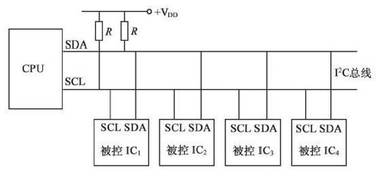
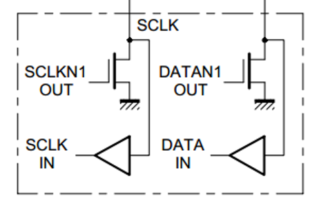
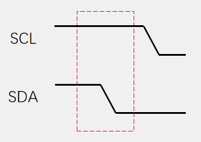
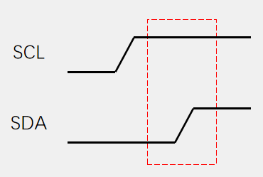
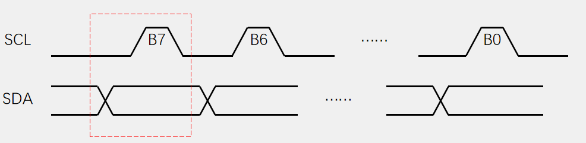
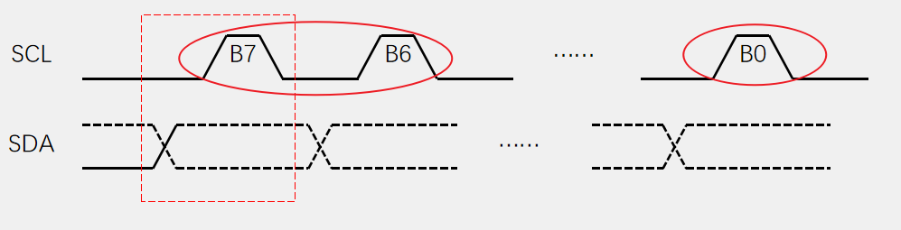
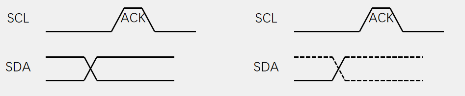
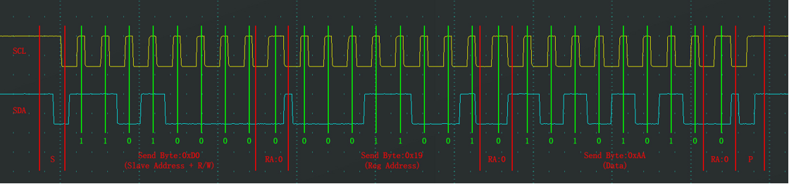
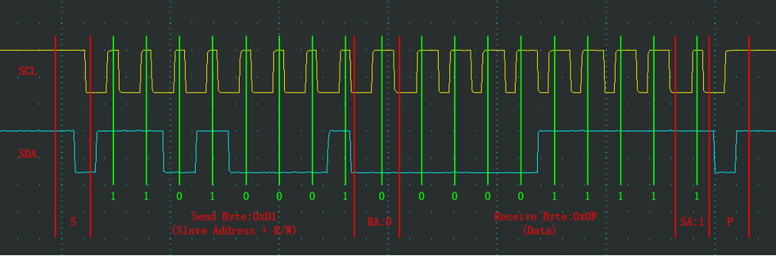
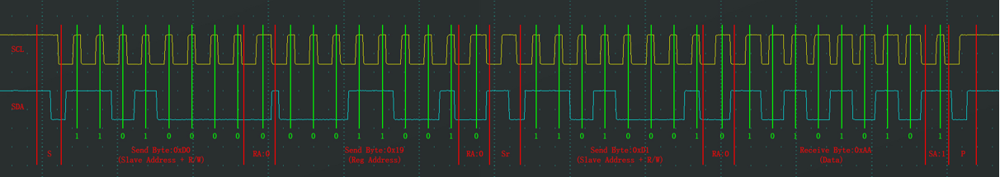

# Note for I2C
## 简介
- `I2C, Inter IC Bus`，一种通用数据总线；
- 两根通信线：`SCL(Serial Clock)` 和 `SDA(Serial Data)`；
- 同步通信，半双工通信；
- 带数据应答；
- 支持总线挂载多设备（一主多从、多主多从）；

## 硬件电路
- 所有 `I2C` 设备的 `SCL` 连在一起，`SDA` 连在一起；
- **设备的 `SCL` 和 `SDA` 都要配置成开漏输出默认**；
- `SCL` 和 `SDA` 各添加一个上拉电阻，阻值一般为 $4.7 \ K\Omega$ 左右；

## 基本时序
1. 起始时序
   - `SCL` 高电平期间，`SDA` 从高电平切换到低电平；
   
2. 终止时序
   - `SCL` 高电平期间，`SDA` 从低电平切换到高电平；
   
3. 发送一个字节
   - `SCL` 低电平期间，主机将数据位依次放到 `SDA` 数据线上（**高位先行**），然后释放 `SCL`；
   - 从机将在 `SCL` 高电平期间读取数据位；
   - `SCL` 高电平期间 `SDA` 不允许有数据变化，依次循环上述过程 8 次，即可发送一个字节；
   
4. 接收一个字节
   - `SCL` 低电平期间，从机将数据位依次放到 `SDA` 线上（**高位先行**），然后释放 `SCL`；
   - ...
   
5. 发送应答和接收应答
   - 发送应答：主机在接受完一个字节之后，在下一个时钟发送一位数据，**数据 0 表示应答，数据 1 表示非应答**；
   - 接收应答：主机在发送完一个字节之后，在下一个时钟接收一位数据，判断从机是否应答。数据 0 表示应答，数据 1 表示非应答（**主机在接收之前，需要释放 `SDA`**）。
   

## 通信过程
- 指定地址写：
  - 起始位；
  - 发送从机设备地址 + `W(0)` 位；
  - 从机应答（`0`）；
  - 发送从机内部地址；
  - 从机应答（`0`）；
  - 发送写入数据；
  - 从机应答（`0`）；
  - 停止位；
  
- 当前地址读：
  - 起始位；
  - 发送从机设备地址 + `R(1)` 位；
  - 从机应答（`0`）;
  - 接收数据；
  - 发送应答位（`0`，继续读取；`1`,读取结束）；
  - 读取结束，发送停止位；
  
- 指定地址读（通过指定地址写改变从机设备当前的读地址，然后再开始读过程）：
  - 起始位；
  - 发送从机设备地址 + `W(0)` 位；
  - 从机应答（`0`）;
  - 发送从机内部地址；
  - 从机应答（`0`）；
  - **起始位**；
  - 发送从机设备地址 + `R(1)` 位；
  - 从机应答（`0`）
  - 接收数据；
  - 发送应答位（`0`，继续读取；`1`,读取结束）；
  - 读取结束，发送停止位；
  

## I2C 数据传输速度

## 软件 I2C 和硬件 I2C
- 软件
  1. 软件模拟时将起始时序后 `SDA` 和 `SCL` 按照低电平处理；结束位反之；发送和接收数据的 `SCL` 时序在每处理一个位之后默认当作低电平处理；
  2. 软件 I2C 在接收数据时，需要先释放 `SDA`（将 `SDA` 置高，因为 `SDA` 具有线与逻辑）；

## reference
1. [江科大](https://www.bilibili.com/video/BV1th411z7sn?spm_id_from=333.788.videopod.episodes&vd_source=f87b1dc9ce95722a192942b341ae04d2&p=31)