# Note for STM32
## 简介
- STM32 系列
  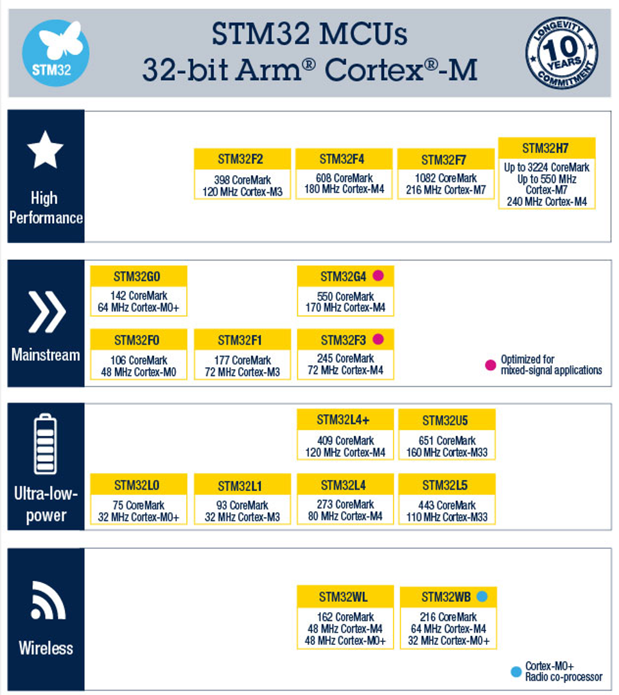
- ARM 家族架构信息
  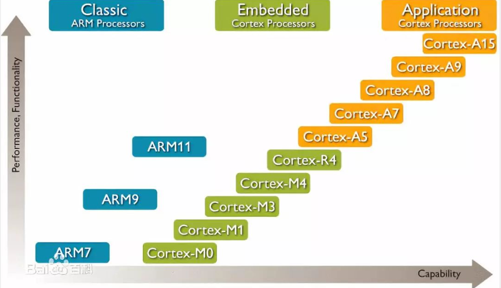
- `STM32F103C8T6`:
  - 系列：主流系列，`STM32F1`；
  - 内核：`ARM Cortex-M3`；
  - 主频：`72MHz`；
  - RAM: 20K(SRAM);
  - ROM: 64K(Flash);
  - 供电：2.0~3.6v（标准 3.3v）；
  - 封装：`LQFP48`；
  - 引脚定义
    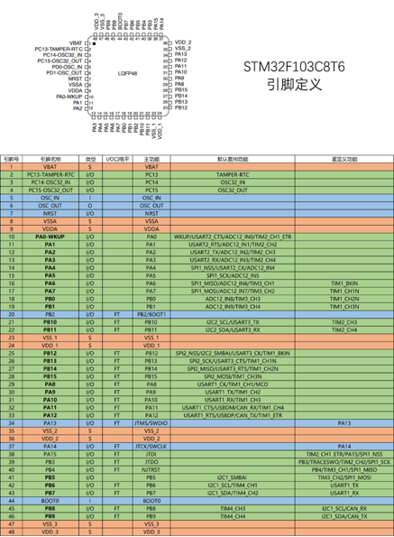
    - 红色-电源相关引脚、蓝色-最小系统相关引脚、绿色- `IO` 口、功能口相关引脚（正常工作起码需要电源和最小系统部分连接好）；
    - `S`：电源相关；
    - `IO` 口电平：`IO` 口所能容忍的电压，`FT, Five Tolarance` 表示可以容忍 5V 电压，无则表示只能容忍 3.3V；
    - 主功能：上电后的默认功能；
    - 默认复用功能：配置 `IO` 口时可以选择是通用 `IO` 口还是复用功能；
    - 重定义功能：如果有两个功能同时复用在了一个 `IO` 口上，可以把其中一个复用功能重映射到其他端口上，前提是这个重定义功能的表里有对应端口；
- 引脚介绍：
  - `VBAT`：备用电池供电引脚。当系统电源断电时，备用电池可以给内部的 `RTC` 时钟和备份寄存器提供电源；
  - `PC13-TAMPER-RTC`：可用作 `IO` 口或者侵入检测或者 `RTC`。侵入检测可以用来实现安全保障功能；`RTC` 引脚可以用来输出 `RTC` 校准时钟、`RTC` 闹钟脉冲或秒脉冲；
  - `PC14-OSC32_IN, PC15-OSC32_OUT`：可用作`IO` 口或者 `32.768KHz` （2 的 15 次方）的 `RTC` 晶振的输入输出端口；内部 `RTC` 电路经过 2 的 15 次方分频，就可以生成 1 秒的时间信号；
  - `OSC_IN, OSC_OUT`：用作系统主晶振的输入输出端口，一般为 `8MHz`，可通过内部锁相环电路倍频到 `72MHz`，以作为系统的主时钟；
  - `NRST`：系统复位引脚，`N` 表示低电平复位；
  - `VSSA, VDDA`：内部模式部分的电源，比如 `ADC, RC 震荡器`等。`VSS` 为负极，`VDD` 为正极；
  - `PA0-WKUP`：用作 `IO` 口或唤醒功能。可唤醒处于待机模式的 `STM32`；
  - `PB2/BOOT1`：可用于设置启动模式（`BOOT1` 时）；优先使用加粗的 `IO` 口；
  - `JTMS/SWDIO, JTCK/SWCLK, JTDI, JTDO, NJTRST`：`IO` 口（需额外配置）或调试端口，可用来调试程序和下载程序。支持 `SWD` 和 `JTAG` 两种调试方式，`SWD` （`STLink` 使用的方式）需要两根线：`SWDIO` 和 `SWCLK`；`JTAG` 需要五根线：`JTMS, JTCK, JTDI, JTDO, NJTRST`；
  - `BOOT0`：用作启动配置；
- 命名规则
  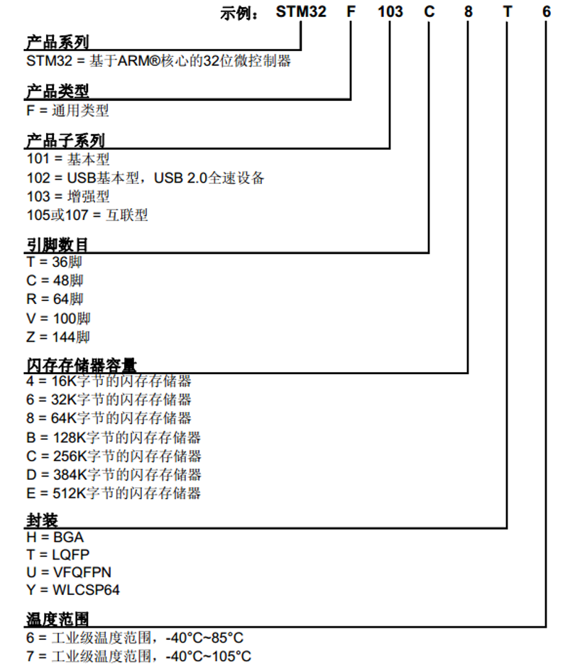
- 系统结构
  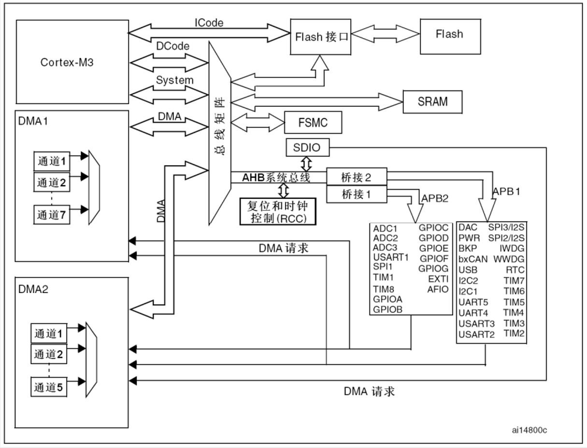
  来自 《STM32F10xxx参考手册》。
  - 内核：
    - `ICode`（指令总线）和 `DCode`（数据总线），连接`Flash`（存储程序）；
    - `System`（系统总线）：连接到 `SRAM`（存储程序运行时的数据）、`FSMC`、`AHB 系统总线`等；
  - `AHB`（外设相关）:
    `Advance High Performance Bus`，用于挂载主要的外设（最基本、性能较高的外设）：
    - 复位和时钟控制（`RCC`）；
    - `SDIO, Secure Digital Input/Output`；
    - 桥接电路，连接到 `APB, Advance Peripheral Bus`，`AHB` 性能总体比 `APB` 高一些，其中 `APB2` 的性能又比 `APB1` 高一些，`APB2` 和 `AHB` 一般同频率（都是 `72MHz`，`APB1` 一般是 `36MHz`）；
      - `APB2`：连接外设中更加重要的部分，如 `GPIO 端口`、一些外设的一号选手（`UASRT1`、`SPI1`、`TIM1`、`TIM8`）、`ADC`、`EXTI`、`AFIO`等；
      - `APB2`：其他编号外设、`DAC`、`PWR`、`BKP` 等；
  - `DMA`：
    执行数据搬运等工作，特点是简单重复；
    - 通过 `DMA` 总线连接到总线矩阵上；
    - 可以拥有和 `CPU` 一样的总线控制权，用于访问外设；
    - 当需要 `DMA` 搬运数据时，外设通过请求线与发送 `DMA` 请求，然后在 `DMA` 获得总线控制权后，访问并转运数据；整个过程无需 `CPU` 的参与，提高了 `CPU` 的工作效率；

## 启动配置
指定开始运行时的程序位置。一般情况下，程序都是在 `Flash` 程序存储器开始执行的，通过设置启动配置可以改变程序开始执行的位置。
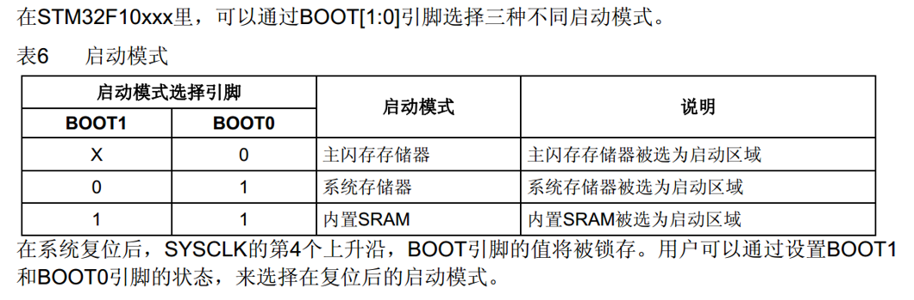
- 系统存储器存储了 `STM32` 中的一段 `Bootloader` 程序，其作用是接收串口的数据，然后刷新到主闪存（`Flash`）中，可用于串口下载程序；
- “在系统复位后，`SYSCLK` 的第 4 个上升沿，`BOOT` 引脚的值将被所存。用户可以通过设置 `BOOT1` 和 `BOOT0` 引脚的状态，来选择在复位后的启动模式”。说明 `BOOT` 引脚的值是在上电复位后的一瞬间有效的，之后就随便了（第 4 个时钟过后，`BOOT1` 转为 `PB2` 的功能）。

## 片上资源/外设（`peripheral`）：
`STM32F1` 整个系列的所有外设，并不是所有芯片都具有如下所有外设：
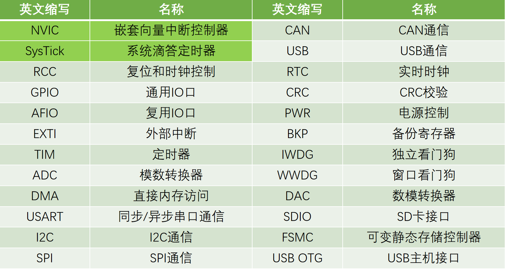
  - 深颜色为位于 `cortex` 内核里的外设；
  - 其他为内核外外设；

## `NVIC`
设置中断优先级等；

## `RCC`
`Reset and Clock Controller`，对系统的时钟进行控制以及使能各模块的时钟。在 `STM32` 中，其他的外设在上电的情况下默认是没有时钟的，此时操作外设无效，这样的目的是降低功耗。因此，在操作外设之前必须要先使能它的时钟。

## `EXTI`
外部中断/事件控制器。包含 19 个边沿检测器，用于产生中断/事件请求。

## `IWDG` 和 `WWDG`
看门狗就是处理器处理任务时，要定期完成喂狗操作，当程序死了，就相当于忘记去喂狗，狗饿死了，触发复位。

## 相关电路
- 最小系统电路
  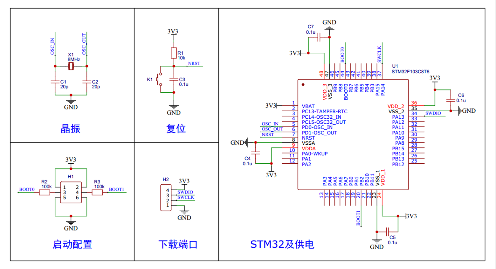
  - 电源部分的电容，用于提供供电电源的稳定；

## 裸机编程实操
### 开发方式
- 基于寄存器：直接操作寄存器；
- 基于函数库：使用 `ST` 官方提供的封装好的函数库，间接配置寄存器；
- 基于 `HAL` 库：图形化界面快速配置 `STM32`；

### 基于函数库的 STM32 开发
- 参考库函数用户手册或下述使用手册；
- 数据类型：
  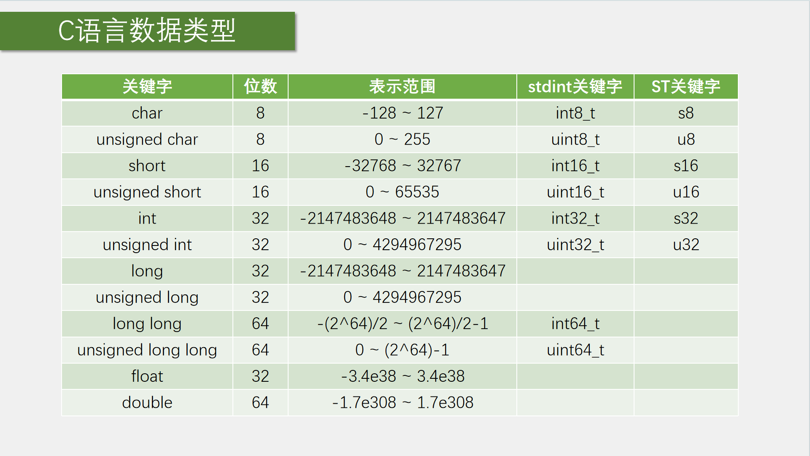
- 固件库 - `STM32F10x_StdPeriph_lib`
  - `Libraries`：库
    - `CMSIS`
    - `STM32F10x_StdPeriph_Driver`
  - `Project`：官方示例和模板；
  - `Utilies`：官方评估板的相关例程；
  - `Release_Notes`：发布文档，含版本说明等；
  - `stm32f10x_stdperiph_lib_um`：使用手册，含库函数使用说明等；
- `Keil` 新建工程（空）：
  - `New Project -> New uVision Project -> 选择本工程对应的文件夹 + 命名工程名 -> 选择器件型号 -> 跳过新建工程助手`；
  - 启动相关文件：
    - 启动文件（`固件库/Libraries/CMSIS/DeviceSupport/ST/STM32F10x/startup/arm/*`）：
    - `STM32` 的外设寄存器描述文件（`固件库/Libraries/CMSIS/DeviceSupport/ST/STM32F10x/stm32f10x.h`）和其他文件（主要用来配置系统时钟：`system_stm32f10x.c` 和 `system_stm32f10x.h`）；
    - 内核寄存器描述文件（`固件库/Libraries/CMSIS/CM3/CoreSupport/core_cm3.c 和 core_cm3.h`）；
  - 复制上述所有文件到新建工程中：新建文件夹 `Start`；
  - 在工程中新建目录（组） `Start`，添加启动文件工程中。其中，启动文件选择后缀为 `_md.s` 的文件（需要根据芯片型号(`Flash` 容量)来选择，`md` 表示中等容量），其余的 `.c` 和 `.h` 均添加进来：
    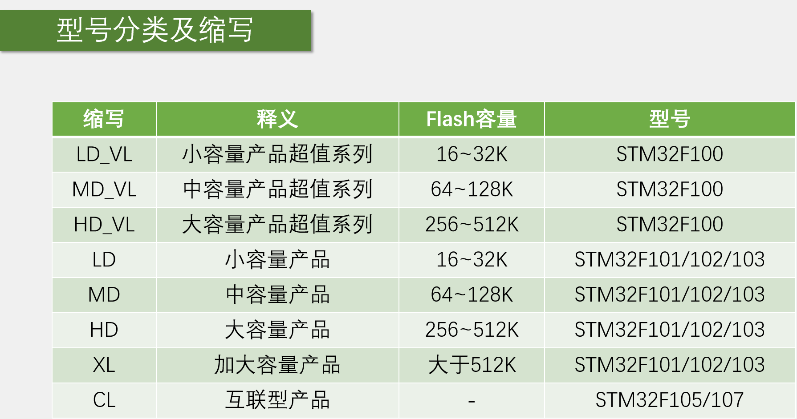
  - 添加相关文件的包含路径：`魔术棒 -> C/C++ -> Include Paths`；
  - 在工程文件夹下新建 `User`，项目入口 `main` （`main.c`）放到该位置，并在 `Keil` 工程做相应操作；
  - `main`：
    ```c
    #include "stm32f10x.h"

    int main(void){
      RCC->APB2ENR = 0x00000010;  // 使能时钟
      GPIOC->CRH = 0x00300000;    // GPIO 设置，电气属性、方向
      GPIOC->ODR = 0x00002000;    // 写数据，输出寄存器
      while (1) {

      }
    }

    ```
  - 调试器选择：`魔术棒 -> Debug -> Use 选择 ST-Link Debugger`，并点击 `Settings`，在 `Flash Download` 中勾选 `Reset and Run`（下载程序后会立马复位并执行）；
  - 添加其他函数，新建 `Library` 文件夹（本地目录和工程目录），添加固件库中的 `.../Libraries/STM3210x_StdPeriph_Driver/src/*`，其中 `misc.c`（混杂）为内核库函数，其他为内核外的库函数；同理，将与 `src` 同级的 `inc/*` 复制到工程中；
  - 添加 `.../Project/STM32F10x_StdPeriph_Template` 下的 `stm32f10x_conf.h`（用来配置库函数头文件的包含关系，以及用来参数检查的函数定义，所有库函数都需要）、`stm32f10x_it.c` 和 `stm32f10x_it.h`（中断相关）（`main.c` 也可同时复制，这样上述的 `main.c` 就不用创建了）到 `User` 目录下；
  - 添加宏定义以包含标准外设库，在 `魔术棒 -> C/C++ -> Define` 中添加 `USE_STDPERIPH_DRIVER`（与 `stm32f10x.h` 中的条件编译相关）；
  - 完善头文件包含路径；
  ```c
  #include "stm32f10x.h"

  int main(void){
    RCC_APB2PeriphClockCmd(RCC_APB2Periph_GPIOC, ENABLE);
    GPIO_InitTypeDef GPIO_InitStructure;
    GPIO_InitStructure.GPIO_Mode = GPIO_Mode_Out_PP;    // 推挽输出
    GPIO_InitStructure.GPIO_Pin = GPIO_Pin_13;
    GPIO_InitStructure.GPIO_Speed = GPIO_Speed_50MHz;
    GPIO_Init(GPIOC, &GPIO_InitStructure);
    // GPIO_SetBits(GPIOC, GPIO_Pin_13);
    GPIO_ResetBis(GPIOC, GPIO_Pin_13);
    while (1) {

    }
  }

  ```
  - 其他设置：右上角扳手图标；
- 工程架构
  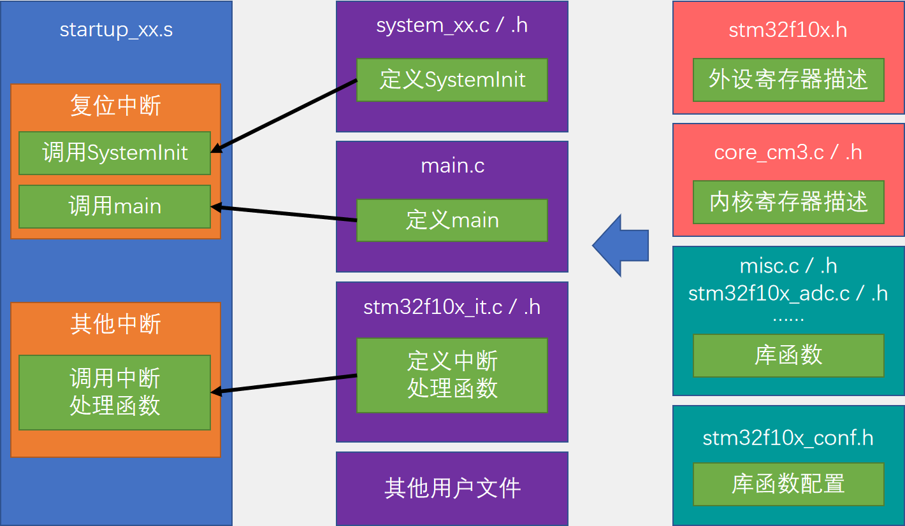
  - `startup_xxx.s`：
    ```asm
    Reset_Handler   PROC
                    EXPORT    Reset_Handler     [WEAK]
          IMPORT  _main
          IMPORT  SystemInit
                    LDR   R0, =SystemInit
                    BLX   R0
                    LDR   R0, =_main
                    BX    R0
                    ENDP
    ```
    - `SystemInit` -> `system_xx.c/.h`，Setup the microcontroller system, Initialize the Embedded Flash Interface, the PLL and update the SystemCoreClock variable；
  - 在 `stm32f10x.h` 在对 `stm32f10x_conf.h` 进行条件编译；
- 中间文件的删除 `keilkill`
  ```bat
  del *.bak /s
  del *.ddk /s
  del *.edk /s
  del *.lst /s
  del *.lnp /s
  del *.mpf /s
  del *.mpj /s
  del *.obj /s
  del *.omf /s
  ::del *.opt /s  ::不允许删除JLINK的设置
  del *.plg /s
  del *.rpt /s
  del *.tmp /s
  del *.__i /s
  del *.crf /s
  del *.o /s
  del *.d /s
  del *.axf /s
  del *.tra /s
  del *.dep /s           
  del JLinkLog.txt /s

  del *.iex /s
  del *.htm /s
  del *.sct /s
  del *.map /s
  exit
  ```
- `Keil` 快捷方式
  - `ctrl + alt + space`：代码提示；

### GPIO 部分
- GPIO, General Purpose Input Output，通用输入输出口；
- 可配置为 8 种输入输出模式；
- 引脚电平：0~3.3V，部分引脚可容忍 5V；
- 输出模式下可控制端口输出高低电平，用以驱动 LED、控制蜂鸣器、模拟通信协议输出时序等；
- 输入模式下可读取端口的高低电平或电压，用于读取按键输入、外接模块电平信号输入、ADC 电压采集、模拟通信协议接收数据等；
- GPIO 的基本结构：
  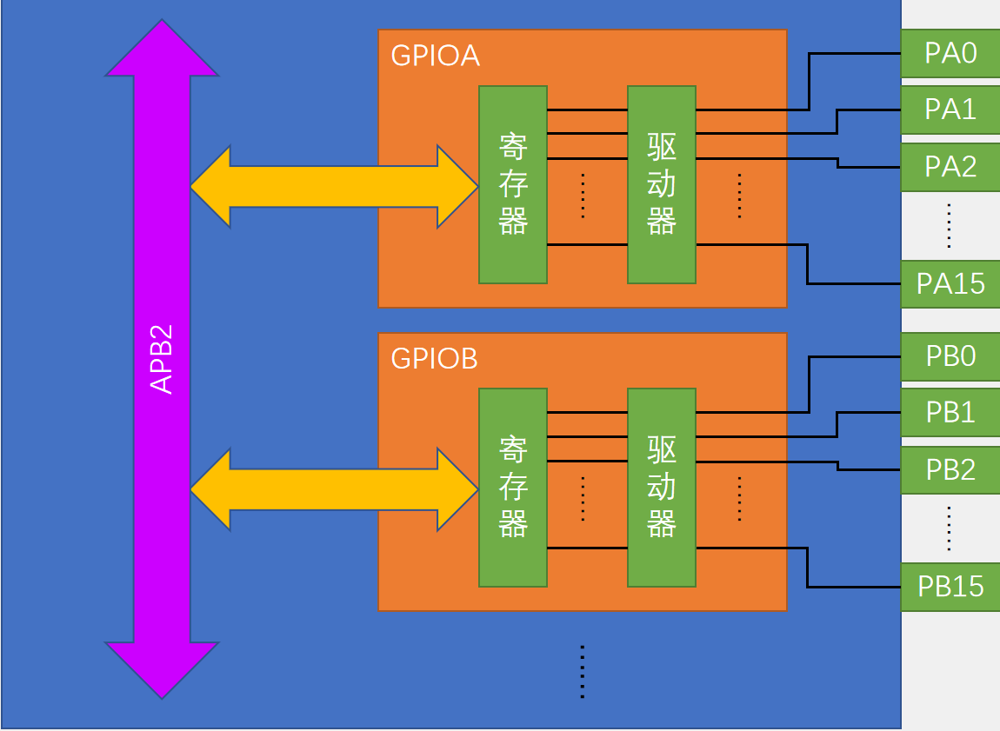
  - `STM32` 的所有 GPIO 均挂载在 `APB2` 外设总线上；
  - 每个 GPIO 外设具有 16 个引脚；
  - 在每个 GPIO 模块内包含有寄存器、驱动器。内核通过 APB2 总线对寄存器进行读写，寄存器（32 位寄存器，只有低 16 位有端口）的每一位对应一个引脚。其中对输出寄存器写 1，对应的引脚输出高电平，写 0 则输出低电平；输入寄存器读取相应引脚，高电平为 1，低电平为 0。驱动器的功能是用于增加输出信号的驱动能力；
- GPIO 端口位的基本结构
  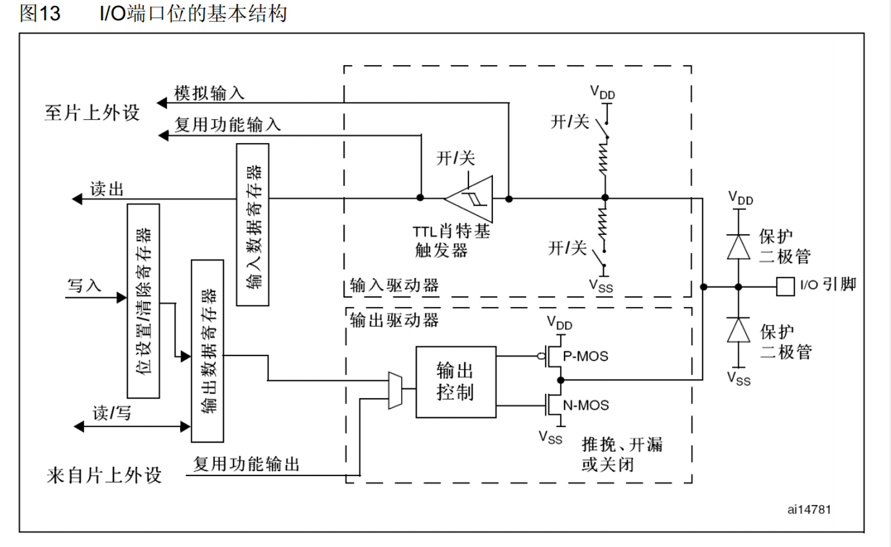
  - 结构上，上面对应输入、下面对应输出；
  - 输入部分：
    - I/O 引脚处的保护二极管用于对输入电压进行限幅，上面二级管接 VDD（3.3V），下面二极管接 VSS（0V）。当输入电压高于 3.3V 时，上方二极管导通，电流流入 VDD，避免过高的电压对内部电路造成损害；当输入电压比 0V 低时，下方二极管导通，电流从 VSS 流出，而不会从内部电路汲取电流，也能够起到对内部电路的保护作用；当电压处于 0~3.3V 之间，两个二极管均不会导通，它们对电路没有影响；
    - 上下拉开/关（图中右上角），用于给输入提供一个默认的输入电平。悬空情况下，引脚的输入电平极易受到外界干扰而改变。为了避免引脚悬空导致的输入数据不确定，需要加上上拉或者下拉电阻。上拉输入-默认高电平输入（当引脚悬空时，端口为高电平）；下拉输入-默认为低电平输入。为弱上拉和弱下拉（电阻阻值较大），目的是不影响正常的输入操作；
    - 肖特基触发器（实际应为施密特触发器），用于对输入电压进行整形（如果输入电压大于某一阈值，输出变为高电平；如果输入电压小于某一个阈值，输出变为低电平。两个阈值可以有效地避免因信号波动造成的输出抖动现象）；
    - 经过施密特触发器整形过的数据即可写入输入数据寄存器；
    - 模拟输入可连接到 ADC 输入，它的对应信号未经过施密特触发器的处理；
    - 复用端口输入用于连接到其他需要读取端口的外设上，比如串口的输入引脚等，它也是一个数字量，需要经过施密特触发器的处理；
  - 输出部分：
    - 输出数据可源于输出数据寄存器（普通的I/O 口输出）和片上外设，通过数据选择器进行选择；
    - 位设置/清除寄存器可用于单独操作输出数据寄存器的某一位而不影响其他位（输出数据寄存器只能通过整体读写的方式直接操作，具有三种方式对其进行操作：先读再写、通过位带区域进行读写、通过位设置/清除寄存器直接一步到位进行操作：需要对某一位置 1 时，在位设置寄存器种对应的位写 1 即可，其他不需要操作的位写 0，只会对数据寄存器中写 1 的位进行置位，其他位不受影响；同理，对位清除寄存器预清除位写 1 即可完成清零操作）；
    - 位带区域，在 `STM32`（`M3`） 中专门分配了一段地址区域，这段地址映射了 RAM 和外设寄存器所有的位，读写这段地址中的数据，就相当于读写所映射位置的某一位；
    - 根据 `MOS` 管的是否有效，分为三种模式：推挽输出、开漏输出、关闭
      - 推挽输出：此时，`P-MOS` 和 `N-MOS` 均有效。输出数据寄存器为 1 时，`P-MOS` 导通、`N-MOS` 断开，I/O 端口输出为高电平；输出寄存器为 0 时，则相反。**在该模式下，高低电平都具有较强的驱动能力**，所以推挽输出模式也可以叫强推输出模式；
      - 开漏输出：`P-MOS` 无效，只有 `N-MOS` 工作。输出数据寄存器为 1 时，`N-MOS` 断开，这时输出相当于断开，即**高阻模式**。数据寄存器为 0 时，输出低电平（VSS）。在该模式下，**只有低电平有驱动能力**，高电平没有驱动能力。**可以作为通信协议的驱动方式**，如 `I2C` 的通信引脚就是使用开漏模式。**在多机通信的情况下，该模式可以避免各个设备的相互干扰**。此外，该模式还可用于输出 5V 电平信号，比如在 I/O 外接一个上拉电阻到 5V 的电源，当输出低电平时，由内部的 VSS 作为输出；当输出高电平时，由外部的上拉电阻拉高至 5V；
      - 关闭：当引脚配置为输入模式时，两个 `MOS` 均断开，此时端口的电平由外部输入控制；
- GPIO 模式
  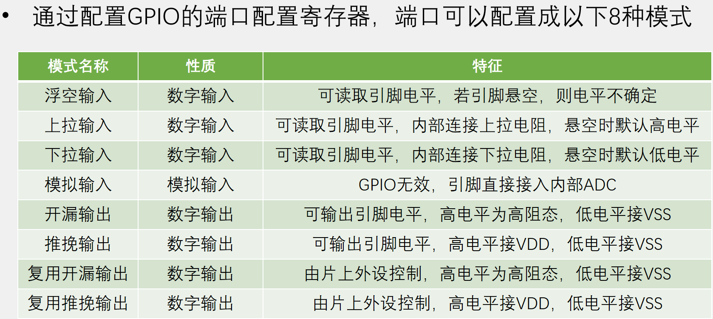
  - 在使用浮空输入时，端口一定要接上一个连续的驱动源，不能出现悬空的状态；
  - 浮空/上拉/下拉输入
    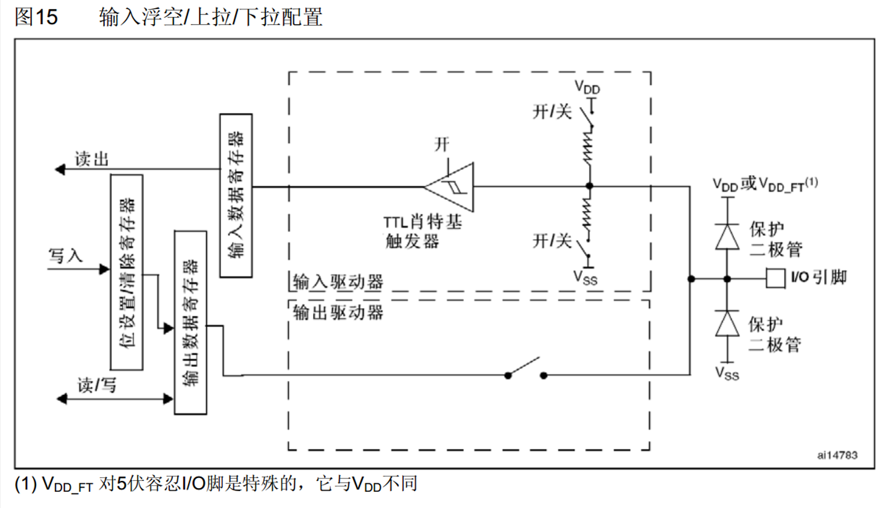
  - 模拟输入
    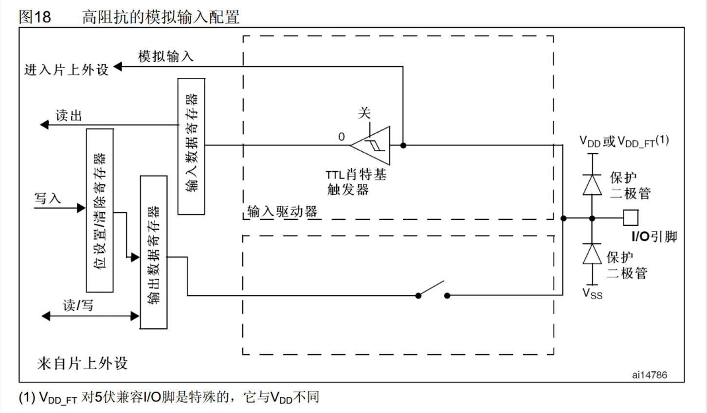
    - 在 8 个模式中，只有该模式会关闭数字输入；
  - 开漏/推挽输出
    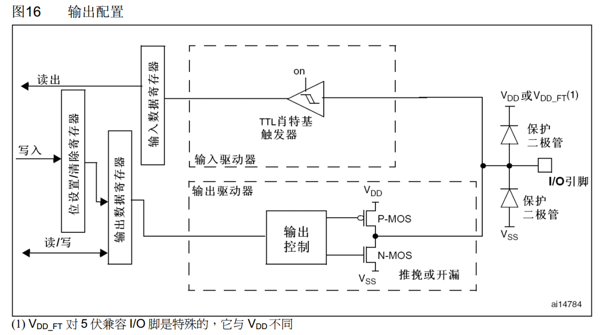
    - 此时输出接到输出数据寄存器上；
    - 此时输入也是有效的（输入时，输出是断开的）；
  - 复用开漏/复用推挽
    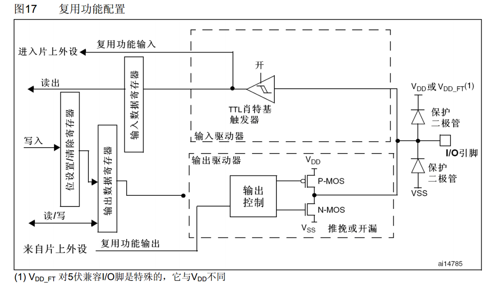
    - 此时输出接到片上外设；
    - 此时输入也是有效的（输入时，输出是断开的）；
- GPIO 输出速度，限制输出引脚的最大翻转速度，主要为了低功耗和稳定性；
- 可以使用同时具有位设置和位清除功能的寄存器，以保证信号的同步性；
- 很多单片机都使用**高电平弱驱动、低电平强驱动**的规则；
- 编程：
  - `stm32f10x_rcc.h/c`： `rcc` 相关函数；
  - `stm32f10x_gpio.h/c`： `gpio` 相关函数；
  - `GPIO` 输出——`LED` 闪烁、`LED` 流水灯和蜂鸣器
    - `System` 文件夹存放延时相关函数`Delay.c/h`，同时添加相关头文件路径；`todo`：延时函数解析
    - 闪烁
      ```c
      #include "stm32f10x.h"
      #include "Delay.h"

      int main(void) {
        RCC_APB2PeriphClockCmd(RCC_APB2Periph_GPIOA, ENABLE);

        GPIO_InitTypeDef GPIO_InitStructure;
        GPIO_InitStructure.GPIO_Mode = GPIO_Mode_Out_PP;  // 推挽输出
        GPIO_InitStructure.GPIO_Pin = GPIO_Pin_0;
        GPIO_InitStructure.GPIO_Speed = GPIO_Speed_50MHz;
        GPIO_Init(GPIOA, &GPIO_InitStructure);

        while (1) {
          GPIO_ResetBits(GPIOA, GPIO_Pin_0);
          Delay_ms(500);
          GPIO_SetBits(GPIOA, GPIO_Pin_0);
          Delay_ms(500);

          GPIO_WriteBit(GPIOA, GPIO_Pin_0, Bit_RESET);
          Delay_ms(500);
          GPIO_WriteBit(GPIOA, GPIO_Pin_0, Bit_SET);
          Delay_ms(500);

          GPIO_WriteBit(GPIOA, GPIO_Pin_0, (BitAction)0);
          Delay_ms(500);
          GPIO_WriteBit(GPIOA, GPIO_Pin_0, (BitAction)1);
          Delay_ms(500);
        }
      }
      ```
      - 推挽模式下，二极管在低电平点亮和高电平点亮下都能正常闪烁；
      - 开漏模式下，二极管在高电平点亮下不能闪烁（开漏输出模式在高电平下没有驱动能力），低电平下可闪烁；
    - 流水灯
      ```c
      #include "stm32f10x.h"
      #include "Delay.h"

      int main(void) {
        RCC_APB2PeriphClockCmd(RCC_APB2Periph_GPIOA, ENABLE);

        GPIO_InitTypeDef GPIO_InitStructure;
        GPIO_InitStructure.GPIO_Mode = GPIO_Mode_Out_PP;
        GPIO_InitStructure.GPIO_Pin = GPIO_Pin_All;
        GPIO_InitStructure.GPIO_Speed = GPIO_Speed_50MHz;
        GPIO_Init(GPIOA, &GPIO_InitStructure);

        while (1) {
          GPIO_Write(GPIOA, ~0x0001);     // 0000 0000 0000 0001
          Delay_ms(500);
          GPIO_Write(GPIOA, ~0x0002);     // 0000 0000 0000 0010
          Delay_ms(500);
          GPIO_Write(GPIOA, ~0x0004);     // 0000 0000 0000 0100
          Delay_ms(500);
          GPIO_Write(GPIOA, ~0x0008);     // 0000 0000 0000 1000
          Delay_ms(500);
          GPIO_Write(GPIOA, ~0x0010);     // 0000 0000 0001 0000
          Delay_ms(500);
          GPIO_Write(GPIOA, ~0x0020);     // 0000 0000 0010 0000
          Delay_ms(500);
          GPIO_Write(GPIOA, ~0x0040);     // 0000 0000 0100 0000
          Delay_ms(500);
          GPIO_Write(GPIOA, ~0x0080);     // 0000 0000 1000 0000
          Delay_ms(500);
        }
      }
      ```
    - 蜂鸣器
      ```c
      #include "stm32f10x.h"
      #include "Delay.h"

      int main(void) {
        RCC_APB2PeriphClockCmd(RCC_APB2Periph_GPIOB, ENABLE);

        GPIO_InitTypeDef GPIO_InitStructure;
        GPIO_InitStructure.GPIO_Mode = GPIO_Mode_Out_PP;  // 推挽输出
        GPIO_InitStructure.GPIO_Pin = GPIO_Pin_12;
        GPIO_InitStructure.GPIO_Speed = GPIO_Speed_50MHz;
        GPIO_Init(GPIOB, &GPIO_InitStructure);

        while (1) {
          GPIO_ResetBits(GPIOB, GPIO_Pin_12);
          Delay_ms(100);
          GPIO_SetBits(GPIOB, GPIO_Pin_12);
          Delay_ms(100);
          GPIO_ResetBits(GPIOB, GPIO_Pin_12);
          Delay_ms(100);
          GPIO_SetBits(GPIOB, GPIO_Pin_12);
          Delay_ms(700);
        }
      }
      ```
  - `GPIO` 输入——按键控制 `LED` 和光敏传感器控制蜂鸣器
    - 按键抖动
      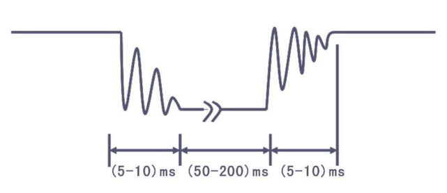
    - 增加 `Hardware` 文件夹用于存放硬件驱动相关代码，以及相关头文件路径的包含；
    - `LED.c/h`：
      ```c
      /*
       * LED.h
       */
      #ifndef __LED_H
      #define __LED_H

      void LED_Init(void);
      void LED1_ON(void);
      void LED1_OFF(void);
      void LED2_ON(void);
      void LED2_OFF(void);
      void LED1_Turn(void);
      void LED2_Turn(void);

      #endif

      /*
       * LED.c
       */
       #include "stm32f10x.h"

       void LED_Init(void) {
        RCC_APB2PeriphClockCmd(RCC_APB2Periph_GPIOA, ENABLE);

        GPIO_InitTypeDef GPIO_InitStructure;
        GPIO_InitStructure.GPIO_Mode = GPIO_Mode_Out_PP;
        GPIO_InitStructure.GPIO_Pin = GPIO_Pin_1 | GPIO_Pin_2;
        GPIO_InitSturcture.GPIO_Speed = GPIO_Speed_50MHz;
        
        GPIO_Init(GPIOA, &GPIO_InitStructure);
        GPIO_SetBits(GPIOA, GPIO_Pin_1 | GPIO_Pin_2);
       }

       void LED1_ON(void) {
        GPIO_ResetBits(GPIOA, GPIO_Pin_1);
       }

       void LED1_OFF(void) {
        GPIO_SetBits(GPIOA, GPIO_Pin_1);
       }

       void LED1_Turn(void) {
        if (GPIO_ReadOutputDataBit(GPIOA, GPIO_Pin_1) == 0) {
          GPIO_SetBits(GPIOA, GPIO_Pin_1);
        }else {
          GPIO_ResetBits(GPIOA, GPIO_Pin_1);
        }
       }

       void LED2_ON(void) {
        GPIO_ResetBits(GPIOA, GPIO_Pin_2);
       }

       void LED2_OFF(void) {
        GPIO_SetBits(GPIOA, GPIO_Pin_2);
       }

       void LED2_Turn(void) {
        if (GPIO_ReadOutputDataBit(GPIOA, GPIO_Pin_2) == 0) {
          GPIO_SetBits(GPIOA, GPIO_Pin_2);
        }else {
          GPIO_ResetBits(GPIOA, GPIO_Pin_2);
        }
       }
      ```
    - `Key.c/h`
      ```c
      /*
       * Key.h
       */
      #ifndef __KEY_H_
      #define __KEY_H_
      
      void Key_Init(void);
      uint8_t Key_GetNum(void);

      #endif // !__KEY_H_

      /*
       * Key.c
       */
      #include "stm32f10x.h"
      #include "Delay.h"

      void Key_Init(void) {
        RCC_APB2PeriphClockCmd(RCC_APB2Periph_GPIOB, ENABLE);

        GPIO_InitTypeDef GPIO_InitStructure;
        GPIO_InitStructure.GPIO_Mode = GPIO_Mode_IPU;   // 上拉输入
        GPIO_InitStructure.GPIO_Pin = GPIO_Pin_1 | GPIO_Pin_11;
        GPIO_InitStructure.GPIO_Speed = GPIO_Speed_50MHz;   // 输入模式下无效果

        GPIO_Init(GPIOB, &GPIO_InitStructure);
      }

      uint8_t Key_GetNum(void) {
        uint8_t KeyNum = 0;
        if (GPIO_ReadInputDataBit(GPIOB, GPIO_Pin_1) == 0) {
          Delay_ms(20);
          while (GPIO_ReadInputDataBit(GPIOB, GPIO_Pin_1) == 0);
          Delay_ms(20);
          KeyNum = 1;
        }
        if (GPIO_ReadInputDataBit(GPIOB, GPIO_Pin_11) == 0) {
          Delay_ms(20);
          while(GPIO_ReadInputDataBit(GPIOB, GPIO_Pin_11) == 0);
          Delay_ms(20);
          KeyNum = 2;
        }

        return KeyNum;
      }
      ```
    - `Buzzer.c/h`
      ```c
      /*
       * Buzzer.h
       */
       #ifndef __BUZZER_H
       #define __BUZZER_H

       void Buzzer_Init(void);
       void Buzzer_ON(void);
       void Buzzer_OFF(void);
       void Buzzer_TURN(void);

       #endif // !__BUZZER_H
      /*
       * Buzzer.c
       */
       #include "stm32f10x.h"

       void Buzzer_Init(void) {
        RCC_APB2PeriphClockCmd(RCC_APB2Periph_GPIOB, ENABLE);

        GPIO_InitTypeDef GPIO_InitStructure;
        GPIO_InitStructure.GPIO_Mode = GPIO_Mode_Out_PP;
        GPIO_InitStructure.GPIO_Pin = GPIO_Pin_12;
        GPIO_InitSturcture.GPIO_Speed = GPIO_Speed_50MHz;
        
        GPIO_Init(GPIOB, &GPIO_InitStructure);
        GPIO_SetBits(GPIOB, GPIO_Pin_12);
       }

       void Buzzer_ON(void) {
        GPIO_ResetBits(GPIOB, GPIO_Pin_12);
       }

       void Buzzer_OFF(void) {
        GPIO_SetBits(GPIOB, GPIO_Pin_12);
       }

       void Buzzer_Turn(void) {
        if (GPIO_ReadOutputDataBit(GPIOB, GPIO_Pin_12) == 0) {
          GPIO_SetBits(GPIOB, GPIO_Pin_12);
        }else {
          GPIO_ResetBits(GPIOB, GPIO_Pin_12);
        }
       }
      ```
    - `LightSensor`
      ```c
      /*
       * LightSensor.h
       */
       #ifndef __LIGHTSENSOR_H_
       #define __LIGHTSENSOR_H_

       void LightSensor_Init(void);
       uint8_t LightSensor_Get(void);

       #endif // !__LIGHTSENSOR_H_
      /*
       * LightSensor.c
       */
       #include "stm32f10x.h"

       void LightSensor_Init(void) {
        RCC_APB2PeriphClockCmd(RCC_APB2Periph_GPIOB, ENABLE);

        GPIO_InitTypeDef GPIO_InitStructure;
        GPIO_InitStructure.GPIO_Mode = GPIO_Mode_Out_IPU;
        GPIO_InitStructure.GPIO_Pin = GPIO_Pin_13;
        GPIO_InitSturcture.GPIO_Speed = GPIO_Speed_50MHz;
        
        GPIO_Init(GPIOB, &GPIO_InitStructure);
       }

       uint8_t LightSensor_Get(void) {
        return GPIO_ReadInputDataBit(GPIOB, GPIO_Pin_13);
       }
      ```
    - `main.c`
      ```c
      #include "stm32f10x.h"
      #include "Delay.h"
      #include "LED.h"
      #include "Key.h"
      #include "Buzzer.h"
      #include "LightSensor.h"

      uint8_t KeyNum;

      int main(void) {
        LED_Init();
        Key_Init();
        Buzzer_Init();
        LightSensor_Init();

        while (1) {
          KeyNum = Key_GetNum();
          if (KeyNum == 1) {
            LED1_Turn();
          }
          if (KeyNum == 2) {
            LED2_Turn();
          }

          if (LightSensor_Get() == 1) {
            Buzzer_ON();
          } else {
            Buzzer_OFF();
          }
        }
      }
      ```

## todo
- 位寻址、寻址方式

## 参考
- [江科大视频](https://www.bilibili.com/video/BV1th411z7sn?spm_id_from=333.788.videopod.episodes&vd_source=f87b1dc9ce95722a192942b341ae04d2&p=2)
