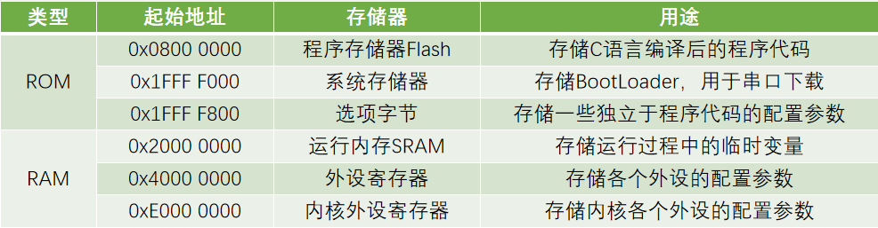
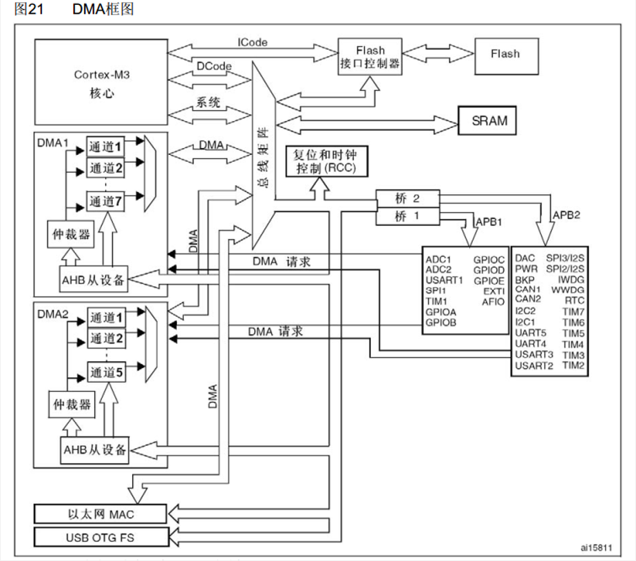
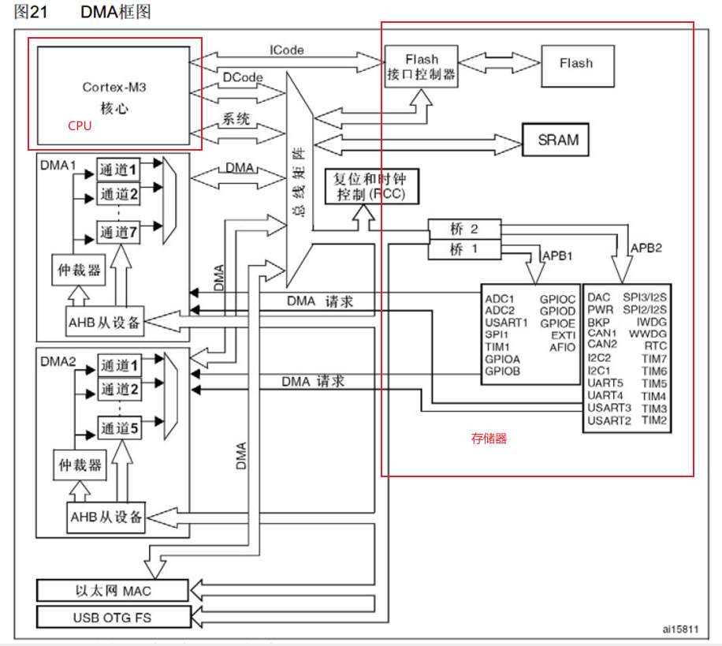
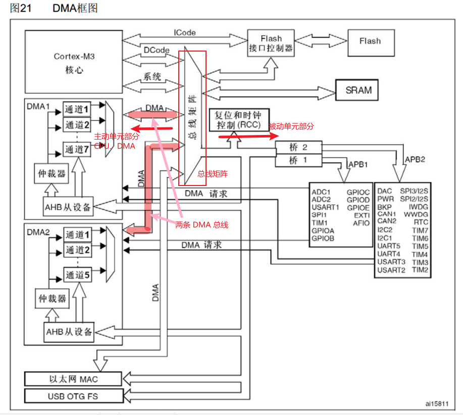
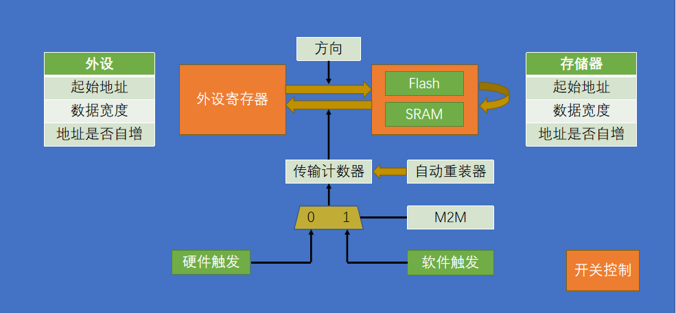
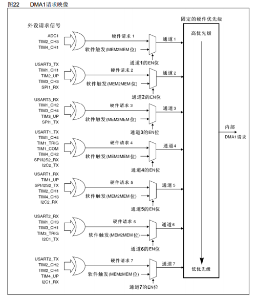
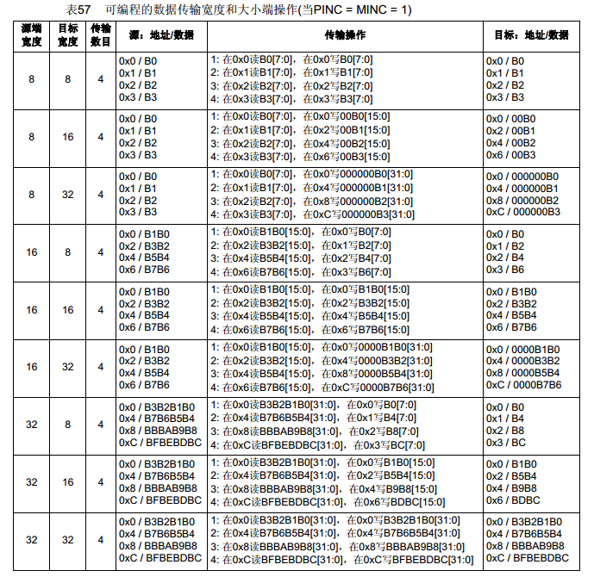
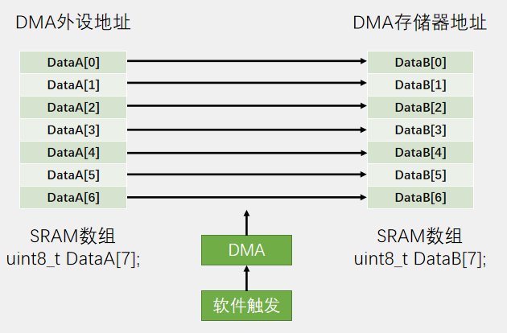
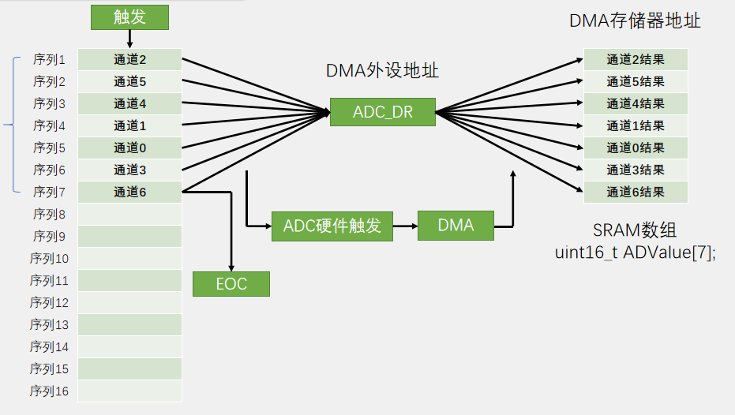

# DMA
DMA, Direct Memory Access，直接存储器访问。

## 特点
- 可直接访问 STM32 内部的存储器，包括运行**内存 SRAM、程序存储器 Flash 和寄存器等**；
- 可以提供外设和存储器、存储器和存储之间的**高速数据传输，无须 CPU 干预**，节省了 CPU 资源；
- **复制转运**；
- 12 个独立可配置的通道：DMA1（7 个通道），DMA2（5 个通道）；
  - **通道，数据转运的路径**。数据从某一位置转运到另一位置需要占用一个通道，如果有多个通道进行转运，那它们之间可以各转各的，互不干扰；
  - **每个通道都支持软件触发和特定的硬件触发**。存储器到存储器的转运一般使用软件触发、外设到存储器的数据转运一般使用硬件触发。“特定”是指每**个 DMA 的通道，其硬件触发源是不一样的**；

## 存储器映像
STM32 存储器映像


## DMA 框图详解
如下是 DMA 框图：


- 模块划分：
    
    - CPU: 即 Cortex-M3 内核（运算器 + 控制器部分）；
    - 存储器：包括主存储器 flash、运行内存 SRAM 和外设寄存器；
    - 补充：寄存器也是一种 SRAM 存储器。是特殊的存储器，一方面 CPU 可以对寄存器进行读写，另一方面寄存器的每一位背后都连接了一根导线，这些导线可以用来控制外设电路的状态（例如置引脚的高低电平、导通/断开开关、切换数据选择器、多位组合成计数器、数据寄存器等等）。因此，**寄存器是连接软件和硬件的桥梁**，软件读写寄存器就相当于在控制硬件的运行；
    - 补充：计算机系统的五大组成部分：运算器、控制器、存储器、输入和输出设备。运算器 + 控制器 = CPU，存储器：存储器内容和地址。

- 总线矩阵
    为了高效有条理地访问存储器，设计了总线矩阵。
    
    - 主动单元：总线矩阵左端，拥有存储器的访问权；
      - 内核有 `DCode` 和系统总线，用于访问右边的存储器；
        - `DCode`，即数据总线，专用于访问 Flash；
        - 系统总线用于其他存储器的访问；
      - 由于 DMA 要转运数据，所以 DMA 也必须要有访问的主动权；
        - 多个通道：各个通道都可以设置自身的源地址和目的地址，这样它们就可以各自独立地工作了；
        - 仲裁器（DMA）：多个通道共享同一条 DMA 总线、所有通道对 DMA 总线的分时复用。若有通道间的冲突，则通过仲裁器根据通道的优先级来决定 DMA 总线的使用权；
        - 仲裁器（总线矩阵）：如果 DMA 和 CPU 都要求使用总线，DMA 可以暂停 CPU 的使用，以防止冲突。不过总线仲裁器仍会保证 CPU 得到一半的总线带宽，使 CPU 也能正常地工作；**DMA 控制器和 Cortex-M3 核心共享系统数据总线，执行直接存储器数据传输。当 CPU 和 DMA 同时访问相同的目标（RAM 或外设时），DMA 请求会暂停 CPU 访问系统总线达若干个周期，总线仲裁器执行循环调度，以保证 CPU 至少可以得到一半的系统总线（存储器或外设）带宽**；
    - 被动单元：总线矩阵右端，相关存储器只能被左边的主动单元读写；
      - DMA（AHB 从设备）：DMA 作为一个外设，它自己也会有相应的配置寄存器，这里连接到了总线矩阵右边的 AHB 总线上；
    - 综上，DMA 既是总线矩阵的主动单元，可以读写各种存储器；也是 AHB 总线上的被动单元，从而可对 DMA 进行配置；

- DMA 请求
    DMA 请求即 DMA 的**硬件触发源**，如 ADC 转换完成、串口接收到数据等，需要触发 DMA 转运数据的时候，就会通过 DMA 请求线路向 DMA 发出硬件触发信号，之后 DMA 就可以执行数据转运的工作了。

- 补充：
  - Flash：如果通过总线直接访问的话，无论是 CPU 还是 DMA，都是只读的，只能读取数据而不能写入；如果 DMA 转运的目的地址为 Flash 区域，则转运会出错。可以通过配置 Flash 接口控制器，对 Flash 进行写入（需先对 Flash 按页进行擦除，再写入数据）。
  - SRAM：可以任意读写；
  - 外设寄存器：有的寄存器是只读的，有的寄存器是只写的。常用数据寄存器，可正常读写；

## 基本结构
DMA 基本结构


参数内容包括：
- 方向（DMA 数据转运方向）：
  - 可以是：从外设到存储器、从存储器到外设、存储器到存储器（Flash 到 SRAM、SRAM 到 SRAM）；
  - 不可以是：SRAM 到 Flash、Flash 到 Flash（Flash 只读）；
- 传输地址（外设、存储器）
  - 起始地址：源起始地址和目的起始地址；
  - 数据宽度：指定一次转运按多大的数据宽度来进行（一次转运多大的数据量），可以选择的值有：Byte-8, HalfWord-16, Word-32；
  - 地址是否自增：指定一次转运完成后，下一次的地址是否要移动到下一个位置去；
- 传输计数器：
  - 指定总共需要转运几次；
  - 当计数器值为 0 时，DMA 转运结束。**同时，之前自增的地址也会恢复到起始地址的位置**，以方便之后 DMA 开始新一轮的转运；
  - 是自减计数器；
- 自动重装器：
  - **决定转运的模式，单次模式或循环模式**；
  - 传输计数器减到 0 之后，是否要自动恢复到最初的值。例如计数器值为 5，在不使用自动重装器的情况下，计数器减到 0 后，DMA 转运结束；在使用自动重装器时，计数器减到 0 后被立即重置到初始值 5。

触发控制
- 触发方式由 `M2M, Memory 2 Memory` 这个参数（位）决定：
  - 0-硬件触发；
  - 1-软件触发；
- 硬件触发
  - 触发源可以选择 ADC、串口、定时器等等；
  - 使用硬件触发的转运，一般都是与外设有关的转运；
- 软件触发
  - 并不是调用某个函数一次，触发一次。软件触发逻辑是，以最快的速度，连续不断地触发 DMA，争取早日把传输计数器清零，完成这一轮的转换；
  - **软件触发不能和循环模式同时使用**，同时用导致 DMA 停不下来（软件触发将计数器清零，循环模式将计数器重置为初始值，如此不断循环）；
  - **软件触发一般适用于存储器到存储器的转运**；

开关控制
当给 DMA 使能后，DMA 就准备继续，可以进行转运了。
- 转运条件：
  - DMA 使能；
  - 传输计数器必须大于 0；
  - 触发源，有触发信号（触发一次，转运一次，传输计数器自减一次）；

当传输计数器等于 0，且没有自动重装时，这时无论是否触发，DMA 都不会再进行转运了。此时需要先 Disable DMA，再为传输计数器写一个大于 0 的数，再 Enable DMA，开启转运，这时 DMA 才能继续工作。
- 注意：
  - 写传输计数器时，必须要先关闭 DMA，再进行写入操作。不能在 DMA 开启时，写传输计数器。

## DMA 请求
**每个通道都支持软件触发和特定的硬件触发**。

- 每个通道的硬件触发源都是不同的，需根据具体情况选择。**如果想要使用某个硬件触发源的话，就必须使用它所在的通道**；
- 如果使用软件触发，则通道可以任意选择（因为每个通道的软件触发都是一样的）；
- 硬件触发源的选择，需要根据通道对应的外设是否开启了 DMA 传输来决定。开启的那个即为 DMA 的触发源；如果多个外设都开启了 DMA，由于触发源是进行“或”操作的，理论上都可以触发 DMA。但是一般情况下一个通道只会有一个触发源开启；
- 默认优先级是通道号越小，优先级越高。也可以在程序中配置优先级；

## DMA 中断
1. 传输过半中断
2. 传输完成中断
3. 传输错误中断

## DMA burst
- [ ] 理解 DMA burst

## 数据宽度与对齐

考虑的是外设和存储器数据宽度的对齐问题：
- 双方指定的数据宽度一致：正常转运；
- 源端宽度小于目标宽度，则在目标宽度中多出来的位进行补零。例如，转运 4 次，源端宽度为 8 位，值依次为 0x00、0x01、0x02、0x03，目标宽度为 16 位。则转运的顺序和结果为：0x0000、0x0001、0x0002、0x0003；
- 源端宽度大于目标宽度，则只会将源端中每个数据的低位部分写入到目标位置，高位被舍弃。

## 示例程序
1. 数据转运 + DMA
   
    ```c
    ```
2. ADC 扫描模式 + DMA
   
   ```c
   ```

- [ ] 完成 DMA 相关示例程序。

## 参考
1. [江科大 b 站视频](https://www.bilibili.com/video/BV1th411z7sn?spm_id_from=333.788.videopod.episodes&vd_source=f87b1dc9ce95722a192942b341ae04d2&p=23)