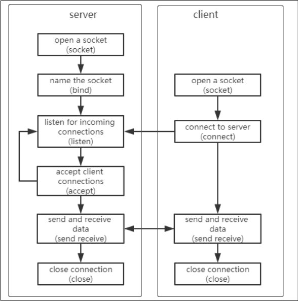
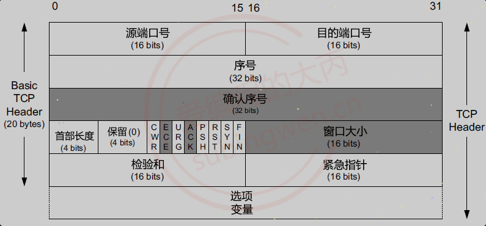
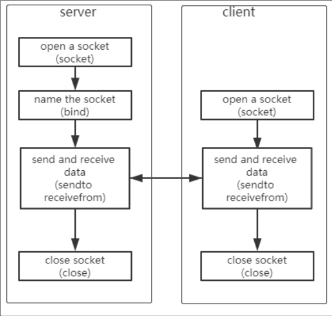

# 网络编程

## 基础概念
### 网络相关
1. 局域网和广域网
2. IP（Internet Protocol）：**本质是一个整型数，用于表示计算机在网络中的地址**。IP 协议版本有两个：
   - IPv4：
     - 使用一个 32 的整型数描述一个 IP 地址，4 个字节，int 型；
     - 也可以使用一个点分**十进制**字符串描述这个 IP 地址，分成 4 份，每份 1 字节，最大值为 255；
     - 可使用的 IP 地址共有 2^32 个；
   - IPv6：
     - 使用一个 128 位的整型数描述一个 IP 地址，16 字节；
     - 也可以使用一个字符串描述这个 IP 地址，分成 8 份，每份 2 字节，每份以 **16 进制**的方式表示；
     - 可以使用的 IP 地址共有 2^128 个；
   ```bash
   # 查看 ip 地址
   # linux
   ifconfig

   # windows
   ipconfig

   # 特殊 ip 地址：127.0.0.1 -> 和本地的 IP 地址是等价的
   ```
3. 端口：**端口的作用是定位到主机上的某一个进程**，通过这个端口，进程就可以接收到对应的网络数据了。
   - 端口也是一个整型数（unsigned short），一个 16 位整型数，**有效端口的取值范围是：0~65535**；
   - **通多 IP 地址可以定位到某一台主机，通过端口就可以定位到主机上的某一个进程**；
   - 计算机中，并不是所有的进程都需要关联一个端口（如果这个进程不需要网络通信，那么该进程就不需要绑定端口）；
   - 一个端口只能给某一个进程使用，多个进程不能同时使用同一个端口；

### 数据传输三要素
- 源地址；
- 目的地址；
- 数据传输长度；

在网络传输中使用“IP 和端口”来表示源或目的。

在网络传输中，涉及两个对象：server 和 client，即 server （服务器）程序和 client （客户端）程序。后者主动发起请求，前者被动地响应请求。

## 字节序
> 字节序，顾名思义字节的顺序，就是大于一个字节类型的数据在内存中的存放顺序，也就是说对于单个字符来说是没有字节序问题的，字符串是单字符的集合，**因此字符串也没有字节序问题**。

字节序问题只出现在：**一个多字节数值内部**的字节如何排列。

字符串的每个字符是独立编码端元，字符本身不涉及多字节数值的字节序问题。字符在字节流中的排列顺序就是其逻辑顺序，不存在因字节序不同而产生的歧义解释。字符串只有：字符 A 在字符 B 前面，这种逻辑顺序。

目前，在各种体系的计算机中通常采用的字节存储机制主要有两种：`Big-Endian` 和 `Little-Endian`。

### 小端-`Little-Endian`
- 主机字节序；
- 数据的**低位字节**存储到内存的**低地址位**，数据的**高位字节**存储到内存的**高位地址**；
- PC 机，数据的存储默认使用的是小端；

### 大端-`Big-Endian`
- 网络字节序；
- 数据的**低位字节**存储到内存的**高位地址**，数据的**高位字节**存储到内存的**低地址位**；
- **套接字通信过程中操作的数据都是大端存储的，包括接收、发送的数据、IP 地址、端口**。

### 转换接口函数
```c
// 网络通信中 IP 和端口的转换
// 主机字节序到网络字节序
uint16_t htons(uint16_t hostshort);
uint32_t htonl(uint32_t hostlong);

// 网路字节序到主机字节序
uint16_t ntohs(uint16_t netshort);
uint32_t ntohl(uint32_t netlong);

// ip 地址转换
// 主机字节序的 IP 地址转换位网络字节序
// 主机字节序的 IP 地址为字符串，网络字节序 IP 地址是整型
/* 
 * @af: 地址族，AF_INET（ipv4 格式的 ip 地址）、AF_INET6（ipv6 格式的 ip 地址）；
 * @src: 传入参数，对应要转换的点分十进制的 ip 地址，如 192.168.1.100
 * @dst: 传出参数，函数调用完成，转换得到的大端整型 ip 被写入到这块内存中
 * 返回值：成功返回 1，失败返回 0 或者 -1
 */
int inet_pton(int af, const char *src, void *dst);

// 将大端的整型数，转换为小端的点分十进制的 ip 地址
#include <arpa/inet.h>
/* 
 * @af: 同上；
 * @src: 传入参数，指向内存中存储了大端的整型 ip 地址；
 * @dst: 传出参数，存储转换后得到的小端的点分十进制的 ip 地址；
 * @size: 修饰 dst 参数的，标记 dst 指向的内存中最多可以存储多少个字节
 * 返回值：成功，指向第三个参数对应的内存地址；失败，NULL
 */
const char *inet_ntop(int af, const void *src, char *dst, socklen_t size);

// 只能用于处理 ipv4 地址大小端的转换的一组函数
// 点分十进制 IP -> 大端整型
in_addr_t inet_addr(const char *cp);
// 大端整型 -> 点分十进制 IP
char *inet_ntoa(struct in_addr in);
```

## 分层架构

> [上述图片来源](https://subingwen.cn/linux/socket/#1-%E6%A6%82%E5%BF%B5)

1. 应用层：
   - 直接为应用进程（如电子邮件、文件传输等）提供网络通信服务；
   - 应用层涉及的协议很多，比如 HTTP（网络应用）、SMTP（电子邮件）、FTP（文件传送）以及 DNS、POP3、SNMP、Telnet 等；
2. 表示层：
   - 对应用层数据编码和转化，确保以一个系统应用层发送的信息可以被另一个系统应用层识别；
   - 处理用户信息的表示问题，数据的编码，压缩与解压缩，数据的加密与解密；
3. 会话层：
   - 建立、管理和终止网络中两个节点之间的通信会话；
   - 建立一个连接（自动的收集信息、自动的网络寻址）；
4. 传输层：
   - 向高层提供可靠的端到端的网络数据流服务；
   - 每个应用程序都会在网卡注册一个端口号，该层就是端口与端口的通信；
   - 基于传输层协议编写应用程序，应用程序位于“应用层”；
   - 传输层协议可以选择 TCP 协议，也可以选择 UDP 协议；
   - 在源端与目的端之间提供可靠的透明数据传输；
5. 网络层：
   - 负责在源点和终点之间建立连接；
   - 此处需要确定计算机的位置，通过 IPv4，IPv6 格式的 IP 地址来找到对应的主机；
   - 将网络地址翻译成对应的物理地址，并通过路由选择算法为分组通过通信子网选择最适当的路径；
6. （数据）链路层：
   - 规定了 0 和 1 的分包形式，确定了网络数据包的形式等；
   - 接收来自物理层的位流形式的数据，并封装成帧，传输到上一层；
7. 物理层：
   - 负责最后将信息编码成电流脉冲或其他信号用于网上传输；
   - 在物理层上所传数据的单位是比特，物理层的任务就是透明地传送比特流。

## 通信操作流程

> [上述图片来源](https://subingwen.cn/linux/socket/#2-%E7%BD%91%E7%BB%9C%E5%8D%8F%E8%AE%AE)

- 在网络通信的时候，程序员需要负责应用层数据的处理（最上层）：
  - 应用层的数据可以使用某些协议进行封装，也可以不封装；
  - 调用发送数据的接口函数，将数据发送出去；
  - 接口函数做底层数据处理：
    - 传输层使用传输层协议打包数据；
    - 网络层使用网络协议打包数据；
    - 网络接口层使用网络接口层协议打包数据；
    - 数据被发送到 Internet

- 程序员调用接收数据的接口函数获取数据，如果应用层也使用了协议对数据进行了封装，数据包的解析需要在应用层中执行。

## 各层协议
网络协议指的是计算机网络中互相通信的对等实体之间交换信息时所必须遵守的规则的集合。一般系统网络协议包括五分部分：通信环境，传输服务，词汇表，信息的编码格式，时序、规则和过程。

OSI 参考模型（七层） -> TCP/IP 五层模型：
- 应用层 + 表示层 + 会话层 -> 应用层：
  - FTP
  - HTTP
  - DNS
  - Telnet
  - SMTP
- 传输层 -> 传输层：
  - TCP
  - UDP
- 网络层 -> 网络层：
  - RIP
  - IP
  - ICMP
  - IGMP
- 数据链路层 -> 数据链路层
  - ARP
  - IEEE802 3
  - RARP
- 物理层 -> 物理层
  - PAM5
  - FE 自协商
  - EIA422

应用层常见协议：
| 协议 | 名称 | 默认端口 | 底层协议 |
| ---- | ---- | ---- | ---- |
| HTTP | 超文本传输协议 | 80 | TCP |
| HTTPS| 超文本传输安全协议 | 443 | TCP |
| Telnet | 远程登录服务的标准协议 | 23 | TCP |
| FTP | 文件传输协议 | 20 传输、21 连接 | TCP |
| TFTP| 简单文件传输协议 | 69 | UDP |
| SMTP | 简单邮件传输协议（发送用）| 25 | TCP |
| POP | 邮局协议（接收用）| 110 | TCP |
| DNS | 域名解析服务 | 53 | 服务器间进行域传输的时候用 TCP，<br />客户端查询 DNS 服务器时用 UDP |

## 传输层协议：TCP 和 UDP
### TCP
#### 概述
TCP（Transmission Control Protocol，传输控制协议）是一种面向连接的、可靠的、基于字节流的传输层通信协议。

- 特点
  - **面向连接**：是一个双向连接，通过三次握手完成，断开连接需要通过四次挥手完成；
  - **安全**：tcp 通信过程中，会对发送的每一数据包都进行校验，如果发现数据丢失，会自动重传；
  - **流式传输**：发送端和接收端处理数据的速度，数据的量都可以不一致；

- 功能
  - 可靠传输（重传机制）、流量控制（即发送方/接收方速率匹配）；
  - 应用层报文划分为短报文，并提供拥塞控制机制；

- 通信交互流程

> 图片来源：[1]

#### 文件描述符相关
1. 服务器端的两类文件描述符
  - 监听的文件描述符：
    - 只需要有一个；
    - 不负责和客户端通信，负责检测客户端的连接请求，检测到后调用 `accept()` 就可以建立新的连接；
  - 通信的文件描述符：
    - 负责和建立连接的客户端通信；
    - 如果有 N 个客户端和服务器建立了新的连接，通信的文件描述符就有 N 个，每个客户端和服务器都对应一个通信的文件描述符；

2. 文件描述符对应的内存结构：
  - **一个文件描述符对应两块内存，一块内存是读缓冲区，一块内存是写缓冲区**；
  - 监听的文件描述符：
    - 客户端的连接请求会发送到服务器端监听的文件描述符的读缓冲区中；
    - 读缓冲区中有数据，说明有新的客户端连接；
    - 调用 `accept()` 函数，这个函数会检测监听文件描述符的读缓冲区。检测不到数据，该函数阻塞；如果检测到数据，接触阻塞，建立新的连接；
  - 通信的文件描述符：
    - 客户端和服务器端都有通信的文件描述符；
    - 发送数据（调用 `write()/send()`），数据进入到内核中。数据并没有被发送出去，而是将数据写入到了通信的文件描述符对应的写缓冲区中。内核检测到通信的文件描述符写缓冲区中有数据，内核会将数据发送到网络中；
    - 接收数据（调用 `read()/recv()`），从内核读取数据。数据如何进入到内核程序员不需要处理，数据进入到通信的文件描述符的读缓冲区中。数据进入到内核，必须使用通信的文件描述符，将数据从读缓冲区中读出即可。

#### tcp 协议中的重要字段：
  
    > [图片来源](https://subingwen.cn/linux/three-four/)
   - 源端口：表示发送端端口号，字段长 16 位，2 个字节；
   - 目的端口：表示接收端端口号，字段长 16 位，2 个字节；
   - 序号：字段长 32 位，4 个字节，序号范围为 0~2^32 - 1：
     - 由于 tcp 是面向字节流的，在一个tcp 连接中传送的字节流中的每个字节都按顺序编号；
     - 首部中的序号字段则是指本报文所发送的数据的第一个字节的序号，这是随机生成的；
     - 序号循环使用，当序号增加到最大值时，下一个序号就又回到了 0；
     - 当一端为建立连接而发送它的 SYN 时，它为连接选择一个初始序号。ISN 随时间而变化，因此每个连接都将具有不同的 ISN；
     - ISN 大概 4ms 加 1；
     - 三次握手的其中一个重要功能是客户端和服务端交换 ISN，以便让对方知道接下来接收数据的时候如何按照序列号组装数据。如果 ISN 是固定的，攻击者很容易猜出后续的确认号，因此 ISN 是动态生成的。
     - 总结：传输方向上字节流的字节编号。初始时序号会被设置一个随机的初始值（ISN，Initial Sequence Number），之后每次发送数据时，序号值 = ISN + 数据在整个字节流中的偏移。假设 A -> B 且 ISN = 1024，第一段数据 512 字节已经到 B，则第二段数据发送时序号为 1024 + 512。**用于解决网络包乱序问题**。
   - 确认序号：字段长 32 位，4 字节：
     - 表示期望收到的下一个报文段的第一个数据字节的序号。确认序号 = 期望收到的下一个字节序号（收到的序号 + 数据长度、最后一个收到的字节序号 + 1）。
     - 如果确认序号为 N，序号为 S，则表明到序号 N-S 为止的所有数据字节都已经被正确接收到了。确认序号具有累计确认的特性，例如发送发连续发送了两个报文段：报文段 1 = 序号（100），数据（“hello”，5 个字节），报文段 2 = 序号（105），数据（“world”，5 个字节），接收方可以只回复一个确认：取人序号（110，表示 100 ~ 109 全部收到，下次从 110 开始）。**从而可以减少确认报文数量，提高传输效率**。
   - 首部长：4 字节，标识首部有多少个 4 字节，最大为 15，即 60 字节。
   - 8 个标志位：
      - CWR: 拥塞控制相关。
      - ECE: 同上。
      - URG: 标志紧急指针是否有效。
      - ACK: 标志确认号是否有效（确认报文段）。**用于解决丢包问题**。
      - PSH: 提示接收端立即从缓冲读走数据。
      - RST: 表示要求对方重新建立连接（复位报文段）。
      - SYN: 表示请求建立一个连接（连接报文段）。
      - FIN: 表示关闭连接（断开报文段）。
   - 窗口大小：
     - 字段长 16 位，表示从确认序号所指位置开始能够接收的数据大小，tcp 不允许发送超过该窗口大小的数据。
     - 接收窗口，用于告知对方（发送方）本方的缓冲还能接收多少字节数据。**用于解决流控**。
   - 校验和：16 bit，接收端用 CRC 检验整个报文段有无损坏。

#### 状态转换
1. 常见状态：
   - `CLOSED`：初始状态；
   - `LISTEN`：服务器处理监听状态；
   - `SYN_SEND`：客户端 socket 执行 connect 连接，发送 SYN 包，进入此状态；
   - `SYN_RECV`：服务端收到 SYN 包并发送服务端 SYN 包，进入此状态；
   - `ESTABLISH`：表示连接建立。客户端发送了最后一个 ACK 包后进入此状态，服务端接收到 ACK 包后进入此状态。
   - `FIN_WAIT_1`：终止连接的一方（通常是客户机）发送了 FIN 报文后进入。等待对方 FIN。
   - `CLOSE_WAIT`：（假设服务器）接收到客户机 FIN 包之后等待关闭的阶段。在接收到对方的 FIN 包之后，自然是需要立即回复 ACK 包的，表示已经知道断开请求。但是本方是否立即断开连接（发送 FIN 包）取决于是否还有数据需要发送给客户端，若有，则在发送 FIN 包之前均为此状态。
   - `FIN_WAIT_2`：此时是**半连接状态**，即有一方要求关闭连接，等待另一方关闭。客户端接收到服务器的 ACK 包，但并没有立即接收到服务端的 FIN 包，进入 `FIN_WAIT_2` 状态；
   - `LAST_ACK`：服务端发送最后的 FIN 包，等待最后的客户端 ACK 响应，进入此状态。
   - `TIME_WAIT`：客户端收到服务端的 FIN 包，并立即发送 ACK 包做最后的确认，在此之后的 2MSL 时间称为 `TIME_WAIT` 状态。
     - MSL，Maximum Segment Lifetime，表示报文最大生存时间；
     - MSL 是 TCP 报文段在网络中能够生存的最长时间。任何报文段如果在网络中停留超过 MSL 时间，就会被丢弃；
     - 通常设置为 2 分钟、1 分钟或 30 秒等；
     - `TIME_WAIT` 为 2MSL 的原因：1MSL，最后一个 ACK 到达对方的最长时间；1MSL，对方重传的 FIN 到达本地的最长时间。2MSL，确保双方都能正常关闭，且旧数据全部消亡。

#### 三次握手
所谓的面向连接就是三次握手，在客户端调用 `connect()` 函数，三次握手就自动进行了。

三次握手（Three-way Handshake）其实就是指建立一个 tcp 连接时，需要客户端和服务器总共发送 3 个包。**进行三次握手的主要作用就是为了确认双方的接收能力和发送能力是否正常、指定自己的初始化序列号为后面的可靠性传送做准备**。

**实质上其实就是连接服务器指定端口，建立 tcp 连接，并同步连接双方的序列号和确认号，交换 tcp 窗口大小**。

tcp 连接是双向连接，客户端和服务器需要分别向对方发送连接请求，并且建立连接，三次握手成功之后，二者之间的双向连接也就成功建立了。

1. 前提条件
   - 服务器端：已经启动，并且启动了监听；
   - 客户端：基于服务器端监听的 IP 和端口，向服务器端发起连接请求；

2. 三次握手过程
   - [ ] 补充图示
   - 刚开始客户端处理 `CLOSED` 状态，服务端处于 `LISTEN` 状态；
   - 第一次握手：客户端给服务端发一个 SYN 报文，并指明客户端的初始化序列号 ISN-c。此时客户端状态转到 `SYN_SEND`；**首部的同步位 SYN=1，初始序列号 seq=x，SYN=1 的报文段不能携带数据，但要消耗掉一个序号**；
   - 第二次握手：服务器端接收到客户端的 SYN 报文之后，会以自己的 SYN 报文作为应答，并且也指定了自己的初始化序列号 ISN-s。同时会把客户端的 ISN + 1 作为 ACK 的值（确认序号），表示自己已经收到了客户端的 SYN。此时服务器处于 `SEND_RCVD` 状态。在确认报文段中 SYN=1，ACK=1，确认号 ack=x + 1，初始序号 seq=y。
   - 第三次握手：客户端收到 SYN 报文之后，会发送一个 ACK 报文。同样的，也是把服务器的 ISN + 1 作为 ACK 的值，表示已经收到了服务端的 SYN 报文，此时客户端的状态转为 `ESTABLISHED`。服务器收到 ACK 报文后，也处于 `ESTABLISHED` 状态。此时双方建立了连接。确认报文段 ACK=1，确认号ack=y + 1，序号seq=x+1（初始为seq=x，第二个报文段所以要+1），**ACK 报文段可以携带数据，不携带数据则不消耗序号**。

    发送第一个 SYN 的一端将执行主动打开（active open），接收这个 SYN 并发回下一个 SYN 的另一端执行被动打开（passive open）。

3. 为什么需要三次握手，两次不行吗？
   弄清这个问题，需要先弄明白三次握手的目的是什么，能不能只用两次握手来达到同样的目的。
   - 第一次握手：客户端发送网络包，服务端收到了。这样服务端就能得出结论：客户端的发送能力、服务端的接收能力是正常。
   - 第二次握手：服务端发包，客户端收到了。这样客户端就能得出结论：服务端的接收、发送能力，客户端的接收、发送能力是正常的。不过此时服务器并不能确认客户端的接收能力是否正常。
   - 第三次握手：客户端发包，服务端收到了。这样服务端就能得出结论：客户端的接收、发送能力正常，服务器自己的发送、接收能力也正常。

    综上，需要三次握手才能确认双方的接收能力与发送能力是否正常。

    两次握手可能出现的情况：
     - 客户端发出连接请求，但因连接请求报文丢失而未收到确认，于是客户端再次请求连接。后来收到了确认，建立了连接。
     - 数据传输完毕后，就释放了连接，客户端共发出了两个连接请求报文段。其中第一个丢失，第二个到达了服务器。但是第一个丢失的报文段只是在某些网络节点长时间滞留了，延误到连接释放以后的某个时间才达到服务器。
     - 此时服务端误认为客户端又发出了一次新的连接请求，于是就向客户端发出确认报文段，同意建立连接。这时，如果不采用三次握手，只要服务端发出确认就建立新的连接的话，此时客户端忽略服务端发出来的确认，也不发送数据，则服务端一直等待客户端发送数据，浪费资源。

4. 半连接队列
   服务器第一次收到客户端的 SYN 之后，就会处于 `SYN_RCVD` 状态，此时双双还没有完全建立其连接，服务器会把此种状态下请求连接放在一个队列里。称这种队列为**半连接队列**。

   当然还有**全连接队列**，就是已经完成三次握手，建立起来连接的就会放在全连接队列中。如果队列满了就可能会出现丢包现象。

   关于 **SYN-ACK 重传次数**的问题：服务器发送完 SYN-ACK 包，如果未收到客户确认包，服务器进行首次重传，等待一段时间仍未收到客户确认包，进行第二次重传。注意，每次重传等待时间不一定相同，一般会是指数增长，比如间隔时间为 1s、2s、4s...如果重传次数超过系统规定的最大重传次数，系统将该连接信息从半连接队列中删除。

5. 三次握手过程中的携带数据问题
   只有第三次握手的时候可以携带数据，第一次、第二次握手不可以（防止攻击者在此过程中携带大量数据，浪费服务器时间、空间资源）。

   服务器端的资源分配是在二次握手时分配的，而客户端的资源是在完成三次握手的时候分配的。所以服务器容易收到 SYN 洪泛攻击。SYN 攻击就是 Client 在短时间内伪造大量不存在的 IP 地址，并向 Server 不断地发送 SYN 包，Server 则回复确认包，并等待 Client 确认。由于源地址不存在，因此 Server 需要不断重发直至超时，这些伪造的 SYN 包将长时间占用未连接队列，导致正常的 SYN 请求因为队列满而被丢弃，从而引起网络拥塞甚至系统瘫痪。

   常见防御 SYN 攻击的方法：缩短超时（SYN Timeout）时间、增加最大半连接数、SYN cookies 技术、过滤网关防护等。

#### 四次挥手
TCP 的连接的拆除需要发送四个包，因此称为四次挥手（Four-way handshake）。

四次挥手是断开连接的过程，需要双向断开。关于哪一方先断开连接是没有要求的。通信的两端如果想要断开连接就需要调用 `close()` 函数。当两端都调用该函数，四次挥手也就完成了。

建立一个连接需要三次握手，而终止一个连接需要经过四次挥手。这由 TCP 的**半关闭（half-close）**造成的。所谓半关闭，其实就是 **TCP 提供了连接的一端在结束它的发送后还能接收来自另一端数据的能力**。

1. 四次挥手过程：
   - [ ] 补充示例图
  刚开始双方都处于 `ESTABLISHED` 状态。假如是客户端先发起关闭请求，四次挥手过程为：
   - 第一次挥手：客户端发送一个 `FIN` 报文，报文中会指定一个序列号。此时客户端状态转为 `FIN_WAIT_1` 状态。即发出连接释放报文段（FIN=1，序号seq=u），并停止再发送数据，主动关闭 tcp 连接，进入 `FIN_WAIT_1`（终止等待1）状态，等待服务端的确认；
   - 第二次挥手：服务端收到 `FIN` 之后，会发送 `ACK` 报文，且把客户段的序列号值 + 1 作为 ACK 报文的（确认）序列号值，表明已收到客户端的报文了，此时服务端处于 `CLOSE_WAIT` 状态。即**服务端收到连接释放报文段后即发出确认报文段**（ACK=1，确认好ack=u+1，序号seq=v），服务端进入`CLOSE_WAIT`（关闭等待）状态。**此时的 tcp 处于半关闭状态**，客户端到服务端的连接释放。客户端收到服务端的确认后，进入 `FIN_WAIT_2`（终止等待2）状态，等待服务端发出的连接释放报文段；
   - 第三次挥手：如果服务端也想断开连接了，和客户端的第一次挥手一样，发给 `FIN` 报文，且指定一个序列号。此时服务端处于 `LAST_ACK` 状态。**即服务端没有要向客户端发出的数据，服务端发出连接释放报文段**（FIN=1，ACK=1，序号seq=w，确认号=u+1），服务端进入 `LAST_ACK`（最后确认）状态，等待客户端的确认；
   - 第四次挥手：客户端收到 `FIN` 之后，一样发送一个 ACK 报文作为应答，且把服务端的序列号值 + 1 作为自己 ACK 报文的确认号值，此时客户端处于 `TIME_WAIT` 状态。需要过一阵子以确保服务端收到自己的 ACK 报文之后才会进入 `CLOSED` 状态，服务端收到 ACK 报文后，就处于关闭连接了，处于 `CLOSED` 状态。**即客户端收到服务端的连接释放报文段后，对此发出确认报文段（ACK=1，seq=u+1，ack=w+1）**，客户端进入 `TIME_WAIT` （时间等待）状态。此时 tcp 未释放掉，需要经过时间等待计时器设置的时间 2MSL 后，客户端才进入 `CLOSED` 状态。

    收到一个 `FIN` 只意味着在这一方向上没有数据流动。客户端指定主动关闭并进入 `TIME_WAIT` 是正常的，服务端通常执行被动关闭，不会进入 `TIME_WAIT` 状态。

    在 socket 编程中，任何一方执行 `close()` 操作即可产生挥手操作。

2. 挥手需要四次的原因
   因为当服务端收到客户端的 SYN 连接请求报文后，可以直接发送 SYN + ACK 报文。**其中 ACK 报文是用来应答的，SYN 报文是用来同步的**。但是关闭连接时，当服务端收到 FIN 报文时，很可能并不会立即关闭 SOCKET，所以只能先回复一个 ACK 报文，告诉客户端：“你发的 FIN 报文我收到了”。只有等到我服务端的所有报文都发送完了，我才能发送 FIN 报文。因此不能一起发送，所以需要四次挥手。

3. 等待 2MSL 的意义
   - 保证客户端发送的最后一个 ACK 报文段能够达到服务端（ACK 丢失 + 服务端重传 FIN + ACK 报文段，重启 2MSL 计时器，如此循环直到双方进入到 `CLOSED` 状态）；
   - 防止“已失效的连接请求报文段”出现在本连接中（客户端在发送完最后一个 ACK 报文段后，再经过 2MSL，就可以使本连接持续的时间内所产生的所有报文段从网络中消失，使下一个新的连接不会出现这种旧的连接请求报文段）。
   - 客户端只需要等待 2MSL，如果没有再次收到服务端的消息，就说明服务端已经接收到自己确认消息；此时双方都关闭连接，TCP 四次挥手完毕。

#### 流量控制
发送方根据接收方的窗口大小来决定发送的数据量，实现速率匹配，解决接收端数据处理不过来的问题。

流量控制可以让发送端根据接收端的实际能力控制发送的数据量。它的具体操作是，接收端主机向发送端主机通知自己可以接收数据的大小，于是发送端会发送不会超过该大小的数据量，该限制大小即为窗口大小。**窗口大小由接收端主机决定**。

tcp 首部中，专门有一个字段来通知窗口大小，接收主机将自己可以接收的缓冲区大小放在该字段中通知发送端。当接收端的缓冲区面临数据溢出时，窗口大小的值也随之改变，设置一个更小的值通知发送端。从而控制数据的发送量，实现流量的控制。**这个控制流程的窗口也可以称作滑动窗口**。

#### 拥塞控制
发送端自己根据网络拥塞程度（丢包、延迟、ACK 速率等）来探测估算，避免网络本身的拥堵（路由器/链路超载）。

拥塞控制主要涉及四个算法：
   - 慢启动；
   - 拥塞避免；
   - 拥塞发生
   - 快速回复

1. 慢启动
   - **目的**：探测网络可用带宽，避免一开始就大量发送数据导致拥塞
   - **机制**：拥塞窗口（cwnd）从 1 个 MSS（Maximum Segment Size，最大报文长度，TCP 报文段中最大的数据长度，不包括 TCP 首部） 开始，每收到一个 ACK 就加倍（指数增长）
   - **阈值**：达到慢启动阈值（ssthresh）后，进入拥塞避免阶段

2. 拥塞避免
   - **目的**：在接近网络容量时更谨慎地增长
   - **机制**：每轮 RTT（Round-Trip Time, 返回时间。从发送方发送数据开始，到发送方接收到 ACK 所经历的时间） 只将 cwnd 增加 1 个 MSS（线性增长），而非加倍

3. 拥塞发生
   - **触发条件**：收到**3个重复的 ACK**（说明中间有包丢失，但后续包仍到达）
   - **行为**：不等超时定时器到期，立即重传丢失的报文段
   - **优势**：比超时重传更快恢复

4. 快速恢复
   - **配合快速重传使用**
   - **机制**：
     - ssthresh 设为当前 cwnd 的一半
     - cwnd 设为 ssthresh + 3（补偿已离开网络的报文）
     - 进入拥塞避免阶段（而非慢启动）

----- 
实际发送窗口 = min(接收窗口 rwnd, 拥塞窗口 cwnd)
- `rwnd, receiver window`：接收端能接收多少；
- `cwnd, congestion window`：网络能承载多少；
- 发送端取两者中较小值，同时满足不超过接收端的处理能力，以及不超过网络的承载能力；

-----
1. 为何快速重传是选择 3 次 ACK？
   略

#### 粘包和拆包
1. 粘包
   - tcp 是基于流的传输协议，数据发送端和接收端每次处理的数据量、处理的频率可以是不对等的。
   - 通信过程中，客户端会不定期地给服务器发送一个不定长度的有特定含义的字符串；而服务器端需要接收这个不定长的字符串，并对其进行解析。
   - 服务器端在接收数据时可能出现的情况：
     - 一个完整数据包；
     - N 个数据包，由于每个包的长度不定，无法将各个数据包拆开；
     - N 个数据包 + 下一个数据包的一部分；
     - 不足一个数据包，下一次收到剩余部分 + 下个数据包的一部分；
     - 另外，还有一些不可抗因素：比如客户端和服务器端的网速不一样，发送和接收的数据量也会不一致；
2. 解决方案：
   - 使用标准的应用层协议（比如 http、https）来封装要传输的不定长的数据包；
   - 在每条数据的尾部添加特殊字符，如果遇到特殊字符，代表当条数据接收完毕：有缺陷（效率低，需要一个字节一个字节接收，接收一个字节判断一次，判断是不是那个特殊字符）；
   - 在发送数据块之前，在数据块最前边添加一个固定大小的数据头，这时候数据由两部分组成：数据头 + 数据块；
     - 数据头：存储当前数据包的总字节数，接收端先接收数据头，然后再根据数据头接收对应大小的字节；
     - 数据块：当前数据包的内容；
3. 拆包
   **通常使用添加包头的方式轻松地解决掉这个问题**。关于数据包的包头大小可以根据实际情况进行设定。可以规定包头的固定大小为 4 个字节，用于存储当前数据块的总字节数。
4. 实现时注意事项（以包头占 4 字节为例）：
   - 发送端：
     - 申请的内存大小为 N + 4（N 是数据块所需内存大小）；
     - 将数据块总长度写入申请内存的头 4 个字节中，**需要先将总长度转换为网络字节序（大端）**；
     - 将待发送的数据拷贝到包头后边的内存中，将完整的数据包发送出去（**字符串没有字节序问题**）；
     - 释放申请的堆内存；
   - 接收端
     - 首先接收 4 字节数据，**并将其从网络字节序转换为主机字节序**，从而得到将要接收的数据总长度；
     - 根据得到的数据总长度申请固定大小的堆内存，用于存储待接收数据；
     - 根据得到的数据块长度接收固定数目的数据保存到申请的堆内存中；
     - 处理接收的数据（**需等到数据块完整接收到本地才能进行数据处理**）；
     - 释放存储数据的堆内存；

#### 服务器并发与 IO 多路复用
在 tcp 通信过程中，服务器端启动之后可以同时和多个客户端建立连接，并进行网络通信。

1. 单线程/单进程的缺点：
   - 引起程序阻塞的函数：
     - `accept()`：...
     - `read()`：如果通信的套接字对应的读缓冲区没有数据，阻塞当前进程/线程；检测到数据解除阻塞，接收数据；
     - `write()`：如果通信的套接字写缓冲区被写满了，阻塞当前进程/线程；
   - 使用单线程/进程无法满足同时、高效地完成新连接的建立、与已建立连接的客户端之间的通信；
2. 解决方案：
   - 多线程
   - 多进程
   - IO 多路复用实现
   - IO 多路复用 + 多线程实现
3. 多进程并发
4. 多线程并发
5. IO 多路复用-select, poll, epoll

#### 套接字通信封装

### UDP
UDP，User Datagram Protocol，用户数据报协议，向应用程序提供无连接服务。

- 特点
  - 无连接的；
  - 不保证可靠交付，因此主机不需要维持复杂的连接状态；
  - 面向报文的传输；
  - 没有流量控制，也没有拥塞控制，因此网络拥塞不会使源主机的发送速率降低（常用于实时应用，如实时视频会议）；
  - 支持一对一、一对多、多对一和多对多的交互通信；
  - 首部占 8 字节，相比于 TCP 首部占用 20 字节，开销更小；
- 使用特点：
  - 关于何时发送什么数据控制得更为精细：采用 UDP 时只要应用进程将数据传递给 UDP，UDP 就会立即将其传递给网络层；而 TCP 有重传机制，不管可靠传输需要多长时间。在实际应用时，有些场景不希望过分的延迟报文传输，且能容忍一部分数据丢失；
  - 无需建立连接，不会引入建立连接时的延迟；
  - 无连接状态，能支持更多的活跃客户；
  - 分组首部开销较小；
> udp 是一个面向无连接的，不安全的，报式传输层协议，udp 的通信过程默认也是阻塞的。
> - udp 通信不需要建立连接，因此不需要进行 connect() 操作；
> - udp 通信过程中，每次都需要指定数据接收端的 IP 和端口，和发快递差不多；
> - udp 不对收到的数据进行排序，在 udp 报文的首部中没有关于数据顺序的信息；
> - udp 对接收到的报文数据不回复确认信息，发送端不知道数据是否被正确接收，也不会重发数据；
> - 如果发生了数据丢失，不存在丢一半的情况，如果丢了那当前这个数据包就全部丢了；

- 通信交互流程
  
  > 图片来源：[1]

### 对比
1. TCP 和 UDP 的区别
   - 发送数据之前是否需要建立连接：TCP 面向连接；而 UDP 是无连接的；
   - 可靠性：TCP 提供可靠的服务，通过 TCP 连接传输的数据可以做到无差错、不丢失，不重复且按序达到；而 UDP 不保证可靠交付，只尽最大努力交付；
   - 传输方式：TCP 面向字节流传输，它将数据看成一连串无结构的字节流；而 UDP 是面向报文的，同时 UDP 没有拥塞控制，因此网络出现拥塞不会使源主机的发送速率降低（对应实时应用很有用，如实时时评会议等）；
   - 传输方向：每一条 TCP 连接只能是点到点的；而 UDP 支持一对一、一对多、多对一和多对多的交互通信；
   - 首部开销：TCP 首部占用为 20 字节；UDP 的首部占用为 8 个字节，开销更小；
   - 发送方式：UDP 是面向报文的，发送方的 UDP 对应用层交下来的报文，不合并、不拆分，只是在其上面加上首部后就交给下面的网络层，无论应用层交给 UDP 多长的报文，它统统发送，一次发送一个。对接收方而言，接到后直接去除首部，交给上面的应用层就完成任务了。因此，它需要应用层控制报文的大小；而 TCP 是面向字节流的，它把上面应用层交下来的数据看成无结构的字节流发送，可以想象成流水形式的，发送方 TCP 会将数据放入“蓄水池”（缓存区），等到可以发送的时候就发送，不能发送就等着。TCP 会根据当前网络的拥塞状态来确定每个报文段的大小。 
   - TCP 的逻辑通信信道是全双工的可靠信道，UDP 则是不可靠信道；
2. 适用场景：
   - TCP：网页浏览、电子邮件、文件传输、实时通信（如语音通话、视频通话等应用需要保证数据的完整性和顺序，通常选择 TCP 协议）；
     - 优点：可靠性高，能够保证数据的完整性和可靠传输；支持流量控制和拥塞控制，避免网络拥堵和丢包；
     - 缺点：数据传输相对较慢，因为每个数据包都需要进行确认和重传；在某些情况下，TCP 的连接建立和维护可能会增加网络开销；
   - UDP：实时多媒体应用（视频通话（可以接收偶尔的丢包、偶尔的花屏；如果使用 TCP，每个数据包都要确保可靠传输，当它出错时就重传，这会导致后续的数据包被阻滞，视频效果反而不好）、实时音频、视频流传输、游戏数据传输等，需要低延迟和高实时性）、DNS 解析、NTP 时间同步（udp 常用于网络时间同步）；
     - 优点：传输速度快，适用于实时性要求高的场景；不会增加额外的连接和维护开销；
     - 缺点：可靠性不高，数据包可能丢失或乱序；不支持流量控制和拥塞控制，容易导致网络拥堵和丢包问题；

## 网络编程接口
套接字（Socket）是一套网络通信的接口，使用这套接口来完成网络通信。

### `socket` 函数
  ```c
  int socket(int domain, int type, int protocol);
  ```
  - 功能：create an endpoint for communication，创建一个用于通信的套接字；
  - 返回值：returns a file descriptor that refers to that endpoint，返回一个文件描述符，通过它来引用套接字；失败时返回 -1，查看 `errno` 可知道出错的详细情况；
  - 参数：
    - `domain`：The domain argument specific a communication domain; **this selects the protocol family which will be used for communication**. These family are defined in <sys/socket.h>. The formats currently understood by the Linux kernel include:
      - `AF_UNIX`: local communication，只能用于单一的 Unix 系统进程间通信；
      - `AF_LOCAL`: Synonym（同物异名，同义词） for `AF_UNIX`；
      - `AF_INET`: IPv4 Internet protocols。针对网络通信，可用于远程通信；
      - `AF_INET6`: IPv6 Internet protocols；
      - 其他，见 `man` 手册；
    - `type`：The socket has the indicated types（socket 具有指定的类型）,which specifies the communication semantics. Currently defined types are:
      - `SOCK_STREAM`: Provides **sequenced, reliable, two-way, connection-based type stream**. An out-of-band data transmission mechanism may be supported;
      - `SOCK_DGRAM`: Supports **datagrams（数据包）**(**connectionless, unreliable messages of a fixed maximum length**);
      - 其他，见 `man` 手册；
      - Since Linux 2.6.27, the type argument servers a second purpose: in addition to specifying a socket type, it may include the bitwise（逐位） OR of any of the following values, to modify the behavior of socket()：
        - `SOCK_NONBLOCK`: Set the `O_NONBLOCK` file status flag on the open file description referred to by the new file descriptor. Using this flag saves extra calls to `fcntl` to achieve the same result.
        - `SOCK_CLOEXEC`: Set the close-on-exec (FD_CLOEXEC) flag on the new file descriptor. See the description of the `O_CLOEXEC` flag in `open` for reasons why this may be useful. 
    - `protocol`: The protocol specifies a particular protocol to be used with the socket. **Normally only a single protocol exists to support a particular socket type within a given protocol family, in which case protocol can be specified as 0**. 其他信息见 `man` 手册、`protocol(5)`、`getprotoent(3)`；

### `bind` 函数
  ```c
  int bind(int sockfd, struct sockaddr *addr, int addrlen);
  ```
  - 概述：when a socket is created with `socket(2)`, it exists in a name space (address family) but has no address assigned to it. `bind()` assigns the address specified by `addr` to the socket referred to by the file descriptor `sockfd`. `addrlen` specifies the size, in bytes, of the address struct pointed to by `addr`. Traditionally, this operation is called "assigning a name to a socket".
  - **It is normally necessary to assign a local address using `bind()` before a `SOCK_STREAM` socket may receive connections (seet `accept(2)`)**.
  - The rules used in name binding vary between address families. Consult the manual entries in Section 7 for detailed information. For `AF_INET`, see `ip(7)`; for `AF_INET6`, see `ip6(7)`; for `AF_UNIX`, see `unix(7)`; 其他，见 `man` 手册；
  - **The actual struct passed for the `addr` argument will depend on the address family**. The `sockaddr` structure is defined as something like:
    ```c
    struct socketaddr {
      sa_family_t sa_family;
      char sa_data[4];
    };
    ```
    - **The only purpose of this structure is to cast the structure pointer passed in `addr` in order to avoid compiler warnings**.
    - 示例程序：
      ```c
      #include <sys/socket.h>
      #include <sys/un.h>
      #include <stdlib.h>
      #include <stdio.h>
      #include <string.h>

      #define MY_SOCK_PATH  "/somepath"
      #define LISTEN_BACKLOG  50

      #define handle_error(msg) \
        do {perror(msg); exit(EXIT_FAILURE); } while(0)

      int main(int argc, char *argv[]) {
        int sfd, cfd;
        struct sockaddr_un my_addr, peer_addr;
        socklen_t peer_addr_size;

        sfd = socket(AF_UNIX, SOCK_STREAM, 0);
        if (sfd == -1)
          handle_error("socket");

        memset(&my_addr, 0, sizeof(my_addr));
        my_addr.sun_family = AF_UNIX;
        strncpy(my_addr.sun_path, MY_SOCK_PATH, sizeof(my_addr.sun_path) - 1);

        if (bind(sfd, (struct sockaddr*)&my_addr, sizeof(my_addr)) == -1)
          handle_error("bind");
        
        if (listen(sfd, LISTEN_BACKLOG) == -1)
          handle_error("listen");
        
        /*Now we can accept incoming connections one at a time using accept(2)*/

        peer_addr_size = sizeof(peer_addr);
        cfd = accept(sfd, (struct sockaddr*)&peer_addr, &peer_addr_size);
        if (cfd == -1)
          handle_error("accept");

        /* Code to deal with incoming connection(s) */

        /* When no longer required, the socket pathname, MY_SOCK_PATH should be deleted using unlink(2) or remove(3) */
      }
      ```
    - 不过由于系统的兼容性，我们一般使用另外一个结构（`struct sockaddr_in`）来代替：
      ```c
      struct sockaddr_in {
        unsigned short sin_family;
        unsigned short sin_port;
        struct in_addr sin_addr;
        unsigned char sin_zero[8];
      };
      ```
      - 如果使用 `Inernet`，则 `sin_family` 一般为 `AF_INET`；
      - `sin_addr` 设置为 `INADDR_ANY` 表示可以和任何的主机通信；
      - `sin_port` 是要监听的端口号；
      - `bind` 将本地的端口同 `socket()` 返回的文件描述符捆绑在一起，成功返回 0，失败则返回 -1。

### `listen` 函数
```c
int listen(int sockfd, int backlog);
```
- 功能：`listen()` marks the socket referred to by `sockfd` as a **passive socket**, that is, as **a socket that will be used to accept incoming connection requests using `accept(2)`**。
- 返回值：成功时返回 0；失败时返回 -1，同时 `errno` 也被设置。
- 参数：
  - `sockfd`：The `sockfd` argument is a file descriptor that **refers to a socket of type `SOCK_STREAM` or `SOCK_SEQPACKET`**.
  - `backlog`：The `backlog` argument **defines the maximum length to which the queue of pending connections for `sockfd` may grow**. If a connection request arrives when the queue is full, the client may receive an error with an indication of `ECONNREFUSED` or, if the underlying protocol supports retransmission, the request may be ignored so that a later reattempt at connection succeeds.

### `accept` 函数
```c
int accept(int sockfd, struct sockaddr *addr, socklen_t *addrlen);
```
- 功能：The `accept()` system call **is used with connection-based socket types** (`SOCK_STREAM`, `SOCK_SEQPACKET`). **It extracts the first connection request on the queue of pending connections for the listening socket, `sockfd`, creates a new connected socket, and returns a new file descriptor referring to that socket. The newly created socket is not in the listening state. The original socket `sockfd` is unaffected by this call**.
- 参数：
  - `sockfd`：The argument `sockfd` is a socket that has been created with `socket(2)`, bound to a local address with `bind(2)`, and is listening for connections after a `listen(2)`.
  - `addr`: The argument `addr` is a pointer to a `sockaddr` structure. **This structure is filled in with the address of the peer socket（可以理解为 `addr` 中传出的是客户端地址）, as known to the communications layer. The exact format of the address returned `addr` is determined by the socket's address family** (see socket(2) and the respective protocol man pages). When `addr` is NULL, nothing is filled in; in this case, `addrlen` is not used, and should also be NULL.
  - `addrlen`: The `addrlen` argument is a value-result argument; **the caller must initialize it to contain the size (in bytes) of the structure pointed to by `addr`; on return it will contain the actual size of the peer address**.
- 返回值：
  - 返回值：On success, this system call returns a file descriptor for the accepted socket （根据功能描述，该 socket 是新创建的，用以表示与客户端（peer socket）建立连接的 socket）(a nonnegative integer). On error, -1 is returned, `errno` is set appropriately, and **`addrlen` is left unchanged**.
  - 传出参数：The returned address is truncated if the buffer provided is too small; in this case, `addrlen` will return a value greater than was supplied to the call.
  - 根据是否 `nonblocking` 返回值：**If no pending connections are present on the queue, and the socket is not marked as nonblocking, `accept()` blocks the caller until a connetion is present**. If the socket is marked nonblocking and no pending connections are present on the queue, `accept()` fails with the error `EAGIN` or `EWOULDBLOCK`.
- poll 机制（IO 复用）的使用：In order to be notified of incoming connections on a socket, you can use `select(2)`, `poll(2)`, or `epoll(7)`. A readable event will be delivered when a new connection is attempted and you may then call `accept()` to get a socket for that connection. Alternatively, you can set the socket to deliver `SIGIO` when activity occurs on a socket; see `socket(7)` for details.

### `connect` 函数
```c
int connect(int sockfd, const struct sockaddr *addr, socklen_t addrlen);
```
- 功能：
  - The `connect()` system call connects the socket referred to by the file descriptor `sockfd` to the address specified by `addr`. The `addrlen` argument specifies the size of `addr`. The format of the address in `addr` is determined by the address space of the socket `sockfd`; see `socket(2)` for further details.
  - IF the socket `sockfd` is of type `SOCK_DGRAM`, then `addr` is the address to which datagrams are sent by default, and the only address from which datagrams are received（当 socket 类型为 UDP 时，发送端调用 connect 指定接收端的地址，并且只有这个地址的数据包会被接收）. If the socket is of type `SOCK_STREAM` or `SOCK_SEQPACKET`, this call attemps to make a connection to the socket that is bound to the address specified by `addr`.
  - Some protocol sockets (e.g., `UNIX` domain stream sockets) may successfully `connect()` only once.
  - Some protocol sockets (e.g., datagrams sockets in the `UNIX` and Internet domains) may use `connect()` multiple times to change their association.
  - Some protocol sockets (e.g, TCP sockets as well as datagram socket in the UNIX and Internet domains) may dissolve（终止、解除、解散） the association by connecting to an address with the `sa_family` member of `sockaddr` set to `AF_UNSPEC`; thereafter, the socket can be connected to another address. (`AF_UNSPEC` is supported to Linux since kernel 2.2.)
- 返回值：If the connectin or binding succeeds, zero is returned. On error, -1 is returned, and `errno` is set appropriately.

### `send` 相关函数
```c
ssize_t send(int sockfd, const void *buf, size_t len, int flags);

// 其他相关函数，可通过 man 2 send 来找到
ssize_t sendto(int sockfd, const void *buf, size_t len, int flags, const struct sockaddr *dest_addr, socklen_t addrlen);

ssize_t sendmsg(int sockfd, const struct msghdr *msg, int flags);
```
- 功能：The system calls `send()`, `sendto()`, and `sendmsg()` are used to transmit a message to another socket.
  - `send`: **The `send()` call may be used only when the socket is in a `connected` state** (so that the intended recipient iss known-预期的接收者是已知的). The only difference between `send()` and `write(2)` is the presence of `flags`. With a zero `flags` argument, `send()` is equivalent to `write(2)`. 另外，如下调用也是等效的：
    ```c
    send(sockfd, buf, len, flags);
    // 和
    sendto(sockfd, buf, len, flags, NULL, 0);
    ```
  - `sendto`: If `sendto()` is used on a connection-mode (`SOCK_STREAM`, `SOCK_SEQPACKET`) socket, the arguments `dest_addr` and `addrlen` are ignored (and **the error `EISCONN` may be returned when they are not NULL and 0**), and the error `ENOTCONN` is returned when the socket was not actually connected. Otherwise, the address of the target is given by `dest_addr` with `addrlen` specifying its size.
  - `senbmsg`: For `sendmsg()`, the address of the target is given by `msg.msg_name`, with `msg.msg_namelen` specifying its size. 
- 参数：
  - `sockfd`: The argument `sockfd` is the file descriptor of the sending socket（发送方对应的 sockfd）.
  - `buf` and `len`: For `send()` and `sendto()`, the message is found in `buf` and has length `len`. For `sendmsg()`, the message is pointed to by the elements of the array `msg.msg_inv`. The `sendmsg()` call also allows sending ancillary（辅助的、补充的、附属的） data (also known as control information).
  - `flags`: The flags argument is the bitwise OR of zero or more of the following flags.
    - `MSG_CONFIRM`: Tell the link layer that forward progress happened: you got a successful reply from the other size. 其他信息，见 `man` 手册；
    - `MSG_DONTROUTE`: Don't use gateway to send out the packet, send to hosts only on directly connected networks. 其他信息，见 `man` 手册；
    - `MSG_MORE`：略；
    - `MSG_NOSIGNAL`：略；
    - `MSG_OOB`：略；
  - `msghdr` 的定义：
    ```c
    struct msghdr {
      void *msg_name;         // optinal address
      socklen_t msg_namelen;  // size of address
      struct iovec *msg_iov;  // scatter/gather array
      size_t msg_iovlen;      // elements in msg_iov
      void *msg_control;      // ancillary data
      size_t msg_controllen;  // ancillary data buffer len
      int msg_flags;          // flags (unused)
    }
    // 其他信息见 man 手册
    ```
- 返回值：No indication of failure to deliver is implicit in a `send()`. Locally detected errors are indicated by a return value of -1.
- 注意：
  - **IF the message is too long to pass atomically through the underlying protocol, the error `EMSGSIZE` is returned, and the message is not transimitted**.
  - When the message does not fit into the send buffer of the socket, **`send()` normally blocks**, unless the socket has been placed in nonblocking I/O mode. In nonblocking mode it would fail with the error `EAGAIN` or `EWOULDBLOCK` in this case. **The `select(2)` call may be used to determine when it is possible to send more data**.

### `recv` 相关函数
```c
ssize_t recv(int sockfd, void *buf, size_t len, int flags);
ssize_t recvfrom(int sockfd, void *buf, size_t len, int flags, struct sockaddr *src_addr, socklen_t *addrlen);
ssize_t recvmsg(int sockfd, struct msghdr *msg, int flags);
```
- 功能：The `recv()`, `recvfrom()` and `recvmsg()` calls are used to receive messages from a scoket. **They may be used to receive data on both connectionless and connection-oriented sockets**.
  - `recv`: The only difference between `recv()` and `read(2)` is the presence of `flags`. With a zero `flags` argument, `recv()` is equivalent to `read(2)`(but see NOTES). **The `recv()` call is normally used only on a connected socked**. 另外，如下调用也是等效的：
    ```c
    recv(sockfd, buf, len, flags);
    // 和
    recvfrom(sockfd, buf, len, flags, NULL, NULL);
    ```
  - `recvfrom`: `recvfrom()` places the received message into the buffer `buf`. The caller must specify the size of the buffer in `len`. 其他内容略，详见 `man` 手册；
  - `recvmsg()`: The `recvmsg()` call uses a `msghdr` structure to minimize the number of directly supplied arguments. This structure is defined as follows in <sys/socket.h>：其他内容略，见 `man` 手册；
- 参数：
  - `flags`: The `flags` argument is formed by ORing one or more of the following values: 略，详见 `man` 手册；
- 返回值：上述三个函数都返回成功接收数据的长度。If a message is too long to fit in the supplied buffer, excess bytes may be discarded depending on the type of socket the message is recevived from. 如果产生错误，则返回 -1，同时设置 `errno`.
- 注意： 
  - If no messages are avaiable at the socket, the receive calls wait for a message to arrive, unless the socket is nonblocking (see `fcntl(2)`), in which case the value -1 is returned and the external variable `errno` is set to `EAGAIN` or `EWOULDBLOCK`. 
  - The receive calls normaly return any data avaialbe, up to the requested amount, rather than waiting for receipt of the full amount requested（receive 调用只会返回可获取的数据，这取决于调用时指定的接收数据长度，而不会等待到所有要求的数据都可获取）.
  - An application can use `select(2)`, `poll(2)`, or `epoll(7)` to determine when more data arrives on a socked.


## 示例程序

## 参考
1. 韦东山-《嵌入式 Linux 应用开发完全手册 V5.2》第 8 章；
2. [爱编程的大丙-Linux](https://subingwen.cn/linux/)
3. [阿秀的学习笔记](https://interviewguide.cn/notes/03-hunting_job/02-interview/03-03-net.html#_55%E3%80%81%E4%B8%89%E6%AC%A1%E6%8F%A1%E6%89%8B%E7%9B%B8%E5%85%B3%E5%86%85%E5%AE%B9)