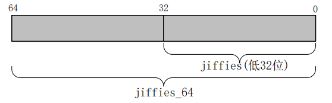

# Linux 驱动开发基石
## 阻塞与非阻塞 I/O
当应用程序对设备驱动进行操作的时候，如果不能获取到设备资源，那么阻塞式 I/O 就会将应用程序对应的线程挂起，直到设备资源可以获取为止。而对于非阻塞 I/O，应用程序的线程不会被挂起。

- 可以让 `read` 函数既能工作于阻塞方式，也可以工作于非阻塞方式：
  - 默认是阻塞方式；
  - 改为非阻塞方式的方法：
    1. APP 调用 `open` 函数时，传入 `O_NOBLOCK`；
    2. 在 `open` 函数之后，通过 `fcntl` 修改为非阻塞方式（当然也可以修改为阻塞方式）；
   ```c
   // open 之前设置
   int fd = open("/dev/xxx", O_RDWR | O_NOBLOCK);  // 非阻塞方式
   int fd = open("/dev/xxx", O_RDWR);              // 阻塞方式
   // open 之后设置
   int flags = fcntl(fd, F_GETFL);
   fcntl(fd, F_SETFL, flags | O_NOBLOCK);          // 非阻塞方式
   fcntl(fd, F_SETFL, flags & ~O_NOBLOCK);         // 阻塞方式
   ```

- `poll`：使用 `poll` 时，如果传入的超时时间不为 0，这种访问方式也是阻塞的。如果超时时间为 0，这样即使没有数据它也会立即返回，属于非阻塞方式。

- 注意：
  - 对于普通文件、块设备文件，`O_NOBLOCK` 不起作用；
  - 对于字符设备文件，`O_NOBLOCK` 起作用的前提是驱动程序针对 `O_NOBLOCK` 做了处理；

### 休眠与唤醒

**适用场景**：当应用程序必须等待某个事件发生时可以适用“休眠-唤醒”机制。

在休眠与唤醒机制中当 APP 调用 `read` 等函数试图获取数据时：
- 当驱动中有数据时立即返回结果；
- 当驱动中没有数据时，APP 休眠（被挂起，运行状态改为非 `RUNNING`，内核调度器不会让它运行）。APP 在内核态被阻塞。当有数据产生时唤醒被阻塞的 APP，继续执行剩下的代码。

阻塞访问最大的好处就是当设备文件不可操作时进程可以进入休眠状态，从而让出 CPU 资源。

可以在中断服务程序中将 APP 唤醒，它不属于 APP 的上下文，不能在处理过程中休眠（也不能调用会导致休眠的函数）。

Linux 内核提供了等待队列（`wait queue`）来实现阻塞进程的唤醒工作，如果要在驱动中使用等待队列，必须创建并初始化一个等待队列头：
```c
// include/linux/wait.h
struct __wait_queue_head {
   spinlock_t lock;
   struct list_head task_list;
};
typedef struct __wait_queue_head wait_queue_head_t;

// 初始化等待队列头
void init_waitqueue_head(wait_queue_head_t *q);
// 使用宏完成定义 + 初始化
DECLARE_WAIT_QUEUE_HEAD(name)
```
每个访问设备的进程都是一个队列项：
```c
struct __wait_queue {
   unsigned int flags;
   void *private;
   wait_queue_func_t func;
   struct list_head task_list;
};
typedef struct __wait_queue wait_queue_t;

// 定义并初始化一个等待队列项
DECLARE_WAITQUEUE(name, tsk)
// 其中 name 表示等待队列项的名字，tsk 表示这个等待队列项对应哪个任务（进程），一般设置为 current。
// 在 Linux 内核中 current 相当于一个全局变量，表示当前进程。
```
当设备操作需要被阻塞的时候需要将对应的等待队列项添加到等待队列头中，只有添加到等待队列头中以后进程才能进入休眠状态。当设备可以访问以后再将进程对应的等待队列项从等待队列头中移除即可。将队列项添加/移除等待队列头：
```c
void add_wait_queue(wait_queue_head_t *q, wait_queue_t *wait);
void remove_wait_queue(wait_queue_head_t *q, wait_queue_t *wait);
```

1. 休眠函数
   参考 `include/linux/wait.h`
   | 函数                                        | 说明                                                                        |
   | ------------------------------------------- | --------------------------------------------------------------------------- |
   | `wait_event_interruptible(wq, condition)` | 休眠，直到 `condition` 为真；<br />休眠期间是可以被打断的，可以被信号打断 |
   | `wait_event(wq, condition)` | 休眠，直到 `condition` 为真；<br />退出的唯一条件是 `condition` 为真，信号也不好使 |
   | `wait_event_interruptible_timeout(wq, condition, timeout)` | 休眠，直到 `condition` 为真或超时；<br />休眠期间是可以被打断的，可以被信号打断 |
   | `wait_event_timeout(wq, condition, timeout)` | 休眠，直到 `condition` 为真或超时；<br />不能被打断，信号也不好使 |
   - `wq`：`waitqueue`，等待队列。休眠时除了把程序状态改为非 `RUNNING` 之外，还要把进程放入 `wq` 中，以后中断服务程序要从 `wq` 中把它取出来唤醒；
   - `condition`：可以是一个变量，也可以是任何表达式。表示“一直等待，直到 `condition` 为真”
2. 唤醒函数
   参考 `include/linux/wait.h`
   | 函数                                        | 说明                                                                        |
   | ------------------------------------------- | --------------------------------------------------------------------------- |
   | `wake_up_interruptible(x)` | 唤醒 `x` 队列中状态为 `TASK_INTERRUPTIBLE` 的线程，只唤醒其中的一个线程 |
   | `wake_up_interruptible_nr(x, nr)` | 唤醒 `x` 队列中状态为 `TASK_INTERRUPTIBLE` 的线程，只唤醒其中的 `nr` 个线程 |
   | `wake_up_interruptible_all(x, nr)` | 唤醒 `x` 队列中状态为 `TASK_INTERRUPTIBLE` 的线程，唤醒其中的所有线程 |
   | `wake_up(x)` | 唤醒 `x` 队列中状态为 `TASK_INTERRUPTIBLE` 或 `TASK_UNINTERRUPTIBLE` 的线程，只唤醒其中的一个线程 |
   | `wake_up_nr(x, nr)` | 唤醒 `x` 队列中状态为 `TASK_INTERRUPTIBLE` 或 `TASK_UNINTERRUPTIBLE` 的线程，只唤醒其中的 `nr` 线程 |
   | `wake_up_all(x)` | 唤醒 `x` 队列中状态为 `TASK_INTERRUPTIBLE` 或 `TASK_UNINTERRUPTIBLE` 的线程，唤醒其中的所有线程 |
3. 驱动示例
   - 初始化 `wq` 队列；
   - 在驱动的 `read` 函数中，调用 `wait_event_interruptible`（它本身会判断 `event` 是否为 `FALSE`。如果为 `FALSE` 表示无数据，则休眠。因此该函数的调用并不一定导致休眠。）；
   - 当从 `wait_event_interruptible` 返回后，把数据复制回用户空间；
   - 在中断服务程序中：设置 `event` 为 `TRUE`，并调用 `wake_up_interruptible` 唤醒线程；
   ```c
   #define BUF_LEN 128
   #define NEXT_POS(x) ((x + 1) % BUF_LEN)

   struct gpio_key{
      int gpio;
      int irq;
      int flags;
      struct gpio_desc *gpiod;
   }

   static int g_keys[BUF_LEN];
   static int r, w;

   static DECLARE_WAIT_QUEUE_HEAD(gpio_key_wait);

   static inline int next_pos(int x) {
      return NEXT_POS(x);
   }

   static int is_key_buf_empty(void) {
      return r == w;
   }

   static int is_key_buf_full(void) {
      return (r == NEXT_POS(w));
   }

   static void put_key(int key) {
      if (!is_key_buf_full()) {
         g_keys[w] = key;
         w = NEXT_POS(w);
      }
   }

   static int get_key(void) {
      int key = 0;
      if (!is_key_buf_empty()) {
         key = g_keys[r];
         r = NEXT_POS(r);
      }
      return key;
   }

   static ssize_t gpio_key_read(struct file *filp, char __user *buf, size_t size, loff_t offt) {
      int err;
      int val;

      wait_event_interruptible(gpio_key_wait, !is_key_buf_empty());

      val = get_key();
      err = copy_to_user(buf, &val, sizeof(val));

      return sizeof(val);
   }

   static struct file_operations gpio_key_opr = {
      .owner = THIS_MODULE,
      .read = gpio_key_read,
   }

   static irqreturn_t gpio_keys_isr(int irq, void *dev_id) {
      int val;
      int key;
      struct gpio_key *gpio_key = dev_id;
      val = gpiod_get_value(gpio_key->gpiod);
      printk("get value %d from gpio %d\n", val, gpio_key->gpio);

      key = (gpio_key->gpio << 8) | val;
      put_key(key);
      wake_up_interruptible(&gpio_key_wait);

      return IRQ_HANDLED;
   }

   static int gpio_key_probe(struct platform_device *pdev) {
      int i;
      int err;
      int count;
      int flags = GPIOF_IN;
      enum of_gpio_flags flag;
      struct gpio_key *gpio_keys;
      struct device_node *node = pdev->dev.of_node;

      // 解析硬件数据
      // 获取 platform device 对应的 gpio 数量
      count = of_gpio_count(node);
      if(!count){
         printk("%s %s line:%d, there is not gpio available!\n", __FILE__, __FUNCTION__, __LINE__);
         return -1;
      }

      // 申请 count 个 gpio_key 对应的内存
      gpio_keys = kzalloc(sizeof(struct gpio_key) * count, GFP_KERNEL);

      // 解析 gpio 信息，如 gpio，irq 以及 gpio desc 等
      for(i = 0; i < count; i++){
         gpio_keys[i].gpio = of_get_gpio_flags(node, i, &flag);
         if(gpio_keys[i].gpio < 0){
               printk("%s %s line: %d, failed to get gpio!\n", __FILE__, __FUNCTION__, __LINE__);
               return -1;
         }
         gpio_keys[i].gpiod = gpio_to_desc(gpio_keys[i].gpio);
         gpio_keys[i].irq = gpiod_to_irq(gpio_keys[i].gpiod);
         if(flag & OF_GPIO_ACTIVE_LOW)
               flags |= GPIOF_ACTIVE_LOW;
         devm_gpio_request_one(&pdev->dev, gpio_keys[i].gpio, flags, NULL);
      }

      for(i = 0; i < count; i++){
         err = request_irq(gpio_keys[i].irq, gpio_keys_isr, IRQF_TRIGGER_FALLING | IRQF_TRIGGER_RISING, NULL, &gpio_keys[i]);
      }
      pdev->dev.platform_data = gpio_keys;

      // 注册 file_operations 结构体
      fops_name = "gpio_key_ops";
      major = register_chrdev(0, fops_name, &gpio_key_opr);
      // 创建设备类
      gpio_key_class = class_create(THIS_MODULE, "gpio_key_circle");
      if(IS_ERR(gpio_key_class)){
         printk("%s %s line:%d, failed to create gpio key class!\n", __FILE__, __FUNCTION__, __LINE__);
         unregister_chrdev(major, fops_name);
         return PTR_ERR(gpio_key_class);
      }

      device_create(gpio_key_class, NULL, MKDEV(major, 0), NULL, "gpio_key_drv_circle_%d", 0);

      return 0;
   }

   static int gpio_key_remove(struct platform_device *pdev){
      struct gpio_key *key;
      
      device_destroy(gpio_key_class, MKDEV(major, 0));
      class_destroy(gpio_key_class);
      unregister_chrdev(major, fops_name);

      key = pdev->dev.platform_data;
      for(; key; key++){
         free_irq(key->gpio, key);
      }
      kfree(pdev->dev.platform_data);

      return 0;
   }
   ...
   ```
   ```c
   // 通过按键实现阻塞、非阻塞、POLL 读取
   #include <linux/types.h>
   #include <linux/kernel.h>
   ...
   #include <asm/mach/map.h>
   #include <asm/uaccess.h>
   #include <asm/io.h>

   #define IMX6UIRQ_CNT    1
   #define IMX6UIRQ_NAME   "blockio"
   #define KEY0VALUE       0x01
   #define INVAKEY         0xFF
   #define KEY_NUM         1

   struct irq_keydesc {
      int gpio;
      int irqnum;
      unsigned char value;
      char name[10];
      irqreturn_t (*handler)(int, void *);
   };

   struct imx6uirq_dev {
      dev_t devid;
      struct cdev cdev;
      struct class *class;
      struct device *device;
      int major;
      int minor;
      struct device_node *nd;
      atomic_t keyvalue;
      atomic_t releasekey;
      struct timer_list timer;
      struct irq_keydesc irqkeydesc[KEY_NUM];
      unsigned char curkeynum;
      wait_queue_head_t r_wait;
   };

   struct imx6uirq_dev imx6uirq;

   static irqreturn_t key0_handler(int irq, void *dev_id) {
      struct imx6uirq_dev *dev = (struct imx6uirq_dev*)dev_id;

      dev->curkeynum = 0;
      dev->timer.data = (volatile long)dev_id;
      mod_timer(&dev->timer, jiffies + msecs_to_jiffies(10));
      return IRQ_RETVAL(IRQ_HANDLED);
   }

   static timer_function(unsigned long arg) {
      unsigned char value;
      unsigned char num;
      struct irq_keydesc *keydesc;
      struct imx6uirq_dev *dev = (struct imx6uirq_dev *)arg;

      num = dev->curkeynum;
      keydesc = &dev->irqkeydesc[num];
      value = gpio_get_value(keydesc->gpio);
      if (value == 0) {
         atomic_set(&dev->keyvalue, keydesc->value);
      } else {
         atomic_set(&dev->keyvalue, 0x80 | keydesc->value);
         atomic_set(&dev->releasekey, 1);
      }

      if (atomic_read(&dev->releasekey)) {
         wake_up_interruptible(&dev->r_wait);
      }
   }

   static int keyio_init(void) {
      unsigned char i = 0;
      char name[10];
      int ret = 0;
      
      // ...

      init_timer(&imx6uirq.timer);
      imx6uirq.timer.function = timer_function;

      init_waitqueue_head(&imx6uirq.r_wait);
      return 0;
   }

   static int imx6uirq_open(struct inode *inode, struct file filp) {
      filp->private_data = &imx6uirq;
      return 0;
   }

   static ssize_t imx6uirq_read(struct file *filp, char __user *buf, size_t cnt, loff_t *offt) {
      int ret = 0;
      unsigned char keyvalue = 0;
      unsigned char releasekey = 0;
      struct imx6uirq_dev *dev = (struct imx6uirq_dev *)filp->private_data;

   if (filp->f_flags & O_NOBLOCK) {
      if (atomic_read(&dev->releasekey) == 0)
         return -EAGAIN;
   } else {
      ret = wait_event_interruptible(dev->r_wait, atomic_read(&dev->releasekey));

      if (ret) {
         goto wait_error;
      }
   }
   // 以下为单独的阻塞 IO 部分
   #if 0
      ret = wait_event_interruptible(dev->r_wait, atomic_read(&dev->releasekey));
      if (ret) {
         goto wait_error;
      }
   #endif
      DECLARE_WAITQUEUE(wait, current);
      if (atomic_read(&dev->releasekey) == 0) {
         // 没有按键按下
         add_wait_queue(&dev->r_wait, &wait);
         __set_current_state(TASK_INTERRUPTIBLE);
         schedule();
         if (signal_pending(current)) {
            // 判断是否为信号引起的唤醒
            ret = -ERESTARTSYS;
            goto wait_error;
         }
         __set_current_state(TASK_RUNNING);
         remove_wait_queue(&dev->r_wait, &wait);
      }
      keyvalue = atomic_read(&dev->keyvalue);
      releasekey = atomic_read(&dev->releasekey);
      // ...
      return 0;
   wait_error:
      set_current_state(TASK_RUNNING);
      remove_wait_queue(&dev->r_wait, &wait);
      return ret;
   data_error:
      return -EINVAL;
   // 到这里为止：单独的阻塞 IO 部分
   wait_error:
      return ret;
   data_error:
      return -EINVAL;
   }

   unsigned int imx6uirq_poll(struct file *filp, struct poll_table_struct *wait) {
      unsigned int mask = 0;
      struct imx6uirq_dev *dev = (struct imx6uirq_dev *)filp->private_data;
      poll_wait(filp, &dev->r_wait, wait);
      if (atomic_read(&dev->releasekey)) {
         mask = POLLIN | POLLRDNORM;
      }
      return mask;
   }

   static struct file_operations imx6uirq_fops = {
      .owner = THIS_MODULE,
      .open = imx6uirq_open,
      .read = imx6uirq_read,
   };

   static int __init imx6uirq_init(void) {
      if (imx6uirq.major) {
         imx6uirq.devid = MKDEV(imx6uirq.major, 0);
         register_chrdev_region(imx6uirq.devid, IMX6UIRQ_CNT, IMX6UIRQ_NAME);
      } else {
         alloc_chrdev_region(&imx6uirq.devid, 0, IMX6UIRQ_CNT, IMX6UIRQ_NAME);
         imx6uirq.major = MAJOR(imx6uirq.devid);
         imx6uirq.minor = MINOR(imx6uirq.devid);
      }
      // ...

      atomic_set(&imx6uirq.keyvalue, INVAKEY);
      atomic_set(&imx6uirq.releasekey, 0);
      keyio_init();
      return 0;
   }

   static void __exit imx6uirq_exit(void) {
      unsigned i = 0;
      del_timer_sync(&imx6uirq.timer);
      ...
      class_destory(imx6uirq.class);
   }

   module_init(imx6uirq_init);
   module_exit(imx6uirq_exit);
   MODULE_LICENSE("GPL");
   ```
   考虑 `O_NOBLOCK` 方式的实现：
   ```c
   static ssize_t drv_read(struct file *fp, char __user *buf, size_t count, loff_t *ppos) {
      if (queue_empty(&as->queue) && fp->f_flags & O_NOBLOCK) {
         return -EAGAIN;
      }

      wait_event_interruptible(apm_waitqueue, !queue_empty(&as->queue));
      ...
   }
   ```
4. 应用程序使用
   ```c
   int main(int argc, char *argv[]) {
      int fd;
      int ret = 0;
      unsigned char data;

      if (argc != 2) {
         printf("Error Usage!\n");
         return -1;
      }

      fd = open(argv[1], O_RDWR);
      if (fd < 0) {
         printf("failed to open this file:%s", argv[1]);
         return -1;
      }

      while (1) {
         ret = read(fd, &data, sizeof(data));
         if (ret < 0) {
               // 数据读取错误或无效
         } else {
               if (data)
                  printf("get key value = %x\n", data);
         }
      }

      close(fd);

      return 0;
   }
   ```

### POLL 机制
**适用场景**：阻塞 + 超时；

APP 不知道驱动程序中是否有数据，可以先调用 `poll` 函数查询一下，`poll` 函数可以传入超时时间。

APP 调用 `poll, select, epoll` 函数（用于处理轮询）后，进入到内核态中驱动的 `poll` 函数：
- 如果有数据的话立即返回；
- 如果没有数据就休眠直到超时时间（内核唤醒 APP）或者在这之前已收到数据（中断服务程序被调用，在其中接收数据并唤醒 APP）；

APP 根据这些函数的返回值就可以知道是否有数据，如果有则可以调用 `read` 函数获取数据。

1. 从应用到驱动的 poll 流程
- [ ] 补充示意图

2. 驱动示例
- poll 函数原型：
   ```c
   /* 
    * @filp: 要打开的设置文件
    * @wait: 由应用程序传递进来的，一般将此参数传递给 poll_wait 函数 
    * @return: 向应用程序返回设备或资源状态
    */
   unsigned int (*poll)(struct file *filp, struct poll_table_struct *wait);

   // 返回状态：
   POLLIN         // 有数据可读取
   POLLPRI        // 有紧急的数据需要读取
   POLLOUT        // 可写数据
   POLLERR        // 指定的文件描述符发生错误
   POLLHUP        // 指定的文件描述符挂起
   POLLNVAL       // 无效的请求
   POLLRDNORM     // 等同于 POLLIN，普通数据可读
   ```
- 在驱动程序的 `poll()` 中调用 `poll_wait()`，`poll_wait()` 不会引起阻塞，只是将应用程序添加到 poll_table 中：
   ```c
   /* 
    * @wait_address: 要添加到 poll_table 中的等待队列头
    * @p: 即 poll 函数中的 wait 参数 
    */
   void poll_wait(struct file *flip, wait_queue_head_t *wait_address, poll_table *p);
   ```
- 驱动示例：
   ```c
   void timer_func(unsigned long arg) {
      unsigned char value;
      unsigned char num;
      struct irq_keydesc *keydesc;
      struct imx6uirq_dev *dev = (struct imx6uirq_dev*)arg;

      num = dev->currkeynum;
      keydesc = &dev->irqkeydesc[num];

      value = gpio_get_value(keydesc->gpio);
      if (value == 0) {
         // 按键按下
         atomic_set(&dev->keyvalue, keydesc->value);
      } else {
         atomic_set(&dev->keyvalue, 0x80 | keydesc->value);
         atomic_set(&dev->releasekey, 1);
      }

      if (atomic_read(&dev->releasekey)) {
         wake_up_interruptible(&dev->r_wait);
      }
   }

   unsigned int imx6uirq_poll(struct file *filp, struct poll_table_struct *wait) {
      unsigned int mask = 0;
      struct imx6uirq_dev *dev = (struct imx6uirq_dev*)filp->private_data;

      // dev->r_wait 为等待队列头
      poll_wait(filp, &dev->r_wait, wait);

      if (atomic_read(&dev->releasekey)) {
         mask = POLLIN | POLLRDNORM;
      }
      return mask;
   }
   ```

3. 应用程序使用
- select
   ```c
   /* 
    * @readfds, writefds, exceptfds: 指向描述符集合，表明关心哪些
    *  描述符。readfds 用于监视指定描述符集的读变化（是否可读），只要
    *  集合中一个文件可读，select 就会返回一个大于 0 的值表示有文件可
    *  读取。如果没有文件可读取，则根据 timeout 参数来判断是否超时。
    *  可以将 readfds 设置为 NULL，表示不关心任何文件的读变化。
    *  另外两个以此类推。writefds-可写、exceptfds-文件异常。
    * @nfds: 所要监视的这三类文件描述符集合中，最大文件描述符加 1
    *（This argument should be set to the highest-numbered file
    * descriptor in any of the three sets, plus 1. The indicated
    * file descriptors in each set are checked, up to this limit.） 
    * @return: 发生错误时，返回 -1，同时 errno 被设置；成功时，返回
    *  三个集合中文件描述符的数量（the total number of bits that are set in readfds, writefds, exceptfds）；0-超时。
    */
   int select(int nfds, fd_set *readfds, fd_set *writefds, fd_set *exceptfds, struct timeval *timeout);

   struct timeval {
      long tv_sec;   // 秒
      long tv_usec;  // 微妙
   };
   ```
   - man: select, pselect, FD_CLR, FD_ISSET, FD_SET, FD_ZERO - **synchronous I/O multiplexing**.
   - man:（功能描述）select() allows a program to monitor multiple file descriptors, waiting until one or more the fd becomes "ready" for some class of I/O operation (e.g., input possible). A fd is considered ready if it is possible to perform a corresponding I/O operation (e.g., read, or a sufficently small write) without blocking.
   - man: **select() can monitor only fd numbers that are less than FD_SETSIZE( 一般为 1024), poll and epoll do not have this limitation**.
   - man: Note，Upon return, each of the fd sets is modified in place to indicate which fd are currently "ready". Thus, **if using select() within a loop, the sets must be reinitialized before each call**. **The implementation of the fd_set arguments as value-result arguments is a design error that is avoided in poll and epoll**.
   - man: The content of a file descriptor set can be manipulated using the following macros:
     - `FD_ZERO()`: clears (remove all file descriptors from) set. It should be employed as the first step in initializing a file descriptor set.
     - `FD_SET()`: adds the fd to set. Adding a fd that is already present in the set is a no-op, and does not produce an error.
     - `FD_CLR()`: removes the fd from set. Removing a fd that is not present in the set is a no-op.
     - `FD_ISET`: select() modifies the contents of the sets according to the rules. After calling select(), this macro can be used to test if a fd is still present in a set. It returns nonzero if fd is present in set, and zero if it is not.
   - **当 select() 函数返回时，只有那些 “ready” 状态的 fd 会继续留在 fd_set 里，其他的则会被删除**。
   - man: the call will block until either:
     - a file descriptor becomes ready;
     - the call is interrupted by a signal handler; or
     - the timeout expires.
   - If both fields of the timeval structure are zero, then select() returns immediately. (This is useful for polling.) If timeout is specified as NULL, select() blocks indefinitely waiting for a fd to become ready.
   - 示例程序：
      ```c
      int main(void) {
         int ret, fd;
         fd_set readfds;
         struct timeval timeout;

         fd = open("dev_xxx", O_RDWR | O_NONBLOCK);
         if (fd < 0) {
            return -1;
         }
         
         FD_ZERO(&readfds);
         FD_SET(fd, &readfds);

         timeout.tv_sec = 0;
         timeout.tv_usec = 500000;  // 500ms

         ret = select(fd + 1, &readfds, NULL, NULL, &timeout);
         switch (ret) {
            case 0:
               printf("timeout\n");
               break;
            case -1:
               printf("error\n");
               break;
            default:
               if (FD_ISSET(fd, &readfds)) {
                  // 读取数据
               }
               break;
         }

         close(fd);
         return 0;
      }
      ```

- poll
   poll 函数本质上和 select 没有太大差别，但是 poll 函数没有最大文件描述符限制。
   ```c
   /* 
    * @fds: 要监视的文件描述符集合，以及要监视的事件，为一个数组 
    * @nfds: 要监视的文件描述符数量
    * @timeout: 超时时间，单位为 ms
    * @return: revents 域中不为 0 的 pollfd 结构体个数，也就是发生
    *  事件或错误的文件描述符数量；0-超时；-1-发生错误，并设置 errno
    */
   int poll(struct pollfd *fds, nfds_t nfds, int timeout);

   // 如果文件描述符无效的话，events 监视事件也无效，并且 revents 返回 0。
   struct pollfd {
      int fd;           // 文件描述符
      short events;     // 请求的事件，输入参数，bit mask
      short revents;    // 返回的事件，输出参数，bit mask
   };
   
   // events 表示要监视的事件，可选类型如下：
   POLLIN         // 有数据可读
   POLLPRI        // 有紧急的数据需要读取
   POLLOUT        // 可写
   POLLERR        // 指定的文件描述符发生错误
   POLLHUP        // 指定的文件描述符挂起
   POLLNVAL       // 无效的请求
   POLLRDNORM     // 等同于 POLLIN
   // 如果 events 被指定为 0，只有 POLLHUP, POLLERR 和 POLLNVAL 可以被返回；当 events 不为 0 时，revents 也可以包含这些 bits。这三个 bit 对 events 是无意义的，只有对应的事件发生时才会设置 revents。
   ```
   - man:（功能描述）poll() performs a similar task to select(): it waits for one of a set of file descriptors to become ready to perform I/O. The Linux-specific epoll API performs a similar task, buf offers features beyond those found in poll().
   - man: If none of the events requested (and no error) has occurred for any of the file descriptors, the poll() blocks until one of the events occurs.
   - man: The call will block until either:
     - a file descriptor becomes ready;
     - the call is interrupted by a signal handler; or
     - the timeout expires.
   - man: specifying a negative value in timeout means an infinite timeout. Specifying a timeout of zero causes poll() to return immediately, even if no file descriptors are ready.
   - 示例程序：
      ```c
      int main(void) {
         int ret;
         int fd;
         struct pollfd fds;

         fd = open(filename, O_RDWR | O_NONBLOCK);
         if (fd < 0) {
            return -1;
         }

         fds.fd = fd;
         fds.events = POLLIN;

         ret = poll(&fds, 1, 500);
         if (ret > 0) {
            // 读取数据
         } else if (ret == 0) {
            // 超时
         } else {
            // 错误
         }

         close(fd);
         return 0;
      }
      ```

- epoll
  - 传统的 select 和 poll 函数都会随着所监听的 fd 数量的增加，出现效率低下的问题（轮询监听导致，poll 函数每次必须遍历所有的描述符来检查是否有就绪的，这个过程很耗费时间）。为此，epoll 应用而生，epoll 就是为处理大并发而准备的（通过事件机制监听文件描述符），一般常常在网络编程中使用 epoll。
  - epoll 更多的是用在大规模的并发服务器上，当涉及到的文件描述符数量比较少时适用 select 和 poll。
  - 使用：
    1. 应用程序需要先使用 `epoll_create()` 创建一个 epoll 句柄：
      ```c
      /* 
         * @size: 从 Linux 2.6.8 开始此参数就没有意义了，随便填写一个大于 0 的值就可以 
         * @return: epoll 句柄，如果为 -1 就表示创建失败。
         */
      int epoll_create(int size);
      ```
    2. 句柄创建后，通过 `epoll_ctl()` 向其中添加要监视的文件描述符以及监视的事件：
      ```c
      /* 
       * @epfd: 要操作的 epoll 句柄 
       * @op: 表示要对 epfd 进行的操作
       * @fd: 要监视的文件描述符
       * @event: 要监视的事件类型
       * @return: 0-成功；-1-失败，并设置 errno
       */
      int epoll_ctl(int epfd, int op, int fd, struct epoll_event *event);

      // op:
      EPOLL_CTL_ADD     // 向 epfd 添加文件参数 fd 表示的描述符
      EPOLL_CTL_MOD     // 修改参数 fd 的 event 事件
      EPOLL_CTL_DEL     // 从 epfd 中删除 fd 描述符

      // event:
      struct epoll_event {
         uint32_t events;        // epoll 事件
         epoll_data_t data;      // 用户数据
      }

      // 可选的 epoll 事件：
      EPOLLIN                    // 有数据可读
      EPOLLOUT                   // 可写数据
      EPOLLPRI                   // 有紧急的数据需要读取
      EPOLLERR                   // 指定的文件描述符发生错误
      EPOLLHUP                   // 指定的文件描述符挂起
      EPOLLET                    // 设置 epoll 为边沿触发，默认触发模式为水平触发
      EPOLLONESHOT               // 一次性的监视，当监视完成后还需要再次监视某个 fd，则需要将 fd 重新添加到 epoll 里面
      ```
    3. 设置完成后，通过 `epoll_wait()` 来等待事件的发生：
      ```c
      /* 
       * @epfd: 要等待的 epoll 
       * @events: 传出参数，调用者可通过此参数判断发生了哪些事件
       * @maxevents: events 数组大小，必须大于 0
       * @timeout: 超时时间，单位为 ms
       * @return: 0-超时；-1-错误；其他值-准备就绪的文件描述符数量
       */
      int epoll_wait(int epfd, struct epoll_event *events, int maxevents, int timeout);
      ```

- `poll`、`select` 以及 `epoll` 的对比
   - [ ] 三种机制对比

4. 内核 poll 机制详解

## 异步通知
**适用场景**：使用“休眠-唤醒”、“POLL 机制”时都需要休眠等待某个事件发生，两者的区别在于后者可以指定休眠的时长。如果 APP 不想休眠，也可以通过异步通知机制使得驱动程序在有数据时主动通知 APP，APP 收到信号后执行处理函数。

驱动利用内核中提供的函数发送信号给 APP，APP 需要把自己告诉驱动并注册信号处理函数。

1. 信号类型
   参考 `include/uapi/asm-generic/signal.h`
   ```c
   #define SIGHUP    1
   #define SIGINT    2
   #define SIGQUIT   3
   ...
   #define SIGIO     29    // 驱动常用信号，表示有 I/O 事件
   #define SIGPOLL   SIGIO
   ```
2. APP 任务
   - 注册信号处理函数
      ```c
      // #include <signal.h>
      typedef void (*sighandler_t)(int);     // APP 需要先实现的处理函数类类型

      /* 绑定信号 signum 和信号处理函数 hander 以完成注册 */
      sighandler_t signal(int signum, sighandler_t handler);
      ```
   - 打开驱动程序对应的设备节点，并使能驱动程序的异步通知功能；
   - 将自己的进程 ID 告诉驱动程序；
   - 意愿（什么时候接收信号、什么时候不收信号）；
3. 驱动程序任务
   - 当 APP 设置进程 ID 时记录；
   - 驱动有对应的异步通知函数 `fasync`（APP 打开驱动程序时，内核会创建对应的 `file` 结构体，`file` 中有 `f_flags`，其中有一个 `FASYNC` 位，当它被置位时表示使能异步通知功能。当 `f_flags` 中的 `FASYNC` 位发生变化时，驱动程序的 `fasync` 函数被调用）；
   - **发生中断**并检测到数据时，驱动程序调用内核辅助函数（`kill_fasync`）发送信号；
4. 整体流程
   - [ ] 补充异步通知时整体流程，包括 APP 端和驱动端
5. 驱动示例
   - 提供对应的 `drv_fasync` 函数（调用 `fasync_helper` 函数就可以）：
      ```c
      static struct fasync_struct *button_async;

      static int drv_fasync(int fd, struct file *filp, int on) {
         return fasync_helper(fd, filp, on, &button_async);
      }
      ```
     - `fasync_helper` 函数会分配、构造一个 `fasync_struct` 结构体；
     - 驱动文件的 `flag` 的 `FASYNC` 被置位时：`button_async->fa_file = filp`；
     - 驱动文件的 `flag` 的 `FASYNC` 被清空时 `button_async->fa_file = NULL`；
     - 想要发送信号时，使用 `button_async` 作为参数就可以，它里面**可能**含有 `PID`；
   - 在合适的时机发信号：
      ```c
      // 示例在 GPIO 的中断服务程序中发送信号
      kill_fasync(&button_async, SIGIO, POLL_IN);
      ```
      - `button_async->fa_file` 非空时，可以从中获取 `PID`，表示发送给哪一个 APP；
      - `SIGIO`：信号类型；
      - `POLL_IN`：信号值（APP 用不到这个参数）；
6. 应用程序使用
   - 编写信号处理函数：
      ```c
      static void sig_func(int sig) {
         int val;
         read(fd, &val, 4);
         printf("get button: 0x%x\n", val);
      }
      ```
   - 注册信号处理函数：
      ```c
      signal(SIGIO, sig_func);
      ```
   - 打开驱动对应的设备文件：
      ```c
      fd = open(argv[1], O_RDWR);
      ```
   - 把进程 ID 告诉驱动：
      ```c
      fcntl(fd, F_SETOWN, getpid());
      ```
   - 置位驱动的 `FASYNC` `flag`：
      ```c
      flags = fcntl(fd, F_GETFL);
      fcntl(fd, F_SETFL, flags | FASYNC);
      ```
7. 内核异步通知机制详解
   - APP 执行 `fcntl` 系统调用时，会导致内核中 `fs/fcntl.c` 文件下的如下函数被调用：
      ```c
      // 位于 fs/fcntl.c
      // SYSCALL_DEFINE3 宏定义展开后可生成 sys_fcntl 标识符
      SYSCALL_DEFINE3(fcntl, unsigned int, fd, unsigned int, cmd, unsigned long, arg)
      {	
         struct fd f = fdget_raw(fd);
         long err = -EBADF;

         if (!f.file)
            goto out;

         if (unlikely(f.file->f_mode & FMODE_PATH)) {
            if (!check_fcntl_cmd(cmd))
               goto out1;
         }

         err = security_file_fcntl(f.file, cmd, arg);
         if (!err)
            err = do_fcntl(fd, cmd, arg, f.file);

      out1:
         fdput(f);
      out:
         return err;
      }
      ```
   - 对于 `F_SETOWN` 的调用，从上述代码中的 `do_fcntl(...)` 可以追溯到 `f_modown(...)` 函数，在该函数中会在 `struct file *filp` 中记录 `PID`：
      ```c
      static void f_modown(struct file *filp, struct pid *pid, enum pid_type type, int force) {
         ...
         filp->f_owner.pid = get_pid(pid);
      }
      ```
   - 对于 `F_GETFL` 的调用，从上述代码中的 `do_fcntl(...)` 可以追溯到仅仅是返回 `filp->f_flags`；
   - 对于 `F_SETFL` 的调用，从上述代码中的 `do_fcntl(...)` 可以追溯到 `setfl(...)` 函数：
      ```c
      static long do_fcntl(int fd, unsigned int cmd, unsigned long arg, struct file *filp) {
         long err = -EINVAL;

         switch (cmd) {
         case F_DUPFD:
            ...
         case F_GETFL:
            err = filp->f_flags;
            break;
         case F_SETFL:
            err = setfl(fd, filp, arg);
            break;
         }
      }
      ```
      在 `setfl(...)` 函数中会比较 `filp->f_flags` 中的 `FASYNC` 位，若发现它**发生变化**了则调用驱动的 `fasync` 函数：
      ```c
      if (((arg ^ filp->f_flags) & FASYNC) && filp->f_op->fasync) {
         error = filp->f_op->fasync(fd, filp, (arg & FASYNC) != 0);
         ...
      }
      ```
      示例驱动程序：
      ```c
      static int gpio_key_drv_fasync(int fd, struct file *file, int on) {
         if (fasync_helper(fd, file, on, &button_fasync) >= 0) {
            return 0;
         } else {
            return -EIO;
         }
      }
      ```
      `fasync_helper` 程序经过精简后可表示为：
      ```c
      if (on) {
         struct fasync_struct *new;
         new = fasync_alloc();
         new->magic = FASYNC_MAGIC;
         new->fa_file = filp;
         new->fa_fd = fd;
         button_fasync = new;
      } else {
         kfree(button_fasync);
         button_fasync = NULL;
      }
      ```
      因此，`FASYNC` 位发生变化且变为置位时，驱动程序的 `button_fasync` 就被设置了，它指向的 `fasync_struct` 结构体中含有 `filp`，而 `filp` 中又含有之前设置的接收方 `PID`。
   - 在驱动程序中调用 `kill_fasync()` 函数后：
      ```c
      kill_fasync(&button_fasync, SIGIO, POLL_IN);
      ```
      它的核心就是从 `button_fasync` 指针中取出 `fasync_struct` 结构体，从而由该结构体得到接收方的 `PID`，最后使用 `send_sigio()` 函数发送信号。
      ```c
      void kill_fasync(struct fasync_struct **fp, int sig, int band) {
         ...
         kill_fasync_rcu(rcu_dereference(*fp), sig, band);
         ...
      }

      static void kill_fasync_rcu(struct fasync_struct *fa, int sig, int band) {
         ...
         struct fown_struct *fown;
         ...
         fown = &fa->fa_file->f_owner;    // app 调用 F_SETOWN 时设置
         ...
         send_sigio(fown, fa->fa_fd, band);  // 发信号
      }
      ```
      `send_sigio` 函数的实质是：根据 `PID` 找到进程在内核的 `task_struct` 结构体，修改里面的某些成员表示收到了信号。
   - APP 收到信号后，处理函数被调用相当于 APP 的中断，处理过程和中断处理过程类似：保存现场、处理信号、恢复现场。
     - APP 进入内核态时，内核在 APP 的栈里保存 APP 的运行环境；
     - APP 退出内核态时，内核从 APP 的栈里恢复 APP 的运行环境；
     - APP 收到信号瞬间处于内核态。因为 `send_sigio` 函数要么由驱动程序调用，要么由 APP 通过系统调用来间接调用，而 `send_sigio` 函数运行时处于内核态；
     - 由内核态返回到用户态时，内核发现 APP 有信号等待处理就会修改 APP 的栈，增加一个新的运行环境。在该环境中运行地址是信号处理函数的地址，于是返回到用户态后开始执行的是信号处理函数；
     - 信号处理函数执行完后，会再次返回到内核态，在内核态里再使用旧的运行环境，从而在再次返回用户态时 APP 得以恢复运行；

## 定时器
涉及到两个要素：
   - 超时时间；
   - 函数；

1. 概述
   - FreeRTOS 等实时系统需要一个硬件定时器提供系统时钟，一般使用 Systick 作为系统时钟源。同理，Linux 的运行也需要一个系统时钟（可能是 Cortex-A7 内核中的通用定时器，关于该定时器参考：《Cortex-A7 Technical Reference Manua.pdf-9: Generic Timer》和 《ARM Architecture Reference Manual ARMv7-A and ARMv7-R edition.pdf-B8: The Generic Timer》）。
   - 硬件定时器提供时钟源，周期性地产生定时中断，中断的频率就是系统频率，也叫节拍率（tick rate），单位是 Hz。
   - 时钟源的频率是可以设置的：
     - 在编译 Linux 内核时，可以通过图形化配置界面设置系统节拍率：`Kernel Features -> Timer frequency (<choice> [=y])`，默认为 100Hz；
     - `/.config` 中存在记录：`CONFIG_HZ=100`、`include/asm-generic/param.h` 中通过 `CONFIG_HZ` 来设置系统时钟：`#define HZ CONFIG_HZ`，`HZ` 表示一秒的节拍数；
   - 节拍率高低的比较：
     - 高节拍率可以提高系统时间精度，对时间要求严格的函数来说，能够以更高的精度运行，同时时间测量也更加准确；
     - 高节拍率会导致中断产生更频繁，加剧了系统处理中断的负担，中断服务函数占用处理器的时间增加；
     - 补充：现在的处理器性能都很强大，采用 1000Hz 的系统节拍率并不会增加太大的负载压力。
   - Linux 内核使用全局变量 `jiffies` 来记录系统从启动以来的系统节拍数，系统启动的时候会将 `jiffies` 初始化为 0：
      ```c
      // include/linux/jiffies.h
      extern u64 __jiffy_data jiffies_64;                   // 64 位
      extern unsigned long volatile __jiffy_data jiffies;   // 32 位
      ```
      - `jiffies_64` 和 `jiffies` 是同一个东西，前者用于 64 位系统，而后者用于 32 位系统；
      - 为了兼容不同的硬件，`jiffies` 其实就是 `jiffies_64` 的低 32 位：
         
      - 使用 `get_jiffies_64` 函数可以获取 `jiffies_64` 的值。在 32 位系统上读取 `jiffies` 的值，在 64 位系统上 `jiffies` 和 `jiffies_64` 表示同一个变量，因此也可以直接读取 `jiffies` 的值；
      - `jiffies/HZ` 就是系统运行时间，单位为秒；
      - Linux 内核使用如下几个函数来处理绕回问题（`jiffies` 数据溢出）：
         ```c
         time_after(unkown, known)
         time_before(unkown, known)
         time_after_eq(unkown, known)
         time_before_eq(unkown, known)
         // unkown 通常为 jiffies，known 通常是需要对比的值
         // 如果 unkown 超过 known 的话，time_after 函数返回真，否则返回假。其他类推
         // 超时判断示例：
         unsigned long timeout;
         timeout = jiffies + 2 * HZ;

         if (time_before(jiffies, timeout)) {
            // 超时未发生
         } else {
            // 超时发生
         }
         ```
      - Linux 内核提供了几个 `jiffies` 和 ms、us、ns 之间的转换函数：
         ```c
         int jiffies_to_msecs(const unsigned long j)
         int jiffies_to_usecs(const unsigned long j)
         u64 jiffies_to_nsecs(const unsigned long j)
         
         long msecs_to_jiffies(const unsigned int m)
         long usecs_to_jiffies(const unsigned int u)
         unsigned long nsecs_to_jiffies(u64 n)
         ```
   - Linux 内核定时器采用系统时钟来实现。如果想要实现周期性定时，需要在定时处理函数中重新开启定时器；
   - Linux 内核提供了毫秒、微妙和纳秒延时函数：
      ```c
      void ndelay(unsigned long nsecs)
      void udelay(unsigned long usecs)
      void mdelay(unsigned long msecs)
      ```

2. API
   参考 `include/linux/timer.h`
   - `struct timer_list` 的定义：
      ```c
      struct timer_list {
         struct list_head entry;
         unsigned long expires;
         struct tvec_base *base;

         void (*function)(unsigned long);
         unsigned long data;

         int slack;
      }
      ```
   - `setup_timer(time, fn, data)`：
     - 设置定时器，主要是初始化 `timer_list` 结构体，设置其中的函数、参数；
   - `void init_timer(struct timer_list *timer)`：
     - 初始化 `timer_list` 类型变量。当定义了一个 `timer_list` 变量以后一定要先初始化。
   - `void add_timer(struct timer_list *timer)`：
     - 向内核添加定时器。`timer->expires` 表示超时时间；
     - 当超时时间达到，内核就会调用这个函数：`timer->function(timer->data)`；
   - `int mod_timer(struct timer_list *timer, unsigned long expires)`：
     - 修改定时器的超时时间；
     - 它等同于 `del_timer(timer); timer->expires = expires; add_timer(timer);`，但是更高效；
   - `int del_timer(struct timer_list *timer)`：删除定时器；
   - `int del_timer_sync(struct time_list *timer)`：同步版的删除定时器，它会等待其他处理器使用完定时器再删除，不能使用在中断上下文中。
3. 定时器时间单位
   - 编译内核时，可以通过 `CONFIG_HZ` 来修改系统滴答（`tick`），100 时表示 10ms 发生一次系统滴答中断。每发生一次 `tick` 中断，全局变量 `jiffies` 就会累加 1；
      ```
      CONFIG_HZ=100
      ```
   - 定时器的时间就是基于 `jiffies` 的；
   - 修改超时时间时，一般使用如下两种方式：
      ```c
      // 在 add_timer 之前，直接修改
      timer.expires = jiffies + xxx;         // xxx 表示多少滴答后超时，也就是 xxx * 10ms
      timer.expires = jiffies + 2 * HZ;      // HZ 等于 CONFIG_HZ，2 * HZ 就相当于 2 秒

      // 在 add_timer 之后，使用 mod_timer 修改
      mod_timer(&timer, jiffies + xxx);
      mod_timer(&timer, jiffies + 2 * HZ);
      ```
4. 定时器内部机制
   - 每发生一次硬件中断时，硬件中断处理完后就会看看有没有软件中断（中断下半部）要处理。
   - **定时器中断就是通过软件中断来实现的**，它属于 `TIMER_SOFTIRQ` 类型的软中断；
   - 软中断（包括下半部中断中的 `tasklet`，以及这里的定时器）处理函数的执行上下文均为中断所在的上下文，因此在该函数中不允许休眠；
   - 对于 `TIMER_SOFTIRQ` 软中断，初始化代码如下：
      ```c
      void __init init_timers(void) {
         init_timer_cpus();
         init_timer_stats();
         open_softirq(TIMER_SOFTIRQ, run_timer_softirq);
      }
      ```
   - 在硬件中断后，内核调用软件中断的处理函数。对于 `TIMER_SOFTIRQ`，会调用 `run_timer_softirq`：
      ```
      run_timer_softirq
         __run_timer(base);
            while (timer_after_eq(jiffies, base->clk)) {
               ...
            }
      expire_timers(base, heads + levels);
         fn = timer->function;
         data = timer->data;
         call_timer_fn(timer, fn, data);
            fn(data);
      ```
      - `add_timer(...)` 函数会把 `timer` 放到内核中的某个链表（应该是按照超时时间排序的有序链表）；
      - 在 `TIMER_SOFTIRQ` 的处理函数中，会从链表中把这些**超时的** `tiemr` 取出来，执行其中的函数（`timer->expires` 大于等于 `jiffies` 时表示超时）；
5. 找到系统滴答
   ```bash
   cat /proc/interrupts
   ```
   - 输出的内容中有一个数值变化特别块，它就是系统滴答中断；
   
   以 `IM6ULL` 为例，滴答中断名字就是 `i.MX Timer Tick`。在 Linux 内核源码目录下执行以下命令：
   ```bash
   grep "i.MX Timer Tick" * -nr
   ```
   - 得到输出： `drivers/clocksource/timer-imx-gpt.c:319 act->name = "i.MX Timer Tick"`；

   打开 `timer-imx-gpt.c`：
   ```c
   act->name = "i.MX Timer Tick"；
   act->flags = IRQF_TIMER | IRQF_IRQPOLL;
   act->handler = mxc_timer_interrupt;
   act->dev_id = ced;

   return setup_irq(imxtm->irq, act);
   ```
   - `mxc_timer_interrupt` 应该就是滴答中断的处理函数：
      ```c
      static irqreturn_t mxc_timer_interrupt(int irq, void *dev_id) {
         struct clock_event_device *ced  = dev_id;
         struct imx_timer *imxtm = to_imx_timer(ced);
         uint32_t tstat;

         tstat = readl_relaxed(imxtm->base + imxtm->gpt->reg_tstat);

         imxtm->gpt->gpt_irq_acknowledge(imxtm);

         ced->event_handler(ced);

         return IRQ_HANDLED;
      }
      ```
   - 通过调试找到 `event_handler(...)` 对应 `tick_handle_periodic`：
      ```c
      // kernel/time/tick-common.c
      tick_handle_periodic
         tick_periodic(cpu)
            do_timer(1)
               jiffies_64 += ticks;    // jiffies 就是 jiffies_64
      
      // arch/arm/kernel/vmlinux.lds.S
      #ifndef __ARMEB__
      jiffies = jiffies_64;
      #else
      jiffies = jiffies_64 + 4;
      #endif
      // 对 jiffies_64 的累加操作，就是对 jiffies 的累加操作
      ```
      - [ ] 上述代码说明了，对于大字节序的 CPU，`jiffies` 指向 `jiffies_64` 的高 4 字节；对于小字节序的 CPU，`jiffies` 指向 `jiffies_64` 的低 4 字节。

## 中断处理
分为上、下半部：
   - 在上半部处理紧急的事情，在上半部的处理过程中，中断是被禁止的；
   - 在下半部处理耗时的事情，在下半部的处理过程中，中断是使能的。

上半部即硬件中断，即通过 `request_irq` 完成注册的中断服务程序。它与裸机的中断服务程序类似，要求快进快出，但不同的是在 Linux 中要求它不能嵌套。因此在实现时通常先关中断，处理完成后开中断。上半部的内容不多，这里主要涉及的是对中断下半部的处理。

### 中断下半部 tasklet
见 [subsystem-interrupt.md]() 相关章节。

### 工作队列
见 [subsystem-interrupt.md]() 相关章节。

### 中断的线程化处理
见 [subsystem-interrupt.md]() 相关章节。

## mmap
1. 作用：
   应用程序和驱动之间传递数据时，可以通过 `read/write`（`copy_from_user/copy_to_user`）函数进行，这涉及在用户态 `buffer` 和内核态 `buffer` 之间传送数据。这种方式在数据量较大或者操作频繁时存在效率低的问题：
   - 数据在 `buffer` 之间的拷贝耗时；
   - 用户态和内核态之间频繁的状态切换导致的耗时；

   改进方式就是让程序可以直接读写驱动程序中的 `buffer`，这可以通过 `mmap` 实现。`mmap` 能够把内核的 `buffer` 直接映射到用户态，从而让 APP 在用户态直接读写。

2. 虚拟地址与 MMU
   背景：通过运行同一程序两次，并在程序中打印全局变量的地址和值，打印结果是地址一样，值可以不一样。

   **CPU 发出的地址是虚拟地址**，它经过 `MMU, Memory Manage Unit`（内存管理单元）映射到物理地址上。对于不同进程的同一个虚拟地址，`MMU` 会把它们映射到不同的物理地址。（上述程序打印结果中的地址是虚拟地址）
   - [ ] 添加虚拟地址到物理地址的转换示意图

3. 虚拟地址与物理地址的转换
   查看某一进程的映射关系：
   ```bash
   # 通过 ps 命令查看进程 ID
   ps
   # 查看目标 ID 的映射关系，325 即目标进程的 PID
   cat /proc/325/maps
   ```
   在 Linux 中进程使用 `struct task_strcut` 表示，每一个 APP 在内核里都有一个 `task_struct`。这个结构体保存有内存信息：`mm_struct`，在 `mm_struct` 中通过 `pgd`(`Page Global Directory`) 字段保存页目录表信息（含有虚拟地址和物理地址的映射关系）以及 `mmap` 字段保存虚拟地址的使用情况。
   - [ ] 添加由 `task_struct` 出发得到的与地址转换相关的数据结构
     - 每个 APP 在内核中都有一个 `task_struct` 结构体，它用来描述一个进程；
     - `task_struct` 中用 `mm_struct` 来管理进程占用的内存；
     - `mm_struct` 中用 `mmap` 字段来记录虚拟地址，用 `pgd` 来描述虚拟地址和物理地址之间的映射关系；
  
   `mmap` 字段对应的数据类型为 `struct vm_area_struct`：
      ```c
      struct vm_area_struct {
         vm_start;
         vm_end;
         vm_flags;
         vm_next;
         ...
      }
      ```
      - 每个 APP 都有一系列的虚拟内存，比如 APP 含有代码段、数据段、BSS 段、栈以及共享库等等。这些单元会保存在内存里，它们的地址空间不同，权限不同（代码段是只读、可运行的；数据段是可读可写的），内核用一系列 `vm_area_struct` 来描述它们；
      - `vm_start` 和 `vm_end` 字段记录的是虚拟地址；
      - 虚拟地址的转换需要借助上述 `mm_struct` 中的 `pgd` 字段；

4. ARM 架构中的内存映射
   ARM 架构支持一级页表映射，还支持二级页表映射。一级页表里地址映射的最小单位是 1M，二级页表地址映射的最小单位有 4K、1K，Linux 使用 4K。

   将页表细分的目的是减少内存浪费（内内存碎片）。

   一级**页表项**里的内容，决定了它是指向一块物理内存，还是指向二级页表：
   - [ ] Level 1 translation table entry format

   - 一级页表映射过程
      - 一级页表中每个表项用来设置 1 M 的空间。对于 32 位的系统，虚拟地址空间有 4G，因此需要 4G/1M = 4096 个页表项。
      - 第 0 个页表项用来表示虚拟地址第 0 个 1M（虚拟地址为 0-0xFFFFF）对应哪一块物理内存，以及一些权限设置。同理，第 1 个页表项表示第 1 个 1M（虚拟地址为 0x100000-0x1FFFFF）对应哪一块物理内存以及一些权限设置。依此类推。
      - **使用一级页表时，先在内存里设置号各个页表项，然后把页表基地址告诉 `MMU`，就可以启动 `MMU` 了**；
      - 映射过程：
         1. CPU 发出虚拟地址 `vaddr`，假设为 0x12345678；
         2. MMU 根据 `vaddr[31:20]` 找到第一级页表项（第 0x123 项，根据此项内容得知它是一个段页表项）；
         3. 在页表项中取出**物理地址**：`Section Base Address`，假设为 0x81000000；
         4. 物理地址加上由 `vaddr` 得到的段内偏移地址 0x45678 得到物理地址 0x81045678； 
      - [ ] 添加示意图

   - 二级页表映射过程
     - **首先要设置好一级页表、二级页表，并把一级页表的基地址告诉 `MMU`**；
     - 二级页表格式：
       - [ ] Format of level 2 translation table entry
     - 映射过程：
       1. CPU 发出虚拟地址 `vaddr`，假设为 0x12345678；
       2. MMU 根据 `vaddr[31:20]` 找到第一级页表项（第 0x123 项，根据此项内容得知它是一个二级页表项）；
       3. 在页表项中取出**物理地址**，是二级页表的首地址；
       4. 根据二级页表的首地址和偏移量大小（`vaddr[19:12]`）0x45，找到二级页表中的第 0x45 项；
       5. 从二级页表项中得到物理地址 `page base addr`，假设是 0x81889000；
       6. 结合页内偏移地址 `vaddr[11:0]` （即 0x678）得到物理地址 0x81889678；
     - [ ] 添加示意图

5. 给 APP 新建内存映射
   综上可知，要给 APP 新开辟一块虚拟内存，并且让它指向某块内核 buffer，需要完成：
   - 得到一个 `vm_area_struct`，它表示 APP 的一块虚拟内存空间：APP 调用 `mmap()` 系统函数时，内核就帮助我们构造了一个 `vm_area_struct`，里面包含虚拟地址的范围、权限；
   - 确定物理地址：若要映射某个内核 `buffer`，则需要得到它的物理地址，这得由你提供；
   - 给 `vm_area_struct` 和物理地址之间建立映射关系：内核提供相关函数；
   ```c
   // mmap 调用过程
   // app: mmap(addr, length, prot, flags, fd, offset)
   // ------
   // 内核：
   SYSCALL_DEFINE6(mmap_pgoff ...)  // mm/mmap.c
      vm_mmap_pgoff(file, addr, len, prot, flags, pgoff);   // mm/util.c
         do_mmap_pgoff(file, addr, len, prot, flag, pgoff, &populate);  // include/linux/mm.h
            do_mmap(file, addr, len, prot, flags, 0, pgoff, populate);  // mm/mmap.c
               addr = get_unmmaped_area(file, addr, len, pgoff, flags); // 得到未使用的虚拟地址
               addr = mmap_region(file, addr, len, vm_flags, pgoff); // mm/mmap.c
                  vma = kmem_cache_zalloc(vm_area_cachep, GFP_KERNEL);  // 分配新的 vm_area_struct

                  // 设置 vm_area_struct
                  vma->vm_mm = mm;
                  vma->vm_start = addr;
                  vma->vm_end = addr + len;
                  vma->vm_flags = vm_flags;
                  vma->vm_page_prot = vm_get_page_prot(vm_flags);
                  vma->vm_pgoff = pgoff;

                  // 调用驱动程序的 mmap
                  err = file->f_op->mmap(file, vma);
   ```
   - 在驱动的 `mmap` 函数中需要完成：
     1. 提供物理地址；
     2. 设置属性：是否使用 `cache, buffer`；
     3. 给 `vm_area_struct` 和物理地址之间建立映射；

6. `mmap` 驱动实现
   - `cache` 和 `buffer`
      使用 `mmap` 时需要有 `cache` 和 `buffer` 的知识。
      - [ ] 添加链接内容 
      参考：[ARM 的 cache 和写缓冲器（write buffer）]()；
      - [ ] 添加 cache、处理器内核及主存之间的关系

      `cache` 是一块高速内存；写缓冲器（`write buffer`）相当于一个 `FIFO`，可以把多个写操作集合起来一次写入内存。

      结合程序运行时的局部性原理。CPU 的速度非常快，内存的速度相对来说很慢。根据局部性原理，通过引入 `cache` 使得 CPU 能够以较快的速度对数据进行读写：
        - 读取内存 `addr` 处数据时：
         1. 先看 `cache` 中有没有 `addr` 的数据，如果有就直接从 `cache` 里返回数据，这被称为 `cache` 命中；
         2. 如果 `cache` 中没有 `addr` 的数据，则从内存里把数据读入。这里它会读入一行（`cache line`）数据，而非仅此一个数据；
         3. CPU 很可能再次用到这个 `addr` 的数据，或者它附近的数据，这时就可以快速地从 `cache` 中获得数据；
       - 写数据：
         CPU 要写数据时，可以直接写入内存（很慢）；也可以先写入 `cache` 再通过 `cache` 写入内存。这里有 2 种从 `cache` 写入内存的策略：
         1. 写通（`write through`）：**数据要同时写入 `cache` 和内存，所以 `cache` 和内存中的数据保持一致**，使用写缓冲器提高效率；有些写缓冲器有“写合并”功能，对于内存来说这没什么差别，但是对于硬件寄存器这可能导致问题。因此，**对于寄存器操作，不会启用 `buffer` 功能**；对于内存操作（例如 LCD），可以启用 `buffer` 功能；
         - [ ] 如何理解写通？
         2. 写回（`write back`）：**新数据只是写入 `cache`，不会立刻写入内存，`cache` 和内存中的数据并不一致**；新数据写入 `cache` 时，这一行 `cache` 被标记为 “脏”（`Dirty`），**当 `cache` 不够用时，才需要把脏数据写入内存**；

      **使用写回功能可以大幅提高效率，但是要注意 `cache` 和内存中的数据很可能不一致**。这在很多时候需要小心处理：比如 CPU 产生了新数据，DMA 把数据从内存搬到网卡，这时候就需要 CPU 先执行命令把新数据从 `cache` 刷到内存；反过来也是一样的，DMA 从网卡获得的新数据在内存里，CPU 读数据之前先把 `cache` 中的旧数据丢弃。
   
   - 是否使用 `cache`、`buffer`
      有 4 种组合方式（`arch/arm/include/asm/pgtable-2level.h`）：
      ```c
      #define L_PTE_MT_UNCACHED           ...   // 00
      #define L_PTE_MT_BUFFERABLE         ...   // 01
      #define L_PTE_MT_WRITETHROUGH       ...   // 10
      #define L_PTE_MT_WRITEBACK          ...   // 11
      ```
      对应下表中的各项（下表来自 s3c2410 芯片手册）：
      | 是否启用 `cache` | 是否启用 `buffer` | 说明 |
      | ----- | ----- | ----- |
      | 0 | 0 | Non-cached, Non-buffered(NCNB)；<br />读、写都直达外设硬件。 |
      | 0 | 1 | Non-cached, buffered(NCB)；<br />读、写都直达外设硬件；<br />写操作通过 `buffer` 实现，CPU 不等待写操作完成，马上执行下一条指令。 |
      | 1 | 0 | Cached, Write-Throuth mode(WT)；<br />读：cache hit 时从 `cache` 读数据；cache miss 时入一行数据到 `cache`；<br />写：通过 `buffer` 实现，CPU 不等待写操作完成，马上执行下一条指令。 |
      | 1 | 1 | Cached, Write-Back mode(WB)；<br />读：cache hit 时从 `cache` 读数据；cache miss 时入一行数据到 `cache`；<br />写：通过 `buffer` 实现，cache init 时新数据不会到达硬件，而是在 `cache` 中被标记为“脏”；cache miss 时，通过 `buffer` 写入硬件，CPU 不等待写操作完成，马上执行下一条指令。 |
      - 第一种适合寄存器的读写；
      - 第二种适合显存操作，因为对显存很少有读操作，基本都是写操作，而写操作即使被“合并”也没有关系；
      - 第三种适用于只读设备，在读数据时用 cache 加速，基本不需要写；
      - 第四种适合一般的内存读写；

   - 驱动实现示例
     - [ ] framebuffer 子系统？
      ```c
      // drivers/video/fbdev/mxsfb.c
      static int mxsfb_mmap(struct fb_info *info, struct vm_area_struct *vma) {
         u32 len;
         unsigned long offset = vma->vm_pgoff << PAGE_SHIFT;

         if (offset < info->fix.smem_len) {
            // mmapping framebuffer memory
            len = info->fix.smem_len - offset;
            // 1. 确定物理地址，单位：page, 4k
            vma->vm_pgoff = (info->fix.smem_start + offset) >> PAGE_SHIFT;
         } else {
            return -EINVAL;
         }

         len = PAGE_ALIGN(len);
         if (vma->vm_end - vma->vm_start > len)
            return -EINVAL;
         
         // make buffers bufferable
         // 2. 设置属性: cache? buffer?
         vma->vm_page_prot = pgprot_writecombine(vma->vm_page_prot);

         // 3. 映射
         if (remap_pfn_range(vma, vma->vm_start, vma->vm_pgoff, vma->vm_end - vma->vm_start, vma->vm_page_prot)) {
            dev_dbg(info->device, "mmap remap_pfn_range failed\n");
            return -ENOBUFS;
         }

         return 0;
      }

      // drivers/video/fbdev/controlfb.c
      static int controlfb_mmap(struct fb_info *info, struct vm_area_struct *vma) {
         unsigned long mmio_pgoff;
         unsigned long start;
         u32 len;

         // 1. 确定物理地址
         start = info->fix.smem_start;
         len = info->fix.smem_len;
         mmio_pgoff = PAGE_ALIGN((start & ~PAGE_MASK) + len) >> PAGE_SHIFT;
         if (vma->vm_pgoff >= mmio_pgoff) {
            if (info->var.accel_flags)
               return -EINVAL;
            vma->vm_pgoff -= mmio_pgoff;
            start = info->fix.mmio_start;
            len = info->fix.mmio_len;
            // 2. 确定属性: cache ? buffer ?
            vma->vm_page_prot = pgprot_noncached(vma->vm_page_prot);
         } else {
            // framebuffer
            vma->vm_page_prot = pgprot_cached_wthru(vma->vm_page_prot);
         }

         // 3. 映射
         return vm_iomap_memory(vma, start, len);
      }
      ```
7. 应用 + 驱动示例
   在驱动程序中申请一个 8K 的 buffer，让 APP 通过 mmap 能直接访问。
   - app
      `mmap(...)` 函数原型：
      ```c
      // man 2 mmap:
      // mmap, munmap - map or unmap files or devices into memory
      /* mmap() creates a new mmaping in the virtual address space
       * of the calling process. The starting address for the new
       * mapping is spesified in addr. The length argument specifies
       * the length of the mapping(which must be greater than 0).
       * @addr：NULL 时由内核选择一个（页对齐的）地址进行 mapping（最常用方式）；
       *       如果不为 NULL，内核将会选择一个最为接近的页边界（大于等于由 /proc/sys/vm/mmap_min_addr 指定的值）以进行 mapping。
       *       如果当前地址（addr）已经被映射，内核可能会/不会按照 addr 选择一个新地址
       * @prot: describes the desired memory protection of the mapping and must not conflict with the open mode of the file.
       *       PROT_EXEC <| PROT_READ | PROT_WRITE | PROT_NONE>
       * @flags: determines whether updates to the mapping are visible to other process mapping the same region, and are carried through to the underlying file.
       *       MAP_SHARED, MAP_SHARED_VALIDATE, MAP_PRIVATE
       * @fd：after the mmap() call has returned, the fd can be closed immediately without invalidating the mmaping.
       * @offset: must be a multiple of the page size as returned by sysconf(_SC_PAGE_SIZE)
       * return: 完成映射的（用户空间虚拟）地址（mapping），出错时返回 MAP_FAILED(-1)
       */
      void *mmap(void *addr, size_t length, int prot, int flags, int fd, off_t offset);
      int munmap(void *addr, size_t length);
      ```
      app 程序（部分）：
      ```c
      // 1. 打开文件
      fd = open("/dev/hello", O_RDWR);
      if (fd == -1) {
         printf("can't open file /dev/hello\n");
         return -1;
      }

      // 2. mmap
      buf = mmap(NULL, 1024*8, PROT_READ | PROT_WRITE, MAP_SHARED, fd, 0);
      if (buf == MAP_FAILED) {
         printf("can't mmap file /dev/hello\n");
         return -1;
      }
      printf("mmap address = 0x%x\n", buf);
      printf("buf origin data = %s\n", buf);

      // 3. write
      strcpy(buf, "new");

      // 4. read & compare
      // 对于 MAP_SHARED 映射，str = "new"；MAP_PRIVATE，str = "old"
      read(fd, str, 1024);
      if (strcmp(buf, str) == 0) {
         // MAP_SHARED
         printf("compare ok!\n");
      } else {
         // MAP_RPIVATE
         printf("compare err!\n");
         printf("str = %s!\n", str);   // old
         printf("buf = %s!\n", buf);   // new
      }
      ```
      - `MAP_SHARED`：多个 app 都调用 mmap 映射同一块内存时，对内存的修改大家都可以看到。就是说多个 app、驱动程序实际上访问的都是同一块内存；
      - `MAP_PRIVATE`：创建一个 `copy to write` 的私有映射。在没有发生写操作时，APP、驱动访问的都是同一块内存。当 app 对该内存进行修改时（写操作），其他程序是看不到的，因为当 app 写内存时内核会先创建一个（这块内存的）拷贝给这个 app（触发 `copy to write`）。这个拷贝是这个 app 私有的，其他的 app、驱动无法访问。
        - Linux 中多个 APP 共享同一个动态库，在写操作之前大家都使用内存中唯一一份代码。当 APP1 发起写操作时，内核会为它复制一份代码，再执行写操作。于是 APP1 就有了专享的、私有的动态库，在里面做的修改只会影响到 APP1。其他程序仍然共享原先的、未修改的代码。
      - 查看该程序的内存使用情况：
         ```bash
         cat /proc/PIC/maps
         ```
   - 驱动
      驱动需要：
     1. 分配 8K 的内存；
         | 函数名 | 说明 |
         | ----- | ----- |
         | `kmalloc` | 分配到的内存在物理地址上是连续的 |
         | `kzalloc` | 分配到的内存在物理地址上是连续的，内容清 0 |
         | `vmalloc` | 分配到的内存在物理地址上不保证是连续的 |
         | `vzalloc` | 分配到的内存在物理地址上不保证是连续的，内容清 0 |
         - 应使用 `kmalloc` 或 `kzalloc`，这样得到的内存物理地址是连续的，在 mmap 后 APP 才可以使用同一个基地址去访问这块内存；
         - 如果物理地址不连续，就要执行多次 mmap；
     2. 提供 mmap 函数：
         ```c
         static int hello_drv_mmap(struct file *file, struct vm_area_struct *vma) {
            // 1. 获得物理地址
            // kernel_buf 是内核使用的虚拟地址
            unsigned long phy = virt_to_phys(kernel_buf);
            // 2. 设置属性
            // 不使用 cache，使用 buffer
            vma->vm_page_prot = pgprot_writecombine(vma->vm_page_prot);
            // 3. 映射
            // 按页映射 phy >> PAGE_SHIFT
            if (remap_pfn_range(vma, vma->vm_start, phy >> PAGE_SHIFT, vma->vm_end - vma->vm_start, vma->vm_page_prot)) {
               printk("mmap remap_pfn_range failed\n");
               return -ENOBUFS;
            }

            return 0;
         }
         ```
         - **`remap_pfn_range` 中 `pfn` 是指 `Page Frame Number`（页帧号）**，当给定物理地址 `phy`，它的 `pfn = phy / PAGE_SIZE = phy >> PAGE_SHIFT`；
         - APP 调用 mmap 后，会导致驱动程序的 mmap 函数被调用，最终 APP 的虚拟地址和驱动程序中的物理地址就建立了映射关系（驱动和 APP 中的虚拟地址指向同一块物理地址）。APP 可以直接访问驱动程序的 buffer。

## 同步与互斥
### 原子操作
1. 原子整型操作
   Linux 内核定义了叫做 `atomic_t` 的结构体来完成整型数据的原子操作，在使用中用原子变量来替代整型变量：
   ```c
   typedef struct {
      int counter;
   }  atomic_t;

   // 定义原子变量
   atomic_t a;
   atomic_t b = ATOMIC_INIT(0);  // 定义并赋初始值 0

   // 64 位原子结构体
   typedef struct {
      long long counter;
   } atomic64_t;
   // API 函数将 atomic_ 前缀换成 atomic64_，将 int 换为 long long。
   ```
   API 函数：
   | 函数 | 描述|
   | ---- | ---- |
   | ATOMIC_INIT(int i) | 定义原子变量的时候对其初始化 |
   | int atomic_read(atomic_t *v) | 读取 v 的值并返回 |
   | void atomic_set(atomic_t *v, int i) | 向 v 写入 i 值 |
   | void atomic_add(int i, atomic_t *v) |  |
   | void atomic_sub(int i, atomic_t *v) |  |
   | void atomic_inc(atomic_t *v) | 给 v 加 1 |
   | void atomic_dec(atomic_t *v) | 从 v 减 1 |
   | int atomic_dec_return(atomic_t *v) | 从 v 减 1，并返回 v 的值 |
   | int atomic_inc_return(atomic_t *v) | 给 v 加 1，并返回 v 的值 |
   | int atomic_sub_and_test(int i, atomic_t *v) | 从 v 减 i，如果结果为 0 就返回真，否则返回假 |
   | int atomic_add_negative(int i, atomic_t *v) | 给 v 加 i，如果结果为负就返回真，否则返回假 |
   | int atomic_dec_and_test(atomic_t *v) | 从 v 减 1，如果结果为 0 就返回真，否则返回假 |
   | int atomic_inc_and_test(atomic_t *v) | 给 v 加 1，如果结果为 0 就返回真，否则返回假 |
2. 原子位操作
   | 函数 | 描述|
   | ---- | ---- |
   | void set_bit(int nr, void *p) | 将 p 地址的第 nr 位置 1 |
   | void clear_bit(int nr, void *p) | 将 p 地址的第 nr 位置清零 |
   | void change_bit(int nr, void *p) | 将 p 地址的第 nr 位进行翻转 |
   | int test_bit(int nr, void *p) | 获取 p 地址的第 nr 位的值 |
   | int test_and_set_bit(int nr, void *p) | 将 p 地址的第 nr 位置 1，并且返回 nr 位原来的值 |
   | int test_and_clear_bit(int nr, void *p) | 将 p 地址的第 nr 位清零，并且返回 nr 位原来的值 |
   | int test_and_change_bit(int nr, void *p) | 将 p 地址的第 nr 位翻转，并且返回 nr 位原来的值 |
### 自旋锁
等待自旋锁的线程会一直处于自旋状态（这样会浪费处理器时间，降低系统性能），所以自旋锁的**持有时间**不能太长。

适用于短时期的轻量级加锁，如果遇到需要长时间持有锁的场景则不适用。

**自旋锁会自动禁止抢占**，因此被自旋锁保护的**临界区一定不能调用任何能够引起睡眠和阻塞的 API 函数**，否则的话可能会导致死锁现象的发生。（线程A 得到锁后如果在持有锁期间进入了休眠状态，那么线程 A 会自动放弃 CPU 适用权。此时如果线程 B 开始运行且它也想获取锁，但是此时锁被线程 A 持有而且内核抢占还被禁止了，就会导致线程 B 无法被调度出去，那么线程 A 就无法运行，从而导致死锁的发生）

如果中断也需要访问共享资源：中断里是可以使用自旋锁的，但是**在中断里使用自旋锁时，在获取锁之前一定要先禁止本地中断，即本 CPU 中断**（对于多核 CPU 来说会有多个 CPU 核），否则可能导致死锁现象的发生。（线程 A 先获取了自旋锁，当线程 A 运行到函数 A 时产生了中断，此时如果在中断中也需要获取该自旋锁就会导致死锁的发生）最好的解决方法就是在（线程 A）获取锁之前关闭本地中断。

在编写驱动程序的时候须考虑到可移植性，因此不管当前用的是单核还是多核的 SOC，都应当作多核 SOC 来编写程序。

```c
typedef struct spinlock {
   union {
      struct raw_spinlock rlock;

#ifdef CONFIG_DEBUG_LOCK_ALLOC
#define LOCK_PADSIZE (offsetof(struct raw_spinlock, dep_map))
      struct {
         u8 __padding[LOCK_PADSIZE];
         struct lockdep_map dep_map;
      };
#endif
   };
} spinlock_t;

// 定义自旋锁
spinlock_t lock;
```

API 函数：
```c
// 定义并初始化一个自旋变量
DEFINE_SPINLOCK(spinlock_t lock)
// 初始化自旋锁
int spin_lock_init(spinlock_t *lock);
// 获取指定的自旋锁，即加锁
void spin_lock(spinlock_t *lock);
// 解锁
void spin_unlock(spinlock_t *lock);
// 尝试加锁，如果加锁失败则返回 0
int spin_trylock(spinlock_t *lock);
// 检查指定的自旋锁是否被获取，如果没有则返回非 0，否则返回 0
int spin_is_locked(spinlock_t *lock);
```
   - 上述函数适用于 SMP 或支持抢占的单 CPU 下线程之间的并发访问；

自旋锁与中断相关的 API 函数：
```c
// 禁止本地中断，并获取自旋锁
void spin_lock_irq(spinlock_t *lock);
// 激活本地中断，并释放自旋锁
void spin_unlock_irq(spinlock_t *lock);
// 保存中断状态，禁止本地中断，并获取自旋锁
// void spin_lock_irqsave(spinlock_t *lock, unsigned long flags);
#define spin_lock_irqsave(lock, flags) \
   do {
      flags = arch_local_save_flags();
      arch_local_irq_disable();
      spin_lock(lock);
   } while (0)
// 将中断状态恢复到以前的状态，并激活本地中断，释放自旋锁
void spin_unlock_irqrestore(spinlock_t *lock, unsigned long flags);
```
   - `spin_lock_irqsave`：禁用当前 CPU 的本地中断，并保存中断状态到 `flags`，同时获取指定的自旋锁 `lock` 以确保临界区代码在**所有 CPU 上**互斥运行；
   - `spin_lock_irqsave` 实际上是一个宏，所以能过通过 `flags` 获取 CPU 的中断状态；
   - 一般在线程中使用 `spin_lock_irqsave`/`spin_lock_irqrestore`，在中断中使用 `spin_lock`/`spin_unlock`：
      ```c
      DEFINE_SPINLOCK(lock)

      // 线程 A
      void functionA() {
         unsigned long flags;
         spin_lock_irqsave(&lock, flags);
         // 临界区
         spin_unlock_irqrestore(&lock, flags);
      }

      // 中断服务函数
      void irq() {
         spin_lock(&lock);
         // 临界区
         spin_unlock(&lock);
      }
      ```

在中断下半部里使用自旋锁：
```c
// 关闭下半部，并获取自旋锁
void spin_lock_bh(spinlock_t *lock);
// 打开下半部，并释放自旋锁
void spin_unlock_bh(spinlock_t *lock);
```

### 读写自旋锁
一次只能允许一个写操作，即只能一个线程持有写锁，而且不能进行读操作。当没有写操作时允许多个线程持有读锁，可以进行并发的读操作。

```c
typedef struct {
   arch_rwlock_t raw_lock;
} rwlock_t;

// 定义、初始化
DEFINE_RWLOCK(rwlock_t lock);
void rwlock_init(rwlock_t *lock);

// 读锁
void read_lock(rwlock_t *lock);     // 获取读锁
void read_unlock(rwlock_t *lock);   // 释放读锁
void read_lock_irq(rwlock_t *lock); // 禁止本地中断，并且获取读锁
void read_unlock_irq(rwlock_t *lock);  // 打开本地中断，并且释放读锁
void read_lock_irqsave(rwlock_t *lock, unsigned long flags);
void read_lock_irqrestore(rwlock_t *lock, unsigned long flags);
void read_lock_bh(rwlock_t *lock);
void read_unlock_bh(rwlock_t *lock);

// 写锁
void write_lock(rwlock_t *lock);
void write_unlock(rwlock_t *lock);
void write_lock_irq(rwlock_t *lock);
void write_unlock_irq(rwlock_t *lock);
void write_lock_irqsave(rwlock_t *lock, unsigned long flags);
void write_unlock_irqrestore(rwlock_t *lock, unsigned long flags);
void write_lock_bh(rwlock_t *lock);
void write_unlock_bh(rwlock_t *lock);
```

### 顺序锁
顺序锁在读写锁的基础上衍生而来，使用读写锁的时候读操作和写操作不能同时进行。**使用顺序锁允许在写的时候进行读操作，但不允许同时进行写操作**。如果在读的过程中发生了写操作，最好重新进行读取，保证数据完整性。

**顺序锁保护的资源不能是指针**。因为如果在写操作的时候可能会导致指针无效，这时如果恰有读操作访问指针的话会导致错误（读取野指针导致系统崩溃）。

```c
typedef struct {
   struct seqcount seqcount;
   spinlock_t lock;
} seqlock_t;


// 定义、初始化
DEFINE_SEQLOCK(seqlock_t sl)
void seqlock_ini(seqlock_t *sl)

// 写操作
void write_seqlock(seqlock_t *sl)
void write_sequnlock(seqlock_t *sl)
void write_seqlock_irq(seqlock_t *sl)
void write_sequnlock_irq(seqlock_t *sl)
void write_seqlock_irqsave(seqlock_t *sl, unsigned long flags)
void write_sequnlock_irqrestore(seqlock_t *sl, unsigned long flags)
void write_seqlock_bh(seqlock_t *sl)
void write_sequnlock_bh(seqlock_t *sl)

// 读操作
// 读单元访问共享资源的时候调用此函数，此函数会返回顺序锁的顺序号
unsigned read_seqbegin(const seqlock_t *sl)
// 读结束以后调用此函数检查在读的过程中有没有对资源进行写操作，如果有的话就要重读
unsigned read_seqretry(const seqlock_t *sl, unsigned start)
```
### 信号量
常用于控制对共享资源的访问。信号量的值常用于表示可用的资源数量，通过信号量可控制访问资源的线程数。

如果信号量初始化值大于 1，则该信号量就是计数型信号量，此时它不能用于互斥访问。如果要互斥地访问共享资源，那么信号量地值就不能大于 1，此时信号量就是一个二值信号量。

**相比于自旋锁，信号量可以使线程进入休眠状态**。但是信号量的开销要比自旋锁大，因为需要线程切换。

特点：
   1. 可以使等待资源线程进入休眠状态，因此适用于占用资源比较久的场合；
   2. **信号量不能用于中断中**，因为中断中不允许休眠；
   3. 如果共享资源的持有时间比较短，则不适合适用信号量，因为频繁的休眠、切换线程引起的开销要远大于信号量带来的那点优势；

```c
struct semaphore {
   raw_spinlock_t lock;
   unsigned int count;
   struct list_head wait_list;
};

// API 
DEFINE_SEMAPHORE(name)
void sema_init(struct semaphore *sem, int val)

// 获取信号量，可能会导致休眠，因此不能在中断中使用
void down(struct semaphore *sem)
// 尝试获取信号量，如果能够获取到则获取并返回 0，否则返回非 0 并且不会进入休眠
void down_trylock(struct semaphore *sem)
// 获取信号量，和 down 类似，只是使用 down 进入休眠状态的线程不能被信号打断
// 使用此函数进入休眠以后是可以被信号打断的
void down_interruptible(struct semaphore *sem)
// 释放信号量
void up(struct semaphore *sem);


// 使用
struct semaphore sem;
sema_init(&sem, 1);

down(&sem);
// 临界区
up(&sem);
```
### 互斥体
将信号量的值设置为 1 就可以使用信号量进行互斥访问了。Linux 提供了一个更专业的机制进行互斥，即互斥体：`mutex`。

互斥体访问表示一次只能有一个线程访问共享资源，不能递归申请互斥体。

`mutex` 可以导致休眠，因此不能在中断中使用（中断中只能使用自旋锁）。其保护的临界区可以调用引起阻塞的 API 函数。

`mutex` 必须由持有者释放。

```c
struct mutex {
   // 1: unlocked, 0: locked, negative: locaked, possible waiters
   atomic_t count;
   spinlock_t wait_lock;
};

// api
DEFINE_MUTEX(name)
void mutex_init(struct mutex *lock)

void mutex_lock(struct mutex *lock)
void mutex_unlock(struct mutex *lock)
// 获取成功返回 1，失败返回 0
int mutex_trylock(struct mutex *lock)
// 如果 mutex 已经被获取就返回 1，否则返回 0
int mutex_is_locked(struct mutex *lock)
// 使用此函数获取 mutex 失败进入休眠以后可以被信号打断
int mutex_lock_interruptible(struct mutex *lock)

// 使用
struct mutex lock;
mutex_init(&lock);

mutex_lock(&lock);
// 临界区
mutex_unlock(&lock);
```

### RCU
`RCU, Read Copy Update`
- 参考：
  1. [Linux 内核-RCU 概念](https://docs.linuxkernel.org.cn/RCU/rcu.html)
