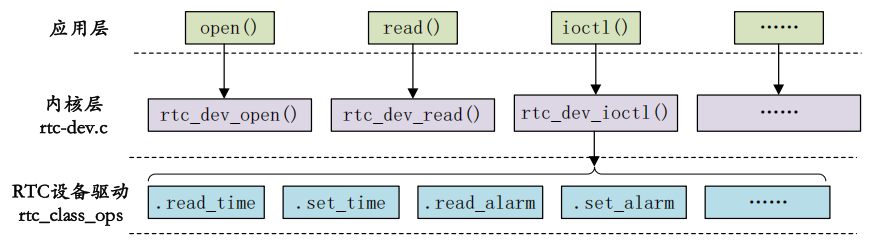

# RTC 驱动
RTC，即实时时钟，用于记录当前系统时间。

## 简介
RTC 设备驱动是一个标准的字符设备驱动，应用程序通过 open, release, read, write 和 ioctl 等函数完成对 RTC 设备的操作。

Linux 内核将 RTC 设备抽象为 `rtc_device` 结构体。因此 RTC 设备驱动就是分配、设置、注册 `rtc_device`。

Linux 内核提供了一个 RTC 通用字符设备驱动文件：`drivers/rtc/rtc-dev.c`。在该文件中提供了所有 RTC 设备共用的 `file_operations` 操作函数集。

应用程序可以通过 ioctl 函数来设置、读取时间，设置、读取闹钟。

## 使用
1. 分配、设置、注册 `rtc_class_ops`（具体 RTC 设备操作函数集）：
    ```c
    // 注册 rtc_class_ops
    /**
     * @name: 设备名字。
     * @dev: 设备。
     * @ops: RTC 底层驱动函数集。
     * @owner: 对应的驱动模块。 
     */
    struct rtc_device *rtc_device_register(const char *name, struct device *dev, 
        const struct rtc_class_ops *ops, struct module *owner);

    // devres:
    // devm_rtc_device_register(...)
    ```

2. 注销：
    ```c
    void rtc_device_unregister(struct rtc_device *rtc);

    // devres:
    // devm_rtc_device_unregister(...)；
    ```

## 源码阅读
### 数据结构
1. `rtc_device`：
    ```c
    // include/linux/rtc.h
    struct rtc_device {
        struct device dev;
        struct module *owner;

        int id;
        char name[RTC_DEVICE_NAME_SIZE];

        const struct rtc_class_ops *ops;    // RTC 设备底层操作函数
        struct mutex ops_lock;

        struct cdev char_dev;
        unsigned long flags;

        unsigned long irq_data;
        spinlock_t irq_lock;
        wait_queue_head_t irq_queue;
        struct fasync_struct *async_queue;

        struct rtc_task *irq_task;
        spinlock_t irq_task_lock;
        int irq_freq;
        int max_user_freq;

        struct timerqueue_head timerqueue;
        struct rtc_timer aie_timer;
        struct rtc_timer uie_rtctimer;
        struct hrtimer pei_timer;
        int pie_enabled;
        struct work_struct irqwork;
        // Some hardware can't support UIE mode
        int uie_unsupported;
        // ...
    };
    ```
2. `rtc_class_ops`：
    用于表示 RTC 设备的最底层操作函数集合，包括从 RTC 设备中读取时间、向 RTC 设备写入新的时间值等。
    `rtc_class_ops` 所包含的操作函数是驱动所需要编写的。
    ```c
    // include/linux/rtc.h
    struct rtc_class_ops {
        int (*open)(struct device *);
        void (*release)(struct device *);
        int (*ioctl)(struct device *, unsigned int, unsigned long);
        int (*read_time)(struct device *, struct rtc_time *);
        int (*set_time)(struct device *, struct rtc_time *);
        int (*read_alarm)(struct device *, struct rtc_wkalrm);
        int (*set_alarm)(struct device *, struct rtc_wkalrm);
        int (*proc)(struct device *, struct seq_file *);
        int (*set_mmss64)(struct device *, time64_t secs);
        int (*set_mmss)(struct device *, unsigned long secs);
        int (*read_callback)(struct device *, int data);
        int (*alarm_irq_enable)(struct device *, unsigned int enabled);
    };
    ```
    - 这些函数并不暴露给应用层用户（而是 file_operation 操作函数集）；
3. 时间值表示-`struct rtc_time`：
    ```c
    // 可以直接使用 unsigned long 来表示中间，单位为 s

    // include/uapi/linux/rtc.h
    struct rtc_time {
        int tm_sec;
        int tm_min;
        int tm_hour;
        int tm_mday;
        int tm_mon;
        int tm_year;
        int tm_wday;
        int tm_yday;
        int tm_isdst;
    };
    ```

### `rtc-dev.c` 源码
1. file_operations 操作函数集实现
    RTC 驱动调用流程（图片来源[1]）：
    
    ```c
    // drivers/rtc/rtc-dev.c
    static const struct file_operations rtc_dev_fops = {
        .owner  = THIS_MODULE,
        .llseek = no_llseek,
        .read   = rtc_dev_read,
        .poll   = rtc_dev_poll,
        .unlocked_ioctl = rtc_dev_ioctl,
        .open   = rtc_dev_open,
        .release = rtc_dev_release,
        .fasync = rtc_dev_fasync,
    };

    static long rtc_dev_ioctl(struct file *file, unsigned int cmd, unsigned long arg) {
        int err = 0;
        struct rtc_device *rtc = file->private_data;
        const struct rtc_class_ops *ops = rtc->ops;
        struct rtc_time tm;
        struct rtc_wkalrm alarm;
        void __user *uarg = (void __user*)arg;

        err = mutex_lock_interruptible(&rtc->ops_lock);
        if (err)
            return err;
        
        ...

        switch (cmd) {
        ...
        case RTC_RD_TIME:       // 读取时间
            mutex_unlock(&rtc->ops_lock);
            err = rtc_read_time(rtc, &tm);
            if (err < 0)
                return err;
            if (copy_to_user(uarg, &tm, sizeof(tm)))
                err = -EFAULT;
            return err;
        case RTC_SET_TIME:      // 设置时间
            mutex_unlock(&rtc->ops_lock);
            if (copy_from_user(&tm, uarg, sizeof(tm)))
                return -EFAULT;
            return rtc_set_time(rtc, &tm);
        ...
        default:
            /* Finally try the drivers's ioctl interface */
            if (ops->ioctl) {
                err = ops->ioctl(rtc->dev.parent, cmd, arg);
                if (err == -ENOIOCTLCMD)
                    err = -ENOTTY;
            } else {
                err = -ENOTTY;
            }
            break;
        }
    done:
        mutex_unlock(&rtc->ops_lock);
        return err;
    }

    // drivers/rtc/interface.c
    int rtc_read_time(struct rtc_device *rtc, struct rtc_time *tm)
    {
        int err;

        err = mutex_lock_interruptible(&rtc->ops_lock);
        if (err)
            return err;

        err = __rtc_read_time(rtc, tm);
        mutex_unlock(&rtc->ops_lock);
        return err;
    }
    EXPORT_SYMBOL_GPL(rtc_read_time);

    static int __rtc_read_time(struct rtc_device *rtc, struct rtc_time *tm)
    {
        int err;
        if (!rtc->ops)
            err = -ENODEV;
        else if (!rtc->ops->read_time)
            err = -EINVAL;
        else {
            memset(tm, 0, sizeof(struct rtc_time));
            err = rtc->ops->read_time(rtc->dev.parent, tm);
            if (err < 0) {
                dev_dbg(&rtc->dev, "read_time: fail to read: %d\n",
                    err);
                return err;
            }

            err = rtc_valid_tm(tm);
            if (err < 0)
                dev_dbg(&rtc->dev, "read_time: rtc_time isn't valid\n");
        }
        return err;
    }
    ```
    - `rtc_dev_ioctl()` 最终会通过 `rtc_class_ops` 中的 `read_time()`、`set_timer()` 等函数来完成对具体 RTC 设备的读写操作。

### I.MX6U RTC 驱动
1. 设备树描述
    ```dts
    snvs_rtc: snvs-rtc-lp {
        compatible = "fsl,sec-v4.0-mon-rtc-lp";
        regmap = <&snvs>;
        offset = <0x34>;
        interrupts = <GIC_SPI 39 IRQ_TYPE_LEVEL_HIGH>, 
                     <GIC_SPI 20 IRQ_TYPE_LEVEL_HIGH>;
    };
    ```
2. 驱动源码：
- 注册和 probe
    ```c
    // drivers/rtc/rtc-snvs.c
    static const struct of_device_id snvs_dt_ids[] = {
        { .compatible = "fsl,sec-v4.0-mon-rtc-lp", },
        { /* sentinel */}
    };
    MODULE_DEVICE_TABLE(of, snvs_dt_ids);

    static int snvs_rtc_probe(struct platform_device *pdev) {
        struct snvs_rtc_data *data;
        struct resource *res;
        int ret;
        void __iomem *mmio;

        data = devm_kzalloc(&pdev->dev, sizeof(*data), GFP_KERNEL);
        if (!data)
            return -ENOMEM;
        
        data->regmap = syscon_regmap_lookup_by_phandle(pdev->dev.of_node, "regmap");
        if (IS_ERR(data->regmap)) {
            dev_warn(&pdev->dev, "snvs rtc: you use old dts file, please update it\n");
            res = platform_get_resource(pdev, IORESOURCE_MEM, 0);
            mmio = devm_ioremap_resource(&pdev->dev, res);
            if (IS_ERR(mmio))
                return PTR_ERR(mmio);
            data->regmap = devm_regmap_init_mmio(&pdev->dev, mmio, &snvs_rct_config);
        } else {
            data->offset = SNVS_LPREGISTER_OFFSET;
            of_property_read_u32(pdev->dev.of_node, "offset", &data->offset);
        }

        if (!data->regmap) {
            dev_err(&pdev->err, "Can't find snvs syscon\n");
            return -ENODEV;
        }

        data->irq = platform_get_irq(pdev, 0);
        if (data->irq < 0)
            return data->irq;
        
        ...

        platform_set_drvdata(pdev, data);

        /* Initialize glitch detect */
        regmap_write(data->regmap, data->offset + SNVS_LPPGDR, SNVS_LPPGDR_INIT);

        /* Clear interrupt status */
        regmap_write(data->regmap, data->offset + SNVS_LPSR, 0xffffffff);

        /* Enable RTC */
        snvs_rtc_enable(data, true);

        dev_init_wakeup(&pdev->dev, true);

        ret = devm_request_irq(&pdev->dev, data->irq, snvs_rtc_irq_handler, IRQF_SHARED, "rtc alarm", &pdev->dev);
        if (ret) {
            dev_err(&pdev->dev, "failed to request irq %d: %d\n", data->irq, ret);
            goto error_rtc_device_register;
        }

        data->rtc = devm_rtc_device_register(&pdev->dev, pdev->name, &snvs_rtc_ops, THIS_MODULE);
        if (IS_ERR(data->rtc)) {
            ret = PTR_ERR(data->rtc);
            dev_err(&pdev->dev, "failed to register rtc: %d\n", ret);
            goto error_rtc_device_register;
        }
        return 0;
    
    error_rct_device_register:
        if (data->clk)
            clk_disable_unprepare(data->clk);
        return ret;
    }

    static struct platform_driver snvs_rtc_driver = {
        .driver = {
            .name = "snvs_rtc",
            .pm   = SNVS_RTC_PM_OPS,
            .of_match_table = snvs_dt_ids,
        },
        .probe = snvs_rtc_probe,
    };
    module_platform_driver(snvs_rtc_driver);
    ```
    - RTC 底层驱动操作函数集为 `snvs_rtc_ops`。
- RTC 底层驱动操作函数
    ```c
    static u32 rtc_read_lp_counter(struct snvs_rtc_data *data) {
        u64 read1, read2;
        u32 val;

        do {
            regmap_read(data->regmap, data->offset + SNVS_LPSRTCMR, &val);
            read1 = val;
            read1 << 32;
            regmap_read(data->regmap, data->offset + SNVS_LPSRTCLR, &val);
            read1 |= val;

            regmap_read(data->regmap, data->offset + SNVS_LPSRTCMR, &val);
            read2 = val;
            read2 << 32;
            regmap_read(data->regmap, data->offset + SNVS_LPSRTCLR, &val);
            read2 |= val;

            /** 
             * when CPU/BUS are running at low speed, there is chance that we never 
             * get same value during two consecutive read, so here we only compare the second 
             * value.
             */
        } while ((read1 >> CNTR_TO_SECS_SH) != (read2 >> CNTR_TO_SECS_SH));

        /* Convert 47-bit counter to 32-bit raw second count */
        return (u32) (read1 >> CNTR_TO_SECS_SH);
    }

    static int snvs_rtc_read_time(struct device *dev, struct rtc_time *tm) {
        struct snvs_rtc_data *data = dev_get_drvdata(dev);
        unsigned long time = rtc_read_lp_counter(data); // 获取 RTC 计数值，这个时间值是秒数

        rtc_time_to_tm(time, tm);       // 将获取到的秒数转换为时间值
        return 0;
    }

    static const struct rtc_class_ops snvs_rtc_ops = {
        .read_time = snvs_rtc_read_time,
        .set_time  = snvs_rtc_set_time,
        .read_alarm = snvs_rtc_read_alarm,
        .set_alarm = snvs_rtc_set_alarm,
        .alarm_irq_enable = snvs_rtc_alarm_irq_enable,
    };
    ```
    - 在 `rtc_read_lp_counter()` 函数中，需要读取两个寄存器以得到 RTC 的计数值，单位为秒。这个秒数就是当前时间。
    - 由于在 `rtc_read_lp_counter()` 函数要读取两个寄存器，因此可能存在读取第二个寄存器的时候时间数据更新了，导致时间不匹配，因此这里连续读两次。如果两次的时间值相等则表示时间数据有效。

## 调试
1. Linux 内核启动时可以看到系统时钟设置信息：
    ```bash
    snvs_rtc 20cc000.snvs:snvs-rtc-lp: rtc core: registerd 20cc000.snvs:snvs-r as rtc0
    ```
2. 查看时间
    ```bash
    date
    ```
3. 设置 RTC 时间
    ```bash
    # 查看帮助信息
    date --help
    # 设置时间
    date -s "2019-08-31 18:13:00"   # 只是设置了系统时间，并没有将时间值写到 RTC 内部，此时重启后时间值会丢失
    hwclock -w                      # 将当前系统时间写入到 RTC 里面，防止重启后时间丢失
    ```

## RTC 和 Systick 比较
- [ ] 系统时钟、定时器时钟、系统滴答-Systick 和 RTC

## 参考
1. 正点原子-I.MX6U 嵌入式 Linux 驱动开发指南

