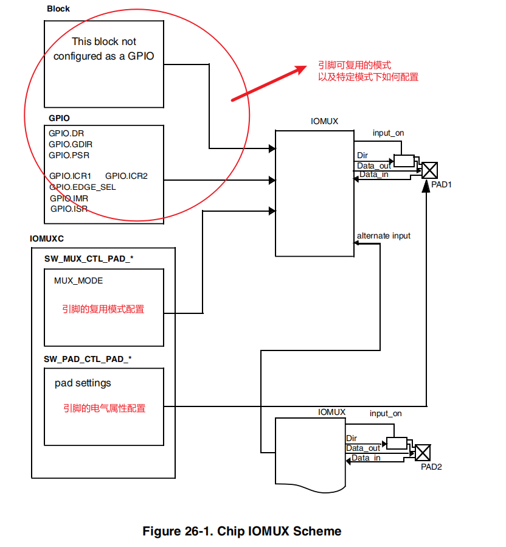
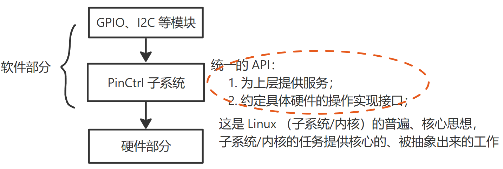

# PinCtrl & GPIO 子系统
Linux 驱动讲究驱动分离与分层。

## PinCtrl 子系统
关于 `IO Ports` 的使用往往涉及：
1. 复用模式选择（如将 `IO` 复用为 `GPIO`、 `UART` 的 `Tx port` 等）；
2. 电气属性配置（如 `IO` 的上下拉属性、驱动能力等）；
3. 中断配置（触发方式等）；

以 `IMX6ull` 为例，其 `IO Ports` 的电路框图如下：


- 所以对于引脚而言 GPIO、I2C 是并列的关系，在引脚被作为具体模式使用之前需要设置 `IOMUX` 以及电气属性。
- 不同的电路板的 `IO Ports` 数量、复用能力以及配置方式等不一致...
- 把引脚的复用、配置操作形成统一的 API，以供其他模块（例如 GPIO、I2C）使用。

统一的 API 以及抽象出来的核心管理操作形成了 PinCtrl 子系统：

通常来说，PinCtrl、GPIO 等子系统 SOC 厂商都会提供实现，驱动工程师只需要结合具体的业务内容调用这些子系统提供的服务即可。

### 主要工作内容
- 获取设备树中的 pin 信息；
- 根据上述信息设置 pin 的复用功能、电气特性等；

### 相关概念
1. `pin controller` 和 `client device`
    ```dts
    // pin controller
    pincontroller {
        state_0_node_a {
            function = "uart0";                 // 复用为哪个功能
            groups = "u0rxtx", "u0rtscts";      // 用到哪些引脚
        };
        state_1_node_a {
            groups = "u0rxtx", "u0rtscts";
            output-high;                        // 配置成什么样（电气属性）
        };
    };

    // client device
    device {
        pinctrl-names = "default", "sleep";     // 这个设备有两种状态
        pinctrl-0 = <&state_0_node_a>;          // 第 0 个状态的名字是 default，对应的引脚在 pinctrl-0 里定义
        pinctrl-1 = <&state_1_node_a>;          // 第 1 个状态的名字是 sleep，对应的引脚在 pinctrl-1 里定义
    }
    ```
2. `pin_state`
   对于一个 `client device` 来说，例如对于一个 UART 设备，它有多个状态：`default` 和 `sleep` 等（如上设备树代码所示），那对应的引脚也有这些状态。
   - `default`：默认状态下，UART 设备是工作的，因此所用的引脚就需要被复用为 UART 功能；
   - `sleep`：在休眠状态下，为了省电可以把这些引脚复用为 GPIO 功能，或者直接把它们配置为输出高电平；
3. `groups` 和 `function`
   - 一个设备会用到若干个引脚，这些引脚就可以归为一组，即 `group`。而这些引脚可以复用为某个功能，即 `function`。
   - 一个设备可以用到多组引脚；

**`pin controller` 节点的格式，没有统一的标准。每家芯片都不一样，甚至上面的 `groups` 和 `function` 关键字也不一定有，但概念是有的**。

### 使用
通常来说，对引脚的操作对于驱动程序而言是透明的。当设备切换状态时，对应的 PinCtrl 就会被调用。
```c
// 示例：在 platform_device 和 platform_driver 的枚举过程中，流程如下：
// probe:
/* if using pinctrl, bind pins now before probing */
ret = pinctrl_bind_pins(dev);
    dev->pins->default_state = pinctrl_lookup_state(dev->pins->p, PINCTRL_STATE_DEFAULT);
    dev->pins->init_state = pinctrl_lookup_state(dev->pins->p, PINCTRL_STATE_INIT);

    ret = pinctrl_select_state(dev->pins->p, dev->pins->init_state);        // 优先引脚状态为 init
    ret = pinctrl_select_state(dev->pins->p, dev->pins->default_state);     // 如果没有 init 状态，则设置为 default 状态
// ...
ret = drv->probe(dev);              // 调用我们在驱动程序中注册的 probe 函数
```
上述程序说明引脚在进入驱动的 probe 函数就被自动设置，不用我们自己去调用代码。

若想自己调用，则相关 API 有：
```c
// 使用 default 状态的引脚（将引脚设置为 default 对应的 pinctrl）
devm_pinctrl_get_select_default(struct device *dev);

// 根据 name 选择某种状态的引脚（将引脚设置为 name 对应的 pinctrl）
pinctrl_get_select(struct device *dev, const char *name);

// 不再使用，推出时调用
pinctrl_put(struct pinctrl *p);
```

- 注意事项：
  1. 需要注意 pin 是否被其他外设使用

### 参考
- 源码：`drivers/pinctrl`；
- 设备树：
  - `Documentation/devicetree/bindings/pinctrl/pinctrl-bindings.txt`；
  - `Documentation/devicetree/bindings/pinctrl/fsl,imx-pinctrl.txt`；
参考需要根据具体芯片厂商提供的参考说明，例如上述设备树格式文件使用的是飞思卡尔的 pinctrl 子系统格式；

### 总结
`PinCtrl` 子系统通过软件分层，抽象出对 `IO Ports` 操作的公共部分并提供相应的接口。`BSP` 开发者在具体硬件的基础上实现这部分接口，驱动开发者通过调用接口，实现对硬件的操作。从而后者可以不必了解具体的 `IO Ports` 操作是如何完成的，实现了对驱动的 `IO Ports` 操作和具体硬件的解耦。即软件中的：用户不应该依赖于具体的实例，而是通过该类实例的抽象接口实现依赖反转。

## GPIO 子系统

### 主要工作内容
- 用于初始化 gpio 并且提供相应的 API 函数（如设置 gpio 为输入/输出，读取 gpio 值等）；
- Linux 内核向驱动程序开发者屏蔽掉了 gpio 的设置过程，方便了驱动开发者使用 gpio(这里前者应该是指 BSP 部分，后者才是驱动开发部分)；

在 BSP 工程师实现了 GPIO 子系统后，我们就可以：
1. 在设备树里指定 GPIO 引脚；
2. 在驱动代码中使用 GPIO 子系统的标准函数获取 GPIO、设置 GPIO 方向、读取/设置 GPIO 值；

这样的驱动代码将是与单板无关的。

### 相关概念
在几乎所有 ARM 芯片中，GPIO 都分为几组，每组中有若干个引脚。所以在使用 GPIO 子系统前就要先确定：哪一组中的哪一个。

1. `gpio-controller`
   在设备树中用以表示 GPIO 组（GPIO 控制器），这通常由芯片厂商设置好，一般在 `xxx.dtsi` 文件中：
   ```dts
   // imx6ul.dtsi
   gpio1: gpio@0209c000 {
    compatible = "fsl,imx6ul-gpio", "fsl,imx35-gpio";
    reg = <0x0209c000 0x4000>;
    interrupts = <GIC_SPI 66 IRQ_TYPE_LEVEL_HIGH>, <GIC_SPI 67 IRQ_TYPE_LEVEL_HIGH>;
    gpio-controller;
    #gpio-cells = <2>;      // 哪个 GPIO 引脚、该引脚的有效电平
    interrupt-controller;
    #interrupt-cells = <2>;
    gpio-ranges = <&iomuxc 0 23 10>, <&iomuxc 10 17 6>, <&iomuxc 16 33 16>;
   };
   ```

2. GPIO 号
   - [ ] 如何理解 gpio 编号

### 使用
1. 设备树
    在自己的设备节点中使用属性“**[<name>-]gpios**”，例如：
    ```dts
    // 100ask_imx6ull_14x14.dts
    led0: cpu {
        label = "cpu";
        gpios = <&gpio5 3 GPIO_ACTIVE_LOW>;
        default-state = "on";
        linux,default-trigger = "heartbeat";
    };

    gt9xx@5d {
        compatible = "goodix,gt9xx";
        reg = <0x5d>;
        status = "okay";
        interrupt-parent = <&gpio1>;
        interrupts = <5 IRQ_TYPE_EDGE_FALLING>;
        pinctrl-names = "default";
        pinctrl-0 = <&pinctrl_tsc_rest &pinctrl_touchscreen_init>;
        
        reset-gpios = <&gpio5 GPIO_ACTIVE_LOW>;
        irq-gpios = <&gpio1 5 IRQ_TYPE_EDGE_FALLING>;
    }
    ```

2. 驱动代码
   - [ ] gpio 和 gpio_desc 之间的关系是什么？
    
    GPIO 子系统有两套接口：基于描述符（`descriptor-based`）的、老的（`legacy`）：
      - 基于描述符：函数都有 `gpiod_` 的前缀，它使用 `gpio_desc` 结构体来表示一个引脚；驱动需要包含 `linux/gpio/consumer.h` 头文件；
      - 老的：函数都有 `gpio_` 前缀，它使用一个整数表示一个引脚；驱动需要包含 `linux/gpio.h` 头文件；

    在驱动程序中操作一个引脚，首先要 get 引脚，然后设置方向，读值、写值。

    常用函数：
      - 获得 GPIO
        | descriptor-based | legacy |
        | ---- | ---- |
        | `gpiod_get` | `gpio_request` |
        | `gpiod_get_index` | `gpio_request_array` |
        | `gpiod_get_array` |  |
        | `devm_gpiod_get` |  |
        | `devm_gpiod_get_index` |  |
        | `devm_gpiod_get_array` |  |
      - 设置方向
        | descriptor-based | legacy |
        | ---- | ---- |
        | `gpiod_direction_input` | `gpio_direction_input` |
        | `gpiod_direction_output` | `gpio_direction_output` |
      - 读写
        | descriptor-based | legacy |
        | ---- | ---- |
        | `gpiod_get_value` | `gpio_get_value` |
        | `gpiod_set_value` | `gpio_set_value` |
      - 释放 GPIO
        | descriptor-based | legacy |
        | ---- | ---- |
        | `gpiod_put` | `gpio_free` |
        | `gpiod_put_array` | `gpio_free_array` |
        | `devm_gpiod_put` | `gpio_free_array` |
        | `devm_gpiod_put_array` | `gpio_free_array` |
       
     - `devm_` 的含义是“设备资源管理（`Managed Device Resource`）”，这是一种自动释放资源的机制。它的思想是：资**源是属于设备的，设备不存在时资源就可以自动释放**。
       - 比如在 Linux 开发过程中，先申请了 GPIO，再申请内存。如果内存申请失败，则需要在返回之前释放 GPIO 资源。这时如果使用 `devm` 相关的函数，在内存申请失败之后可以直接返回，因为设备的销毁函数会自动地释放已经申请了地 GPIO 资源。
   
    ---
      - 在使用一个 gpio 之前一定要先通过 `gpio_request` 函数进行申请：
          ```c
          /* 
           * gpio: 要申请的 gpio 标号，使用 of_get_named_gpio() 函数从设备树中获取指定 gpio 属性信息，此函数会返回这个 gpio 的标号； 
           * label: 给 gpio 设置的名字；
           * 返回值：0-成功，其他值-失败；
           */
          int gpio_request(unsigned gpio, const char *label);
          ```
      - 如果不使用某个 gpio 了，则可以通过 `gpio_free` 函数进行释放：
          ```c
          void gpio_free(unsigned gpio);
          ```
      - 设置某个 gpio 为输入：
          ```c
          // 返回值：0-成功，负值-失败
          int gpio_direction_input(unsigned gpio);
          ```
      - 设置某个 gpio 为输出:
         ```c
         // 返回值：0-成功，负值-失败
         int gpio_direction_output(unsigned gpio);
         ```
      - 读写操作：
          ```c
          // 通过宏获取某个 gpio 的值（0/1）
          #define gpio_get_value __gpio_get_value
          // 非负值-得到的 gpio 值，负值-获取失败
          int __gpio_get_value(unsigned gpio);

          // 通过宏设置某个 gpio 的值
          #define gpio_set_value __gpio_set_value
          void __gpio_set_value(unsigned gpio, int value);
          ```
   ---
   
   与 gpio 相关的 OF 函数：
     - 获取设备树某个属性里面定义了几个 gpio 信息：
        ```c
        // propname: 要统计的 gpio 属性；
        // 返回值：正值-统计到的 gpio 数量；负值-失败
        int of_gpio_named_count(struct device_node *np, const char *propname);
        ```
        空的 gpio 信息也会被统计到，例如：
        ```dts
        gpios = <0
                 &gpio1 1 2
                 0
                 &gpio2 3 4>
        ```
        上述代码 `gpios` 节点一共定义了 4 个 gpio，但有两个是空的，没有实际含义，通过上述函数统计出来的结果是 4。
     - 与上述函数类型，`of_gpio_count` 函数用于统计 “gpios” 这个属性的 gpio 数量，而 `of_gpio_named_count` 函数可以统计任意属性的 gpio 信息：
         ```c
         // 返回值：正值，统计到的 gpio 数量；负值-失败
         int of_gpio_count(struct device_node *np);
         ```
     - 获取 gpio 编号。因为 Linux 内核中关于 gpio 的 API 函数都要使用 gpio 编号，此函数会将设备树中类似 `<&gpio5 7 GPIO_ACTIVATE_LOW>` 的属性信息转换为对应的 gpio 编号。此函数在驱动中使用很频繁。
         ```c
         /* index: gpio 索引，一个属性里可能包含多个 gpio，此参数指定要获取哪个 gpio，如果只有一个 gpio 信息的话此参数为 0 
          * 返回值：正值-获取到的 gpio 编号；负值，失败；
          */
         int of_get_named_gpio(struct device_node *np, const char *propname, int index);
         ```

    示例：
    ```dts
    foo_device {
        compatible = "acme,foo";
        ...
        led-gpios = <&gpio 15 GPIO_ACTIVE_HIGH>,    // red
                    <&gpio 16 GPIO_ACTIVE_HIGH>,    // green
                    <&gpio 17 GPIO_ACTIVE_HIGH>;    // blue
        power-gpios = <&gpio 1 GPIO_ACTIVE_LOW>;
    };
    ```
    ```c
    // 在驱动程序中获取引脚
    struct gpio_desc *red, *green, *blue, *power;

    red = gpiod_get_index(dev, "led", 0, GPIOD_OUT_HIGH);
    green = gpiod_get_index(dev, "led", 1, GPIOD_OUT_HIGH);
    blue = gpiod_get_index(dev, "led", 2, GPIOD_OUT_HIGH)；
    power = gpiod_get(dev, "power", GPIOD_OUT_HIGH);
    ```

    基于 sysfs 操作引脚
    ```bash
    # 输入引脚
    # 110 为 GPIO 号
    # 如果驱动程序已经使用了该引脚，那么将会 export 失败：echo: write error: Device or resource busy
    echo 110 > /sys/class/gpio/export
    echo in > /sys/class/gpio/gpio110/direction
    cat /sys/class/gpio/gpio110/value
    echo 110 > /sys/class/gpio/unexport

    # 输出引脚
    # N 为 GPIO 号
    echo N > /sys/class/gpio/export
    echo out > /sys/class/gpio/gpioN/direction
    echo 1 > /sys/class/gpio/gpioN/value
    echo N > /sys/class/gpio/unexport
    ```

    注意事项：
     1. `gpiod_set_value` 设置的值是逻辑值，而它与物理值不一定相等：
        ```
        Function (example)          active-low property     physical line
        gpiod_set_raw_value(desc, 0);   don't care              low
        gpiod_set_raw_value(desc, 1);   don't care              high
        gpiod_set_value(desc, 0);       default(active-high)    low
        gpiod_set_value(desc, 1);       default(active-high)    high
        gpiod_set_value(desc, 0);       active-low              high
        gpiod_set_value(desc, 1);       active-high             low
        ```
        如果设备树里引脚指定为 GPIO_ACTIVE_LOW，那么 gpiod_set_value 的逻辑值跟引脚的物理值相反。
     2. ~旧的 `gpio_` 函数没办法根据设备树信息获得引脚。~ **引脚号的确定**（`of_get_named_gpio` 以外）：在 GPIO 子系统中，每注册一个 `GPIO Controller` 时会确定它的 `base number`，那么这个控制器里的第 n 号引脚的号码就是 `base number + n`。但是如果硬件有变化、设备树有变化，这个 `base number` 并不能保证是固定的，应该查看 `sysfs` 来确定 `base number`：
        - 先确定某个 GPIO Controller 的基准引脚号（`base number`），再计算出某个引脚的号码；
        - 在 `/sys/class/gpio` 目录下，找到各个 `gpiochipXXX` 目录；
        - 进入某个 gpiochip 目录，查看文件 label 的内容；
        - 根据 label 的内容对比设备树（label 内容来自设备树，比如它的寄存器基地址）；
        - 查看 base 文件的内容获取 `base number`；
     3. 需要注意 pin 是否被其他外设使用；

### 参考
- 源码：`drivers/gpio/gpio_mxc.c`；
- 设备树格式：
  - `Documentation/devicetree/bindings/gpio/gpio.txt`；
  - `Documentation/devicetree/bindings/gpio/fsl-imx-gpio.txt`；
参考需要根据具体芯片厂商提供的参考说明，例如上述设备树格式文件使用的是飞思卡尔的 GPIO 子系统格式；

## 驱动示例
- [ ] 增加示例代码

## 内核源码
1. 内核版本：

## references
1. [蜗窝科技](http://www.wowotech.net/sort/gpio_subsystem)