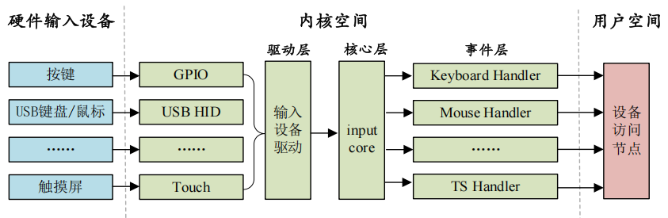

# input 子系统
输入设备本质上还是字符设备。

在 input 框架下，驱动层只需要负责上报输入事件，比如按键值、坐标等信息。这些事件的处理由 input 核心层来完成。

## 概览
input 子系统分为 input **驱动层**、input **核心层**、input **事件处理层**，最终给用户空间提供可访问的设备节点。

input 子系统结构图如下(图片来源[1])：
    

图中：
    左边是最底层的具体设备，根据输入事件的类型可进行分类。
    中间部分属于 Linux 内核空间，分为驱动层、核心层和事件层。
    右边是用户空间，所有的输入设备以文件的形式供应用程序使用。

  - 驱动层：输入设备的具体驱动程序，如按键驱动程序，向内核层报告输入内容；
  - 核心层：承上启下，为驱动层提供输入设备注册和操作接口，通知事件层对输入事件进行处理；
  - 事件层：主要和用户空间进行交流；

## 使用
### 注册
在使用 input 子系统时，需要注册一个 input 设备，使用 `struct input_dev` 表示（**在使用 input 子系统处理输入设备时不需要去注册字符设备，只需要向子系统注册一个 `input_device` 即可**）：
```c
struct input_dev {
    const char *name;
    const char *phys;
    const char *uniq;
    struct input_id id;

    unsigned long propbit[BITS_TO_LONGS(INPUT_PROP_CNT)];
    unsigned long evbit[BITS_TO_LONGS(EV_CNT)];
    unsigned long keybit[BITS_TO_LONGS(KEY_CNT)];
    unsigned long relbit[BITS_TO_LONGS(REL_CNT)];
    unsigned long absbit[BITS_TO_LONGS(ABS_CNT)];
    unsigned long ledbit[BITS_TO_LONGS(LED_CNT)];
    unsigned long sndbit[BITS_TO_LONGS(SND_CNT)];
    unsigned long ffbit[BITS_TO_LONGS(FF_CNT)];
    unsigned long swbit[BITS_TO_LONGS(SW_CNT)];
    ...
    bool devres_managed;
}
```
 - `evbit`：表示该输入设备支持的输入事件类型：
    ```c
    // include/uapi/linux/input.h

    #define EV_SYN 0x00 /* 同步事件 */
    #define EV_KEY 0x01 /* 按键事件 */
    #define EV_REL 0x02 /* 相对坐标事件 */
    #define EV_ABS 0x03 /* 绝对坐标事件 */
    #define EV_MSC 0x04 /* 杂项(其他)事件 */
    #define EV_SW 0x05 /* 开关事件 */
    #define EV_LED 0x11 /* LED */
    #define EV_SND 0x12 /* sound(声音) */
    #define EV_REP 0x14 /* 重复事件，例如按键保持按下状态，对应的按键输入事件会一直产生 */
    #define EV_FF 0x15 /* 压力事件 */
    #define EV_PWR 0x16 /* 电源事件 */
    #define EV_FF_STATUS 0x17 /* 压力状态事件 */
    ```
 - `keybit`：如果输入设置支持按键事件，则通过此 bitmap 来进一步表示支持哪些按键：
    ```c
    // include/uapi/linux/input.h`

    #define KEY_RESERVED 0
    #define KEY_ESC 1
    #define KEY_1 2
    #define KEY_2 3
    #define KEY_3 4
    #define KEY_4 5
    #define KEY_5 6
    #define KEY_6 7
    #define KEY_7 8
    #define KEY_8 9
    #define KEY_9 10
    #define KEY_0 11
    ..
    #define BTN_TRIGGER_HAPPY39 0x2e6
    #define BTN_TRIGGER_HAPPY40 0x2e7
    ```
- 其他 xxbit 也都是 bitmap，用于表示在支持该事件条件下，具体支持的事件输入有哪些。


在编写 input 设备驱动时，需要注册 `input_dev`，其流程大致如下：
  1. 申请一个 `input_dev` 结构体：
        ```c
        struct input_dev *input_allocate_device(void);
        ```
  2. 申请后进行初始化，主要是初始化支持的事件类型以及在支持的事件类型下支持哪些事件输入。初始化方式：
        ```c
        // 方式 1
        __set_bit(EV_KEY, inputDev->evbit); // 设置产生按键事件；
        __set_bit(EV_REP, inputDev->evbit); // 重复事件
        __set_bit(KEY_0, inputDev->keybit); // 设置产生哪些按键值
        // 方式 2
        keyinputdev.inputdev->evbit[0] = BIT_MASK(EV_KEY) | BIT_MASK(EV_REP);
        keyinputdev.inputdev->keybit[BIT_WORD(KEY_0)] |= BIT_MASK(KEY_0);
        // 方式 3
        keyinputdev.inputdev->evbit[0] = BIT_MASK(EV_KEY) | BIT_MASK(EV_REP);
        input_set_capability(keyinputdev.inputdev, EV_KEY, KEY_0);
        ```
  3. 初始化后向内核注册：
        ```c
        // 返回值：0-成功，负值-失败
        int input_register_device(struct input_dev *dev);
        ```

### 事件上报
事件产生时，在相应的处理函数（如中断服务程序）中上报事件。比如按键，在按键的中断处理函数，或者消抖定时器中断函数中将按键值上报给 input 子系统。

不同的事件，其上报事件的 API 函数不同。
- 通用 API:
    ```c
    /* 
     * type: 上报的事件类型，比如 EV_KEY; 
     * code: 事件码，比如 KEY_0, KEY_1 等；
     * value: 事件值，比如 1 表示按键按下，0 表示按键松开
     * 此函数可以上报所有的事件类型和事件值
     */
    void input_event(struct input_dev *dev, unsigned int type, unsigned int code, int value);
    ```
- 对 `input_event` 的进一步封装：
  ```c
  static inline void input_report_key(struct input_dev *dev, unsigned int code, unsigned int value) {
    input_event(dev, EV_KEY, code, !!value);
  }

  void input_report_rel(struct input_dev *dev, unsigned int code, int value);
  void input_report_abs(struct input_dev *dev, unsigned int code, int value);
  void input_report_ff_status(struct input_dev *dev, unsigned int code, int value);
  void input_report_switch(struct input_dev *dev, unsigned int code, int value);
  void input_report_sync(struct input_dev *dev);
  ```

### 事件同步
上报完事件后，需使用 `input_sync()` 以通知 Linux 内核 input 子系统上报结束，它的本质是上报一个同步事件。
```c
void input_sync(struct input_dev *dev);
```

示例程序：
```c
void timer_function(unsigned long arg) {
    unsigned char value;

    value = gpio_get_value(keydesc->gpio);
    if (value == 0) {
        input_report_key(inputdev, KEY_0, 1);   // 按下
        input_sync(inputdev);
    } else {
        input_report_key(inputdev, KEY_0, 0);   // 松开
        input_sync(inputdev);
    }
}
```

### 释放/注销
1. 使用 `input_free_device()` 函数来释放掉之前申请到的 `input_dev`：
    ```c
    void input_free_device(struct input_dev *dev);
    ```
2. 使用 `input_unregister_device()` 函数来注销掉之前注册的 `input_dev`：
    ```c
    void input_unregister_device(struct input_dev *dev);
    ```
3. 释放和注销函数的使用：

### 示例
如下是按键 input 驱动程序示例：
```c
#include <linux/types.h>
#include <linux/kernel.h>
#include <linux/delay.h>
#include <linux/ide.h>
#include <linux/init.h>
#include <linux/module.h>
#include <linux/errno.h>
#include <linux/gpio.h>
#include <linux/cdev.h>
#include <linux/device.h>
#include <linux/of.h>
#include <linux/of_address.h>
#include <linux/of_gpio.h>
#include <linux/input.h>
#include <linux/semaphore.h>
#include <linux/timer.h>
#include <linux/irq.h>
#include <linux/of_irq.h>
#include <asm/mach/map.h>
#include <asm/uaccess.h>
#include <asm/io.h>


#define KEYINPUT_CNT        1           // 设备号个数
#define KEYINPUT_NAM        "keyinput"
#define KEY0VALUE           0x01        // KEY0 按键值
#define INVAKEY             0xff        // 无效按键值
#define KEY_NUM             1           // 按键数量

// 中断 io 描述结构体
struct irq_keydesc {
    int gpio;
    int irqnum;
    unsigned char value;        // 按键对应的按键
    char name[10];
    irqreturn_t (*handler)(int, void *);        // 中断服务函数
};

// keyinput 设备结构体
struct keyinput_dev {
    dev_t devid;
    struct cdev cdev;
    struct class *class;
    struct device *device;
    struct device_node *nd;
    struct timer_list timer;        // 定义一个定时器
    struct irq_keydesc irqkeydesc[KEY_NUM];
    unsigned char curkeynum;        // 当前的按键号
    struct input_dev *inputdev;
};

struct keyinput_dev keinputdev;

/* 中断服务函数，开启定时器，延迟 10ms，定时器用于按键消抖 */
static irqreturn_t key0_handler(int irq, void *dev_id) {
    struct keyinput_dev *dev = (struct keyinput_dev *)dev_id;

    dev->curkeynum = 0;
    dev->timer.data = (volatile long)dev_id;
    mod_timer(&dev->timer, jiffies + msecs_to_jiffies(10));
    return IRQ_RETVAL(IRQ_HANDLED);
};

/* 定时器服务函数，延迟消抖后再次读取按键值，如果还是处于按下状态就表示按键有效 */
void tiemr_function(unsigned long arg) {
    unsigned char value;
    unsigned char num;
    struct irq_keydesc *keydecs;
    struct keyinput_dev *dev = (struct keyinput_dev *)arg;

    num = dev->curkeynum;
    keydesc = &dev->irqkeydesc[num];
    value = gpio_get_value(keydesc->gpio);      // 获取对应 gpio 的值
    if (value == 0) {
        // 按下按键
        // 上报按键值 
        // input_event(dev->inputdev, EV_KEY, keydesc->value, 1);
        input_report_key(dev->inputdev, keydesc->value, 1); // 1，按下
        input_sync(dev->inputdev);
    } else {
        // 松开按键
        // input_event(dev->inputdev, EV_KEY, keydesc->value, 0);
        input_report_key(dev->inputdev, keydesc->value, 0);
        input_sync(dev->inputdev);
    }
}

// 按键 io 初始化
static int keyio_init(void) {
    unsigned char i = 0;
    char name[10];
    int ret = 0;

    keyinputdev.nd = of_find_node_by_path("/key");
    if (keyinputdev.nd == NULL) {
        printk("key node not find!\r\n");
        return 0;
    }

    // 提取 gpio
    for (i = 0; i < KEY_NUM; i++) {
        keyinputdev.irqkeydesc[i].gpio = of_get_named_gpio(keyinputdev.nd, "key-gpio", i);
        if (keyinputdev.irqkeydesc[i].gpio < 0) {
            printk("can't get key%d\r\n", i);
        }
    }

    // 初始化 key 所使用的 io，并且设置成中断模式
    for (i = 0; i < KEY_NUM; ++i) {
        memset(keyinputdev.irqkeydesc[i].name, 0, sizeof(name));
        sprintf(keyinputdev,irqkeydesc[i].name, "KEY%d", i);
        gpio_request(keyinputdev.irqkeydesc[i].gpio, keyinputdev.irqkeydesc[i].name);
        gpio_direction_input(keyinputdev.irqkeydesc[i].gpio);
        keyinputdev.irqkeydesc[i].irqnum = irq_of_parse_and_map(keyinputdev.nd, i);
    }

    // 申请中断
    keyinputdev.irqkeydesc[0].handler = key0_handler;
    keyinputdev.irqkeydesc[0].value = KEY_0;

    for (i = 0; i < KEY_NUM; ++i) {
        ret = request_irq(keyinputdev.irqkeydesc[i].irqnum, keyinputdev.irqkeydesc[i].handler, IRQF_TRIGER_FALLING | IRQF_TRIGGER_RISING, keyinputdev.irqkeydesc[i].name, &keyinputdev);
        if (ret < 0) {
            printk("irq %d request failed!\r\n", keyinputdev.irqkeydesc[i].irqnum);
            return -EFAULT;
        }
    }

    // 创建定时器
    init_timer(&keyinputdev.timer);
    keyinputdev.tiemr.fucntion = timer_function;

    // 申请 input_dev
    keyinputdev.inputdev = input_allocate_device();
    keyinputdev.inputdev->name = KEYINPUT_NAME;
#if 0
    // 初始化 input_dev，设置产生哪些事件
    __set_bit(EV_KEY, keyinputdev.inputdev->evbit);
    __set_bit(EV_REP, keyinputdev.inputdev->evbit);
    // 初始化 input_dev，设置产生哪些按键
    __set_bit(KEY_0, keyinputdev.inputdev->keybit);
#endif

#if 0
    keyinputdev.inputdev->evbit[0] = BIT_MASK(EV_KEY) | BIT_MASK(EV_REP);
    keyinputdev.inputdev->keybit[BIT_WORD(KEY_0)] |= BIT_MASK(KEY_0);
#endif
    keyinputdev.inputdev->evbit[0] = BIT_MASK(EV_KEY) | BIT_MASK(EV_REP);
    input_set_capability(keyinputdev.inputdev, EV_KEY, KEY_0);

    // 注册输入设备
    ret = input_register_device(keyinputdev.inputdev);
    if (ret) {
    printk("register input device failed!\r\n");
    return ret;
    }
    
    return 0;
}

static int __init keyinput_init(void) {
    keyio_init();
    return 0;
}

static void __exit keyinput_exit(void) {
    unsigned int i = 0;
    // 删除定时器
    del_timer_sync(&keyinputdev.timer);
    // 释放中断
    for (i = 0; i < KEY_NUM; ++i) {
        free_irq(keyinputdev.irqkeydesc[i].irqnum, &keyinputdev);
    }
    // 释放 io
    for (i = 0; i < KEY_NUM, ++i) {
        gpio_free(keyinputdev.irqkeydesc[i].gpio);
    }
    // 释放 input_dev
    input_unregister_device(keyinputdev.inputdev);
    input_free_device(keyinputdevice.inputdev);
}

module_init(keyinput_init);
module_exit(keyinput_exit);
MODULE_LICENSE("GPL");
MODULE_AUTHOR("xxx");
```

## 应用层编程
### input_event 结构体
Linux 内核使用 `input_event` 结构体来表示所有的输入事件：
```c
// include/uapi/linux/input.h

typedef long                __kernel_long_t;
typedef __kernel_long_t     __kernel_time_t;
typedef __kernel_long_t     __kernel_suseconds_t;

struct timeval {
    __kernel_time_t tv_sec;         // 秒
    __kernel_suseconds_t tv_usec;   // 微秒
}

struct input_event {
    struct timeval time; // 事件发生的时间；
    _u16 type;
    _u16 code;
    _s32 value;
}
```
- `timeval` 的两个成员变量本质上都为 `long` 类型（32 位或 64 位，取决于所使用平台）。
- 所有的输入设备最终都是按照 `input_event` 结构体呈现给用户，用户应用程序可以通过 `input_event` 来获取到具体的输入事件或相关的值。

## 调试
### 用户空间接口
`/dev/input/xxx`（`/dev/input/eventx`） 文件。

### hexdump 的使用
```bash
hexdump /dev/input/event1
# 输出内容：
/* 编号 */ /* tv_sec */ /* tv_usec */ /* type */ /* code */ /* value */
0000000     0c41 0000   d7cd 000c       0001        000b   0001 0000
0000010     0c41 0000   d7cd 000c       0000        0000   0000 0000
0000020     0c42 0000   54bb 0000       0001        000b   0000 0000
0000030     0c42 0000   54bb 0000       0000        0000   0000 0000
```
  - `EV_SYN` 事件的 type, code, value 均为 0。

## 源码阅读
### input 子系统
核心层文件：`drivers/input/input.c`

1. 分离事件上报和事件处理
   - 驱动层上报输入事件；
   - 核心层提供事件处理机制；
   - 驱动上报的一个事件可以被核心层多个事件 handler 处理。

2. 入口函数：
    ```c
    // drivers/input/input.c
    struct class input_class = {
        .name = "input",
        .devnode = input_devnode;
    };

    ...
    
    static int __init input_init(void) {
        int err;
        err = class_register(&input_class);
        if (err) {
            prr_err("unable to register input_dev class\n");
            return err;
        }

        err = input_proc_init();
        if (err)
            goto fail1;
        
        err = register_chrdev_region(MKDEV(INPUT_MAJOR, 0), INPUT_MAX_CHAR_DEVICES, "input");
        if (err) {
            pr_err("unable to register char major %d", INPUT_MAJOR);
            goto fail2;
        }

        return 0;
    fail2:  input_proc_exit();
    fail1:  class_unregister(&input_class);
        return err;
    }
    ```
    - 注册一个 input 类，从而在 `/sys/class` 目录下创建一个名为 "input" 的入口目录。
    - 申请字符设备号空间，主设备号为 `INPUT_MAJOR`，后续 input 子系统中的所有设备的主设备号都是 `INPUT_MAJOR`。
        ```c
        // include/uapi/linux/major.h
        #define INPUT_MAJOR     13
        ```

### input 相关驱动

## 参考
1. 正点原子-I.MX6U 嵌入式 Linux 驱动开发指南
