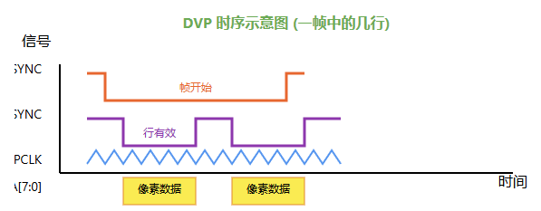
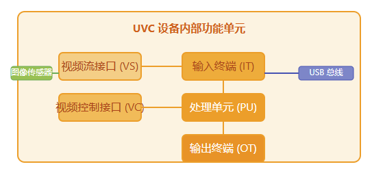
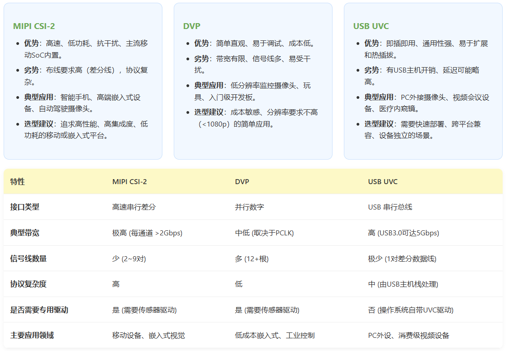
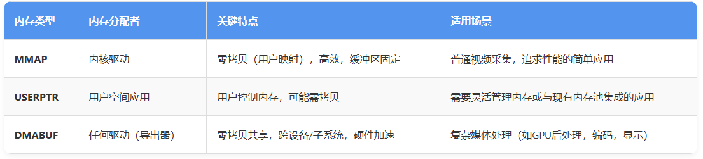
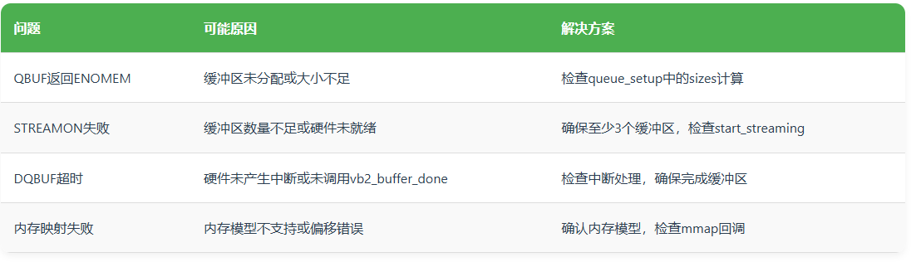

# V4L2 子系统
`v4l2, video for linux 2` 子系统

## 框架简介
- [ ] 补充 v4l2 框架结构
- [ ] 补充与 v4l2 子系统与 media controller(media framework) 和 vb2 子系统之间的关系
1. `v4l2 core`：设备管理、提供统一接口等；
2. `media framework`：摄像头设备由各种组件构成，组件之间的拓扑连接可由 `media framework` 动态控制，形成各种 `pipeline`，从而可控制摄像头数据流；
3. `vb2`：摄像头数据的载体，由 `vb2` 管理被申请的缓冲内存；根据内存的分配者可以分为三种内存类型：...；

### 硬件框图
### 软件框架

## 摄像头硬件接口
**摄像头与主处理器之间的硬件接口**协议决定了数据传输的速率、复杂度与系统设计。

### MIPI CSI-2
`MIPI CSI-2(Camera Serial Interface 2)` 是移动产业处理器接口联盟制定的高速串行摄像头接口标准，广泛用于智能手机、平板电脑和嵌入式视觉系统中。

1. 核心特性
   - 高速串行传输：采用差分信号（1 对时钟线， 1~4 对数据线），抗干扰能力强；
   - 分层协议栈：
     - 物理层（`PHY`）：定义电气特性、时钟与数据通道；
     - 通道管理层（`Lane Management`）：数据分发与合并；
     - 协议层（`Protocol`）：数据包格式（长包、短包）；
     - 像素/字节到像素映射层（`Pixel/Byte to Pixel Mapping`）：将像素数据打包；
     - 应用层（`Application`）：实际图像数据格式（如 `RAW, YUV, RGB`）；
   - 支持高分辨率与高帧率：单通道可达 `2.5Gbps (CSI-2 v1.3)`，满足 4K/8K 视频需求；
   - 低功耗模式：支持 `ULPS`（超低功耗状态）； 
2. 软件架构
   `MIPI CSI-2 软件栈（Linux）`：
   用户空间应用（`v4l2 API`）-> `v4l2` 子系统和 `Video` 设备节点 -> `CSI-2` 控制器驱动 & 传感器驱动（`I2C` 控制） -> `MIPI CSI-2 PHY` 硬件

### DVP
`DVP, Digital Video Port`，也称为并行接口或 `BT.656/BT1120`，是一种传统的并行数字视频接口，常见于早期的 `CMOS` 传感器和低成本的嵌入式设备中。

1. 核心特性
   - 并行传输：使用多根数据线（通常 8/10/12/16 位）、像素时钟（`PCLK`）、行同步（`HSYNC`）和场同步（`VSYNC`）信号；
   - 时序简单直观：通过 `HSYNC` 和 `VSYNC` 信号界定一帧图像的行与场；
   - 带宽有限：受限于并行总线频率和信号完整性，通常用于较低分辨率（如 720p 以下）；
   - 无复杂协议开销：数据流即像素流，易于调试；
  
2. DVP 信号时序图
    

### USB UVC
`USB Video Class, UVC` 是 `USB Implementers Forum` 定义的免驱动视频设备标准。任何符合 `UVC` 协议的摄像头（如常见的 USB 网络摄像头）都可以在支持的操作系统上即插即用，无需安装特定驱动。

1. 和新特性
   - 真正的即插即用：操作系统提供标准 `UVC` 驱动，设备厂商无需提供驱动；
   - 基于 USB 总线：利用 USB 的通用性和高带宽（`USB 2.0/3.0/3.1`）；
   - 灵活的格式与帧率协商：通过 USB 描述符报告设备支持的分辨率、像素格式（`MJPEG, YUY2, H264` 等）和帧率；
   - 支持控制功能：如亮度、对比度、白平衡、聚焦等，通过标准的 `UVC` 控制单元实现；

2. 设备类架构图
    

### 三种接口对比


## V4L2-Core

### 概述

### video_device

### v4l2_device

### v4l2_subdev
在 `V4L2` 框架中，子设备（`sub-device`）代表一个独立的硬件组件，如传感器（sensor）、镜头控制器（lens controller）或图像处理器（ISP）。它通过 `struct v4l2_subdev` 进行抽象，并注册到 `V4L2` 子系统中，与主设备（如视频设备节点）协同工作。

核心思想是子设备将复杂的摄像头硬件模块化，每个子设备负责特定的功能，通过标准接口与主设备通信，实现解耦和灵活配置。

1. 数据结构
   ```c
   struct v4l2_subdev {

   }
   ```

2. 与主设备通信
   子设备与主设备（如 `V4L2` 视频设备节点）之间的通信是 `V4L2` 驱动框架的关键。通信方式主要包括：
   - 直接调用：主设备驱动程序直接调用子设备的操作函数，如 `v4l2_subdev_call(sd, video, s_stream, 1)`；
   - 事件通知：子设备通过 `v4l2_event_queue()` 向主设备发送事件，如帧同步信号；
   - 媒体控制器：通过媒体控制器框架建立数据流管道，实现复杂的多子设备拓扑；
   ```c
   // 主设备调用子设备
   // 主设备驱动中启动视频流
   static int my_video_device_s_stream(struct file *file, void *priv, int enable) {
    struct my_main_device *dev = video_drvdata(file);
    struct v4l2_subdev *sensor_sd = dev->sensor_subdev;
    int ret;

    // 调用子设备的 s_stream 操作
    ret = v4l2_subdev_call(sensor_sd, video, s_stream, enable);
    if (ret < 0) {
        dev_err(dev->dev, "Failed to %s sensor stream\n", enable ? "start" : "stop");
        return ret;
    }

    // 其他硬件启动操作
    // ...

    return 0
   }

   // 子设备通知主设备示例
   // 在子设备中断处理中发送事件
   static irqreturn_t my_sensor_irq_handler(int irq, void *dev_id) {
    struct v4l2_subdev *sd = dev_id;
    struct v4l2_event event = {
        .type = V4L2_EVENT_FRAME_SYNC,
        .u.fram_sync.frame_count = get_frame_count(),
    };

    // 队列事件，主设备可以 poll/read 该事件
    v4l2_event_queue(sd->devnode, &event);
    return IRQ_HANDLED;
   }
   ```

3. 开发流程与实践
   - 子设备开发流程：定义 `ops` -> 初始化 `subdev` -> 注册到 `V4L2` -> 实现通信；
   - 测试与调试：利用 `v4l2-ctl` 工具和内核的 `v4l2-compliance` 测试子设备功能；
   - 明确职责：**子设备应专注于硬件控制，不涉及缓冲区管理等由主设备处理的任务**；
   - 错误处理：子设备操作应返回标准的错误码（如 `-EIO`、`-EINVAL`），并在日志中记录详细错误信息；
   - 电源管理：**实现 `pm_runtime` 支持，确保子设备在空闲时进入低功耗状态**；
   - `DT` 绑定：使用设备树描述子设备的硬件连接和属性，提高可移植性；

### V4L2 控制框架
- [ ] 确定这是 v4l2-core 还是哪个其他框架下的
`V4L2` 控制框架为摄像头、视频采集卡等设备提供了一套统一的控制接口。通过该框架，用户空间应用程序可以查询、设置设备的各种参数（如亮度、对比度、曝光、白平衡等），驱动开发者则可以定义标准或自定义的控制项，并管理它们的状态与事件。

1. 控制框架核心关系：
   `video_device` -> `v4l2_ctrl_handler` -> `v4l2_ctrl`

2. 核心结构-`struct v4l2_ctrl_handler`
   `struct v4l2_ctrl_handler` 是控制框架的管理者，每个 `V4L2` 设备（如 `v4l2_device` 或 `video_device`） 通常关联一个 `handler`，用于管理其所有控制项。
   - 主要职责：
     - 控制项管理：维护一个控制项（`struct v4l2_ctrl`）的链表或哈希表；
     - 锁与同步：提供内部锁机制，保证多线程访问安全；
     - 验证与回调：验证控制值有效性，并调用驱动注册的回调函数；
     - 内存管理：负责控制项内存的分配与释放；
   - API
        ```c
        // 初始化 handler
        void v4l2_ctrl_handler_init(struct v4l2_ctrl_handler *hdl, unsigned nr_of_controls_hint);

        // 释放 handler
        void v4l2_ctrl_handler_free(struct v4l2_ctrl_handler *hdl);

        // 将 handler 关联到 v4l2_device 或 video_device
        ```

3. 自定义控制项
   除了 `V4L2` 自定义的标准控制项（如 `V4L2_CID_BRIGHTNESS`），驱动开发者可以根据硬件特性自定义控制项（`V4L2_CID_PRIVATE_BASE` 及以上）。
   - 创建自定义控制项
        ```c
        struct v4l2_ctrl_config custom_ctrl_cfg = {
            .ops    = &my_ctrl_ops,
            // 自定义控制项的 ID 应从 V4L2_CID_PRIVATE_BASE(0x08000000) 开始，避免与标准 ID 冲突
            // 同时，应在驱动中提供清晰的文档说明其含义与取值范围
            .id     = V4L2_CID_PRIVATE_BASE + 0,
            .name   = "My Custom Control",
            .type   = V4L2_CTRL_TYPE_INTEGER,
            .min    = 0,
            .max    = 100,
            .step   = 1,
            .def    = 50,
            .flags  = V4L2_CTRL_FLAG_SLIDER,
        };
        struct v4l2_ctrl *custom_ctrl;
        custom_ctrl = v4l2_ctrl_new_custom(&handler, &custom_ctrl_cfg, NULL);
        ```
   - 控制项类型：
     - `V4L2_CTRL_TYPE_INTEGER`: 整型
     - `V4L2_CTRL_TYPE_BOOLEAN`: 布尔型
     - `V4L2_CTRL_TYPE_MENU`: 菜单型
     - `V4L2_CTRL_TYPE_BUTTON`: 按钮型
     - `V4L2_CTRL_TYPE_INTEGER64`: 64 位整型
     - `V4L2_CTRL_TYPE_CTRL_CLASS`: 控制类
   - 菜单型控制项（`V4L2_CTRL_TYPE_MENU`）
        允许用户从一组预定义的选项中选择。常用于模式选择、预设配置等场景。
        ```c
        static const char * const my_menu[] = {
            "Mode 1: standard",
            "Mode 2: Vivid",
            "Mode 3: Soft",
            "Mode 4: Monochrome",
            NULL,
        };

        static const struct v4l2_ctrl_config menu_ctrl_cfg = {
            .ops    = &my_ctrl_ops,
            .id     = V4L2_CID_PRIVATE_BASE + 1,
            .name   = "Color Mode",
            .type   = V4L2_CTRL_TYPE_MENU,
            .min    = 0,
            .max    = ARRAY_SIZE(my_menu) - 2,  // 排除 NULL 项，这里 min 和 max 应该对应的是索引值
            .def    = 0,
            .menu_skip_mask = 0,    // 可以跳过某些项
            .qmenu  = my_menu,
        };

        // 菜单操作 API
        // 1. v4l2_ctrl_new_std_menu(): 创建标准菜单项，如曝光模式
        // 2. v4l2_ctrl_new_int_menu(): 创建整型值菜单
        // 3. v4l2_ctrl_get_menu(): 根据 ID 获取标准菜单名称数组
        ```

4. 控制事件
   控制框架支持事件通知机制，当控制项的值发生变化、控制项被添加或删除时，可以通知用户空间。
   - 事件类型
     - `V4L2_EVENT_CTRL_CH_VALUE`: 控制值发生变化；
     - `V4L2_EVENT_CTRL_CH_FLAGS`: 控制标志发生变化；
     - `V4L2_EVENT_CTRL_CH_RANGE`: 控制范围发生变化；
     - `V4L2_EVENT_CTRL_ADD`: 控制项被添加；
     - `V4L2_EVENT_CTRL_DEL`: 控制项被删除；
   - 驱动侧事件通知
        ```c
        // 当控制值发生变化时，调用此函数通知框架
        void v4l2_ctrl_notify(struct v4l2_ctrl *ctrl, v4l2_ctrl_notify_fnc notify, void *priv);

        // 示例：在控制操作回调中触发事件
        static int my_ctrl_set(struct v4l2_ctrl *ctrl) {
            switch (ctrl->id) {
                case V4L2_CID_BRIGHTNESS:
                    hardware_set_brightness(ctrl->val);
                    v4l2_ctrl_notify(ctrl, NULL, NULL); // 通知值变化
                    break;
            }
            return 0;
        }
        ```

5. 示例-创建一个完整的控制项
   展示如何在驱动中初始化一个 `handler`，并添加标准控制项与自定义控制项
   ```c
   #include <media/v4l2-ctrls.h>

   static const struct v4l2_ctrl_ops my_ctrl_ops = {
    .s_ctrl = my_ctrl_set,
    .g_volatile_ctrl = my_ctrl_get,
   };

   int my_v4l2_init(struct my_device *dev) {
        struct v4l2_ctrl_handler *hdl = &dev->ctrl_handler;
        int ret;

        // 1. 初始化 handler 
        v4l2_ctrl_handler_init(hdl, 10);

        // 2. 添加标准控制项
        v4l2_ctrl_new_std(hdl, &my_ctrl_ops, V4L2_CID_BRIGHTNESS, 0, 255, 1, 128);
        v4l2_ctrl_new_std(hdl, &my_ctrl_ops, V4L2_CID_CONTRAST, 0, 127, 1, 64);
        v4l2_ctrl_new_std_menu(hdl, &my_ctrl_ops, V4L2_CID_POWER_LINE_FREQUENCY, V4L2_CID_POWER_LINE_FREQUENCY_60HZ, 0, V4L2_CID_POWER_LINE_FREQUENCY_50HZ);

        // 添加自定义控制项
        struct v4l2_ctrl_config custom_cfg = {
            .ops = &my_ctrl_ops,
            .id = V4L2_CID_PRIVATE_BASE,
            .name = "Custom Sharpness",
            .type = V4L2_CTRL_TYPE_INTEGER,
            .min = 0, 
            .max = 10,
            .step = 1,
            .def = 5,
        };
        v4l2_ctrl_new_custom(hdl, &custom_cfg, NULL);

        // 4. 检查错误并关联 handler
        if (hdl->error) {
            ret = hdl->error;
            v4l2_ctrl_handler_free(hdl);
            return ret;
        }
        dev->v4l2_dev.ctrl_handler = hdl;
        // 或 video_set_ctrl_handler(dev->vdev, hdl);

        // 5. 可选：设置默认值到硬件
        v4l2_ctrl_handler_setup(hdl);
        return 0;
   }
   ```

6. 总结
   - 核心要点：
     - 一个设备，一个 `handler`：每个 `V4L2` 设备应拥有独立的控制 `handler`；
     - 合理使用控制类型：根据参数特性选择整数、布尔、菜单或按钮类型；
     - 验证与回调：在 `s_ctrl` 会调中验证值并配置硬件；
     - 事件通知：重要状态变化应通过事件机制通知用户空间；
   - 常见陷阱：
     - 忘记检查 `hdl-error` 导致控制项添加失败；
     - 自定义控制项 ID 与标准 ID 冲突；
     - 未正确处理控制项的并发访问；
     - 菜单项数组未以 `NULL` 结尾；
   - 建议：
     - 对于复杂的设备，可以考虑将控制项分组（使用 `V4L2_CTRL_CLASS_*`），并利用 `v4l2_ctrl_new_std_cluster()` 创建关联控制项集群，以优化用户体验与硬件配置效率；

## 内存类型与缓冲区队列
视频缓冲区管理是 `V4L2` 子系统的核心，它负责在用户空间和内核空间之间高效、稳定地传出视频数据。涉及到三种内存类型和用于管理这些缓冲区地核心数据结构 `struct vb2_queue`；

理解不同内存类型的特点和 `vb2_queue` 的工作机制，有助于开发者根据应用场景做出最佳选择，并编写出高效、稳定的 `V4L2` 摄像头驱动；

### 内存类型
`V4L2` 定义了三种内存类型，用于指定视频数据缓冲区的分配和管理方式。应用程序通过 `VIDIOC_REQBUFS` `ioctl` 的 `memory` 字段来选择：
```c
struct v4l2_requestbuffers reqbuf;
reqbuf.count    = 4;
reqbuf.type     = V4L2_BUF_TYPE_VIDEO_CAPTURE;
reqbuf.memory   = V4L2_MEMORY_MMAP;     // 指定 MMAP 类型

if (ioctl(fd, VIDIOC_REQBUFS, &reqbuf) == - 1) {
    perror("VIDIOC_REQBUFS");
    exit(EXIT_FAILURE);
}
...
```

1. `MMAP`
   内核负责分配缓冲区内存，用户空间通过 `mmap()` 系统调用将内核缓冲区映射到用户空间地址进行访问。
    - 工作流程：
      - 驱动分配物理连续或散列的缓冲区；
      - 用户调用 `VIDIOC_QUERYBUF` 获取缓冲区信息，如长度、偏移等；
      - 用户调用 `mmap()` 映射缓冲区到用户空间；
      - 通过 `VIDIOC_QBUF/VIDIOC_DQBUF` 进行缓冲区的入队和出队；
    - 优点：
        零拷贝（用户空间直接访问内核缓冲区），效率高；
    - 缺点：
        缓冲区大小和数量在内核分配后固定；

2. `USERPTR`
   缓冲区内存由用户空间应用程序分配（如 `malloc`），将用户空间指针传递给内核驱动使用。
   - 工作流程：
     - 应用程序分配内存，需满足对齐要求等；
     - 通过 `VIDIOC_QBUF` 将包含用户指针的缓冲区结构体提交给驱动；
     - 驱动通过 `DMA` 或 `CPU` 访问该内存区域；
   - 优点：
        应用程序完全控制内存的分配和生命周期；
   - 缺点：
        可能存在额外的拷贝开销，如果硬件 `DMA` 需要物理连续内存；

3. `DMABUF`
   基于 `Linux DMA-BUF` 框架，允许在不同驱动或子系统之间共享缓冲区，无需拷贝。是零拷贝和硬件加速的关键。
   - 工作流程：
     - 缓冲区由导出器（如 `GPU`、`ISP` 驱动）分配并导出为 `DMABUF` 文件描述符（`fd`）；
     - 导入器（如 `V4L2` 驱动）通过该 `fd` 导入并使用缓冲区；
     - 通过 `VIDIOC_QBUF` 传递包含 `dmabuf fd` 的缓冲区结构；
   - 优点：
        真正的零拷贝，支持跨设备、跨子系统共享，适合复杂图像处理流水线；
   - 缺点：
        需要硬件和驱动支持 `DMA-BUF`；

---
1. 对比
    
   - `MMAP`：最常用，性能好，适合大多数标准视频采集应用；性能高；
   - `USERPTR`：当应用程序需要复用其自身自有内存池时使用，但需要注意性能和数据对齐；性能中等（需复制）；
   - `DMABUF`：`DMA` 缓冲区，可跨设备共享；现代复杂媒体应用的首选，尤其是涉及 `GPU, VPU`，显示等硬件加速和零拷贝流水线；性能最高；

2. 缓冲区生命周期
   1. 分配：通过 `vb2_queue_init()` 和 `vb2_reqbufs()` 分配缓冲区内存；
   2. 映射：用户空间调用 `mmap()` 将内核缓冲区映射到用户空间；
   3. 入队：`VIDIOC_QBUF` 将缓冲区交给驱动/硬件；
   4. 出队：硬件填充数据后，通过 `VIDIOC_DQBUF` 返回给用户；
   5. 释放：流停止或驱动卸载时释放所有缓冲区；

### 缓冲区管理
`videobuf2` 是 Linux `V4L2` 子系统的核心缓冲区管理框架，它为视频设备驱动提供了统一、高效且灵活的缓冲区管理机制。涉及 `vb2_ops` 操作集、缓冲区的分配与内存映射、以及流控制状态的工作原理，是驱动开发者掌握 `V4L2` 高级编程的关键。

`struct vb2_queue` 是 `V4L2` 核心提供的缓冲区队列抽象，**它封装了缓冲区的管理逻辑，驱动开发者只需实现特定操作回调**。

`vb2` 框架极大地简化了驱动开发，开发者只需关注硬件相关的操作，而无需重复实现缓冲区队列管理、同步、等待队列等复杂逻辑。

驱动开发者必须理解和使用的核心框架，正确实现其回调是驱动稳定的关键。

- 数据结构
  ```c
  struct vb2_queue {
    enum v4l2_buf_type type;
    enum v4l2_memory memory;
    unsigned int io_modes;
    unsigned int num_buffers;
    unsigned int buf_struct_size;       // size of the driver-specific buffer structure
    u32 timestamp_flags;                // Timestamp flags; V4L2_BUF_FLAG_TIMESTAMP_* and V4L2_BUF_FLAG_TSTAMP_SRC_*
    struct list_head queued_list;       // 已排队缓冲区
    struct list_head done_list;         // 已处理缓冲区
    const struct vb2_mem_ops *mem_ops;  // 内存操作函数集
    const struct vb2_ops *ops;  // 缓冲区操作函数集
    void *drv_priv;                     // 驱动私有数据
    // ... 其他字段
  }
  ```

- 核心操作流程
  - 队列初始化：驱动填充 `vb2_queue` 结构体并调用 `vb2_queue_init()`（在驱动 probe 或 open 函数中初始化队列）；
  - 缓冲区申请：用户空间通过 `VIDIOC_REQBUFS` 触发，最终调用驱动的 `buf_init()` 等回调；
  - 缓冲区入队列：`QBUF`，用户将缓冲区交给驱动准备填充数据，对应 `vb2_qbuf()`；
  - 启动流：`VIDIOC_STREAMON` 触发 `vb2_streamon()`，驱动开始向缓冲区填充数据；
  - 缓冲区出队列：`DQBUF`，用户获取已填充数据的缓冲区，对应 `vb2_dqbuf()`；
  - 停止流：`VIDIOC_SREAMOFF` 触发 `vb2_streamoff()`；

- 流控制状态机
  `Videobuf2` 内部维护了一个严谨的状态机，确保流控制的有序性。

  1. 状态机
  - [ ] 补充状态机对应的状态转换图

    涉及的状态：
    1. `DEQUEUED`：缓冲区在用户空间，未提交给驱动；
    2. `PREPARED`：已调用 `buf_prepare`，缓冲区就绪；
    3. `QUEUED`：已提交给驱动，等待硬件处理；
    4. `ACTIVE`：硬件正在处理该缓冲区；
    5. `DONE`：硬件处理完成，数据就绪，等待用户取出；
    6. `ERROR`：处理过程中发生错误；

  2. 流控制序列
    `REQBUFS -> QUERYBUF -> QBUF(多个) -> STREAMON -> DQBUF/QBUF -> STREAMOFF`

  3. **驱动必须正确处理 `start_streaming` 和 `stop_streaming` 的调用，确保硬件状态与缓冲区状态的同步**。在 `stop_streaming` 中应将所有缓冲区状态重置为 `DEQUEUED`。

- `videobuf2` 队列管理
  视频流开启后，驱动需要持续地将捕获地视频数据填充到用户提供的缓冲区中，并实现缓冲区的循环使用。
  - 入队（`buf_queue`）：用户空间通过 `VIDIOC_QBUF` 将缓冲区放入驱动队列；
  - 出队（`buf_done`）：**DMA 传输完成中断中，驱动程序调用 `vb2_buffer_done` 通知核心缓冲区数据就绪**；
  - 轮转策略：通常采用 `FIFO`（先进先出）方式，确保缓冲区按顺序被填充和消费。


## Media Controller 框架
媒体控制器（`Media Controller`）是 Linux 内核 `V4L2` 子系统中的一个核心框架，**用于描述和管理复杂的多媒体硬件拓扑结构**。它允许用户空间应用程序发现、配置和控制由多个硬件模块（实体）组成的多媒体设备，如摄像头、图像传感器、ISP、编解码器等。

设计目标是提供一种统一的方式来描述硬件内部连接关系，使得用户空间可以动态地重新配置数据流路径，而无需修改驱动代码。

### 数据结构
1. `media_device`
   ```c
   // <media/media-device.h>
   ```
   - 代表整个媒体设备，包含所有实体和链路。

2. `media_entity`
   ```c
   // <media/media-entity.h>
   struct media_entity {

   }
   ```
    - 代表一个实体，包含 pad 和链路信息；
    - `media_entity` 是媒体控制器框架中的基本构建块，代表硬件或软件中的一个功能单元；
    - 每个 `media_entity` 都有一个唯一的 ID 和一组 `meia_pad`；
    
    | 实体类型  | 描述   | 示例 |
    | ------------ | ------------------------ | -------- | 
    | `V4L2` 子设备 | 通常代表一个独立的硬件模块，如图像传感器、镜头控制器等   | ov5640 传感器 |
    | `V4L2` 设备节点 | 代表一个可被用户空间访问的设备，如 `/dev/video0`   | 视频捕获设备 |
    | 媒体设备 | 代表整个媒体硬件设备，包含多个实体   | USB 摄像头模块 |

3. `media_pad`
   ```c
   // <media/meida-entity.h>

   ```
   代表实体的输入/输出连接点。是 `media_entity` 上的连接点，用于数据的输入或输出，每个 Pad 都有一个方向（`sink` 或 `source`）和类型：
   - `source`: 输出数据流，数据从此处流出；
   - `sink`: 输入数据流，数据从此处流入；

4. `media_link`
   ```c
   ```
   代表两个 pad 之间的连接。link 连接两个 `media_entity` 的 `media_pad`，定义了数据流的路径。link 可以是：
   - 使能（`Enable`）：数据可以通过此链路流动；
   - 禁用（`Disabled`）：数据不能通过此链路流动；
   - 动态（`Dynamic`）：可以在运行时启用或禁用

### 拓扑描述与配置
   - [ ] 补充由媒体控制器框架构成的拓扑结构图

2. 典型摄像头硬件拓扑：
        传感器 -> ISP -> 编解码器 -> V4L2 设备节点

3. 驱动中的拓扑配置示例
   ```c
   #include <media/media-entity.h>
   #include <media/v4l2-subdev.h>

   // 1. 定义 entity
   struct v4l2_subdev sensor_sd;
   struct media_entity *sensor_entity = &sersor_sd.entity;

   // 2. 初始化 entity
   sensor_entity->name = "ov5640";
   sensor_entity->function = MEDIA_ENT_F_CAM_SENSOR;

   // 3. 初始化 pad
   sensor_entity->pads = kcalloc(1, sizeof(struct media_pad), GFP_KERNEL);
   sensor_entity->pads[0].flags = MEDIA_PAD_FL_SOURCE;  // 输出 pad
   sensor_entity->num_pads = 1;

   // 4. 注册 entity
   ret = meida_device_register_entity(mdev, sensor_entity);

   // 5. 创建 link
   struct media_link *link;
   link = media_create_pad_link(sensor_entity, 0,   // source entity 和 pad
                                isp_entity, 0,      // sink entity 和 pad
                                MEDIA_LNK_FL_ENABLE | MEDIA_LNK_FL_IMMUTABLE
                            );
   ```

4. 用户空间配置
   使用 `media-ctl` 工具可以查看和配置媒体控制器拓扑：
   ```bash
   # 查看拓扑
   media-ctl -p

   # 设置格式
   media-ctl --set-v4l2 '"ov5640":0[fmt:UYVY8_2x8/1280x720]'

   # 启动/禁用链路
   media-ctl -l '"ov5640":0->"isp":0[0]' # 禁用
   media-ctl -l '"ov5640":0->"isp":0[1]' # 启用
   ```

5. `struct v4l2_subdev` 通常包含一个 `struct media_entity`

### 实践与注意事项
1. 媒体控制器框架虽然强大，但也增加了驱动复杂性，仅在硬件确实需要动态配置数据流路径时才使用。
2. 合理设计拓扑：在驱动设计阶段就明确硬件的数据流路径；
3. 正确设置链路标志：
   - `MEDIA_LNK_FL_ENABLE`：链路默认启用；
   - `MEDIA_LNK_FL_IMMUTABLE`：链路不可更改；
   - `MEDIA_LNK_FL_DYNAMIC`：链路可动态启动/禁用
4. 错误处理：媒体控制器 API 可能失败，需要适当的错误处理；
5. 用户空间兼容性：确保 `media-ctl` 等工具可以正确操作驱动；

## 调用链
### 涉及的 ops 结构体
1. `ioctl` 操作
    ```c
    // 操作集数据结构
    ```

2. `vb2` 操作
   ```c
   // struct vb2_mem_ops: 用于操作内存
   // struct vb2_ops: 用于操作缓存区
   ```

3. `v4l2_subdev` 操作
   ```c
   ```

### 调用流程
1. `vb2`:
   - `streamon`：
        
        1. 用户空间调用 `ioctl(fd, VIDIOC_STREAMON, &type)`；
        2. `V4L2` 核心层调用 `vb2_core_streamon()`；
        3. 检查状态，确保缓冲区已准备（`VB2_BUF_STATE_QUEUED`）；
        4. 调用驱动注册的 `start_streaming()` 回调函数；
        5. 驱动使能硬件（传感器、DMA 控制器等）；
        6. 将缓冲区状态改为 `VB2_BUF_STATE_ACTIVE`；
   - `streamoff`:
        1. 用户空间调用 `ioctl(fd, VIDIOC_STREAMOFF, &type)`;
        2. `V4L2` 核心调用 `vb2_core_streamoff()`；
        3. 调用驱动注册的 `stop_streaming()` 回调；
        4. 驱动停止 DMA 传输：`dmaengine_terminate_sync()`；
        5. 停止传感器数据输出；
        6. 将所有缓冲区状态重置为 `VB2_BUF_STATE_ERROR`;
        7. 清空内部缓冲队列；

## 操作集实现
### ioctl 操作集
1. 操作流程概述
    典型的 `V4L2` **应用初始化流程**（**查询 -> 枚举 -> 获取 -> 设置**）：先查询设备能力，再枚举支持的格式，然后获取当前格式（或直接设置新格式）；

    **应用层（`ioctl` 调用） -> `V4L2` 核心（验证与路由） -> 驱动层（驱动回调）-> 硬件（寄存器设置）**

2. ioctl 支持的操作（相关宏）
    - `VIDIOC_QUERYCAP`：查询设备能力，如是否支持视频输入/输出、驱动信息等；
    - `VIDIOC_G_FMT`：获取当前视频格式、分辨率、像素格式等；
    - `VIDIOC_S_FMT`：设置...；
    - `VIDIOC_ENUM_FMT`：枚举支持的图像格式；
    - `VIDIOC_REQBUFS`：申请缓冲区（用于流格式 I/O 传输）；
    - `VIDIOC_QUERYBUFS`：查询缓冲区信息，如内存地址、大小、状态等；
    - `VIDIOC_QBUF`：将缓冲区放入队列，用于数据采集；
    - `VIDIOC_DQBUF`：从队列中取出缓冲区，以获取采集的数据；
    - `VIDIOC_STREAMON`：启动视频流，开始采集数据；
    - `VIDIOC_STREAMOFF`：停止视频流，停止采集数据；
    - `VIDIOC_DEFAULT`：处理未定义的 `ioctl` 请求，默认操作；
    - `VIDIOC_S_PARM`：
    - `VIDIOC_ENUM_FRAMESIZES`：
    - `VIDIOC_ENUM_FRAMEINTERVALS`：

3. `VIDIOC_QUERYCAP`-查询设备能力
   准确填写驱动名、设备名、能力标志
   ```c
   struct v4l2_capability {
    __u8 driver[16];        // 驱动名称
    __u8 card[32];          // 设备名称
    __u8 bus_info[32];      // 总线信息
    __32 version;           // 内核版本
    __32 capabilities;      // 设备能力标志
    __32 device_caps;       // 设备特定能力
    __32 reserved[3];
   }

   // 关键能力标志-capabilities
   V4L2_CAP_VIDEO_CAPTURE       // 支持视频捕获
   V4L2_CAP_STREAMING           // 支持流式 I/O （mmap）
   V4L2_CAP_READWRITE           // 支持 read()/write I/O
   ```
   驱动实现示例：
   ```c
   static int my_v4l2_querycap(struct file *file, void *priv, struct v4l2_capability *cap) {
    struct my_device *dev = video_drvdata(file);

    strscpy(cap->driver, "my_camera_driver", sizeof(cap->driver));
    strscpy(cap->card, "My USB Camera", sizeof(cap->card));
    snprintf(cap->buf_info, sizeof(cap->bus_info), "usb-%s", dev->udev->bus->bus_name);

    cap->device_caps = V4L2_CAP_VIDEO_CAPTURE | V4L2_CAP_STREAMING | V4L2_CAP_READWRITE;
    cap->capabilities = cap->device_caps | V4L2_CAP_DEVICE_CAPS;

    return 0;
   }
   ```
   必须正确填充的字段（用户空间工具，如 `v4l2_ctl` 依赖这些信息显示设备）:
    - `driver`;
    - `card`;
    - `bus_info`;

4. `VIDIOC_ENUM_FMT`-枚举图像格式
   枚举设置支持的图像格式（如 `YUYV, MJPG, RGB24` 等），按 `index` 顺序返回，描述清晰；
   ```c
   struct v4l2_fmtdesc {
    __u32 index;            // 格式索引，从 0 开始
    __u32 type;             // 缓冲区类型，如 V4L2_BUF_TYPE_VIDEO_CAPTURE
    __u32 flags;            // 格式标志
    __u8 description[32];   // 格式描述字符串
    __u32 pixelformat;      // 四字符码（FOURCC）
    __u32 reserved[4];
   }
   ```
   驱动实现示例：
   ```c
   static int my_v4l2_enum_fmt(struct file *file, void *priv, struct v4l2_fmtdesc *f) {
    // 只支持视频捕获类型的枚举
    if (f->type != V4L2_BUF_TYPE_VIDEO_CAPTURE) {
        return -EINVAL;
    }

    switch (f->index) {
        case 0:
            f->pixelformat = V4L2_PIX_FMT_YUYV;
            strscpy(f->description, "YUYV 4:2:2", sizeof(f->description));
            break;
        case 1:
            f->pixelformat = V4L2_PIX_FMT_MJPEG;
            strscpy(f->description, "Motion-JPEG", sizeof(f->description));
            break;
        case 2:
            f->pixelformat = V4L2_PIX_FMT_RGB24;
            strscpy(f->description, "RGB 24-bit", sizeof(f->description));
            break;
        default:
            return -EINVAL; // 超出索引范围
    }

    f->flags = 0;
    return 0;
   }
   ```
   **应用会循环调用此 `ioctl`，递增 `index` 直到返回错误，从而获取所有支持的格式**；

5. `VIDIOC_G_FMT, VIDIOC_S_FMT`-获取/设置格式
   获取时，从设备状态返回真实参数；设置时，检查、调整参数，最后配置硬件；
    ```c
    struct v4l2_format {
        __u32 type;                     // 缓冲区类型
        union {
            struct v4l2_pix_format pix; // 用于视频捕获/输出
            // ...，其他格式，如 overlay,vbi 等
        } fmt;
    };

    struct v4l2_pix_format {
        __u32 width;
        __u32 height;
        __u32 pixelformat;          // 像素格式（FOURCC）
        __u32 field;                // 场序，如 V4L2_FIELD_NONE
        __u32 bytesperline;         // 每行字节数，包含填充
        __u32 sizeimgae;            // 图像缓冲区大小
        __u32 colorspace;           // 色彩空间
        // ... 其他字段
    };
    ```
    驱动实现示例：
    ```c
    static int my_v4l2_g_fmt(struct file *file, void *priv, struct v4l2_format *f) {
        struct my_device *dev = video_drvdata(file);

        if (f->type != V4L2_BUF_TYPE_VIDEO_CAPTURE) {
            return -EINVAL;
        }

        f->fmt.pix.width        = dev->width;
        f->fmt.pix.height       = dev->height;
        f->fmt.pix.pixelformat  = dev->pixelformat;
        f->fmt.pix.field        = V4L2_FIELD_NONE;
        f->fmt.pix.bytesperline = dev->bytesperline;
        f->fmt.pix.sizeimgage   = dev->imagesize;
        f->fmt.pix.colorspace   = V4L2_COLORSPACE_SRGB;

        return 0;
    }

    static int my_v4l2_s_fmt(struct file *file, void *priv, struct v4l2_format *f) {
        struct my_device *dev = video_drvdata(file);
        struct v4l2_pix_format *pix = &f->fmt.pix;

        // 检查缓冲区类型
        if (f->type != V4L2_BUF_TYPE_VIDEO_CAPTURE) {
            return -EINVAL;
        }

        // 检查是否支持该像素格式
        if (pix->pixelformat != V4L2_PIX_FMT_YUYV && pix->pixelformat != V4L2_PIX_FMT_MJPEG) {
            return -EINVAL;
        }

        // 调整宽度和高度以满足硬件对齐要求（例如 16 像素对齐）
        pix->width  = ALIGN(pix->width, 16);
        pix->height = ALIGN(pix->height, 2);

        // 计算 bytesperline 和 sizeimage
        if (pix->pixelformat == V4L2_PIX_FMT_YUYV) {
            pix->bytesperline = pix->width * 2; // YUYV 每个像素 2 字节
            pix->sizeimage = pix->bytesperline * pix->height;
        } else if (pix->pixelformat == V4L2_PIX_FMT_MJPEG) {
            pix->bytesperline = 0;      // MJPEG 是压缩格式，行跨度无意义
            pix->sizeimage = pix->width * pix->height * 3 / 8;  // 估算
        }

        pix->field = V4L2_FIELD_NONE;
        pix->colorspace = V4L2_COLORSPACE_SRGB;

        // 保存到设置结构体
        dev->width  = pix->width;
        dev->height = pix->height;
        dev->pixelformat = pix->pixelformat;
        dev->bytesperline = pix->bytesperline;
        dev->imagesize = pix->sizeimage;

        // 配置硬件寄存器，伪代码
        // write_reg(dev, WIDTH_REG, dev->width);
        // write_reg(dev, HEIGHT_REG, dev->height);
        // write_reg(dev, FORMAT_REG, dev->pixelformat);

        return 0;
    }
    ```
    要点：
    1. `VIDIOC_G_FMT`：返回当前设置的格式，驱动需从内部状态中填充结构体；
    2. `VIDIOC_S_FMT`：应用请求设置格式，驱动需检查并调整参数（如对齐要求），然后配置硬件；
    3. **驱动可以修改应用请求的参数，如将宽度对齐到 16 像素，但必须返回实际设置的格式**；
    补充：
    4. `ioctl` 的 `VIDIOC_TRY_FMT` 与 `VIDIOC_S_FMT` 类似，但是只测试格式而不实际配置硬件，常用于应用预览可用格式；

6. 动态分辨率与帧率切换
   - [ ] 这部分是属于 ioctl 还是属于 controls ?
   在现代摄像头应用中，根据应用场景需求动态切换分辨率和帧率是核心功能之一。`V4L2` 子系统提供了一套标准的 IOCTL 接口，允许用户空间查询和设置摄像头的分辨率和帧率。

   - 涉及的三个关键 IOCTL：
     - `VIDIOC_S_PARM`：设置流参数（包括帧率）
     - `VIDIOC_ENUM_FRAMESIZES`：枚举支持的分辨率
     - `VIDIOC_ENUM_FRAMEINTERVALS`：枚举支持的帧间隔
   - `VIDIOC_ENUM_FRAMESIZES`
        此 IOCTL 用于查询摄像头设备支持的所有图像分辨率。它通常与像素格式（`pixel format`）结合使用，因为不同的格式可能支持不同的分辨率。
        - 数据结构
            ```c
            struct v4l2_frmsizeenum {
                __u32 index;                // 枚举索引，0 开始
                __u32 pixel_format;         // 像素格式（如 V4L2_PIX_FMT_YUYV）
                __u32 type;                 // 帧尺寸类型（离散、步进、连续）
                union {
                    struct v4l2_frmsize_discrete discrete;  // 离散尺寸
                    struct v4l2_frmsize_stepwise stepwise;  // 步进尺寸
                };
                __u32 reserved[2];
            };

            struct v4l2_frmsize_discrete {
                __u32 width;
                __u32 height;
            };      // 像素宽度和高度
            ```
        - 使用流程
            1. 设置 `pixel_format` 为感兴趣的像素格式；
            2. 从 `index = 0` 开始循环调用 `VIDIOC_ENUM_FRAMESIZES`；
            3. 驱动返回成功直到返回 `-EINVAL` 错误，表示枚举结束；
            4. 根据 `type` 字段解析分辨率信息（离散、步进或连续）；
        - 步进类型（`V4L2_FRMSIZE_TYPE_STEPWISE`）表示分辨率可以在最小/最大值之间按步进值变化，常用于缩放传感器；
    - `VIDIOC_ENUM_FRAMEINTERVALS`
        在选定分辨率后，此 IOCTL 用于查询该分辨率下支持的帧间隔（即帧率的倒数）。帧间隔通常以分数形式表示（分子/分母）。
        - 数据结构
            ```c
            struct v4l2_frmivalenum {
                __u32 index;            // 枚举索引
                __u32 pixel_format;     // 像素格式
                __u32 width;            // 已选宽度
                __u32 height;           // 已选高度
                __u32 type;             // 帧间隔类型（离散、步进、连续）
                union {
                    struct v4l2_fract discrete;     // 离散帧间隔
                    struct v4l2_frmival_stepwise stepwise;  // 步进帧间隔
                };
                __u32 reserved[2];
            };

            struct v4l2_fract {
                __u32 numerator;        // 分子（通常为 1）
                __u32 denominator;      // 分母（帧率，如 30 表示 30fps）
            };
            ```
        - 调用序列
            先枚举分辨率 -> 针对每个分辨率枚举帧间隔 -> 选择合适的分辨率、帧率组合。
        - 典型分辨率和帧率
            | 分辨率  | 支持帧率（fps）   | 类型 |
            | --- | ---- | ---- | 
            | 1920x1080 | 30,25,24 | 离散 |
            | 1280x720 | 60，50，30，25 | 离散 |
            | 640x480 | 90-120（步进 1） | 步进 |
    - `VIDIOC_S_PARM`
        此 IOCTL 用于设置视频流的参数，其中最常用的就是帧率。它通过 `v4l2_streamparm` 结构体传递参数。
        - 数据结构
            ```c
            struct v4l2_streamparm {
                __u32 type;         // 流类型（如 V4L2_BUF_TYPE_VIDEO_CAPTURE）
                union {
                    struct v4l2_captureparm capture;    // 捕获流参数
                    struct v4l2_outputparm output;  // 输出流参数
                } parm;
            };

            struct v4l2_captureparm {
                __u32 capability;       // 能力标志
                __u32 capturemode;      // 捕获模式
                struct v4l2_fract timeperframe; // 帧间隔
                __u32 extendedmode;     // 扩展模式
                __u32 readbuffers;      // 读缓冲区数量
                __u32 reserved[4];
            };
            ```
        - 设置帧率示例
            ```c
            int set_frame_rate(int fd, int width, int hegiht, int fps) {
                struct v4l2_streamparm parm = {0};
                parm.type = V4L2_BUF_TYPE_VIDEO_CAPTURE;

                // 先获取当前参数
                if (ioctl(fd, VIDIOC_G_PARM, &parm) == -1) {
                    perror("VIDIOC_G_PARM");
                    return -1;
                }

                // 设置帧间隔
                parm.parm.capture.timeperframe.numerator = 1;
                parm.parm.capture.timeperframe.denominator = fps;

                // 应用设置
                if (ioctl(fd, VIDIOC_S_PARM, &parm) == -1) {
                    perror("VIDIOC_S_PARM");
                    return -1;
                }

                printf("帧率设置为：%d fps\n", fps);
                return 0;
            }
            ```
            **驱动可能不支持任意帧率，实际帧率会在 `VIDIOC_S_PARM` 调用后被调整，建议调用`VIDIOC_G_PARM` 验证实际设置值**。
     - 完整动态切换流程
        1. 步骤：枚举支持的分辨率 -> 枚举选定的分辨率的帧间隔 -> 停止当前流 -> 设置新格式（`S_FMT`） -> 设置帧率（`S_PARM`） -> 重启流
        2. 要点：
            - 查询优先：切换前务必通过 `ENUM` 系列 IOCTL 查询设备能力；
            - 停止流：修改分辨率或格式前必须停止视频流（调用`VIDIOC_STREAMOFF`）；
            - 顺序设置：先设置格式（`VIDIOC_S_FMT`），再设置帧率（`VIDIOC_S_PARM`）；
            - 验证结果：设置后使用 `VIDIOC_G_FMT` 和 `VIDIOC_G_PARM` 确认实际生效值；
     - 驱动开发
       - 核心回调函数
            | V4L2 操作  | 驱动回调   | 说明 |
            | --- | ---- | ---- | 
            | ENUM_FRAMESIZES | v4l2_ioctl_ops->vidioc_enum_framesizes | 填充分辨率枚举信息 |
            | ENUM_FRAMEINTERVALS | v4l2_ioctl_ops->vidioc_enum_frameintervals | 填充帧间隔枚举信息 |
            | S_PARM/G_PARM | v4l2_ioctl_ops->vidioc_s_parm/vidioc_g_parm | 设置/获取流参数 |
       - 实现示例
            ```c
            static int mycam_enum_framesizes(struct file *file, void *fh, struct v4l2_frmsizeenum *fsize) {
                // 检查像素格式是否支持
                if (fsize->pixel_format != V4L2_PIX_FMT_YUYV) {
                    return -EINVAL;
                }

                // 根据索引返回分辨率
                switch (fsize->index) {
                    case 0 :
                        fsize->type = V4l2_FRMSIZE_TYPE_DISCRETE;
                        fsize->discrete.width = 1920;
                        fsize->discrete.height = 1080;
                        break;
                    case 1:
                        fsize->type = V4L2_FRMSIZE_TYPE_DISCRETE;
                        fsize->discrete.width = 1280;
                        fsize->discrete.height = 720;
                        break;
                    default:
                        return -EINVAL;     // 枚举结束
                }

                return 0;
            }
            ```

7. 建议：
   - 始终验证 `v4l2_format.type`（总体格式） 或 `v4l2_fmtdesc.type`（像素格式）字段，确保应用请求的是正确类型；
   - 在 `VIDIOC_S_FMT` 中，如果硬件不支持请求的分辨率，应将其调整为最接近的可用值；
   - 计算 `bytesperline` 和 `sizeimage` 时要考虑硬件对齐要求，避免缓冲区溢出；
   - 实现 `VIDIOC_ENUM_FMT` 时，确保索引从 0 开始连续，直到所有格式枚举完毕；

### vb2 操作集
`struct vb2_queue` 结构体涉及两种操作集：`struct vb2_mem_ops`（用于操作内存）和 `struct vb2_ops`（用于操作缓冲区）。

1. 与 `struct vb2_queue` 相关的 `ioctl` 操作：
    - `REQBUFS`：申请缓冲区；
    - `QBUF`：缓冲区入队列；
    - `DQBUF`：缓冲区出队列；
    - `STREAMON`：启动数据采集；

2. `struct vb2_ops` 是驱动开发者必须实现的一组回调函数，`Videobuf2` 框架通过它来与具体的硬件交互。
   - `queue_setup`：设置缓冲区数量、大小和内存类型；调用时机：流开启前；
   - `buf_init/buf_cleanup`：初始化/清理缓冲区私有数据；调用时机：缓冲区分配/释放时；
   - `buf_prepare/buf_finish`：准备/完成缓冲区（同步缓存、元数据）；调用时机：入队前/出队后；
   - `buf_queue`：将缓冲区加入硬件队列；调用时机：用户空间 `QBUF` 时；
   - `start_streaming/stop_streaming`：启动/停止硬件流；调用时机：流开启/停止时；
   - `wait_prepare/wait_finish`：释放/重新获取锁（避免死锁）；调用时机：等待事件前/后；

3. 视频流的开启`VIDIOC_STREAMON`和停止`VIDIOC_STREAMOFF`-`start_streaming`、`stop_streaming`
   标志着视频数据采集的开始和结束，涉及到缓冲区队列的管理、DMA 传输的启动与停止，以及驱动与硬件交互的关键流程。

   - `streamon` 前后状态转换：
        | 组件  | streamon 前状态   | streamon 后状态 |
        | --- | ---- | ---- | 
        | 缓冲区 | `VB2_BUF_STATE_QUEUED`   | `VB2_BUF_STATE_ACTIVE` |
        | 硬件传感器 | 待机/低功耗   | 连续输出视频数据 |
        | DMA 控制器 | 空闲   | 循环传输中 |
        | 驱动标志 | dev->streaming = false   | dev->streaming = true |
    - `streamon` 与 `streamoff` 对比
        | 特性  | VIDIOC_STREAMON   | VIDIOC_STREAMOFF |
        | --- | ---- | ---- | 
        | 主要作用 | 启动视频采集   | 停止视频采集 |
        | 硬件状态 | 传感器、DMA 使能   | 传感器、DMA 禁用 |
        | 缓冲区状态 | QUEUED -> ACTIVE   | ACTIVE/DONE -> ERROR |
        | 可重入性 | 已开启时调用返回 -EBUSY   | 已停止时调用无影响 |
        | 典型调用时机 | QBUF 之后，DQBUF 之前   | 采集结束或出错时 |
    - 调试
        1. 典型问题排查
            | 问题现象  | 可能原因   | 解决方案 |
            | --- | ---- | ---- | 
            | streamon 返回 -EINVAL | 缓冲区为正确入队   | 检查 `QBUF` 调用次数和返回值 |
            | 视频流丢帧、卡顿 | DMA 配置不当或中断延迟高   | 优化 DMA 突发长度，检查中断亲和性 |
            | streamoff 后再次 streamon 失败 | 缓冲区状态未正确重置   | 确保 stop_streaming 中清空所有内部状态 |
            | 内存泄露 | DMA 描述符未释放   | 在 stop_streaming 中释放所有 DMA 资源 |
        2. 日志
            ```c
            // 在驱动关键位置添加调试信息
            #define MY_DEBUG 1
            #if MY_DEBUG
            #define my_dbg(dev, fmt, ...) \ deb_dbg(dev->dev, "%s:%d" fmt, __func__, __LINE__, ##__VA_ARGS)
            #else
            #define my_dbg(dev, fmt, ...)
            #endif

            static int my_v4l2_start_streaming(struct vb2_queue *vq, unsigned int count) {
                my_dbg(dev, "Starting streaming, %u buffers queued\n", count);
                my_dbg(dev, "DMA addr: 0x%llx, size: %u\n", dev->cur_buf->dma_addr, dev->buf_size);
                // ...
            }
            ```

4. 驱动实现示例：
   ```c
    static int my_queue_setup(struct vb2_queue *vq, unsigned int *num_buffers, unsigned int *num_planes, unsigned int sizes[], struct device *alloc_devs[]) {
        // 计算缓冲区大小，设置 num_planes（平面数）
        size[0] = image_width * image_height * 2;   // 例如 YUV422
        *num_planes = 1;

        if (*num_buffers < 3) {
            *num_buffers = 3;       // 建议最小缓冲区数
        }

        return 0;
    }

    static int my_v4l2_start_streaming(sturct vb2_queue *vq, unsigned int count) {
        struct my_device *dev = vb2_get_drv_priv(vq);
        int ret;

        // 1. 启动 DMA 引擎
        ret = dmaengine_submit(dev->dma_desc);
        if (ret) {
            dev_err(dev->dev, "Failed to submit DMA: %d\n", ret);
            return ret;
        }

        // 2. 配置传感器输出
        ret = i2c_smbus_write_byte_data(dev->sensor_client, SENSOR_CTRL_REG, START_STREAMING);
        if (ret) {
            dev_err(dev->dev, "Sensor start failed: %d\n", ret);
            dmaengine_terminate_sync(dev->dma_chan);
            return ret;
        }

        // 3. 启动 DMA 传输
        dma_async_issue_pending(dev->dma_chan);

        // 4. 标记设备为流开启状态
        dev->streaming = true;

        dev_info(dev->dev, "Stream started successfully\n");
        return 0;
    }

    // DMA传输完成中断中，驱动调用 vb2_buffer_done() 通知核心缓冲区数据就绪
    // DMA 完成中断处理示例
    static irqreturn_t my_dma_isr(int irq, void *dev_id) {
        struct my_device *dev = dev_id;
        struct vb2_v4l2_buffer *vbuf;
        struct my_buffer *buf;

        // 获取当前传输完成的缓冲区
        buf = dev->cur_buf;
        if (!buf) {
            return IRQ_NONE;
        }

        vbuf = &buf->vb;

        // 1. 标记缓冲区数据就绪
        vbuf->sequence = dev->frame_sqe++;
        vbuf->vb2_buf.timestamp = ktime_get_ns();

        // 2. 通知 videobuf2 缓冲区已完成
        vb2_buffer_done(&vbuf->vb2_buf, VB2_BUF_STATE_DONE);

        // 3. 从队列中取出下一个缓冲区
        dev->cur_buf = list_first_entry_or_null(&dev->buf_list, struct my_buffer, list);

        if (dev->cur_buf) {
            // 4. 启动下一次 DMA 传输
            start_dma_transfer(dev, dev->cur_buf);
        }

        return IRQ_HANDLED;
    }

    static void my_v4l2_stop_streaming(struct vb2_queue *vq) {
        struct my_device *dev = vb2_get_drv_priv(vq);

        // 1. 停止 DMA 传输（同步等待进行中的传输完成）
        if (dev->dma_chan) {
            dmaengine_terminate_sync(dev->dma_chan);
        }

        // 2. 停止传感器
        i2c_smbus_write_byte_data(dev->sensor_client, SENSOR_CTRL_REG, STOP_STREAMING);

        // 3. 释放所有内部资源
        release_internal_buffers(dev);

        // 4. 重置流状态标志
        dev->streaming = false;
        dev->frame_seq = 0;
        dev->cur_buf = NULL;

        // 5. 清空缓存区队列（由核心层自动调用）
        // 注意：此处不需要手动调用 vb2_buffer_done，核心层的 streamoff 会处理所有缓冲区状态重置

        dev_info(dev->dev, "Stream stopped\n");
    }

    static const struct vb2_ops my_vb2_ops = {
        .queue_setup    = my_queue_setup,          // 设置缓冲区数量和大小
        .buf_init       = my_buf_init,             // 缓冲区初始化
        .buf_prepare    = my_buf_prepare,          // 缓冲区准备
        .buf_finish     = my_buf_finish,           // 缓冲区处理完成
        .buf_cleanup    = my_buf_cleanup,          // 缓冲区清理
        .buf_queue      = my_buf_queue,             // 缓冲区入队到驱动内部队列
        .start_streaming  = my_v4l2_start_streaming,        // 启动流
        .stop_streaming   = my_v4l2_stop_streaming,      // 停止流
        .wait_prepare   = vb2_ops_wait_prepare,
        .wait_finish    = vb2_ops_wait_finish,
    };

    // 在驱动 probe 或 open 函数中初始化队列
    static int my_video_open(struct file *file) {
        struct my_device *dev = video_drvdata(file);
        struct vb2_queue *q = &dev->vb2_q;

        q->type = V4L2_BUF_TYPE_VIDEO_CAPTURE;
        q->io_modes = VB2_MMAP | VB2_DMABUF;    // 支持的 I/O 模式
        q->drv_priv = dev;
        q->buf_struct_size = sizeof(struct my_buf);
        q->ops = &my_vb2_ops;
        q->mem_ops = &vb2_dma_contig_memops;    // 使用 DMA 连续内存操作
        q->timestamp_flags = V4L2_BUF_FLAG_TIMESTAMP_MONOTONIC;
        q->lock = &dev->lock;

        return vb2_queue_init(q);
   }
   ```

5. 最佳实践与调试技巧
   - checklist
     - 正确实现 `vb2_ops` 所有必需的回调函数；
     - 根据硬件能力选择合适的内存模型（通常 `MMAP` 或 `DMABUF`）；
     - 在 `buf_prepare` 中验证缓冲区大小，避免溢出；
     - 在 `start_streaming` 中启动硬件，并处理可能发生的错误；
     - 在 `stop_streaming` 中停止硬件，并返回所有缓冲区；
     - 使用 `vb2_buffer_done()` 正确设置缓冲区状态（`VB2_BUF_STATE_DONE` 或 `VB2_BUF_STATE_ERROR`）；
   - 调试工具
     - 查看 `videobuf2` 调试信息
        ```bash
        # 需要内核配置 CONFIG_VIDEOBUF2_DEBUG
        echo 0x1f > /sys/module/videobuf2_core/parameters/debug
        ```
     - 使用 `v4l2-ctl` 工具测试流
        ```bash
        v4l2-ctl --device /dev/video0 --set-fmt-video=width=1920,height=1080,pixelformat=YUYV
        v4l2-ctl --device /dev/video0 --stream-mmap --stream-count=100 --stream-to=test.raw
        ```
    - 常见问题与解决方案
      

### v4l2_subdev_ops 操作集
`struct v4l2_subdev_ops` 是子设备驱动中最核心的结构体，它定义了一系列回调函数指针，用于实现子设备的各种操作。这些操作被分组到不同的子结构体中。

1. 主要操作子结构体
    | 结构体  | 描述   | 常用函数示例 |
    | ------------ | ------------------------ | -------- | 
    | `v4l2_subdev_core_ops` | 核心操作：日志、初始化、中断处理、IOCTL 等   | `log_status`、`reset`、`ioctl` |
    | `v4l2_subdev_video_ops` | 视频流操作：设置格式、帧率、裁剪 等   | `s_stream`、`g_fmt`、`s_fmt` |
    | `v4l2_subdev_pad_ops` | Pad 操作：用于 `media framework`，处理数据流连接 | `get_fmt`、`set_fmt`、`link_validate` |
    | `v4l2_subdev_sensor_ops` | 传感器特定操作：获取曝光、增益等   | `g_skip_frames`|

2. 示例
   ```c
   #include <media/v4l2-subdev.h>

   // 子设备可以通过自定义的 IOCTL 命令来扩展功能，这些命令通常通过 v4l2_subdev_core_ops 中的 .ioctl 回调实现
   // 子设备 IOCTL 通常由主设备驱动调用，用户空间也可以通过 VIDIOC_SUBDEV_QUERYCAP 等标准子设备 IOCTL 与子设备交互
   
   // 定义私有 IOCTL 命令
   #define MY_SUBDEV_GET_CONFIG     _IOWR('V', BASE_VIDIOC_PRIVATRE + 0, struct my_config)
   #define MY_SUBDEV_SET_PARAM      _IOW('V', BASE_VIDIOC_PRIVATE + 1, struct my_param)

   // ioctl 回调实现
   static long my_subdev_ioctl(struct v4l2_subdev *sd, unsigned int cmd, void *arg) {
    switch (cmd) {
        case MY_SUBDEV_GET_CONFIG: {
            struct my_config *cfg = arg;
            // 从硬件读取配置并填充 cfg
            cfg->exposure = read_exposure_reg(sd);
            cfg->gain = read_gain_reg(sd);
            return 0;
        }
        case MY_SUBDEV_SET_PARAM: {
            struct my_param *param = arg;
            // 根据 param 设置硬件参数
            write_exposure_reg(sd, param->exposure);
            write_gain_reg(sd, param->gain);
            return 0;
        }
        default:
            return -ENOTTY;     // 未知命令
    }
   }

   static const struct v4l2_subdev_video_ops my_subdev_video_ops = {
    .s_stream = my_subdev_s_stream,
    .g_frame_interval = my_subdev_g_frame_interval,
    .s_frame_interval = my_subdev_s_frame_interval,
   };

   static const struct v4l2_subdev_core_ops my_subdev_core_ops = {
    .log_status = my_subdev_log_status,
    .reset = my_subdev_reset,
    .ioctl = my_subdev_ioctl,
   };

   static const struct v4l2_subdev_ops my_subdev_ops = {
    .core = &my_subdev_core_ops,
    .video = &my_subdev_video_ops,
   };

   // 在 probe 函数中初始化子设备
   static int my_subdev_probe(struct i2c_client *client, const struct i2c_device_id *id) {
    struct v4l2_subdev *sd;
    sd = devm_kzalloc(&client->dev, sizeof(*sd), GFP_KERNEL);
    v4l2_i2c_subdev_init(sd, client, &my_subdev_ops);
    // 其他初始化
    // ...
    return 0;
   }
   ```

### v4l2_ctrl_ops 操作集

## 拓扑结构各环节驱动
### 摄像头传感器驱动
摄像头传感器驱动是连接硬件传感器与 `V4L2` 框架的核心桥梁。**它负责通过 `I2C` 总线与传感器芯片通信，配置其内部寄存器、管理电源与时钟并设置图像输出格式**。

1. I2C 通信
   - I2C 设备与驱动匹配
        ```c
        static const struct of_device_id ov5640_of_match[] = {
            {.compatible = "ovti, ov5640"},
            {/* sentinel */}
        };
        MODULE_DEVICE_TABLE(of, ov5640_of_match);

        static struct i2c_driver ov5640_i2c_driver = {
            .driver = {
                .name = "ov5640",
                .of_match_table = ov5640_of_match,
            },
            .probe = ov5640_probe,
            .remove = ov5640_remove,
            .id_table = ov5640_id,
        };
        module_i2c_driver(ov5640_i2c_driver);
        ```
    - I2C 读写操作
        ```c
        // 外设通过调用 SOC I2C 控制器驱动完成与自己的通信
        static int ov5640_write_reg(struct i2c_client *client, u16 reg, u8 val) {
            struct i2c_msg msg;
            u8 buf[3];
            int ret;

            buf[0] = reg >> 8;
            buf[1] = reg & 0xff;
            buf[2] = val;

            msg.addr = client->addr;
            msg.flags = 0;
            msg.buf = buf;
            msg.len = sizeof(buf);

            ret = i2c_transfer(client->adapter, &msg, 1);
            if (ret < 0) {
                dev_err(&client->dev, "Write reg error: %d\n", ret);
                return ret;
            }

            return 0;
        }

        static int ov5640_read_reg(struct i2c_client *client, u16 reg, u8 *val) {
            struct i2c_msg msg[2];
            u8 buf[2];
            int ret;

            buf[0] = reg >> 8;
            buf[1] = reg & 0xff;

            msg[0].addr = client->addr;
            msg[0].flags = 0;
            msg[0].buf = buf;
            msg[0].len = sizeof(buf);

            msg[1].addr = client->addr;
            msg[1].flags = I2C_M_RD;
            msg[1].buf = val;
            msg[1].len = 1;

            ret = i2c_transfer(client->adapter, &msg, 2);
            if (ret < 0) {
                dev_err(&client->dev, "Read reg error: %d\n", ret);
                return ret;
            }

            return 0;
        }
        ```

2. 寄存器配置
   传感器初始化、模式切换、参数调整均通过配置寄存器完成。
   - 寄存器配置序列：通常将寄存器配置组织成数组，在 `probe` 或 `stream on` 时批量写入。
        ```c
        static const struct regval ov5640_init_regs[] = {
            {0x3103, 0x11},     // 系统时钟源选择
            {0x3008, 0x82},     // 软件复位
            {0x3008, 0x42},     // 退出复位
            {0x3103, 0x03},     // PLL 控制
            {0x3017, 0xff},     // MIPI 使能
            {0x3018, 0xff},     // GPIO 控制
            {0x3034, 0x1a},     // MIPI 10-bit
            {0x3037, 0x13},     // MIPI PLL 分频
            {0x3108, 0x01},     // PLL 分频器
            {0x3630, 0x36},
            {0x3631, 0x0e},
            // ... 更多初始化寄存器
            {REG_NULL, 0x00},
        }

        static int ov5640_write_array(struct i2c_client *client, const struct regval *regs) {
            u32 i;
            int ret = 0;

            for (i = 0; regs[i].addr != REG_NULL; i++) {
                ret = ov5640_write_reg(client, regs[i].addr, regs[i].val);
                if (ret)
                    break;
            }

            return ret;
        }
        ```
    - 常用配置类别：
        | 类别 | 寄存器示例 | 功能描述 |
        | ------------ | ------------------------ | -------- |
        | 电源复位 | `0x3008`   | 软件复位、睡眠模式控制 | 
        | 时钟与 PLL | `0x3034, 0x3108`   | 系统时钟、MIPI 时钟配置 | 
        | 图像尺寸 | `0x3800-0x3807`   | 水平/垂直起始、尺寸设置 | 
        | 输出格式 | `0x4300`   | `RGB/YUV` 格式选择 | 
        | 曝光与增益 | `0x3500-0x350A`   | 自动曝光、手动增益控制 | 

3. 电源与时钟管理
   现代传感器通常需要多路电源（模拟、数字、IO）和时钟（MCLK）才能工作。
    ```dts
    &i2c1 {
        camera_sensor: ov5640@3c {
            compatible = "ovti, ov5640";
            reg = <0x3c>;
            clocks = <&clks IMX8MP_CLK_IPP_DO_CLKO2>;
            clock-names = "xclk";
            pinctrl-names = "default";
            pinctrl-0 = <&pinctrl_csi>;
            powerdown-gpios = <&gpio1 5 GPIO_ACTIVE_LOW>;
            reset-gpios = <&gpio1 6 GPIO_ACTIVE_LOW>;
            avdd-supply = <_avdd_2v8>;      // 模拟电源 2.8v
            dovdd-supply = <_dovdd_1v8>;    // IO 电源 1.8v
            dvdd-supply = <_dvdd_1v2>;      // 数字核心电源 1.2v
            port {
                sensor_ep: endpoint {
                    remote-endpoint = <&csi_ep>;
                    data-lanes = <1 2>;
                    clock-lanes = <0>;
                }
            };
        };
    };
    ```
   - 电源管理：使用 `regulator` 框架管理电源，在设备树中定义电源引脚；
        在驱动中获取 `regulator`：
        ```c
        static int ov5640_power_on(struct device *dev) {
            struct ov5640 *sensor = dev_get_drvdata(dev);
            int ret;

            ret = regulator_enable(sensor->avdd);
            if (ret) {
                dev_err(dev, "Failed to enable AVDD\n");
                return ret;
            }
            usleep_range(1000, 2000);

            ret = regulator_enable(sensor->dovdd);
            if (ret) {
                dev_err(dev, "Failed to enable DOVDD\n");
                goto err_dovdd;
            }
            usleep_range(1000, 2000);

            ret = regulator_enable(sensor->dvdd);
            if (ret) {
                dev_err(dev, "Failed to enable DVDD\n");
                goto err_dvdd;
            }
            usleep_range(1000, 2000);

            // 使能时钟
            ret = clk_prepare_enable(sensor->xclk);
            if (ret) {
                dev_err(dev, "Failed to enable xclk\n");
                goto err_clk;
            }
            usleep_range(5000, 10000);

            // 释放复位引脚
            gpiod_set_value_cansleep(sensor->reset_gpio, 1);
            usleep_range(5000, 10000);

            return 0;
        err_clk:
            regulator_disable(sensor->dvdd);
        err_dvdd:
            regulator_disable(sensor->dovdd);
        err_dovdd:
            regulator_disable(sensor->avdd);
            return ret;
        }
        ```
    - 时钟管理：传感器需要外部主时钟（MCLK），通过时钟框架获取并设置频率
        ```c
        static int ov5640_configure_clocks(struct ov5640 *sensor) {
            struct device *dev = &sensor->client->dev;
            unsigned long rate;
            int ret;

            // 获取时钟
            sensor->xclk = devm_clk_get(dev, "xclk");
            if (IS_ERR(sensor->xclk)) {
                dev_err(dev, "failed to get xclk\n");
                return PTR_ERR(sensor->xclk);
            }

            // 设置频率，例如 24MHz
            rate = clk_round_rate(sensor->xclk, 24000000);
            ret = clk_set_rate(sensor->xclk, rate);
            if (ret < 0) {
                dev_err(dev, "failed to set xclk rate\n");
                return ret;
            }

            dev_dbg(dev, "xclk frequency: %lu\n", clk_get_rate(sensor->xclk));
            return 0;
        }
        ```

4. 输出格式设置
   传感器支持多种输出格式（`YUV, RGB, RAW`），需通过寄存器配置并与 `V4L2` 媒体框架对接。
   - 格式描述与配置
        ```c
        static const struct ov5640_pixfmt ov5640_formats[] = {
            {
                .code = MEDIA_BUS_FMT_UYVY8_2x8,
                .regs = ov5640_init_regs_uyvy,
            },
            {
                .code = MEDIA_BUS_FMT_RGB565_2x8_LE,
                .regs = ov5640_init_regs_rgb565,
            },
            {
                .code = MEDIA_BUS_FMT_SBGGR10_1x10,
                .regs = ov5640_init_regs_raw10,
            },
        };

        static int ov5640_set_format(struct v4l2_subdev *sd, struct v4l2_subdev_state *sd_state, struct v4l2_subdev_format *fmt) {
            struct ov5640 *sensor = to_ov5640(sd);
            const struct ov5640_pixfmt *format;
            struct v4l2_mbus_framefmt *mbus_fmt = &fmt->format;

            // 查找匹配的格式
            format = ov5640_find_format(mbus_fmt->code);
            if (!format) {
                format = &ov5640_formats[0];    // 默认格式
            }

            mbus_fmt->code = format->code;
            mbus_fmt->width = clamp_t(u32, mbus_fmt->width, OV5640_MIN_WIDTH, OV5640_MAX_WIDTH);
            mbus_fmt->height = clamp_t(u32, mbus_fmt->height, OV5640_MIN_HEIGHT, OV5640_MAX_HEIGHT);
            mbus_fmt->field = V4L2_FIELD_NONE;
            mbus_fmt->colorspace = V4L2_COLORSPACE_SRGB;

            // 保存设置
            if (fmt->which == V4L2_SUBDEV_FORMAT_ACTIVE) {
                sensor->cur_fmt = format;
                sensor->frame_size.width = mbus_fmt->width;
                sensor->frame_size.height = mbus_fmt->height;
                // 应用寄存器配置
                ov5640_write_array(sensor->client, format->regs);
                // 设置尺寸相关寄存器
                ov5640_set_size(sensor);
            } else {
                // 用于 TRY 格式，仅存储于 sd_state
                struct v4l2_mbus_framefmt *try_fmt = v4l2_subdev_get_try_format(sd, sd_state, fmt->pad);
                *try_fmt = *mbus_fmt;
            }

            return 0;
        }
        ```
    - 分辨率与帧控制率
        | 分辨率          | 寄存器组  | 最大帧率（fps） | 输出接口 |
        | ------------ | ------------------------ | -------- | -------- |
        | `2592x1944(5MP)` | `0x3800-0x3814`   | 15 | MIPI CSI-2 |
        | `1920x1080(1080P)` | `0x3800-0x3814`   | 30 | DVP 并行 |
        | `1280x720(720p)` | `0x3800-0x3814`   | 60 | MIPI CSI-2 |
        | `640x480(VGA)` | `0x3800-0x3814`   | 90 | DVP 并行 |
        注意：输出格式、分辨率与帧率相互制约。高分辨率通常伴随着低帧率，且不同输出接口（`MIPI`、`DVP`）的能力也不同。配置时需要参考传感器数据手册的 `Timing Chart` 章节。

5. 总结
   - 硬件对接：确认设备树中 I2C 地址、电源、时钟、复位引脚配置正确；
   - 驱动框架：实现 `i2c_driver` 并注册，在 `probe` 中初始化 `V4L2` 子设备；
   - 电源时钟：使用 `regulator` 和 `clk` 框架按顺序上电、提供时钟；
   - I2C 通信：实现可靠的寄存器读写函数，可加入重试机制；
   - 初始化序列：根据数据手册编写初始化寄存器数组，并在合适时机写入；
   - 格式支持：**定义支持的媒体总线格式**，实现 `set_fmt`、`get_fmt` 等 `V4L2` 子设备操作；
   - 流控制：实现 `s_stream` 回调，在开启流时启动传感器，**关闭时进入低功耗模式**；
   - 调试：使用 `media-ctl`、`v4l2-ctl` 工具验证拓扑与格式设置，通过 `i2c-tools` 直接读写寄存器进行硬件调试；

### MIPI CSI-2
1. 概述
   `MIPI CSI-2, Camera Serial Interface 2` 是移动产业处理器接口联盟定义的摄像头串口接口标准，广泛应用于嵌入式图像采集系统。它采用差分信号传输，支持高速数据传输、低功耗和多数据通道。

   **数据流**：图像传感器 -> `CSI-2 TX` -> `CSI-2 RX` -> 处理器

   核心特点：   
      - 分层协议：物理层、协议层、应用层
      - 多通道支持：1~4 个数据通道，可合并提高带宽；
      - 虚拟通道：最多支持 4 个虚拟通道，多传感器复用；
      - 包格式：短包（控制信息）、长包（图像数据）；
      - 低功耗模式：`ULPS(Ultra-Low Power State)`；

2. CSI 主机控制器配置
   CSI 主机控制器是 SOC 中负责接收 `CSI-2` 数据的硬件模块，需要正确配置寄存器才能正常工作。
   - 关键配置寄存器
        | 寄存器名称 | 功能描述  | 配置示例 |
        | ------------ | ------------------------ | -------- |
        | `CTRL_REG` | 全局控制寄存器，使能 CSI 控制器   | 0x00000001(使能位) |
        | `CONFIG_REG` | 配置数据通道数、虚拟通道等   | 0x00000103(2 通道，VC0) |
        | `INT_EN_REG` | 中断使能寄存器   | 0x000000FF(使能所有中断) |
        | `CLK_CTRL_REG` | 时钟控制寄存器   | 0x00000005(分频系数) |
    - 驱动配置示例
        ```c
        // CSI 主机控制器初始化函数
        static int csi_host_init(struct csi_host *host) {
            struct device *dev = host->dev;
            void __iomem *base = host->base;
            u32 val;

            // 1. 软复位
            writel(CSI_SW_RESET, base + CSI_RESET_REG);
            udelay(100);
            write1(0, base + CSI_RESET_REG);

            // 2. 配置数据通道数
            val = read1(base + CSI_CONFIG_REG);
            val &= ~CSI_DATA_LANE_MASK;
            val |= (host->data_lens - 1) << CSI_DATA_LANE_SHIFT;

            // 3. 配置虚拟通道
            val &= ~CSI_VC_MASK;
            val |= host->virtual_channel << CSI_VC_SHIFT;
            write1(val, base + CSI_CONFIG_REG);

            // 4. 设置时钟
            val = read1(base + CSI_CLK_CTRL_REG);
            val &= ~CSI_CLK_DIV_MASK;
            val |= (host->clk_divider << CSI_CLK_DIV_SHIFT);
            write1(val, base + CIS_CLK_CTRL_REG);

            // 5. 使能中断
            write1(CSI_FRAME_DONE_INT | CSI_ERR_INT, base + CSI_INT_EN_REG);

            // 6. 使能 CSI 主机
            write1(CSI_ENABLE, base + CSI_CTRL_REG);

            dev_info(dev, "CSI host initialized: %d lanes, VC %d\n", host->data_lanes, host->virtual_channel);
            return 0;
        }
        ```

3. 数据通道与虚拟通道
   - [ ] 补充数据通道架构
   - [ ] 如何理解数据通道和虚拟通道？
   - 虚拟通道配置：
     - 虚拟通道允许在同一个物理链路上传输多个独立的数据流；
     - 每个虚拟通道有独立的标识符（`VC ID 0~3`）；
   - 虚拟通道应用场景：
     - 多摄像头切换：多个摄像头共享同一 CSI 接口；
     - 深度/彩色双传感器：同时传输深度和彩色图像；
     - 主副流分离：高分辨率主图像和低分辨率预览图像；
     - 元数据传输：图像数据与传感器元数据分离
   - 虚拟通道配置示例：
        ```c
        struct csi_virtual_channel {
            u8 vc_id;               // 虚拟通道 ID：0-3
            u8 data_type;           // 数据类型：RAW8，RAW10，YUV422 等
            u32 width;              // 图像宽度
            u32 height;             // 图像高度
            dma_addr_t dma_addr;    // DMA 缓冲区地址
            bool enabled;           // 通道使能状态
        };

        // 配置虚拟通道
        int csi_configure_vc(struct csi_host *host, struct csi_virtual_channel *vc) {
            u32 reg_val;

            // 设置虚拟通道 ID
            reg_val = read1(host->base + CSI_VC_CONFIG_REG);
            reg_val &= ~(0x3 << (vc->vc_id * 8));
            reg_val |= (vc->vc_id << (vc->vc_id * 8));

            // 设置数据类型
            reg_val &= ~(0xFF << (vc->vc_id * 8 + 2));
            reg_val |= (vc->data_type << (vc->vc_id * 8 + 2));
            write1(reg_val, host->base + CSI_VC_CONFIG_REG);

            // 使能虚拟通道
            reg_val = read1(host->base + CSI_VC_ENABLE_REG);
            reg_val |= (1 << vc->vc_id);
            write1(reg_val, host->base + CSI_VC_ENABLE_REG);

            vc->enabled = true;

            return 0;
        }
        ```

4. 长短包处理机制
   - 包结构
        | 包类型 | 大小 | 内容 | 用途 | 示例 |
        | ------------ | ------------------------ | -------- | -------- | ------ |
        | 短包 | 4 字节   | 帧开始/结束、行开始/结束 | 控制信息、同步 | FS(Frame Start), FE(Frame End) |
        | 长包 | 6-65541 字节   | 图像数据、嵌入式数据 | 有效载荷信息 | RAW 图像数据、YUV 数据 |
    - 包处理
        接收原始数据 -> 解析包头部 -> 分类处理 -> 数据存储
        1. 短包处理：帧同步、行同步、更新寄存器状态；
        2. 长包处理：提取有效载荷、DMA 传输到内存；
    - 驱动实现示例
        ```c
        // CSI 中断处理函数，处理长短包
        static irqreturn_t csi_irq_handler(int irq, void *dev_id) {
            struct csi_host *host = dev_id;
            u32 status = read1(host->base + CSI_INT_STATUS_REG);
            u32 packet_info;

            // 处理帧开始短包
            if (status & CSI_FRAME_START_INT) {
                packet_info = read1(host->base + CSI_PACKET_INFO_BASE);
                host->current_frame++;
                host->current_line = 0;

                dev_dbg(host->dev, "Frame %d start, VC: %d\n", host->current_frame, (packet_info >> 16) && 0x3);

                // 清除中断
                write1(CSI_FRAME_START_INT, host->base + CSI_INT_STATUS_REG);
            }

            // 处理长包数据就绪
            if (status & CSI_LONG_PACKET_READY_INT) {
                u32 data_type, vc_id, length;

                packet_info = read1(host->base + CSI_PACKET_INFO_REG);
                data_type = (packet_info >> 8) & 0xFF;
                vc_id = (packet_info >> 16) && 0x3;
                length = packet_info & 0xFFFF;

                // 启动 DMA 传输
                if (length > 0 && length <= CSI_MAX_PACKET_SIZE) {
                    csi_start_dma_transfer(host, vc_id, length);
                }

                // 清除中断
                write1(CIS_LONG_PACKET_READY_INT, host->base + CSI_INT_STATUS_REG);
            }

            // 处理帧结束短包
            if (status & CSI_FRAME_END_INT) {
                dev_dbg(host->dev, "Frame %d end\n", host->current_frame);

                // 通知 V4L2 子系统一帧完成
                if (host->current_vb) {
                    struct vb2_buffer *vb = &host->current->vb->vb2_buffer;
                    vb->timestamp = ktime_get_ns();
                    vb2_buffer_done(vb, VB2_BUF_STATE_DONE);
                }

                write1(CSI_FRAME_END_INT, host->base + CSI_INT_STATUS_REG);
            }

            return IRQ_HANDLED;
        }

        // 启动 DMA 传输长包数据
        static void csi_start_dma_transfer(struct csi_host *host, u8 vc_id, u32 length) {
            dma_addr_t dma_src = host->base + CSI_DATA_FIFO_REG;
            dma_addr_t dma_dst = host->dma_buffer[vc_id];

            // 配置 DMA 源地址
            write1(dma_src, host->base + CSI_DMA_SRC_ADDR_REG);
            // 配置 DMA 目标地址
            write1(dma_dst + host->dma_offset[vc_id], host->base + CSI_DMA_DST_ADDR_REG);
            // 配置传输长度
            write1(length, host->base + CSI_DMA_LENGTH_REG);
            // 启动 DMA 传输
            write1(CSI_DMA_START, host->base + CSI_DMA_CTRL_REG);

            // 更新偏移量
            host->dma_offset[vc_id] += length;

            dev_dbg(host->dev, "DMA transfer: VC %d, len = %u\n", vc_id, length);
        }
        ```
    - 注意：**实际驱动中需要处理错误情况，如 CRC 错误，ECC 错误、FIFO 错误等，并实现相应的错误恢复机制**。

5. 调试与优化
   - 常见问题与排查
      - 无数据接收：检查时钟配置、数据通道极性、电源状态；
      - 图像错位：检查虚拟通道配置、同步信号时序；
      - 数据损坏：检查信号完整性、阻抗匹配、接地；
      - 性能瓶颈：优化 DMA 传输、减少中断延迟、使用双缓冲
   - 性能优化
     - 使用 DMA 散列表：减少内存拷贝开销；
     - 中断合并：多个包完成后触发一次中断；
     - 缓存优化：确保 DMA 缓冲区缓存对齐；
     - 时钟门控：无数据传输时关闭时钟节省功耗；
   - 调试信息输出：
        ```c
        static void csi_dump_registers(struct csi_host *host) {
            dev_info(host->dev, "=== CSI Register Dump ===\n");
            dev_info(host->dev, "CTRL_REG: 0x%08x\n", read1(host->base + CSI_CTRL_REG));
            dev_info(host->dev, "CONFIG_REG: 0x%08x\n", read1(host->base + CSI_CONFIG_REG));
            dev_info(host->dev, "STATUS_REG: 0x%08x\n", read1(host->base + CSI_STATUS_REG));
            dev_info(host->dev, "INT_STATUS_REG: 0x%08x\n", read1(host->base + CSI_INT_STATUS_REG));
            dev_info(host->dev, "VC_CONFIG_REG: 0x%08x\n", read1(host->base + CSI_VC_CONFIG_REG));
            dev_info(host->dev, "================\n");
        }
        ```

### ISP
图像信号处理（`Image Signal Process, ISP`）是现代摄像头系统中的核心硬件，负责将原始传感器数据（`Bayer RAW`）转换为高质量、可视的 `YUV/RGB` 图像。在 `V4L2` 框架中，`ISP` 被建模为一系列子设备，通过媒体控制器构建可编程的数据处理流水线（`pipeline`）。

数据流：`Sensor` -> `ISP Subdeb` -> `V4L2 Video Node` -> `User Space`

**`ISP` 子设备通常提供多个处理模块**（如去马赛克、降噪、色彩校正等），每个模块可**通过 `V4L2` 控件进行配置**。这种设计使得驱动和应用程序能够灵活地控制图像质量。

1. `V4L2` 子设备链（`Subdev Chain`）
   `V4L2` 通过媒体控制器 API 将传感器、`ISP`、编解码器等硬件组件连接成一条可配置的数据流管道。
   ```bash
   # 通过 media-ctl 发现拓扑
   media-ctl -p
   # 通过 media-ctl 建立子设备链接
   # 建立传感器 -> CSI -> ISP 链路
   media-ctl -l "'ov5640 2-003c':0 -> 'imx6-mipi-csi2':0 [1]"
   media-ctl -l "'imx6-mipi-csi2':1 -> 'ipu_csi0':0 [1]"
   # 设置格式（传感器输出 -> CSI 接收）
   media-ctl -V "'ov5640 2-003c':0 [fmt:UYVY8_2x8/640x480]"
   media-ctl -V "'imx6-mipi-csi2':0 [fmt:UYVY8_2x8/640x480]"
   media-ctl -V "'ipu1_csi0':0 [fmt:UYVY8_2x8/640x480]"
   ```
   注意：子设备链的配置必须在打开视频设备节点前完成，以确保数据流路径正确建立。

2. `ISP` 控件（`Controls`）系统
   **`V4L2` 控件（`Controls`）是配置 `ISP` 参数的标准接口**，涵盖从基础参数到高级图像质量调整的各个方面。

    | 控件类别 | 典型控件 ID | 功能描述 | 数值类型 |
    | ------ | ------| -------- | -------- |
    | 曝光控制 | `V4L2_CID_EXPOSURE_AUTO`   | 自动/手动曝光模式 | 枚举型 |
    | 白平衡 | `V4L2_CID_AUTO_N_PRESET_WHILE_BALANCE`   | 自动/预设白平衡 | 枚举型 |
    | 色彩校正 | `V4L2_CID_SATURATION`   | 饱和度调整 | 整型（`0~255`） |
    | 锐化/降噪 | `V4L2_CID_SHARPNESS`   | 锐化强度 | 整型 |
    | 镜头校正 | `V4L2_CID_LENS_SHADING_CORRECTION`   | 镜头阴影校正 | 布尔型 |
    | 3A 统计 | `V4L2_CID_3A_STATISTICS`   | 获取AE/AWB/AF统计信息 | 复合型 |

    查询和设置 ISP 控件示例：
    ```c
    #include <linux/v4l2-controls.h>

    // 查询控件信息
    struct v4l2_queryctrl queryctrl = {0};
    queryctrl.id = V4L2_CID_EXPOSURE_AUTO;
    if (ioctl(fd, VIDIOC_QUERYCTRL, &queryctrl) == 0) {
        printf("Control name: %s\n", queryctrl.name);
        printf("Min: %d, Max: %d, Step: %d\n", queryctrl.minimum, queryctrl.maximum, queryctrl.step);
    }

    // 设置自动曝光模式
    struct v4l2_control control = {0};
    control.id = V4L2_CID_EXPOSURE_AUTO;
    control.value = V4L2_EXPOSURE_AUTO;
    if (ioctl(fd, VIDIOC_S_CTRL, &control) < 0) {
        perror("Failed to set exposure");
    }
    ```

3. `3A` 算法接口
   `3A`（自动曝光（`AE`）、自动白平衡（`AWB`）、自动对焦（`AF`））是 `ISP` 的核心算法，`V4L2` 提供了标准化的接口供用户空间算法与 `ISP` 硬件交互。
   - `3A` 统计数据结构
        ```c
        // V4L2 3A 统计数据结构（简化）
        struct v4l2_3a_statistics {
            // AF 统计
            struct {
                __u32 exposure_value;
                __u32 brightness_avg;
                __u32 histogram[256];
            } ae;

            // AWB 统计
            struct {
                __u32 r_gain;
                __u32 g_gain;
                __u32 b_gain;
                __u32 color_temperature;
            } awb;

            // AF 统计
            struct {
                __u32 focus_position;
                __u32 contrast_value;
                __u32 sharpness_score;
            } af;

            __u32 flags;        // V4L2_3A_STAT_* 标志位
        }
        ```
   - `3A` 算法集成步骤
     1. 启用统计信息收集：通过 `V4L2_CID_3A_STATISTICS_MODE` 控件启用 `ISP` 统计功能；
     2. 获取统计信息：使用 `VIDIOC_G_EXT_CTRLS` 获取 AE/AWB/AF 统计数据结构；
     3. 算法处理：用户控件算法分析统计信息，计算最优参数；
     4. 应用新参数：通过 `V4L2` 控件设置新的曝光时间、增益、白平衡增益等；
     5. 循环反馈：持续收集统计信息，实现闭环控制；

4. 完整 `ISP` 驱动集成示例：
   简化的 `ISP` 驱动模块示例，展示如何注册 `ISP` 子设备并暴露控件。
   ```c
    #include <linux/module.h>
    #include <linux/v4l2-subdev.h>
    #include <media/v4l2-ctrls.h>
    #incldue <media/v4l2-device.h>

    struct isp_device {
    struct v4l2_subdev sd;
    struct v4l2_ctrl_handler ctrl_handler;
    // ISP 硬件寄存器基地址等私有数据
    void __iomem *base;
   };

   static const struct v4l2_ctrl_ops isp_ctrl_ops = {
    .s_ctrl = isp_s_ctrl,   // 控件设置回调
   };

   static int isp_init_controls(struct isp_device *isp) {
    v4l2_ctrl_handler_init(&isp->ctrl_handler, 10);

    // 添加自动曝光控件
    v4l2_ctrl_new_std_menu(&isp->ctrl_handler, &isp_ctrl_ops, V4L2_CID_EXPOSURE_AUTO, V4L2_EXPOSURE_MANUAL, 0, V4L2_EXPOSURE_AUTO);
    // 添加曝光时间控件
    v4l2_ctrl_new_std(&isp->ctrl_handler, &isp_ctrl_ops, V4L2_CID_EPOSURE_ABSOLUTE, 1, 10000, 1, 100);
    // 添加白平衡控件
    v4l2_ctrl_new_std_menu(&isp->ctrl_handler, &isp_ctrl_ops, V4L2_CID_AUTO_N_PRESET_WHITE_BALANCE, V4L2_WHITE_BALANCE_SHADE, 0, V4L2_WHITE_BALANCE_AUTO);
    // 添加饱和度控件
    v4l2_ctrl_new_std(&isp_ctrl_handler, &isp_ctrl_ops, V4L2_CID_SATURATION, 0, 255, 1, 128);
    
    if (isp->ctrl_handler.error) {
        return isp->ctrl_handler.error;
    }

    isp->sd.ctrl_handler = &isp->ctrl_handler;
    return 0;
   }

   static int isp_probe(struct platform_device *pdev) {
    struct isp_device *isp;
    int ret;

    isp = devm_kzalloc(&pdev->dev, sizeof(*isp), GFP_KERNEL);
    if (!isp) {
        return -ENOMEM;
    }

    // 初始化 v4l2 子设备
    v4l2_subdev_init(&ips->sd, &isp_subdev_ops);
    isp->sd.owner = THIS_MODULE;
    isp->sd.flags = V4L2_SUBDEV_FL_HAS_DEVNODE;
    snprintf(ips->sd.name, sizeof(ips->sd.name), "isp-subdev");

    // 初始化控件
    ret = isp_init_controls(isp);
    if (ret) {
        return ret;
    }

    // 注册子设备
    ret = v4l2_async_register_subdev(&isp->sd);
    if (ret) {
        v4l2_ctrl_handler_free(&isp->ctrl_handler);
        return ret;
    }

    platform_set_drvdata(pdev, isp);
    dev_info(&pdev->dev, "ISP subdev registerd successfully\n");
    return 0;
   }

   module_platform_driver(isp_driver);
   ```

### DMA
直接内存访问（DMA）是视频流传输性能的关键，它允许数据在设备和内存之间直接传输，无需 CPU 参与。
1. 视频采集 DMA 配置要素
   - 传输模式：**连续循环模式**（`Scatter-Gather`）；
   - 数据宽度：根据像素格式确定（如 `YUV422` 为 16 位）；
   - 突发长度：优化内存带宽利用率；
   - 中断：**每帧传输完成产生中断**（可见 `vb2` 操作集的实现）；

2. DMA 描述符链表示例
   ```c
   static int setup_dma_descriptors(struct my_device *dev) {
    struct dma_async_tx_descriptor *desc;
    struct scatterlist *sg;
    int i, ret;

    // 为每个缓冲区创建 scatterlist
    for (i = 0; i < dev->buf_count; i++) {
        sg = &dev->bufs[i].sg;
        sg_init_table(sg, 1);
        sg_dma_address(sg) = dev->bufs[i].dma_addr;
        sg_dma_len(sg) = dev->buf_size;
    }

    desc = dmaengine_prep_slave_sg(dev->dma_chan, dev->sg_list, dev->buf_count, DMA_DEV_TO_MEM, DMA_PREP_INTERRUPT | DMA_CTRL_REUSE);
    if (!desc) {
        dev_err(dev->dev, "Failed to prepare DMA descriptor\n");
        return -ENOMEM;
    }

    // 设置回调（可选）
    desc->callback = my_dma_callback;
    desc->callback_param = dev;
    
    dev->dma_desc = desc;
    return 0;
   }
   ```

3. 实践
   - 在 `start_streaming` 中预先提交所有 DMA 描述符，避免在中断上下文中分配内存；
   - 使用 `DMA_CTRL_REUSE` 标志实现描述符循环，减少运行时开销；
   - 确保 DMA 缓冲区已正确缓存同步（`dma_sync_for_device/cpu`）；
   - 在 `stop_streaming` 中使用 `dmaengine_terminate_sync()` 确保安全停止；

### 中断处理
在摄像头驱动中，中断处理是实现高效、稳定图像采集的核心机制。它负责在特定硬件事件发生时通知 CPU，从而触发相应的处理程序，确保图像数据的准确捕获与传输。

1. 帧同步
   帧同步是通过一系列有序的中断，**协调图像传感器、图像处理单元（`ISP`）和 `DMA` 控制器之间的工作**，保证每一帧图像数据完整、无撕裂地传递到用户空间。

   - 简化数据流
        图像传感器 -> `ISP`/控制器 -> `DMA` 引擎 -> 内存缓冲区
        - [ ] 数据流中 `ISP` 和 `CSI` 它们一定存在吗？若两者同时存在，它们的顺序关系是什么？

2. 关键中断类型
   摄像头驱动主要涉及以下三种关键中断，它们按顺序协作完成一帧图像的采集：
   - 垂直同步（`VSYNC`）中断
   - 帧完成（`FRAME DONE`）中断
   - `DMA` 完成（`DMA DONE`）中断
    | 中断类型 | 触发时机 | 主要作用 | 软件响应动作 |
    | ----- | ----- | ----- | ---- |
    | `VSYNC` 中断 | 传感器开始输出新的一帧时 | 帧开始的标志，同步时序 | 重置行计数器，准备接收新帧 |
    | 帧完成中断 | 传感器完成一帧所有行的曝光与读出 | 表示一帧原始数据已经就绪 | 启动 `ISP` 处理或直接启动 `DMA` 传输 |
    | `DMA` 完成中断 | `DMA` 控制器将一帧数据完整搬运到内存后 | 表示数据已安全存入内存缓冲区 | 将缓冲区放入“完成队列”（`Done que`），通知用户空间 |

    不同硬件平台和传感器，其中断名称和具体行为可能略有差异，但基本遵循“开始-就绪-传输完成”这一逻辑书顺序。

3. 中断处理流程
   - `VSYNC` 中断处理
        `VSYNC`（垂直同步）信号是**图像传感器输出**的时序基准。其下降沿或上升沿（取决于硬件设计）通常触发中断，标志着一帧数据的开始。

        - 硬件行为：
            传感器完成上一帧输出，消隐期结束，开始输出新帧的第一行；
        - 驱动处理：
           1. 清除可能残留的状态标志；
           2. 重置内部行计数器；
           3. 如果使用“乒乓缓冲区”，在此切换下一个缓冲区准备接收；
           4. 可能启动一些与帧率相关的控制逻辑；
        
        ```c
        // 示例：VSYNC 中断处理函数骨架
        static irqreturn_t sensor_vsync_irq_handler(int irq, void *dev_id) {
            struct sensor_device *sensor = (struct sensor_device*)dev_id;

            // 1. 读取并清除中断状态寄存器
            u32 int_status = read1(sensor->base + INT_STATUS_REG);
            if (!(int_status & VSYNC_INT_MASK)) {
                return IRQ_NONE;
            }
            write1(VSYNC_INT_MASK, sensor->base + INT_BASE_REG);

            // 2. 重置帧内行计数器
            sensor->current_line = 0;

            // 3. 切换至下一个 DMA 缓冲区（乒乓缓冲策略）
            if (sensor->use_pingpong) {
                sensor->active_buffer = (sensor->active_buffer == &sensor->buf0) ? &sensor->buf1 : &sensor->buf0;
                // 重新配置 DMA 目标地址
                config_dma_destination(sensor->active_buffer->dma_addr);
            }

            // 4. 唤醒可能等待 VSYNC 的线程
            wake_up_interruptible(&sensor->vsync_waiting);

            return IRQ_HANDLED;
        }
        ```
    - 帧完成中断处理
        当传感器将一帧的所有像素数据都读出到其内部总线后，会触发此中断。对于集成 `ISP` 的 `SOC`，此时原始数据已可供 `ISP` 进行后续处理。
        - [ ] 从 `VSYNC` 中断到帧完成中断这段时间的数据保存在哪里呢？是传感器内部？还在外部已经规划了一块空间来保存传感器的原始数据呢？如果是后者，又是如何规划/传感器和外部通信的呢？

        - 硬件行为：
            最后一行的像素数据被送出。
        - 驱动处理：
            1. 确认帧数据完整（无丢失行）；
            2. 如果驱动直接负责 `DMA`，则在此启动 `DMA` 传输；
            3. 如果由 `ISP` 处理，则通知 `ISP` 单元开始工作；
            - [ ] `ISP` 的数据来源不是通过 `DMA` 转运的吗？而是直接处理原始的未经转运的传感器数据？

    - `DMA` 完成中断处理
        这是数据链路中最后一步的中断，标志着图像数据已安全抵达内存，可供 `CPU` 或用户空间应用程序访问。

        - 硬件行为：
            `DMA` 引擎的传输计数器归零。
        - 驱动处理：
            1. 将已填满的缓冲区从“活动队列”移至“完成队列”；
            2. 更新缓冲区状态为 `V4L2_BUF_STATE_DONE`；
            3. 通过 `V4L2` 框架的 `vb2_buffer_done()` 函数通知核心层；
            4. 如果有用户进程正在等待数据（如执行 `read()` 或 `select()`），则唤醒它；
            5. 准备下一个缓冲区并重新启动 `DMA` （对于流式传输）；

        ```c
        // 示例：DMA 完成中断处理关键部分
        static irqreturn_t dma_done_irq_handler(int irq, void *dev_id) {
            struct my_driver *drv = dev_id;
            struct vb2_v4l2_buffer *vbuf;

            // 1. 获取当前已经传输完成的缓冲区
            vbuf = drv->cur_vb;
            if (!vbuf) {
                // 错误处理：没有活动的缓冲区
                return IRQ_HANDLED;
            }

            // 2. 标记缓冲区状态为 DONE
            vbuf->vb2_buf.timestamp = ktime_get_ns();
            vbuf->sequence = drv->frame_sequence++;     // 帧序列号递增
            vbuf->field = V4L2_FIELD_NONE;

            // 3. 通知 V4L2 核心和 vb2 框架此缓冲区已完成
            vb2_buffer_done(&vbuf->vb2_buffer, VB2_BUF_STATE_DONE);

            // 4. 从驱动内部活动队列移除
            drv->cur_vb = NULL;

            // 5. 尝试从“等待队列”获取下一个缓冲区并启动 DMA
            if (!list_empty(&drv->buf_list)) {
                struct buffer_data *next_buf = list_first_entry(&drv->buf_list, struct buffer_data, list);
                list_del(&next_buf->list);
                drv->cur_vb = &next_buf->vbuf;
                start_dma_transfer(drv, next_buf->dma_addr);
            }

            // 6. 唤醒可能等待帧的 poll/select 调用
            wake_up_interruptible(&drv->frame_waitq);

            return IRQ_HANDLED;
        }
        ```
        - [ ] 既然要通知 V4L2 核心和 vb2 框架，为什么不在这些的相关处理函数中才唤醒等待的 poll/select ？
        - [ ] 为什么要直接开启下一个缓冲区的 DMA 传输，下一个缓冲区一定转杯好了吗？

4. 帧同步与缓冲区管理
    三个中断的协同工作构成了完整的帧同步机制，驱动必须妥善管理多个缓冲区，以实现无丢帧的连续采集。

    - 缓冲区队列管理策略（通常由 `V4L2 vb2` 框架协助管理）：
      - 空闲缓冲区（`V4L2_BUF_STATE_QUEUED`）：已由用户空间（`QBUF`），等待被驱动使用；
      - 活动缓冲区（`V4L2_BUF_STATE_ACTIVE`）：缓冲区已被 `DMA` 使用，用于接收数据；
      - 完成缓冲区（`V4L2_BUF_STATE_DONE`）：数据已就绪，等待用户空间取出（`DQBUF`）；
    - `DMA` 完成中断的处理函数是状态转换的关键，它将缓冲区从 `ACTIVE` 移至 `DONE`；

5. 调试
   - 中断丢失或风暴
     - 现象：系统卡死、帧率极低、内核打印大量中断消息；
     - 可能原因：
          1. 中断处理函数中没有正确清除硬件中断标志；
          2. 中断共享配置错误；
          3. 处理时间过长，导致后续中断被合并或丢失；
     - 调试：在中断处理函数开头和结尾增加打印，检查执行频率。使用 `cat /proc/interrupts` 观察中断计数是否异常。
   - 帧撕裂或不完整
     - 现象：图像上半部分和下半部分内容不连续；
     - 可能原因：
         1. `VSYNC` 中断处理中缓冲区切换时机错误，导致一帧数据写入了两个不同的缓冲区。
     - 调试：确保在 `VSYNC` 中断中切换缓冲区，并且在整个帧传输完成前，`DMA` 目标地址不再改变。
   - 性能优化
     - 将中断处理函数分为上半部和下半部。上半部只做最紧要的操作（如清除标志、保存数据），耗时的操作（如缓冲区队列管理、唤醒进程）放到工作队列（`workqueue`）或任务软中断（`tasklet`）中执行；
     - **使用 `DMA` 分散-聚集（`Scatter-Gather`）功能传输不连续的物理内存块**；
     - 合理设置缓冲区数量，太少容易丢帧，太多增加延迟和内存占用；
        ```c
        static void dma_done_work_handler(struct work_struct *work) {
            struct my_driver *drv = container_of(work, struct my_driver, dma_work);
            // 这里执行耗时的缓冲区处理逻辑
            process_done_buffer(drv);
        }

        // 在 DMA 中完成中断上半部分
        static irqreturn_t dma_done_irq_top_half(int irq, void *dev_id) {
            struct my_driver *drv = dev_id;
            // 1. 立即清除中断
            clear_interrupt();
            // 2. 禁止再次触发（如果需要）
            // 3. 调度下半部工作队列
            schedule_work(&drv->dma_work);
            return IRQ_HANDLED;
        }
        ```

## 图像格式与色彩空间
### 像素格式
在 `V4L2` 子系统中，像素格式（`Pixel Format`）定义了图像数据在内存中的存储方式。**它是驱动与应用程序之间数据交换的“协议”**。`V4L2` 使用 `struct v4l2_fmtdesc` 和 `struct v4l2_format` 来描述和协商格式。
```c
struct v4l2_fmtdesc {
    __u32 index;            // 格式索引，从 0 开始
    __u32 type;             // 缓冲区类型，如 V4L2_BUF_TYPE_VIDEO_CAPTURE
    __u32 flags;            // 格式标志
    __u8 description[32];   // 格式描述字符串
    __u32 pixelformat;      // 四字符码（FOURCC）
    __u32 reserved[4];
}

struct v4l2_format {
    __u32 type;                     // 缓冲区类型
    union {
        struct v4l2_pix_format pix; // 图像格式，用于视频捕获/输出
        struct v4l2_window win;
        struct v4l2_vbi_format vbi;
        struct v4l2_sliced_vbi_format sliced;
        __u8 raw_data[200];
    } fmt;
};
```

- 常见 `FourCC` 码
| FourCC 码           | 格式名称                       | 描述 | 典型应用 |
| ------------ | ------------------------ | -------- | -------- |
| `YUYC` | `YUYV 4:2:2`   | 打包的 `YUV` 格式，Y 和 UV 分量交错存储 | 摄像头采集、视频流 |
| `NV12` | `YUY 4:2:0` 半平面 | Y 平面 + 交错的 UV 平面 | 硬件编解码、显示 |
| `RGB24` | `RGB 8:8:8` | 每个像素 24 位，R，G，B 各 8 位 | 图像处理、显示 |
| `MJPG`  | `Motion-JPEG` | 压缩的 `JPEG` 图像序列 | 网络摄像头、存储 |
| `H264`  | `H.264/AVC`   | 高级视频编码 | 高清视频录制 |

1. `YUV` 格式解析
   `YUV` 是一种颜色编码系统，将亮度信息（Y）与色度信息（UV）分离。这种分离使得 `YUV` 格式在视频压缩和传输中具有优势。
   - `YUV 4:2:2 (YUYV/YUY2)`: 每两个水平相邻的像素共享一组 UV 分量。内存布局示例：像素 1-`Y0 U0 Y1 V0`，像素 2-`Y2 U1 Y3 V1`，每个宏像素（2 个像素）占用 4 字节；
   - `YUV 4:2:0 (NV12/NV21)`: 每 `2x2` 的 Y 像素块共享一组 UV 分量， 数据量仅为 `RGB` 的 50％，UV 分量存储在一个单独的平面中交错排列。示例：`[Y 平面]: Y00 Y01 Y02 Y03 ... Y10 Y11 Y12 Y13 ...` `[UV 平面] U00 V00 U01 V01 ...`；常用于硬件加速；
   - `YUV 4:4:4`: 每个像素都有独立的 Y、U、V 分量，无下采样，质量最高但数据量最大。示例：像素 1-`Y0 U0 V0`，像素 2-`Y1 U1 V1`；主要用于专业图像处理；

2. `RGB` 格式解析
   `RGB` (红绿蓝)是加色模型，通过不同强度的红、绿、蓝光组合来呈现颜色。在数字图像中，`RGB` 通常以每个分量 8 位（24 位色）或更多位存储。
    | 格式名称           | 内存排列       | 字节/像素 | 特点 |
    | ------------ | ------------------------ | -------- | -------- |
    | `RGB24(RGB888)` | `R0 G0 B0 R1 G1 B1 ...` | 3 | 标准格式，兼容性好 |
    | `BGR24(BGR888)` | `B0 G0 R0 B1 G1 R1 ...` | 3 | OpenCV 默认格式 |
    | `RGB32(RGB8888)` | `R0 G0 B0 A0 R1 G1 B1 A1 ...` | 4 | 带 `Alpha` 通道或填充字节 |
    | `RGB565`  | `R[4:0] G[5:0] B[4:0](16位)` | 2 | 嵌入式系统常用，节省内存 |
    
    注：`RGB` 格式的内存排列与字节序（`Endianness`）密切相关。在大端系统和小端系统中，多字节像素值（如 `RGB565`）的存储顺序可能不同。

### 色彩空间转换
在实际应用中，经常需要在 `YUV` 与 `RGB` 之间进行转换，转换公式基于 `ITU-R` 标准（如 `BT.601`, `BT.709`）。

1. `YUV` 到 `RGB` 的转换-`BT.601` 标准
   ```bash
   # YUV (BT.601) 转 RGB24 公式
   # 假设 Y、U、V 范围均为 0-255
   R = 1.164 * (Y - 16) + 1.596 * (V - 128);
   G = 1.164 * (Y - 16) - 0.813 * (V - 128) - 0.391 * (U - 128);
   B = 1.164 * (Y - 16) + 2.018 * (U - 128);

   # 需要钳位到 [0, 255] 范围
   R = clamp(R, 0, 255);
   G = clamp(G, 0, 255);
   B = clamp(B, 0, 255);
   ```

2. `RGB` 到 `YUV` 的转换-`BT.601` 标准
   ```bash
   # RGB24 转 YUV (BT.601) 公式
   Y = 0.257 * R + 0.504 * G + 0.098 * B + 16;
   U = -0.148 * R - 0.291 * G + 0.439 * B + 128;
   V = 0.439 * R - 0.368 * G - 0.071 * B + 128;
   ```

3. 转换优化技巧
    - 整数运算：使用定点数运算避免浮点开销，例如将系数乘以 256 后使用整数乘除；
    - 查表法：对有限的宿儒（如 0~255）预先计算转换表，用空间换时间；
    - `SIMD` 指令：使用 `SSE/NEON` 等 `SIMD` 指令集并行处理多个像素；
    - 硬件加速：利用 `GPU` 或专用的图像处理单元 `IPU` 进行转换；

### 应用示例
示例展示如何在 `V4L2` 应用程序中查询和设置像素格式：
```c
#include <linux/videodev2.h>
#include <fcntl.h>
#include <sys/ioctl.h>
#include <stdio.h>
#include <string.h>

int main() {
    int fd = open("/dev/video0", O_RDWR);
    if (fd < 0) {
        perror("打开设备失败");
        return -1;
    }

    // 1. 查询设备支持的格式
    struct v4l2_fmtdesc fmtdesc;
    memeset(&fmtdesc, 0, sizeof(fmtdesc));
    fmtdesc.type = V4L2_BUF_TYPE_VIDEO_CAPTURE;

    printf("设备支持的格式：\n");
    for (fmtdesc.index = 0; ioctl(fd, VIDIOC_ENUM_FMT, &fmtdesc) == 0; fmtdesc.index++) {
        printf("%d: %s (FourCC: %.4s)\n", fmtdesc.index, fmtdesc.description, (char *)&fmtdesc.pixelformat);
    }

    // 2. 获取当前格式
    struct v4l2_format fmt;
    memset(&fmt, 0, sizeof(fmt));
    fmt.type = V4L2_BUF_TYPE_VIDEO_CAPTURE;

    if (ioctl(fd, VIDIOC_G_FMT, &fmt) == 0) {
        printf("\n当前格式：%.4s，宽度：%d，高度：%d\n", (char *)&fmt.fmt.pix.pixelformat, fmt.fmt.pix.width, fmt.fmt.pix.height);
    }

    // 3. 尝试设置新格式（NV12）
    fmt.fmt.pix.pixelformat = V4L2_PIX_FMT_NV12;
    fmt.fmt.pix.width = 1920;
    fmt.fmt.pix.height = 1080;
    fmt.fmt.pix.field = V4L2_FIELD_NONE;

    if (ioctl(fd, VIDIOC_S_FMT, &fmt) == 0) {
        printf("格式设置成功！\n");
    } else {
        printf("格式设置失败，可能设备不支持！\n");
    }

    close(fd);
    return 0;
}
```

## 实战
### USB 摄像头（UVC）驱动框架解析
`USB Video Class, UVC` 是 `USB Implementers Forum` 定义的标准协议，用于规范 USB 视频设备（如摄像头）与主机之间的通信。Linux 内核中的 `UVC` 驱动是一个**复合驱动**，它基于 `V4L2` 框架，**负责将标准的 `UVC` 协议数据转换为 `V4L2` 内核 API 可识别的格式**。

核心特点：
   - 免驱（在主流操作系统中）：得益于标准化的协议；
   - 支持流传输：通过 `USB Isochronous/Interrupt` 端点传输视频流；
   - 功能丰富：支持亮度、对比度、饱和度等控件调节；

#### 架构图


#### 相关数据结构


#### 驱动初始化与 probe 流程
#### 视频流传输机制
#### Controls 处理
#### 调试
#### 

### 基于 MIPI CSI 的嵌入式摄像头驱动开发
目标：掌握 `MIPI CSI` 摄像头驱动的核心组件、数据流路径、与 `Sensor` 及 `CSI` 控制器的交互，并能编写、调试一个功能完整的驱动

#### MIPI CSI-2 硬件与数据流
`MIPI CSI-2` 是移动产业处理器接口联盟定义的摄像头串行接口标准，广泛用于嵌入式图像采集。

1. 关键特性：
   - 分层协议：物理层（`D-PHY`/`C-PHY`）、通道管理层、像素到字节打包层、应用层；
   - 高速串行：每条数据通道（`Lane`）速率可达数 `Gbps`；
   - 低功耗：支持 `ULPS`（超低功耗状态）；
   - 多数据流：支持虚拟通道（`Virtual Channel`）；

2. 嵌入式系统连接拓扑
    - [ ] 补充连接拓扑

#### 驱动开发核心组件
一个完整的 `MIPI CSI` 摄像头驱动涉及多个内核模块协同工作。

| 组件 | 职责 | 对应内核源码目录 |
| ---- | ---- | ---- | 
| `Sensor` 驱动（`I2C`） | 配置传感器寄存器（分辨率、帧率、曝光等），提供 `V4L2` 子设备操作 | `drivers/media/i2c/` |
| `CSI` 主机控制器驱动 | 配置 `MIPI D-PHY`，接收 CSI-2 数据包，进行错误检查，通过 `DMA` 传输到内存 | `drivers/media/platform/(如 mx6s_capture.c)` |
| `V4L2` 子设备框架 | 管理 `Sensor`、`CSI` 控制器等硬件实体，定义它们之间的数据流链路 | `drivers/media/v4l2-core/` |
| 媒体控制器（`Media Controller`） | 抽象并配置复杂的硬件拓扑（如图像信号处理器 `ISP`） | `drivers/media/mc/` |
| `V4L2` 设备节点 | 向用户空间提供统一的视频设备文件（如 `/dev/video0`），实现 `ioctl` 控制 | `drivers/media/v4l2-core/` |

#### 开发步骤
1. 硬件与内核配置
   确认设备树中已正确配置 `I2C` 总线（用于 `Sensor`）和 `CSI` 控制器节点，并启用相关内核选项：
   ```bash
   CONFIG_MEDIA_SUPPORT=y
   CONFIG_VIDEO_DEV=y
   CONFIG_V4L_PLATFORM_DRIVERS=y
   CONFIG_VIDEO_MX6_CAPTURE=y       # 示例：i.mx csi
   CONFIG_VIDEO_OV5640=y            # 示例：ov5640 Sensor 驱动
   ```

2. `Sensor` 驱动开发（子设备）
   实现 `I2C` 驱动，注册为 `V4L2` 子设备（`v4l2_subdev`），定义如 `s_power`、`s_stream`、`s_fmt` 等核心操作：
   ```c
   static const struct v4l2_subdev_core_ops ov5640_core_ops = {
    .s_power = ov5640_s_power;
   };

   static const struct v4l2_subdev_video_ops ov5640_video_ops = {
    .s_stream = ov5640_s_stream,
    .s_fmt = ov5640_s_fmt,
   };

   static const struct v4l2_subdev_ops ov5640_subdev_ops = {
    .core = &ov5640_core_ops,
    .video = &ov5640_video_ops,
   };

   // 在 probe 函数中注册
   v4l2_i2c_subdev_init(&sensor->sd, client, &ov5640_subdev_ops);
   ```

3. `CSI` 主机控制器驱动开发
   **实现 `platform` 驱动**，负责 `DMA` 缓冲区管理、`CSI` 硬件初始化、中断处理，**并注册为 `V4L2` 视频设备（`video_device`）**：
   ```c
   static struct video_device mx6s_videodev = {
    .name = "mx6s-capture",
    .fops = &mx6s_capture_fops,
    .ioctl_ops = &mx6s_capture_ioctl_ops,
    .release = video_device_release_empty,
    .v4l2_dev = &pcdev->v4l2_dev,
   }

   // 队列操作集，管理缓冲区
   static cosnt struct vb2_ops mx6s_vb2_ops = {
    .queue_setup = mx6s_queue_setup,
    .buf_prepare = mx6s_buf_prepare,
    .buf_queue   = mx6s_buf_queue,
    .start_streaming = mx6s_start_streaming,
    .stop_streaming = mx6s_stop_streaming,
   }
   ```

4. 建立媒体控制链路
   在驱动中创建 `media_entity`、`media_pad` 和 `media_link`，将 `Sensor` 子设备与 `CSI` 主机控制器连接起来：
   ```c
    // Sensor entity
    sensor->sd.entity.name = "ov5640";
    sensor->sd.entity.function = MEDIA_ENT_F_CAM_SENSOR;

    // CSI Controller entity
    csi->vdev.entity.name = "mx6s-csi";
    csi->vdev.entity.function = MEDIA_ENT_F_IO_V4L;

    // 创建链接 sensor:0 -> csi:0
    meida_create_pad_link(&sensor->sd.entity, 0, &csi->vdev.entity, 0, MEDIA_LNK_FL_ENABLED);
   ```

5. 用户空间交互测试
   使用 `v4l2-ctl`、`media-ctl` 等工具验证驱动，并使用 `GStreamer` 或自定义应用采集图像：
   ```bash
    # 查看媒体拓扑
    media-ctl -p -d /dev/meida0

    # 设置链路和格式
    media-ctl -l "'ov5640 0-003c':0 -> 'mx6s-csi':0[1]"
    media-ctl -V "'ov5640 0-003c':0 [fmt:YUYV8_2x8/640x480]"

    # 使用 v4l2-ctl 抓图
    v4l2-ctl --device /dev/video0 --set-fmt-video=width=640,height=480,pixelformat=YUYV
    v4l2-ctl --device /dev/video0 --stream-mmap=3 --stream-count=10 --stream-to=frame.raw
   ```

#### 调试
1. `I2C` 通信失败：检查设备树 `I2C` 地址、上电时序、电源和时钟；
2. `CSI` 数据不同步：检查 `D-PHY` 时钟配置、数据通道对齐、`Sensor` 输出格式；
3. `DMA` 缓冲区错误：确认 `Scatter-Gather` 配置，内存是否连续（`CMA` 区域）；
4. 媒体链路未激活：使用 `media-ctl` 检查链路状态，确保 `MEDIA_LNK_FL_ENABLED`；
5. 使用内核日志：打开 `CONFIG_VIDEO_DEBUG`，使用 `dmesg | grep -i csi\|v4l2` 过滤日志；

### `V4L2` 性能优化
#### 核心目标
在视频采集与处理流水线中，性能瓶颈常出现在数据拷贝、内存分配与同步等待环节，优化目标包括：
1. 降低 CPU 占用：减少不必要的内存赋值与格式转换；
2. 减少内存带宽压力：避免同一数据在内存中多次搬运；
3. 降低端到端延迟：从传感器到用户空间的数据路径最短化；
4. 提高吞吐量：稳定支持高分辨率、高帧率视频流；

#### 措施
1. 零拷贝（`Zero-Copy`）技术
   传统视频采集路径中，数据往往需要从内核空间拷贝到用户空间，零拷贝技术旨在消除或减少这种拷贝。零拷贝并非绝对无拷贝，有时仍需为格式转换或对齐做小规模拷贝，但主体数据流无需复制。
   - 实现方式（`vb2` 缓冲区的三种内存类型）：
     - 内存映射（`mmap`）：用户空间直接映射驱动分配的 `DMA` 缓冲区；
     - 用户指针（`userptr`）：用户提供缓冲区，驱动直接填充；
     - `DMABUF` 机制：跨设备、跨子系统共享缓冲区句柄；
        ```c
        // mmap 示例代码
        struct v4l2_requestbuffers rebuf = {0};
        reqbuf.count = 4;
        reqbuf.type = V4L2_BUF_TYPE_VIDEO_CAPTURE;
        reqbuf.memory = V4L2_MEMORY_MMAP;
        ioctl(fd, VIDIOC_REQBUFS, &reqbuf);

        for (int i = 0; i < reqbuf.count; i++) {
            struct v4l2_buffer buf = {0};
            buf.type = V4L2_BUF_TYPE_VIDEO_CAPUTRE;
            buf.memory = V4L2_MEMORY_MMAP;
            buf.index = i;
            ioctl(fd, VIDIOC_QUERYBUF, &buf);
            void *ptr = mmap(NULL, buf.length, PORT_READ | PROT_WRITE, MAP_SHARED, fd, buf.m.offset);
            // 将 ptr 加入缓冲区队列
        }

        // DAMBUF 示例
        // 导出 DMABUF 文件描述符
        struct v4l2_exportbuffer expbuf = {0};
        expbuf.type = V4L2_BUF_TYPE_VIDEO_CAPTURE;
        expbuf.index = 0;
        expbuf.plane = 0;
        expbuf.flags = O_CLOEXEC;
        ioctl(fd, VIDIOC_EXPBUF, &expbuf);
        int dma_fd = expbuf.fd;
        // 将 dma_fd 传递给其他驱动（如 DRM/KMS）
        ```
        `DMABUF` 的核心优势：
            1. 跨设备共享：摄像头采集的缓冲区可直接传递给 `GPU`、显示或编码器；
            2. 引用计数：自动管理缓冲区生命周期；
            3. 同步机制：通过 `DMA Fence` 实现生产者-消费者同步；
            4. （缓冲区以文件描述符的形式传递，无数据拷贝）

2. 缓冲区池（`Buffer Pool`）管理
   预先分配并管理一组固定大小的缓冲区，避免运行时动态分配的开销与碎片。
   - 池化策略对比
        | 策略 | 优点 | 缺点 | 适用场景 |
        | ---- | ---- | ---- | 
        | 静态池 | 延迟稳定，无分配开销 | 内存占用固定 | 实时流媒体 |
        | 动态池 | 内存按需分配 | 分配可能引入延迟 | 变分辨率应用 |
        | 混合池 | 平衡性能与灵活性 | 管理复杂 | 通用视频处理 |
    - 优化建议
      - 根据分辨率、帧率计算池大小，通常为 3~6 个缓冲区；
      - 使用 `VIDIOC_REQBUFS` 一次性申请多个缓冲区；
      - 结合 `DMABUF` 导出，实现跨进程/设备池共享；

3. 降低延迟的关键措施
   端到端延迟是衡量实时性的关键指标，需从多环节优化。
   - 延迟来源与优化手段
        | 延迟来源 | 优化手段 | 预期效果 |
        | ---- | ---- | ---- | 
        | 传感器曝光/读出 | 调整模式，使用快照模式 | 减少 1~30ms |
        | 内核驱动处理 | 启用零拷贝，减少中断延迟 | 减少 0.5~5ms |
        | 用户空间唤醒 | 实时调度策略（`SCHED_FIFO`） | 减少 1~10ms |
        | 应用处理 | 流水线并行，异步处理 | 减少 2~20ms |
        | 显示输出 | 直接送显，避免合成 | 减少 1~3 帧 |
    - 示例
        ```c
        // 设置实时调度策略
        struct sched_param param = {
            .sched_priority = 50,
        };
        pthread_setschedparam(pthread_self(), SCHED_FIFO, &param);

        // 减少 V4L2 缓冲区数量以降低延迟
        struct v4l2_requestbuffers reqbuf = {0};
        reqbuf.count = 3;       // 最小化，但需避免丢帧
        reqbuf.type = V4L2_BUF_TYPE_VIDEO_CAPTURE;
        reqbuf.memory = V4L2_MEMORY_MMAP;
        ioctl(fd, VIDIOC_REQBUFS, &reqbuf);
        ```

#### 总结
将零拷贝、`DMABUF`、缓冲区池与实时调度结合，构建高性能、低延迟视频流水线。
- [ ] 补充综合优化架构图

- 优先使用 `V4L2_MEMORY_MMAP` 或 `V4L2_MEMORY_DMABUF` 内存模式；
- 合理设置缓冲区数量（通常为 4 个），平衡延迟与流畅度；
- 使用 `DMABUF` 将视频流直接送至显示或编码硬件；
- 为实时线程设置适当的调度策略与优先级；
- 监控帧间隔与处理实践，持续调优；