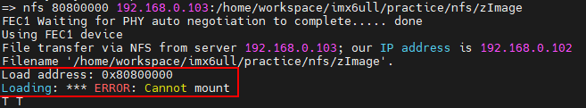

# 主机端 ubuntu 环境配置
## 文件夹和磁盘用量查看
> 1. [Ubuntu下查看文件、文件夹和磁盘空间的大小](https://blog.csdn.net/BigData_Mining/article/details/88998472)

### 查看文件夹
1. 查看当前目录已经使用总大小以及当前目录下一级文件夹各自使用的总空间大小
    ```bash
    du -h --max-depth=1
    ```
2. 查看当前文件夹总量
    ```bash
    du -sh
    ```
3. 查看当前文件夹下所有文件（递归子目录中的文件）
    ```bash
    dh -h
    ```
4. 查看指定文件夹的总量
    ```bash
    du -h dir-name # 同样会显示该文件夹下所有文件的大小
    du -hs dir-name # 统计 summarize
    ```
5. 其他：`du --help`

### 查看磁盘
```bash
df -h
```

## 系统中存在多个软件版本时的默认选择
通过 `update-alternatives` 工具对 Linux 系统中的软件版本进行管理、切换。

`update-alternatives` 只管理系统链接，不会卸载实际的软件包（如果需要卸载：`sudo apt-get remove package-name`）。

1. install
    ```bash
    # update-alternatives: --install needs <link> <name> <path> <priority>
    sudo update-alternatives --install /usr/bin/g++  g++ /usr/bin/g++-5 50
    ```
   - `update-alternatives`：Debian/Ubuntu 系统的替代版本管理工具；
   - `--install`：注册一个新的替代选项；
   - `/usr/bin/g++`：系统默认的 g++ 路径（对外暴露的统一入口）；
   - `g++`：替代组的名称；
   - `/usr/bin/g++-5`：实际指向的具体版本（`g++ 5.x`）；
   - `50`：优先级数值（越大优先级越高）。
   - 上述命令的作用是将 `g++-5` 注册为 `g++` 的一个替代版本。**当系统中有多个 `g++` 版本时，用户可以通过统一命令切换默认使用的编译器，而无需手动修改软链接**。

2. remove
    ```bash
    sudo update-alternatives --remove g++ /usr/bin/g++-5
    ```
   - 从 `g++` 替代组中移除 `g++-5` 这个选项；
   - 如果这是唯一/最后一个选项，直接删除真个替代组。
    ```bash
    sudo update-alternatives --remove-all g++
    ```
   - 完全删除 `g++` 的替代配置。

3. display
    ```bash
    update-alternatives --display g++
    ```
   - 查看当前配置

4. 自动/手动模式
    ```bash
    # 改为自动模式（按优先级自动选择）
    sudo update-alternatives --auto g++

    # 手动指定默认版本
    sudo update-alternatives --config g++
    ```

## 交叉编译器
1. 交叉编译器安装
   - 下载
    [Linaro 交叉编译器下载](https://releases.linaro.org/components/toolchain/binaries/4.9-2017.01/arm-linux-gnueabihf/)
   - 安装
    ```bash
    sudo mkdir /usr/local/arm
    # 解压
    sudo tar -xf gcc-linaro-xxx...tar.xz -C /usr/local/arm/
    # /etc/profile （建议使用时单独导出，创建 .sh 脚本即可）
    sudo vi /etc/profile
    export PATH=$PATH:/usr/local/arm/gcc-linaro-.../bin # 添加到文件末尾，并重启系统
    # 可以添加到 .bashrc 文件末尾，并 source ~/.bashrc 即可
    ```
   - 依赖安装
    ```bash
    sudo apt-get install lsb-core lib32stdc++6
    ```
   - 验证
    ```bash
    # 在导入环境变量的终端中：
    arm-linux-gnueabihf-gcc -v
    ```
2. clangd
   - 生成 `compile_commands.json`：
        ```bash
        # Makefile
        sudo apt-get install bear
        make clean; bear -- make               # for bear 3.0.x versions
        make clean; bear -- make               # for bear 2.4.x versions

        # CMake
        cmake -DCMAKE_EXPORT_COMPILE_COMMANDS=1
        ```
   - *clangd* 宏展开的 *expand to* 功能要求：*clangd* 版本大于 16

3. 工具链头文件、库文件目录查看
    ```bash
    # 提前设置环境变量，使系统能够找到编译工具
    echo 'main(){}' | arm-linux-gnueabihf-gcc -E -v -
    ```

## 网络登录
开启 ubuntu 的 ssh 服务后就可以通过 ssh 登录到 ubuntu 主机端：
```bash
sudo apt-get install openssh-server
```
ssh 的配置文件为 `/etc/ssh/sshd_config`，使用默认配置即可。


## 网络下载
### nfs
1. 安装 nfs 服务：
    ```bash
    sudo apt-get install nfs-kernel-server rpcbind
    ```
2. 创建共享文件夹供 nfs 服务器使用：`/path/to/nfs-dir`
3. 设置共享文件夹
   ```bash
   sudo vim /etc/exports
   # 在 /etc/exports 中添加如下内容
   /path/to/nfs-dir *(rw,sync,no_root_squash)
   ```
4. 重启 nfs 服务
   ```bash
   sudo /etc/init.d/nfs-kernel-server restart
   ```

#### nfs 文件下载出错
1. 问题：
    
2. 解决方法：
   1. 确认 ubuntu 主机端是否支持开发板 nfs 版本
        ```bash
        sudo cat /proc/fs/nfsd/versions
        ```
   2. 如果主机端支持 nfs version2（上述检查输出和 “2” 有关内容）：
      1. 修改服务端 `/etc/default/nfs-kernel-server` 文件：
            ```bash
            ...
            RPCNFSDCOUNT="-V 2 8"

            ...
            RPCNFSDPRIORITY=0

            ...
            RPCMOUNTDOPTS="-V 2 --manage-gids"

            ...
            NEED_SVCGSSD=""

            ...
            RPCSVCGSSDOPTS="--nfs-version 2,3,4 --debug --syslog"
            ```
      2. 重启 nfs 服务：
            ```bash
            sudo service nfs-kernel-server restart
            ```
      3. 确认主机端 nfs 版本：
            ```bash
            sudo cat /proc/fs/nfsd/versions
            ```
      4. 如果上述输出中含有 “-2” 的内容，则还需要开启 V2 版本的 nfs：
            ```bash
            sudo vim /etc/nfs.conf
            # 配置 udp 和 vers2 为 y：
            udp=y
            vers2=y
            ```
            - 配置完成后再次重启 nfs 服务；
            - 再次确认 nfs 版本。
   3. 如果主机端不支持 nfs version2（上述检查未输出和 “2” 有关内容）:
      1. 检查 ubuntu 和内核版本：
            ```bash
            # 检查内核版本
            uname -r
            # 检查 ubuntu 版本
            lsb_release -a # 或者 cat /etc/os-release
            ```
            - Linux 内核 6.2+ 已移除 NFSv2 支持，如果内核 >= 6.2，需要将低内核版本到 5.15 LTS 内核（Ubuntu 22.04 默认内核）；
      2. 检查已安装的所有内核：
            ```bash
            dpkg --list | grep linux-image
            ```
      3. 安装 5.15 LTS 内核（如果未安装）
            ```bash
            # 先搜索可用的 5.15 内核包
            apt-cache search linux-image-5.15
            # 安装
            sudo apt update
            sudo apt install linux-image-5.15.0-XX-generic linux-headers-5.15.0-XX-generic
            ```
      4. 在安装 5.15 内核的情况下，配置 GRUB 引导
         - 更新 GRUB
            ```bash
            sudo update-grub
            ```
         - 设置默认启动内核
            ```bash
            # 编辑 GRUB 配置文件
            sudo vim /etc/default/grub
            # 找到 GRUB_DEFAULT 行，修改为指定 5.15 内核：
            GRUB_DEFAULT="Advanced options for Ubuntu>Ubuntu, with Linux 5.15.0-91-generic"
            ```
         - 再次更新 GRUB
            ```bash
            sudo update-grub
            ```
      5. 重启系统：`sudo reboot`；
      6. 可能还需要手动选择进入的内核版本：“Ubuntu 的高级选项” -> “Ubuntu,Linux 5.15...-generic”。
      7. 验证当前内核版本
            ```bash
            uname -r
            ```
            - 应显示 5.15.x 开头的版本。
      8. 修改配置或者确认 nfs 的支持版本。
3. 补充：
   - 检查 U-Boot 中 nfs 的版本：
     - 直接查看 nfs 在 U-Boot 中的源码：
        ```c
        // net/nfs.c
        pkt.u.call.rpcvers = htonl(2);  /* use RPC version 2 */
        pkt.u.call.vers = htonl(2);     /* NFS version 2 */
        ```
      - 大多数 U-Boot 版本（尤其是嵌入式开发板常用的版本）固定使用 NFSv2；
      - 如果连接 Ubuntu 时，出现 T 超时或失败 → 很可能是 U-Boot 用 NFSv2，而服务器只开了 v3/v4；
      - 如果你只是要解决 U-Boot 与 Ubuntu 的 NFS 兼容问题，不用纠结查版本，直接在 Ubuntu 上开启 NFSv2 支持 即可；
4. 参考
   1. [U-Boot 中使用 nfs 命令加载文件报错指南](https://developer.aliyun.com/article/1482486)
   2. [Ubuntu 24.04.2 LTS Linux内核6.8降级更换内核版本（以5.19.0为例）](https://blog.csdn.net/m0_55983825/article/details/149669450)
   3. [ubuntu降低你使用的内核到指定版本](https://developer.aliyun.com/article/1114822)
   4. [LINUX开发板Loading: *** ERROR: Cannot mount T T T T T T T T T T T T T T问题解决](https://blog.csdn.net/qq_41470735/article/details/130447381)

### tftp
1. 安装 tftp-hpa 和 tftpd-hpa
    ```bash
    sudo apt-get install tftp-hpa tftpd-hpa
    sudo apt-get install xinetd
    ```
2. 创建共享文件夹供 tftp 使用：`/path/to/tftp-dir` 并**提供权限**：
   ```bash
   mkdir /path/to/tftp-dir
   chmod 777 /path/to/tftp-dir
   ```
3. 配置 tftp
   - 新建文件 `/etc/xinetd.d/tftp`，在里面输入如下内容：
        ```txt
        server tftp
        {
            socket_type = dgram
            protocol = udp
            wait = yes
            user = root
            server = /usr/sbin/in.tftpd
            server_args = -s /path/to/tftp-dir
            disable = no
            per_source = 11
            cps = 100 2
            flags = IPv4
        }
        ```
    - 重启 tftp 服务
        ```bash
        sudo service tftpd-hpa start
        ```
    - 修改 `/etc/default/tftpd-hpa` 文件：
        ```txt
        # /etc/default/tftpd-hpa

        TFTP_USERNAME="tftp"
        TFTP_DIRECTORY="/path/to/tftp-dir"
        TFTP_ADDRESS=":69"
        TFTP_OPTIONS="-l -c -s"
        ```
4. 重启 tftp 服务器
    ```bash
    sudo service tftpd-hpa restart
    ```
注意：后续需要通过 tftp 传输的文件，放置在 /path/to/nfs-dir 后还需要给予文件相应的权限。

## 分区管理
使用 `gparted` 调整 ubuntu 下的分区大小、调整根目录、家目录大小...
参考：[【Ubuntu】压缩根目录/空间给home目录扩容](https://zhuanlan.zhihu.com/p/695100294)、[gparted 官网](https://gparted.org/)、[通过 ubuntu 启动盘的方式修改-拯救者会出现黑屏现象，无法使用，仅参考](https://blog.csdn.net/HeLoZhaoFei/article/details/123724956)：
- 直接制作 `gparted` 启动盘；
- 通过 bios 设置启动 `gparted live` 系统；
- 使用默认设置进入配置界面，选择需要编辑的硬盘，并调整相应的分区大小；
- 调整完成点击界面上的绿色勾按钮，等待分区调整任务完成；
- 分区完成后，点击界面左上角的 `gparted` 并退出、重启即可。