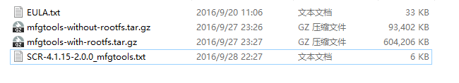
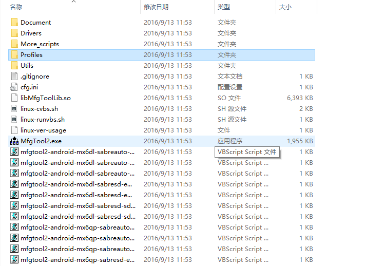
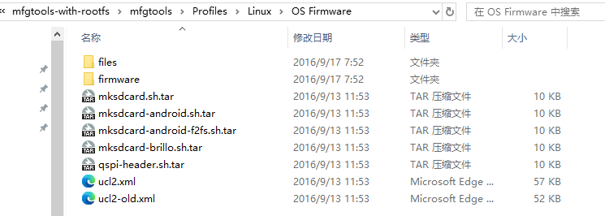

# 系统烧写
目的是将 uboot、linux kernel、dtb 和 rootfs 这四个文件烧写到板子上的 EMMC、NAND 或 QSPI Flash 等存储设备上。

## NXP MfgTool
- MfgTool 工具是 NXP 提供的**专门用于给 I.MX 系列 CPU** 烧写系统的软件。
- 在 Windows 下使用。
- 关注的文件：
    
  - 两个 .txt；
  - 两个 .gz：mfgtools-without-rootfs.tar.gz 和 mfgtools-with-rootfs.tar.gz；

### mfgtools-with-rootfs:
    
   - `./profiles`：要烧写的文件放在此文件夹中；
   - `MfgTool2.exe`；
   - `*.vbs`：配置脚本，指定要烧写的芯片、烧写的位置等；
     - `mfgtool2-yocto-mx-evk-emmc.vbs`：EMMC 烧写脚本；
     - `mfgtool2-yocto-mx-evk-nand.vbs`：NAND 烧写脚本；
     - `mfgtool2-yocto-mx-evk-qspi-nor-n25q256a.vbs`：QSPI Flash 烧写脚本，型号为 n25q256a；
     - `mfgtool2-yocto-mx-evk-sdcard-sd1.vbs`：向 SD 卡 1 上烧写系统；
     - `mfgtool2-yocto-mx-evk-sdcard-sd2.vbs`：向 SD 卡 2 上烧写系统；
   - 其他；

### MfgTool 工作原理、工作流程
- 烧写方式：
  - MfgTool 是通过 USB OTG 接口将系统烧写到 EMMC 等设备中的；
  - 将 BOOT_CFG 选择为 USB 下载模式（拨码开关控制。如果插了 TF 卡，先将 TF 卡弹出，否则电脑不能识别 USB，等识别出来以后再插上 TF 卡）；
  - 复位开发板；
- 烧写原理：
  - 双击 `.vbs`，打开下载对话框。如果出现“符合 HID 标准的供应商定义设备”就说明连接正常，可以进行烧写。点击 “start” 即可开始烧写；
  - 烧写的文件位置：`./profiles/Linux/OS Firmware`:
    
    - `files`：最终要烧写到存储设备上的系统文件：uboot、kernel、dtb 和 rootfs；
    - `firmware`：烧写到 DDR 上运行的系统文件：uboot、kernel 和 dtb；
    - `ucl2.xml`：指定烧写时选择的文件。
- 烧写流程：
  1. MfgTool 先通过 USB OTG 将 uboot、kernel 和 dtb 三个文件下载到开发板的 DDR 中；
  2. 通过 DDR 启动 Linux 系统；
  3. 向 EMMC 等设备中烧写完整的系统：uboot、kernel、dtb 和 rootfs。
- 烧写的 2 个阶段：
  1. 将 `firmware` 中的 uboot、kernel 和 dtb 通过 USB OTG 下载到开发板 DDR 中，目的是在 DDR 中启动 Linux 系统；
  2. 在 Linux 已经运行起来的前提下，完成对 EMMC 等设备的格式化、分区等操作。分区建立好以后，从 `files` 目录中读取要烧写的 uboot、kernel、dtb 和 rootfs，并将它们烧写到存储设备中。
- 注意：`firmware` 和 `files` 目录下的 uboot 后缀为 `.imx`，即添加了头部的 uboot；

### `./profiles/Linux/OS Firmware/ucl2.xml` 文件：
```xml
<UCL>
    <CFG>
        ...
        <STATE name="BootStrap" dev="MX6ULL" vid="15A2" pid="0080"/>
        ...
    </CFG>

    <LIST name="eMMC" desc="Choose eMMC as media">
        <CMD state="BootStrap" type="boot" body="BootStrap" file ="firmware/u-boot-imx6q%plus%%board%_sd.imx" ifdev="MX6Q">Loading U-boot</CMD>
        <CMD state="BootStrap" type="boot" body="BootStrap" file ="firmware/u-boot-imx6dl%board%_sd.imx" ifdev="MX6D">Loading U-boot</CMD>
        <CMD state="BootStrap" type="boot" body="BootStrap" file ="firmware/u-boot-imx6sx%board%_emmc.imx" ifdev="MX6SX">Loading U-boot</CMD>
        <CMD state="BootStrap" type="boot" body="BootStrap" file ="firmware/u-boot-imx7d%7duboot%_sd.imx" ifdev="MX7D">Loading U-boot</CMD>
        <CMD state="BootStrap" type="boot" body="BootStrap" file ="firmware/u-boot-imx6ul%6uluboot%_emmc.imx" ifdev="MX6UL">Loading U-boot</CMD>
        <CMD state="BootStrap" type="boot" body="BootStrap" file ="firmware/u-boot-imx6ul%lite%%6uluboot%_emmc.imx" ifdev="MX6ULL">Loading U-boot</CMD>
            
        <CMD state="BootStrap" type="load" file="firmware/zImage" address="0x12000000"
            loadSection="OTH" setSection="OTH" HasFlashHeader="FALSE" ifdev="MX6Q MX6D">Loading Kernel.</CMD>
        <CMD state="BootStrap" type="load" file="firmware/zImage" address="0x80800000"
            loadSection="OTH" setSection="OTH" HasFlashHeader="FALSE" ifdev="MX6SL MX6SX MX7D MX6UL MX6ULL">Loading Kernel.</CMD>

        <CMD state="BootStrap" type="load" file="firmware/%initramfs%" address="0x12C00000"
            loadSection="OTH" setSection="OTH" HasFlashHeader="FALSE" ifdev="MX6Q MX6D">Loading Initramfs.</CMD>
        <CMD state="BootStrap" type="load" file="firmware/%initramfs%" address="0x83800000"
            loadSection="OTH" setSection="OTH" HasFlashHeader="FALSE" ifdev="MX6SL MX6SX MX7D MX6UL MX6ULL">Loading Initramfs.</CMD>

        <CMD state="BootStrap" type="load" file="firmware/zImage-imx6q%plus%-%board%%ldo%.dtb" address="0x18000000"
            loadSection="OTH" setSection="OTH" HasFlashHeader="FALSE" ifdev="MX6Q">Loading device tree.</CMD>
        <CMD state="BootStrap" type="load" file="firmware/zImage-imx6dl-%board%%ldo%.dtb" address="0x18000000"
            loadSection="OTH" setSection="OTH" HasFlashHeader="FALSE" ifdev="MX6D">Loading device tree.</CMD>
        <CMD state="BootStrap" type="load" file="firmware/zImage-imx6sx-%sxdtb%-emmc.dtb" address="0x83000000"
            loadSection="OTH" setSection="OTH" HasFlashHeader="FALSE" ifdev="MX6SX">Loading device tree.</CMD>
        <CMD state="BootStrap" type="load" file="firmware/zImage-imx7d-%7ddtb%.dtb" address="0x83000000"
            loadSection="OTH" setSection="OTH" HasFlashHeader="FALSE" ifdev="MX7D">Loading device tree.</CMD>
        <CMD state="BootStrap" type="load" file="firmware/zImage-imx6ul-%6uldtb%-emmc.dtb" address="0x83000000"
            loadSection="OTH" setSection="OTH" HasFlashHeader="FALSE" ifdev="MX6UL">Loading device tree.</CMD>
        <CMD state="BootStrap" type="load" file="firmware/zImage-imx6ul%lite%-%6uldtb%-emmc.dtb" address="0x83000000"
            loadSection="OTH" setSection="OTH" HasFlashHeader="FALSE" ifdev="MX6ULL">Loading device tree.</CMD>

        <CMD state="BootStrap" type="jump" > Jumping to OS image. </CMD>


        <!-- create partition -->
        <CMD state="Updater" type="push" body="send" file="mksdcard.sh.tar">Sending partition shell</CMD>
        <CMD state="Updater" type="push" body="$ tar xf $FILE "> Partitioning...</CMD>
        <CMD state="Updater" type="push" body="$ sh mksdcard.sh /dev/mmcblk%mmc%"> Partitioning...</CMD>

        <!-- burn uboot -->
        <CMD state="Updater" type="push" body="$ dd if=/dev/zero of=/dev/mmcblk%mmc% bs=1k seek=768 conv=fsync count=8">clear u-boot arg</CMD>
        <!-- access boot partition -->
        <CMD state="Updater" type="push" body="$ echo 0 > /sys/block/mmcblk%mmc%boot0/force_ro">access boot partition 1</CMD>
        <CMD state="Updater" type="push" body="send" file="files/u-boot-imx6q%plus%%board%_sd.imx" ifdev="MX6Q">Sending u-boot.bin</CMD>
        <CMD state="Updater" type="push" body="send" file="files/u-boot-imx6dl%board%_sd.imx" ifdev="MX6D">Sending u-boot.bin</CMD>
        <CMD state="Updater" type="push" body="send" file="files/u-boot-imx6sx%board%_emmc.imx" ifdev="MX6SX">Sending u-boot.bin</CMD>
        <CMD state="Updater" type="push" body="send" file="files/u-boot-imx7d%7duboot%_sd.imx" ifdev="MX7D">Sending u-boot.bin</CMD>
        <CMD state="Updater" type="push" body="send" file="files/u-boot-imx6ul%6uluboot%_emmc.imx" ifdev="MX6UL">Sending u-boot.bin</CMD>
        <CMD state="Updater" type="push" body="send" file="files/u-boot-imx6ul%lite%%6uluboot%_emmc.imx" ifdev="MX6ULL">Sending u-boot.bin</CMD>
        <CMD state="Updater" type="push" body="$ dd if=$FILE of=/dev/mmcblk%mmc%boot0 bs=512 seek=2">write U-Boot to sd card</CMD>
        <CMD state="Updater" type="push" body="$ echo 1 > /sys/block/mmcblk%mmc%boot0/force_ro"> re-enable read-only access </CMD>
        <CMD state="Updater" type="push" body="$ mmc bootpart enable 1 1 /dev/mmcblk%mmc%">enable boot partion 1 to boot</CMD>

        <!-- create fat partition -->
        <CMD state="Updater" type="push" body="$ while [ ! -e /dev/mmcblk%mmc%p1 ]; do sleep 1; echo \"waiting...\"; done ">Waiting for the partition ready</CMD>
        <CMD state="Updater" type="push" body="$ mkfs.vfat /dev/mmcblk%mmc%p1">Formatting rootfs partition</CMD>
        <CMD state="Updater" type="push" body="$ mkdir -p /mnt/mmcblk%mmc%p1"/>
        <CMD state="Updater" type="push" body="$ mount -t vfat /dev/mmcblk%mmc%p1 /mnt/mmcblk%mmc%p1"/>

        <!-- burn zImage -->
        <CMD state="Updater" type="push" body="send" file="files/zImage">Sending kernel zImage</CMD>
        <CMD state="Updater" type="push" body="$ cp $FILE /mnt/mmcblk%mmc%p1/zImage">write kernel image to sd card</CMD>

        <!-- burn dtb -->
        <CMD state="Updater" type="push" body="send" file="files/zImage-imx6q%plus%-%board%%ldo%.dtb" ifdev="MX6Q">Sending Device Tree file</CMD>
        <CMD state="Updater" type="push" body="send" file="files/zImage-imx6dl-%board%%ldo%.dtb" ifdev="MX6D">Sending Device Tree file</CMD>
        <CMD state="Updater" type="push" body="send" file="files/zImage-imx6sx-%sxdtb%-emmc.dtb" ifdev="MX6SX">Sending Device Tree file</CMD>
        <CMD state="Updater" type="push" body="send" file="files/zImage-imx7d-%7ddtb%.dtb" ifdev="MX7D">Sending Device Tree file</CMD>
        <CMD state="Updater" type="push" body="send" file="files/zImage-imx6ul-%6uldtb%-emmc.dtb" ifdev="MX6UL">Sending Device Tree file</CMD>
        <CMD state="Updater" type="push" body="send" file="files/zImage-imx6ul%lite%-%6uldtb%-emmc.dtb" ifdev="MX6ULL">Sending Device Tree file</CMD>

        <CMD state="Updater" type="push" body="$ cp $FILE /mnt/mmcblk%mmc%p1/imx6q%plus%-%board%.dtb" ifdev="MX6Q">write device tree to sd card</CMD>
        <CMD state="Updater" type="push" body="$ cp $FILE /mnt/mmcblk%mmc%p1/imx6dl-%board%.dtb" ifdev="MX6D">write device tree to sd card</CMD>
        <CMD state="Updater" type="push" body="$ cp $FILE /mnt/mmcblk%mmc%p1/imx6sx-%sxdtb%.dtb" ifdev="MX6SX">write device tree to sd card</CMD>
        <CMD state="Updater" type="push" body="$ cp $FILE /mnt/mmcblk%mmc%p1/imx7d-%7ddtb%.dtb" ifdev="MX7D">write device tree to sd card</CMD>
        <CMD state="Updater" type="push" body="$ cp $FILE /mnt/mmcblk%mmc%p1/imx6ul-%6uldtb%.dtb" ifdev="MX6UL">write device tree to sd card</CMD>
        <CMD state="Updater" type="push" body="$ cp $FILE /mnt/mmcblk%mmc%p1/imx6ul%lite%-%6uldtb%.dtb" ifdev="MX6ULL">write device tree to sd card</CMD>

        <!-- burn m4 demo bins-->
        <CMD state="Updater" type="push" body="send" file="files/imx7d_sabresd_m4_TCM_helloworld.bin" ifdev="MX7D">Sending helloworld demo</CMD>
        <CMD state="Updater" type="push" body="$ cp $FILE /mnt/mmcblk%mmc%p1/imx7d_sabresd_m4_TCM_helloworld.bin" ifdev="MX7D">write demo image to eMMC</CMD>
        <CMD state="Updater" type="push" body="send" file="files/imx7d_sabresd_m4_TCM_mcctty.bin" ifdev="MX7D">Sending mcctty demo</CMD>
        <CMD state="Updater" type="push" body="$ cp $FILE /mnt/mmcblk%mmc%p1/imx7d_sabresd_m4_TCM_mcctty.bin" ifdev="MX7D">write demo image to eMMC</CMD>
        <CMD state="Updater" type="push" body="send" file="files/imx7d_sabresd_m4_TCM_Pingpang.bin" ifdev="MX7D">Sending pingpong demo</CMD>
        <CMD state="Updater" type="push" body="$ cp $FILE /mnt/mmcblk%mmc%p1/imx7d_sabresd_m4_TCM_Pingpang.bin" ifdev="MX7D">write demo image to eMMC</CMD>

        <CMD state="Updater" type="push" body="$ umount /mnt/mmcblk%mmc%p1">Unmounting vfat partition</CMD>

        <!-- burn rootfs -->
        <CMD state="Updater" type="push" body="$ mkfs.ext3 -F -E nodiscard /dev/mmcblk%mmc%p2">Formatting rootfs partition</CMD>
        <CMD state="Updater" type="push" body="$ mkdir -p /mnt/mmcblk%mmc%p2"/>
        <CMD state="Updater" type="push" body="$ mount -t ext3 /dev/mmcblk%mmc%p2 /mnt/mmcblk%mmc%p2"/>
        <CMD state="Updater" type="push" body="pipe tar -jxv -C /mnt/mmcblk%mmc%p2" file="files/rootfs.tar.bz2" ifdev="MX6SL MX6D MX6Q MX6SX">Sending and writting rootfs</CMD>
        <CMD state="Updater" type="push" body="pipe tar -jxv -C /mnt/mmcblk%mmc%p2" file="files/rootfs_nogpu.tar.bz2" ifdev="MX6UL MX7D MX6ULL">Sending and writting rootfs</CMD>
        <CMD state="Updater" type="push" body="frf">Finishing rootfs write</CMD>
        <CMD state="Updater" type="push" body="$ umount /mnt/mmcblk%mmc%p2">Unmounting rootfs partition</CMD>
        <CMD state="Updater" type="push" body="$ echo Update Complete!">Done</CMD>
    </LIST>

    <LIST name="SDCard" desc="Choose SD Card as media">
        ...
    </LIST>
    <LIST name="Nor Flash" desc="Choose Nor flash as media">
        ...
    </LIST>
    <LIST name="Quad Nor Flash" desc="Choose Quad Nor flash as media">
        ...
    </LIST>
    <LIST name="NAND Flash" desc="Choose NAND as media">
        ...
    </LIST>
    <LIST name="SDCard-Android" desc="Choose SD Card as media">
        ...
    </LIST>
    ...
</UCL>
```
  - `<UCL>...</UCL>`；
  - `<CFG>...</CFG>`：配置相关内容，主要是判断当前给 I.MX 系列的哪个芯片烧写系统。通过读取芯片的 VID 和 PID 即可判断出当前要烧写什么处理器的系统，如果 VID=0x15A2，PID=0080，则表示给 I.MX6ULL 烧写系统。
  - `<LIST>...</LIST>`：针对不同存储设备的烧写命令；
  - 根据 `<CMD>...</CMD>` 中间的提示内容可推断出相应命令的功能；

### `./mfgtool2-yocto-mc-evk-emmc.vbs` 文件
```vb
Set wshShell = CreateObject("WScript.shell")
wshShell.run "mfgtool2.exe -c ""linux"" -l ""eMMC"" -s ""board=sabresd"" -s ""mmc=1"" -s ""6uluboot=14x14evk"" -s ""6uldtb=14x14-evk"""
Set wshShell = Nothing
```
- 调用 mfgtool2.exe 软件，并给出相关参数：
  - 烧写的系统为 Linux；
  - 存储设备为 eMMC；
  - board=sabresd；
  - mmc=1；
  - 6uluboot=14x14evk；
  - 6uldtb=14x14-evk；

### 流程解析
- 首先，通过 `ucl2.xml` 获取当前的 CPU 型号；
- 通过 `.vbs` 获取需要烧写的存储设备类型；
- 根据存储设备类型从 `ucl2.xml` 中获取相关指令；
- 指令中的参数来源：
  - `.vbs` 文件；
  - `./cfg.ini` 文件：
    ```ini
    [profiles]
    chip = Linux

    [platform]
    board = SabreSD

    [LIST]
    name = SDCard

    [variable]
    board = sabresd
    mmc = 0
    sxuboot=sabresd
    sxdtb=sdb
    7duboot=sabresd
    7ddtb=sdb
    6uluboot=14x14ddr3arm2
    6uldtb=14x14-ddr3-arm2
    6ulldtb=14x14-ddr3-arm2
    ldo=
    plus=
    lite=l
    initramfs=fsl-image-mfgtool-initramfs-imx_mfgtools.cpio.gz.u-boot
    seek = 1
    sxnor=qspi2
    7dnor=qspi1
    6ulnor=qspi1
    nor_part=0
    ```
- 指令的顺序：烧写到 DDR -> jump（跳转去运行 OS）-> 创建分区 -> 烧写系统相关文件到 EMMC；
- 拔出 USB，烧写完成点击 “STOP”，然后点击 “EXIT” 键退出；
- 开发板选择 EMMC 启动（拨码开关控制），重启开发板。
- 注：NXP 官方用户名为 “root”，没有密码。

### 网络开机自启动设置
测试网络连接时可能会发现网络不能使用，这仅仅是因为网络没有打开。在使用 NFS 挂载根文件系统时，因为要使用 NFS 服务，所以 Linux 内核会打开 eth0 这个网卡。

手动开启：
```bash
ifconfig -a
ifconfig eth0 up
# 分配 IP 地址
# 路由器自动分配：
udhcpc -i eth0
# 手动分配：
ifconfig eth0 192.168.1.251 netmask 255.255.255.0   # 设置 IP 地址和子网掩码
route add default gw 192.168.1.1 # 添加默认网关
```

开机自启设置：
在 `/etc/init.d/rcS` 中添加：
```shell
#!/bin/sh

PATH=/sbin:/bin:/usr/sbin:/usr/bin
LD_LIBRARY_PATH=$LD_LIBRARY_PATH:/lib:/usr/lib
export PATH LD_LIBRARY_PATH runlevel

# 网络开机自启设置
ifconfig eth0 up
# udhcpc -i eth0
ifconfig eth0 192.168.1.251 netmask 255.255.255.0
route add default gw 192.168.1.1
...
```

### 解决内核启动失败
1. 由设备树文件名与 uboot bootcmd 和 bootargs 参数不一致导致的内核启动失败：
   - 临时办法（重新烧写系统后都需要手动设置）：重新设置 bootcmd 环境变量值
        ```bash
        set bootcmd 'mmc dev 1;fatload mmc 1:1 80800000 zImage;fatload mmc 1:1 83000000 imx6ull-alientek-emmc.dtb; bootz 80800000 - 83000000'
        # bootargs 的值也需要重新设置一下
        set bootargs `console=ttymxc0,115200 root=/dev/mmcblk1p2 rootwait rw`
        # 保存变量值
        saveenv
        ```
   - 永久办法：修改 uboot 源码中的板级配置文件：
        ```c
        // include/configs/mx6ull_alientek_emmc.h
        // 对宏 CONFIG_EXTRA_ENV_SETTING 进行修改
        "findfdt="\
            "if test $fdt_file = undefined; then "\
                "setenv fdt_file imx6ull-alientek-emmc.dtb; "\
            "fi;\0"\
        ...
        ```