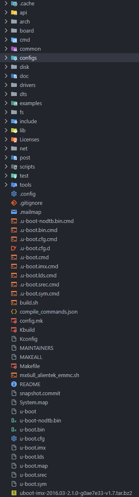

# 系统移植之 uboot

**uboot、Linux-kernel 和 rootfs** 这三者一起构成了一个完整的 Linux 系统，一个可以正常使用、功能完善的 Linux 系统。

## 简介
- uboot, Universal Bootloader，遵循 GPL 协议的开源软件。[官网](http://www.denx.de/wiki/U-Boot/)。

- Linux 系统要启动就必须需要一个 bootloader 程序，**在芯片上电以后先运行该程序来初始化 DDR 等外设，然后将 Linux 内核从 flash（NAND、NOR flash、SD、MMC 等）拷贝到 DDR 中，最后启动 Linux 内核**（bootloader 的实际工作要复杂得多，但是它最主要的工作就是启动 Linux 内核）。

- 地位相当于在 PC 中 Windows 的启动过程中的 BIOS 的地位一样。 

- 一般不会直接使用 uboot 官方提供的 uboot 源码，而是 SOC 厂商准备的。后者会将 uboot 官方源码对自己的芯片进行适配（移植），也可理解为在官方的基础上对芯片进行定制（例如，NXP 的 uboot 支持各种启动方式，比如 EMMC、NAND、NORFLASH 等，这些都是 uboot 官方所不支持的）。

- SOC 厂商提供的 uboot 是针对自家评估板的，使用其他开发板时，需要在此基础上进行修改、移植适配。

- 相关产商的 uboot：
  - [NXP](https://github.com/nxp-imx/uboot-imx)，下载稳定分支，如 `lf_v2022.04`；

- 不同类型的 uboot：
  - uboot 官方；
  - 半导体 SOC 厂商；
  - 开发厂商；

## uboot 目录内容
编译完成后，uboot 目录下的内容如下：

- `u-boot.bin`：编译出来的 uboot 二进制文件；
  - 需要注意的是：uboot 是个裸机程序，**需要在其前面加上头部（IVT、DCD 等数据）才能在 I.MX6U 上运行**。
  - [ ] 补充不同的厂家在这部分都有哪些策略
- `u-boot.imx` 就是添加头部以后的 `u-boot.bin`，`u-boot.imx` 就是最终要烧写到开发板中的 uboot 镜像文件；

## 编译和烧写
### 编译
1. 初次编译时需在 ubuntu 中安装 `ncurses` 库：
   ```bash
   sudo apt-get install libncurses5-dev
   ```
2. 初始化工作，清除工作空间原有设置（非必须）：
   ```bash
   make ARCH=arm CROSS_COMPILE=arm-linux-gnueabihf- distclean
   ```
   - `make distclean`，其他为参数部分；
   - `distclean` 可以在 `Makefile` 文件中找到对应目标，相关内容见详解；
3. 根据配置文件进行配置设置
   ```bash
   make ARCH=arm CROSS_COMPILE=arm-linux-gnueabihf- mx6ull_14x14_ddr512_emmc_defconfig
   ```
   - `mx6ull_14x14_ddr512_emmc_defconfig` 为配置文件，位于 `./config/` 目录下。
4. 编译 uboot
   ```bash
   make V=1 ARCH=arm CROSS_COMPILE=arm-linux-gnueabihf- -j12
   ```
   - `V`：输出编译的详细信息，在 `Makefile` 文件中能够找到该参数信息；
   - `-j12`：并行编译，加快编译速度；
   - 编译完成，通过输出信息可知**入口点（Entry Point）、加载地址（Load Address）、数据大小（Data Size）等**信息；
5. shell 脚本文件：
   ```bash
   #!/bin/bash
   make ARCH=arm CROSS_COMPILE=arm-linux-gnueabihf- distclean
   make ARCH=arm CROSS_COMPILE=arm-linux-gnueabihf- mx6ull_14x14_ddr512_emmc_defconfig
   make V=1 ARCH=arm CROSS_COMPILE=arm-linux-gnueabihf- -j12
   ```

### 烧写
- [ ] 不同厂商的烧写操作可能不相同，在这里进行补充

1. nxp 芯片烧写
- imx6ull
   **需要在 uboot 源码编译生成的二进制文件 `u-boot.bin` 中增加头部信息**。
  - 通过正点原子的工具进行烧写：将 uboot 烧写到 SD 卡中，然后通过 SD 卡来启动并运行 uboot：
    1. 获取可在芯片上运行的 uboot 程序：
      ```bash
      chmod 777 imxdownload
      ./imxdownload u-boot.bin /dev/sdd # 烧写到 SD 卡，不能烧写到 /dev/sda 或 sda1 设备里面
      ```
    2. 设置芯片的启动方式：BOOT 设置从 SD 卡启动，同时连接串口到电脑上（设置好串口参数并打开）；
    3. 复位开发板。

  - [ ] 通过 nxp 提供的 uuu 工具进行烧写

## 使用
### uboot 输出信息
uboot 在启动后可能会输出一些比较有用的信息：
- uboot 版本号和编译时间；
- CPU 信息，包括生产商、频率、运行频率等；
- 复位原因；
- 开发板名字；
- 内存信息；
- 提示信息；
- MMC/SD 卡控制器；
- Display 信息；
- 标准输入、输出、错误所使用的终端；
- 所使用存储器信息；
- 网口信息；

### uboot 命令
1. `help`
   - 使用 `?` 也可以。
   - 用于查看当前 uboot 所支持的命令。
   - uboot 是可配置的，需要什么命令就使能什么命令，而且还可以在 uboot 中自定义命令。
   - 通过 `help/? 命令名` 可以查看命令的详细用法；

2. 信息查询相关
   - `bdinfo`：用于查看板子信息。
   - `printenv/print`：用于输出环境变量信息（uboot 中的环境变量都是字符串）。
   - `version`：查看 uboot 版本号。

3. 环境变量操作
**一般环境变量存放在外部 flash 中，uboot 启动时会将环境变量从 flash 读取到内存中**。
   - `setenv`：用于设置或修改环境变量的值（修改的是内存中的环境变量的值）；
   - `saveenv`：用于保存修改后的环境变量（将环境变量保存到 flash 中）；

   1. 修改环境变量
      ```bash
      # 修改 uboot 启动延迟时间为 5 秒
      setenv bootdelay 5
      saveenv

      # 修改具有空格的环境变量，使用单引号括起来
      setenv bootargs 'console=ttymxc0,115200 root=/dev/mmcblklp2 rootwait rw'
      saveenv # 四组值，通过空格隔开，使用单引号表示这些内容都属于环境变量 bootargs
      ```

   2. 新建环境变量
      ```bash
      # 新建环境变量
      setenv author xxx
      saveenv
      ```

   3. 删除环境变量
      ```bash
      # 删除环境变量
      setenv author
      saveenv  # 通过给环境变量赋空值来删除环境变量
      ```

4. 内存操作命令
   **内存操作命令就是直接对 DRAM 进行读写操作的**，常用的内存操作命令有 `md`, `nm`, `mm`, `mw`, `cp` 和 `cmp`。
   1. `md` 命令
      用于显示内存值。
      ```bash
      md[.b, .w, .l] address [# of objects]
      ```
      - `.b, .w, .l`：表示以多长的内存占用为单位来显示内容，分别为 1 个字节、2 个字节、4 个字节；
      - `address`：要查看的内存起始地址；
      - `[# of objects]`：表示要查看的数据长度，单位是上述所选一致；
      - 注意：**uboot 命令中的数字都是十六进制的，不是十进制**。
      ```bash
      # 以 byte 为单位，显示 20 个字节的内容
      md.b 80000000 14

      # 以 word 为单位，显示 16 * 2 个字节的内容
      md.w 80000000 10

      # 以 long 为单位，显示 16 * 4 个字节的内容
      md.l 80000000 10
      ```
   2. `nm` 命令
      用于修改指定地址的内存值。
      ```bash
      nm [.b, .w, .l] address
      ```
      示例：
      ```bash
      nm.l 80000000
      80000000: 0500e031 ? 输入预写入的内容 # 这里输出的是输入提示，0500e031 表示 80000000 地址处的当前数据值
      ```
      - 输入完成以后按下回车，然后再输入 `q` 即可退出。
      - 修改完成以后可以通过 `md` 命令来进行确认。
   3. `mm` 命令
      也是修改指定地址内存值的，使用 `mm` 修改内存值的时候地址会自增，而使用命令 `nm` 的话不会。
   4. `mw` 命令
      用于使用一个指定的数据填充一段内存。
      ```bash
      mw [.b, .w, .l] address value [count]
      ```
      - `address`：要填充的内存起始地址；
      - `value`：要填充的数据；
      - `count`：是填充的长度（同样是十六进制）。
      ```bash
      # 以数据 0A0A0A0A 填充从内存地址 80000000 开始的 16 * 4 个字节数据
      mw.l 80000000 0A0A0A0A 10
      ```
   5. `cp` 命令
      是数据拷贝命令，用于将 DRAM 中的数据从一段内存拷贝到另一段内存中，或者把 NOR Flash 中的数据拷贝到 DRAM 中。
      ```bash
      cp [.b, .w, .l] source target count
      ```
      - `source`：源地址；
      - `target`：目的地址；
      - `count`：拷贝的长度；
      ```bash
      # 从地址 80000000 开始拷贝 16 * 4 个字节数据到 80000100 开始的地址处
      cp.l 8000000 80000100 10
      ```
   6. `cmp`
      比较命令，用于比较两段内存的数据是否相等。
      ```bash
      cmp [.b, .w, .l] addr1 addr2 count
      ```
      示例：
      ```bash
      cmp.l 80000000 80000100 10
      # 输出：
      Total of 16 word(s) were the same   # 情况 1
      word at 0x80000000 (0xf0c06f00) != word at 0x80000100 (0x3fc0f414)
      Total of 0 word(s) were the same    # 情况 2
      ```

5. 网络操作命令
   **在移植 uboot 的时候一般都要调通网络功能**，因为在移植 Linux kernel 的时候需要使用到 uboot 的网络功能做调试。

   **前期准备**：开发板和主机 PC 都连接到同一个路由器上，最后设置如下几个环境变量：
   - `ipaddr`：开发板 ip 地址，可以不设置，使用 `dhcp` 命令来从路由器获取 ip 地址；
   - `ethaddr`：开发板的 MAC 地址，一定要设置；
   - `gatewayip`：网关地址；
   - `netmask`：子网掩码；
   - `serverip`：服务器 ip 地址，也就是 ubuntu 主机 ip 地址，用于调试代码。
      ```bash
      setenv ipaddr 192.168.1.50
      setenv ethaddr b8:ae:ld:01:00:00
      setenv gatewayip 192.168.1.1
      setenv netmask 255.255.255.0
      setenv serverip 192.168.1.253
      saveenv
      ```
      - 注意：**网络地址环境变量的设置要根据实际情况而定，确保 ubuntu 主机和开发板的 ip 地址在用一个网段内**；
      - MAC 地址是一个 48bit 的地址，如果在同一个网段内有多个开发板的话，一定要保证每个开发板的 `ethaddr` 是不同的，否则通信会有问题。
  
   1. `ping` 命令
      通过 `ping` 命令验证网络通信是否正常，直接 `ping` 服务器的 ip 地址即可。
      ```bash
      ping 192.168.1.253
      ```
      - 注意：只能在 uboot 中 ping 其他机器，其他机器不能 ping uboot，因为 uboot 没有对 ping 命令做处理。如果用其他机器 ping uboot 的话会失败。
   2. `dhcp` 命令
      **`dhcp` 可用于从路由器获取 ip 地址，直接输入 `dhcp` 命令即可通过路由器获取到 ip 地址**。前提是开发板连接到路由器上，如果开发板和电脑是直连的，那么 `dhcp` 命令就会失效。
      `dhcp` 不单单是获取 ip 地址，还会通过 TFTP 来启动 Linux 内核。输入 `? dhcp` 即可查看详细信息：
      ```bash
      ? dhcp
      dhcp - boot image via network using DHCP/TFTP protocol
      Usage:
      dhcp [loadAddress] [[hostIPaddr:]bootfilename]
      ```
      因此，当只执行 `dhcp` 命令时，可能会有如下提示信息：
      ```bash
      warning: no boot file name;
      TFTP from server 192.168.1.1
      ```
   3. `nfs` 命令
      nfs, network file system，即网络文件系统。可以通过 nfs 来实现在计算机之间通过网络来分享资源，比如将 Linux 镜像和设备树文件放到 ubuntu 主机中，然后通过 nfs 将这些内容下载到开发的 DRAM 中。


## Makefile 详解

## 启动流程