# RK3568 SDK 使用
## 环境搭建
1. Rockchip USB 驱动安装
2. 镜像烧录工具安装
   - Windows：
   - Linux：
3. ADB 工具安装

## SDK 使用
### 工程目录
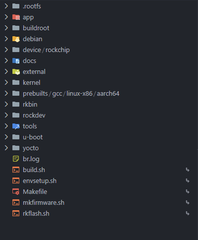

- `app`:
    存放上层应用 app，包括 Qt 应用程序，以及其他的 C/C++ 应用程序。
    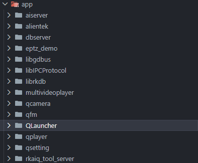
- `buildroot`:
    基于 buildroot 开发的根文件系统。
    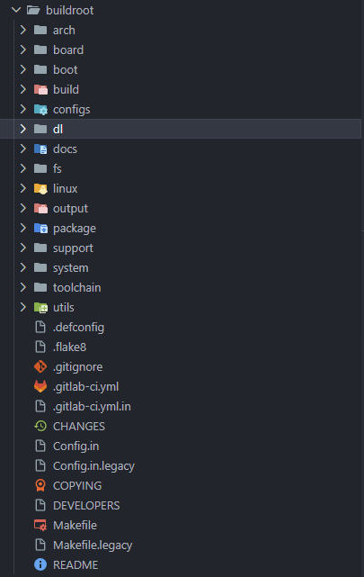
    - `dl`：存放编译 buildroot 时所需的软件包，可以编译的同时联网下载，也可以将下载好的离线包放置在此目录中；
- `debian`:
    基于 Debian 开发的根文件系统。
- `device/rockchip`:
    存放各芯片板级配置文件和 Parameter 分区表文件，以及一些编译与打包固件的脚本和预备文件。
    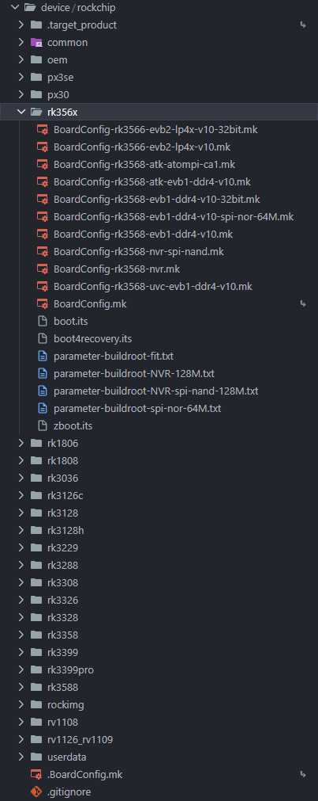
    - `*.mk`：板级配置文件；
    - `*.txt`：Parameter 分区表；
    - `*.its`：制作 FIT 格式文件时用到的描述文件；
- `docs`:
    存放芯片模块开发指导文档、平台支持列表、芯片平台相关文档、Linux 开发指南等。
    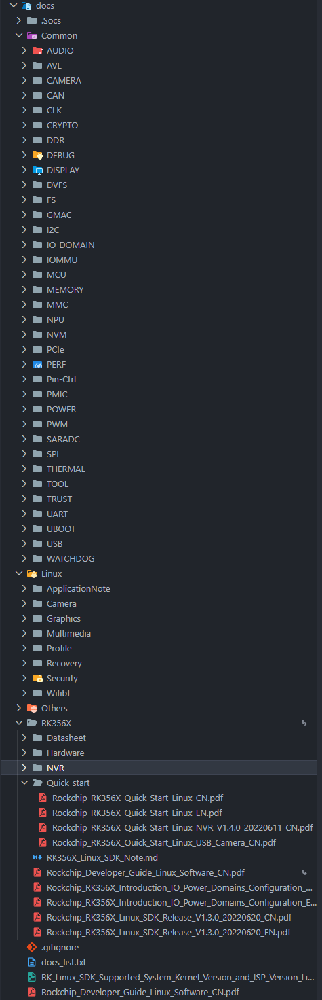
- `external`:
    存放所需的第三方库，包括音频、视频、网络、recovery 等。
    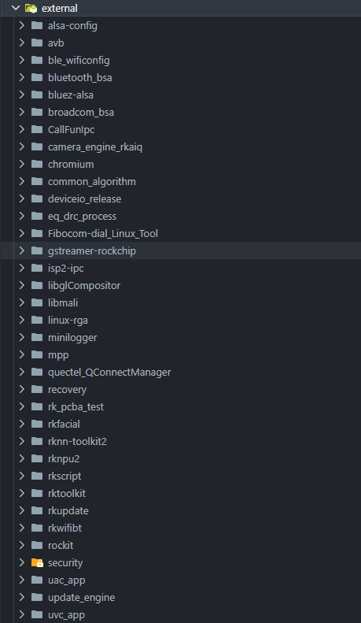
- `kernel`:
    Linux 内核源码。
    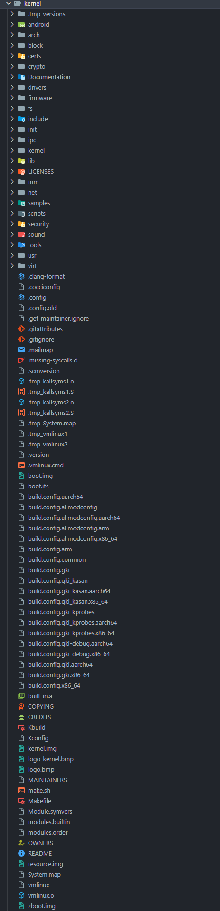
- `prebuilts`:
    存放交叉编译工具链。
    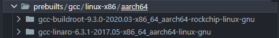
- `rkbin`:
    存放 Rockchip 相关的二进制文件和工具。
    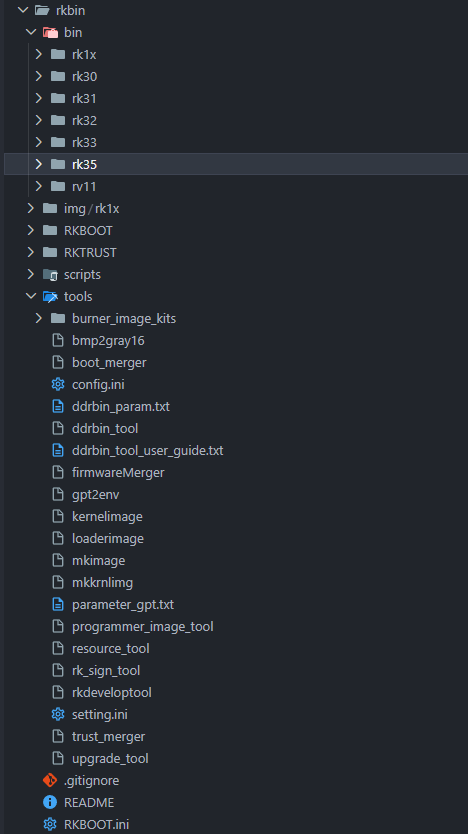
    - `bin/rk35`：存放闭源二进制文件；
    - `RKBOOT`：存放 `.ini` 配置文件；
    - `RKTRUST`：存放 `.ini` 配置文件；
- `rockdev`:
    存放编译输出固件，编译 SDK 后才会生成该文件夹。
    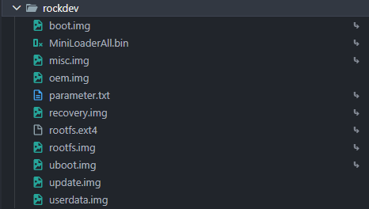
- `tools`:
    存放 Linux 和 Windows 操作系统环境下常用的工具，包括镜像烧录工具、SD 卡升级启动制作工具、批量烧录工具等。例如 RKDevTool 工具以及 Linux_Upgrade_Tool 工具都存放在该目录中。
    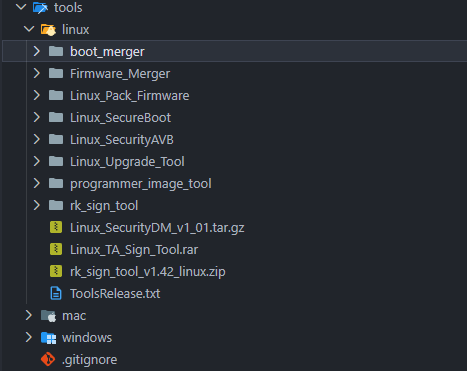
- `u-boot`:
    基于 v2017.09 版本开发的 uboot 源码。
    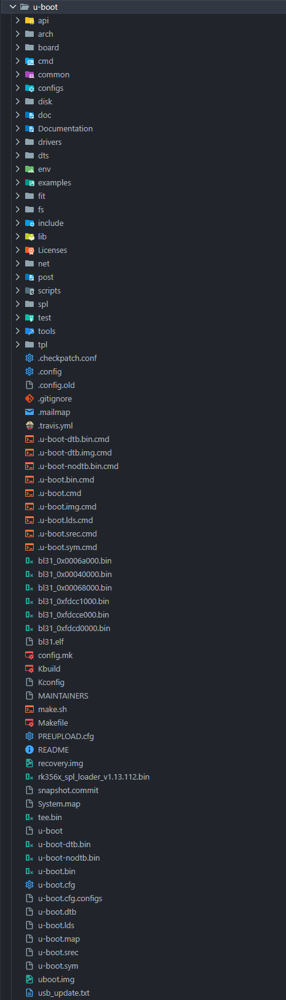
- `yocto`
    基于 Yocto 开发的根文件系统。

### 软件框图
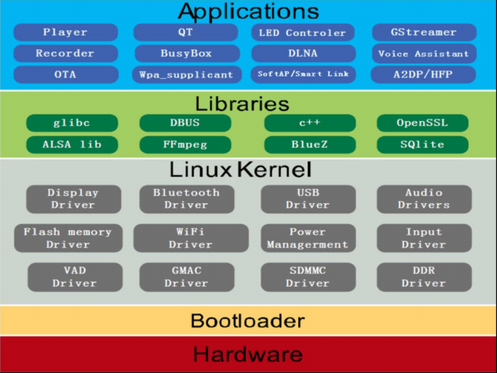

### 编译
1. 依赖安装
2. 脚本工具
3. 全自动编译
4. 单独编译
5. 工程清理

### 各烧录文件
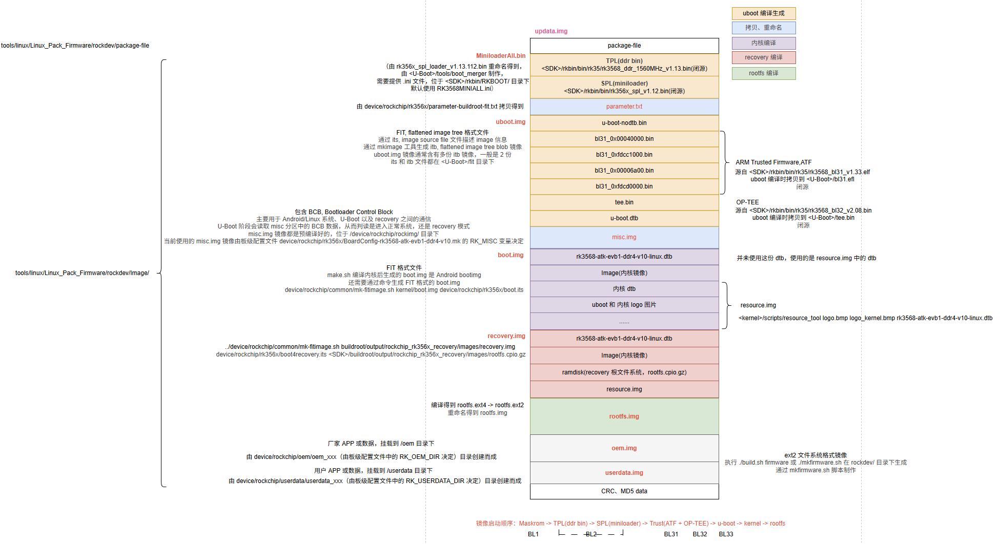

1. MiniloaderAll.bin

### 烧写操作
1. Windows-RKDevTool
2. Linux-Linux_Upgrade_Tool

## SDK 开发
### 板级配置文件
### uboot 部分
### kernel 部分
### rootfs-buildroot 部分
### recovery 部分
### oem 和 userdata 部分
### misc 部分

## 参考
1. 正点原子-《ATK-DLRK3568嵌入式Linux系统开发手册V1.3.pdf》
2. 编译问题及解决方式-[CSDN-RK3568 SDK 编译踩坑笔记](https://blog.csdn.net/qq_40087136/article/details/148409781)、[CSDN-解决 Buildroot 系统编译 perl 编译报错问题](https://blog.csdn.net/Bin_Watson/article/details/147705207)、[Buildroot 的 bwriter_buffer 等多重定义问题](http://www.openedv.com/thread-351942-1-1.html)；