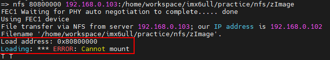

# linux 实操问题记录
## nfs 文件下载出错
1. 问题：
    
2. 解决方法：
   1. 确认 ubuntu 主机端是否支持开发板 nfs 版本
        ```bash
        sudo cat /proc/fs/nfsd/versions
        ```
   2. 如果主机端支持 nfs version2（上述检查输出和 “2” 有关内容）：
      1. 修改服务端 `/etc/default/nfs-kernel-server` 文件：
            ```bash
            ...
            RPCNFSDCOUNT="-V 2 8"

            ...
            RPCNFSDPRIORITY=0

            ...
            RPCMOUNTDOPTS="-V 2 --manage-gids"

            ...
            NEED_SVCGSSD=""

            ...
            RPCSVCGSSDOPTS="--nfs-version 2,3,4 --debug --syslog"
            ```
      2. 重启 nfs 服务：
            ```bash
            sudo service nfs-kernel-server restart
            ```
      3. 确认主机端 nfs 版本：
            ```bash
            sudo cat /proc/fs/nfsd/versions
            ```
      4. 如果上述输出中含有 “-2” 的内容，则还需要开启 V2 版本的 nfs：
            ```bash
            sudo vim /etc/nfs.conf
            # 配置 udp 和 vers2 为 y：
            udp=y
            vers2=y
            ```
            - 配置完成后再次重启 nfs 服务；
            - 再次确认 nfs 版本。
   3. 如果主机端不支持 nfs version2（上述检查未输出和 “2” 有关内容）:
      1. 检查 ubuntu 和内核版本：
            ```bash
            # 检查内核版本
            uname -r
            # 检查 ubuntu 版本
            lsb_release -a # 或者 cat /etc/os-release
            ```
            - Linux 内核 6.2+ 已移除 NFSv2 支持，如果内核 >= 6.2，需要将低内核版本到 5.15 LTS 内核（Ubuntu 22.04 默认内核）；
      2. 检查已安装的所有内核：
            ```bash
            dpkg --list | grep linux-image
            ```
      3. 安装 5.15 LTS 内核（如果未安装）
            ```bash
            # 先搜索可用的 5.15 内核包
            apt-cache search linux-image-5.15
            # 安装
            sudo apt update
            sudo apt install linux-image-5.15.0-XX-generic linux-headers-5.15.0-XX-generic
            ```
      4. 在安装 5.15 内核的情况下，配置 GRUB 引导
         - 更新 GRUB
            ```bash
            sudo update-grub
            ```
         - 设置默认启动内核
            ```bash
            # 编辑 GRUB 配置文件
            sudo vim /etc/default/grub
            # 找到 GRUB_DEFAULT 行，修改为指定 5.15 内核：
            GRUB_DEFAULT="Advanced options for Ubuntu>Ubuntu, with Linux 5.15.0-91-generic"
            ```
         - 再次更新 GRUB
            ```bash
            sudo update-grub
            ```
      5. 重启系统：`sudo reboot`；
      6. 可能还需要手动选择进入的内核版本：“Ubuntu 的高级选项” -> “Ubuntu,Linux 5.15...-generic”。
      7. 验证当前内核版本
            ```bash
            uname -r
            ```
            - 应显示 5.15.x 开头的版本。
      8. 修改配置或者确认 nfs 的支持版本。
3. 补充：
   - 检查 U-Boot 中 nfs 的版本：
     - 直接查看 nfs 在 U-Boot 中的源码：
        ```c
        // net/nfs.c
        pkt.u.call.rpcvers = htonl(2);  /* use RPC version 2 */
        pkt.u.call.vers = htonl(2);     /* NFS version 2 */
        ```
      - 大多数 U-Boot 版本（尤其是嵌入式开发板常用的版本）固定使用 NFSv2；
      - 如果连接 Ubuntu 时，出现 T 超时或失败 → 很可能是 U-Boot 用 NFSv2，而服务器只开了 v3/v4；
      - 如果你只是要解决 U-Boot 与 Ubuntu 的 NFS 兼容问题，不用纠结查版本，直接在 Ubuntu 上开启 NFSv2 支持 即可；
4. 参考
   1. [U-Boot 中使用 nfs 命令加载文件报错指南](https://developer.aliyun.com/article/1482486)
   2. [Ubuntu 24.04.2 LTS Linux内核6.8降级更换内核版本（以5.19.0为例）](https://blog.csdn.net/m0_55983825/article/details/149669450)
   3. [ubuntu降低你使用的内核到指定版本](https://developer.aliyun.com/article/1114822)
   4. [LINUX开发板Loading: *** ERROR: Cannot mount T T T T T T T T T T T T T T问题解决](https://blog.csdn.net/qq_41470735/article/details/130447381)

## 分区管理
使用 `gparted` 调整 ubuntu 下的分区大小、调整根目录、家目录大小...
参考：[【Ubuntu】压缩根目录/空间给home目录扩容](https://zhuanlan.zhihu.com/p/695100294)、[gparted 官网](https://gparted.org/)、[通过 ubuntu 启动盘的方式修改-拯救者会出现黑屏现象，无法使用，仅参考](https://blog.csdn.net/HeLoZhaoFei/article/details/123724956)：
- 直接制作 `gparted` 启动盘；
- 通过 bios 设置启动 `gparted live` 系统；
- 使用默认设置进入配置界面，选择需要编辑的硬盘，并调整相应的分区大小；
- 调整完成点击界面上的绿色勾按钮，等待分区调整任务完成；
- 分区完成后，点击界面左上角的 `gparted` 并退出、重启即可。