# Note for FreeRTOS

## 如何使用
- [FreeRTOS 入门与工程实践-模拟器](https://rtos.100ask.net/zh/FreeRTOS/simulator/)
- [FreeRTOS 入门与工程实践-STM32 开发板](https://rtos.100ask.net/zh/FreeRTOS/DShanMCU-F103/)

### 数据类型
1. `/portable/.../portmacro.h`(下述为 32 位 `MCU` 头文件)：
    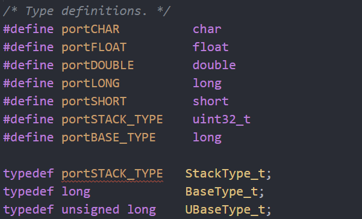
    - `StackType_t` 本质是 `uint32_t`（32 位机）或 `uint16_t`（16 位机）

## 内部机制
- [FreeRTOS 的内部机制](https://www.bilibili.com/video/BV1Ar4y1C7En?spm_id_from=333.788.player.switch&vd_source=f87b1dc9ce95722a192942b341ae04d2&p=4)

### 任务
1. 任务相对于静态的代码（函数）来说是一个动态的概念。与进程、线程类似，是对一个**运行着的**程序的抽象，它具有以下特点：
   - 它有一段对应的程序，任务根据程序指令来运行（它可以只由一个函数组成，也可以由多个函数组成）；
   - 同时具有运行环境，即运行时上下文（寄存器值等，用于记录操作记录、状态、运行位置、栈顶位置等）；

    可以将任务理解为 **（运行中的）函数 + 栈**；

2. 任务创建
   - 栈 + 任务结构体 + 入口函数 + 优先级；
     - 栈空间；
     - 任务结构体：`TCB, Task Control Block`，管理任务，对任务的抽象、描述，涉及栈指针、入口函数指针、优先级、函数参数及名字等；作为任务创建的返回值；
     - 入口函数：任务对应程序；
     - 优先级：任务被调度时需要考虑优先级；
   - 任务创建流程：
     - 分配 `TCB` 结构体；
     - 分配栈；
     - 在栈里写入函数地址、函数参数地址；
     - 将新建任务添加到就绪链表中；
   - `FreeRTOS` 中的 `TCB` 结构体（略去可配置部分）：
    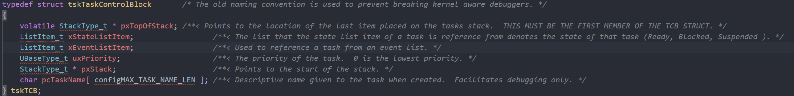
     - `tasks.c` 文件；
   - `TCB` 结构体分配：
    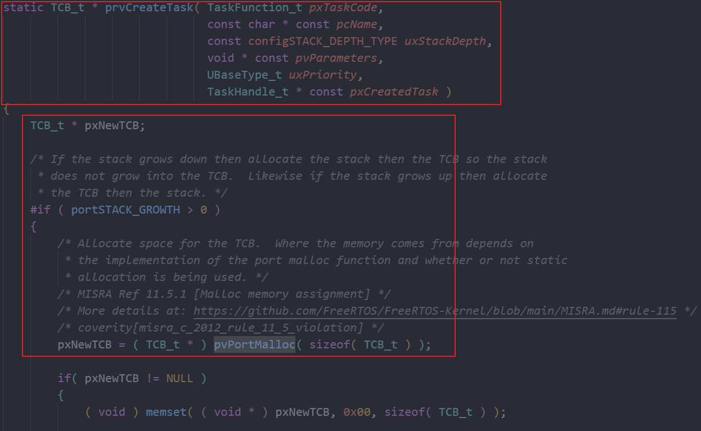
     - `tasks.c` 文件；
   - 栈的分配：
     **栈地址**：
     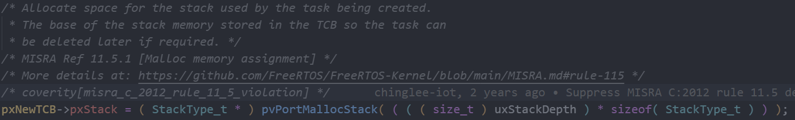
     - `tasks.c` 文件；
     - `pxStack` 字段指向分配的栈空间起始地址；
     - 任务创建函数中指定的栈深度单位不是 `Byte`，而是数据结构 `StackType_t` 的大小；

     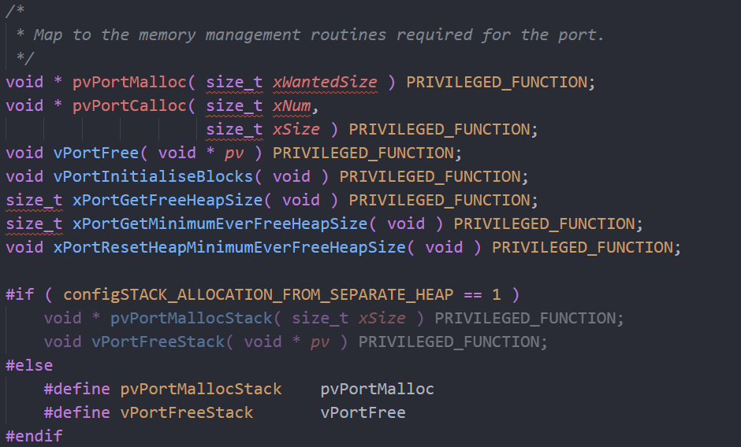
     - `portable.h` 文件；
     - 根据宏 `configSTACK_ALLOCATION_FROM_SEPARATE_HEAP` 的情况，存在两种分配栈的方式；

     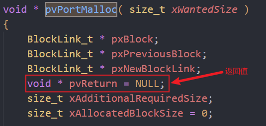
     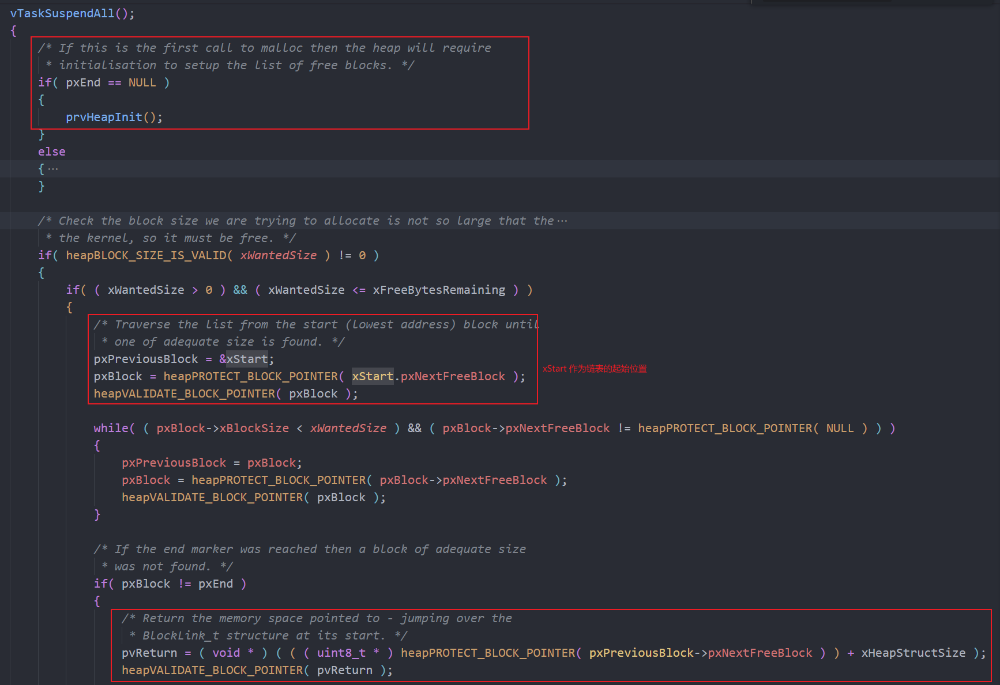
     - `heap_4.c` 文件，根据配置的不同可选用不同的 `heap` 文件（`1~5`）；
     - 通过遍历 `xStart` 管理的链表结构获取所需空间，并由 `pvReturn` 返回对应空间地址；
     - 如果是第一次申请，则通过 `prvHeapInit` 初始化上述链表结构；

     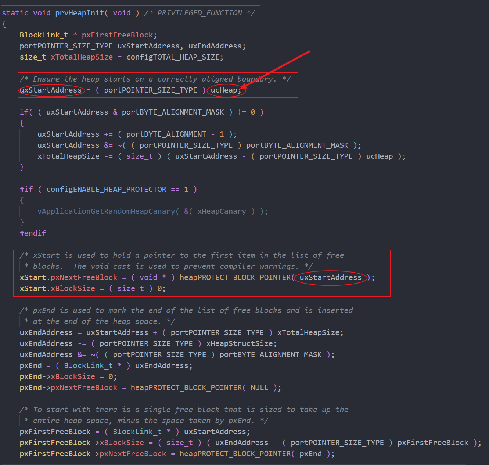
     - 初始化链表时，使用的是 `ucHeap` 指向的空间；

     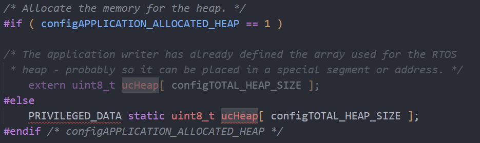
     - `ucHeap` 指向一个大数组，用以划分用户所需动态使用的空间；
     - 在 `FreeRTOSConfig.h` 文件中 `#define configTOTAL_HEAP_SIZE		( ( size_t ) ( 17 * 1024 ) )`，即默认的 `ucHeap` 数组大小为 `17KB`；
   
     **栈大小**：栈的大小取决于局部变量的大小、函数调用深度等，根据这些指标进行粗略估计；
   - 函数指针和函数参数指针记录
     - 两者都是依据任务的现场恢复逻辑提前将相关内容保存到上述分配好的栈中：
     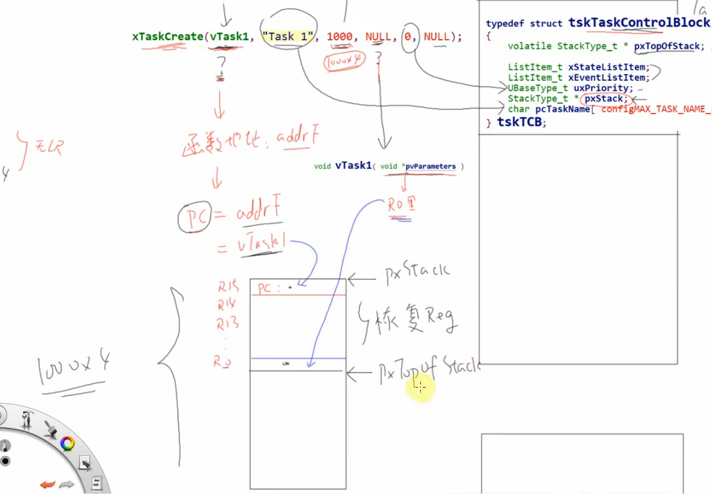
     - `pc` 指向了函数地址，`r0` 指向了函数参数地址，等到任务被调度至运行时，执行现场恢复逻辑，于是入口函数开始执行；
     - 修改：将上述 `pxStack` 指向栈的起始位置（低地址位置，即上述图片方框的最下方）；
   - 将新建任务放入**就绪态**的对应优先级链表中:
     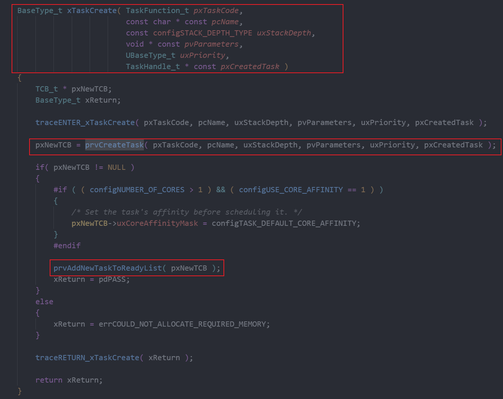
     - `prvCreateTask -> prvAddNewTaskToReadyList -> prvAddTaskToReadyList -> listINSET_END`
    
     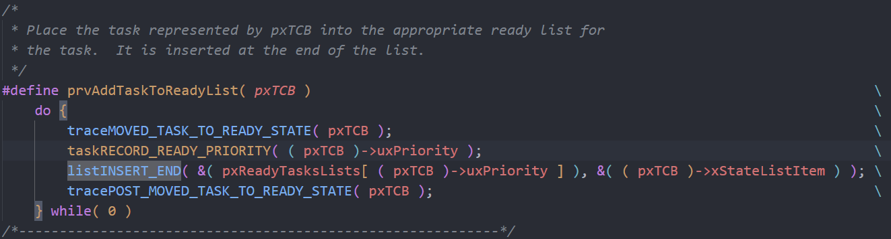
     - 插入的链表为当前任务优先级所对应的链表；
     - 由多个优先级链表组成 `pxReadyTasksLists` 数组，该数组大小可以根据 `configMAX_PRIORITIES` 进行配置（同样位于 `FreeRTOSConfig.h` 中，`#define configMAX_PRIORITIES		( 5 )`，默认为 5）；

     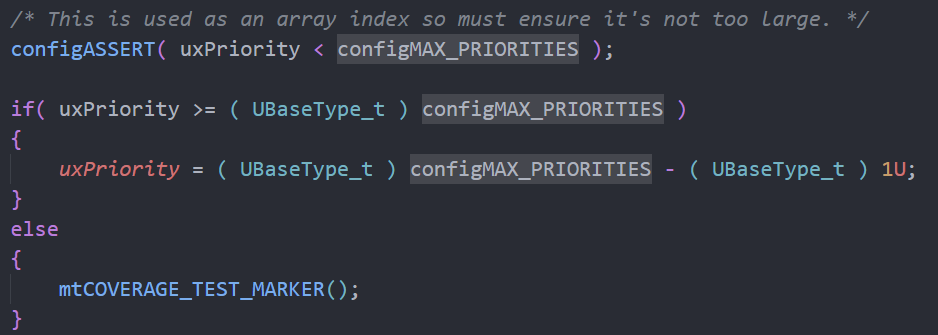
     - 在 `prcCreateTask -> prvInitialiseNewTask` 中，会对当前任务的优先级进行限制；

### 调度机制
1. 任务优先级
   - 高优先级的任务优先运行，可以**抢占**低优先级的任务；
   - **高优先级的任务不停止，低优先级的任务永远无法执行**；
   - 同等优先级的任务，轮流运行：即时间片轮转；
2. 任务管理
   - 将任务通过链表进行管理、不同状态的任务由不同的链表进行管理；
   - 获取将要运行的任务：
     - 找到优先级最高的运行态或就绪态任务，运行它；
     - 如果当前任务的优先级一样，则轮流运行：排队，链表前面的先运行，运行一段时间（1 个 `tcik` 后下链表的下一位置任务开始运行，并将当前任务放到链表末尾）；
3. 任务状态
   - 运行态：`running`；
   - 就绪态：`ready`；
   - 阻塞：`blocked`（需要等待某条件满足要求，eg：时间、资源等）；
   - 暂停：`suspend`（休息去了）；
    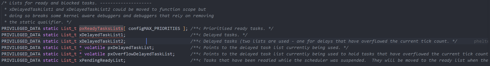
     - 就绪态链表 + 阻塞链表（`tasks.c` 文件）；
     - 就绪链表数组，根据优先级数量决定数组大小；
     - `pending` 链表（一个；已经就绪，但是调度被挂起）；
     - `delayed` 链表（一个；调用了 `vTaskDelay` 函数的任务会被挂在这里）；
4. 状态切换
   - 运行态 -> 阻塞态：调用 `vTaskDelay`；
   - 阻塞态 -> 就绪态：每个 `tick` 中断会先检查 `delayed` 链表中的任务有没有达到延时时长的。如果有，将对应任务由 `delayed` 链表中移出，并将其加入到对应优先级的就绪态任务链表中。最后，选择下一个运行的任务；
5. 调度时机和谁来调度
   - `tick` 中断时进行由 `tick` 中断服务程序进行调度：取出下一个 `Task` 并进行任务切换（保存当前任务线程，恢复下一个任务现场）；
   - `tick` 中断周期可以调整，默认为 `1ms`；

### 现场保存与恢复
1. 涉及到现场保存的几种场景与需要保存的内容：
   - 任务切换
     - 需要保存全部寄存器值（对即将运行的任务会使用哪些寄存器是没有约束的，因此它可能使用 `CPU` 的任意寄存器而导致破坏当前任务的环境）；
   - 函数调用
     - 根据函数调用约定，被调用函数的参数由某些寄存器来传递，因此这部分寄存器可以不用保存；
     - 根据被调用函数对寄存器的使用情况判断是否不需要保存其他寄存器值；
   - 硬件中断
     - 硬件保存：在发生硬件中断时，硬件会自动将部分寄存器值保存到栈中；
     - 软件保存：在中断程序中即将被使用的除上述以外的其他寄存器需要被保存到栈中；

### 栈
1. 作用
   - 函数调用关系；
   - 函数运行时，临时变量的保存；
   - 现场保存；

## 常见问题
- `FreeRTOS` 的调度策略、内部原理；
- `FreeRTOS` 的常用任务间通信手段；
- 优先级翻转背后逻辑以及解决办法；
- 信号量和互斥量的区别、使用场景；
- 信号量和互斥量背后的原理；
- 平时工作中任务优先级如何划分；
- `FreeRTOS` 内存管理策略；
- 中断中能否使用互斥量；
- 如何确定/选择所需的栈大小？堆呢；
  - 栈即一块空闲的内存；
  - 栈的大小取决于局部变量的大小、函数调用深度等；
  - 根据上述指标粗略估计；